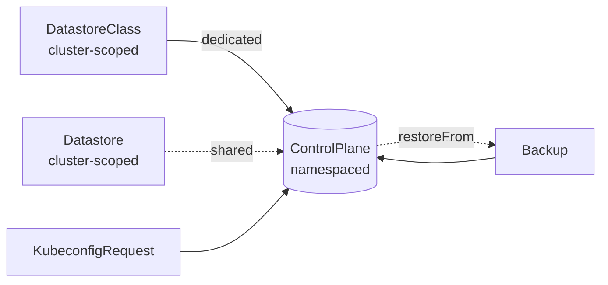
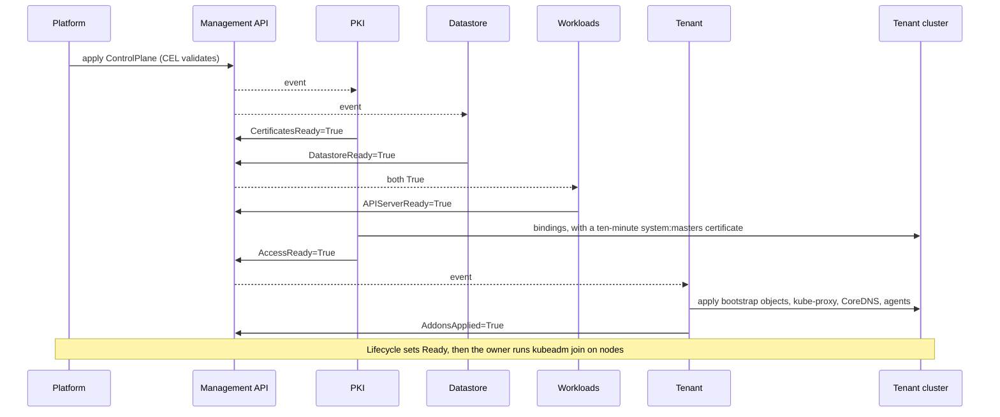
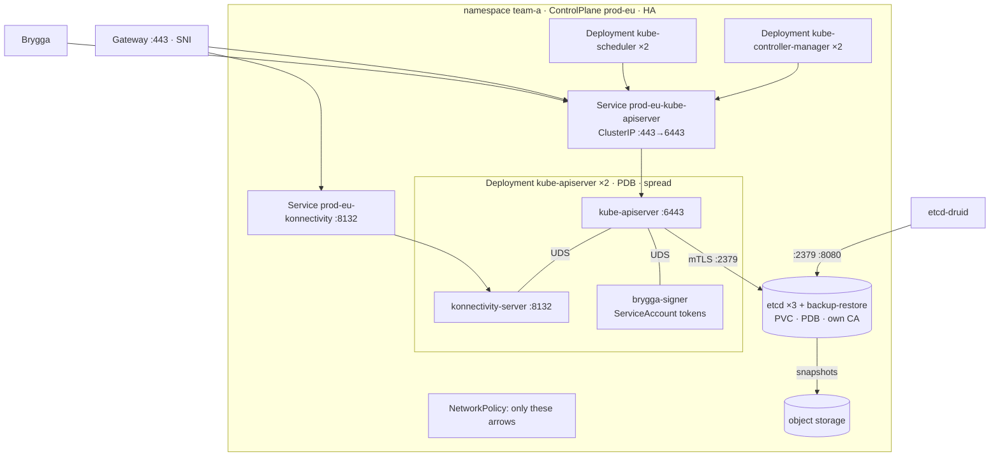
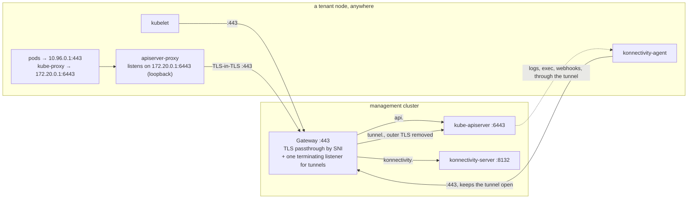
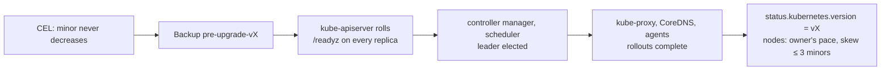
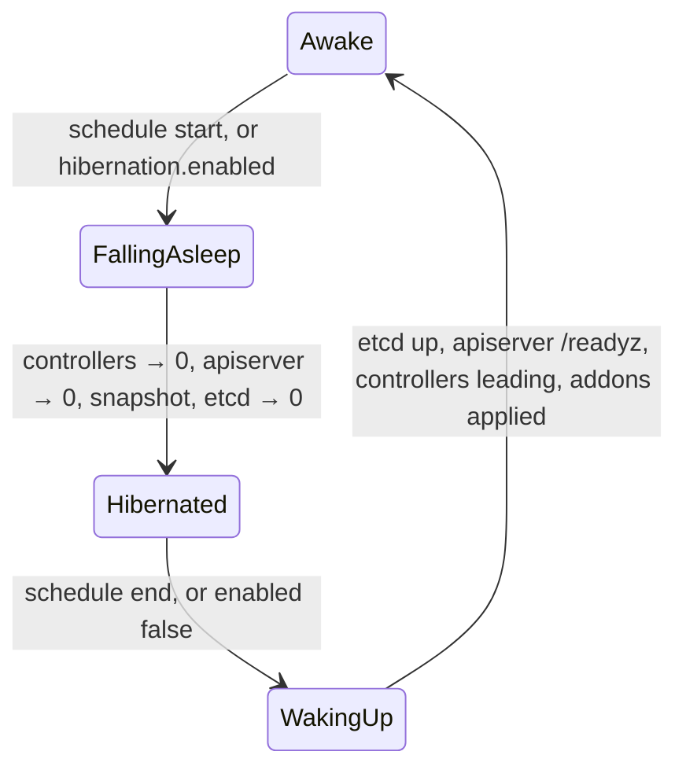
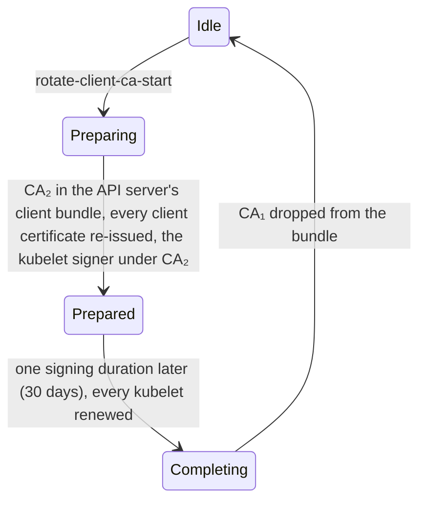

# Brygga docs

Brygga is an operator that runs Kubernetes control planes as pods on a
management cluster, one `ControlPlane` object per tenant cluster. A control
plane is a kube-apiserver with a konnectivity-server at its side, a
kube-controller-manager, a kube-scheduler, each in its own Deployment (or all
in one pod in the Compact layout), and an etcd of its own (or a prefix in a
shared one); the tenant's worker nodes stand anywhere with outbound TCP 443
and join with `kubeadm join`. Six independent controllers keep every
control plane certified, stored, running, reachable and up to date, and talk
to each other only through status conditions.

Go, controller-runtime; runs as a Deployment (`brygga-system`, two replicas,
leader election) on a management cluster with a maintained Kubernetes minor
(1.35 or newer today). Dedicated etcd
clusters are managed through etcd-druid
([decision](decisions/dedicated-etcd-by-default.md)); backups go to
S3-compatible object storage.

**Status: design, 2026-10-23.** This document describes the intended system;
[`roadmap.md`](roadmap.md) says what exists at each phase.

## What it owns

| owns | meaning |
|---|---|
| `ControlPlane` | the desired and observed state of one tenant control plane ([field reference](api/controlplane.md)) |
| `DatastoreClass`, `Datastore` | how a dedicated etcd is built; a shared etcd several tenants use by prefix |
| `KubeconfigRequest`, `Backup` | a short-lived credential for a person; an on-demand snapshot |
| the tenant namespace's control plane objects | Deployments, Services, PodDisruptionBudgets, NetworkPolicies, Gateway routes, Secrets, ConfigMaps, the etcd resource; all owned by the `ControlPlane` and labelled `brygga.segla.io/control-plane` |
| the PKI of every tenant | CAs, leaf certificates, kubeconfigs, ServiceAccount keys, encryption keys, their renewal and staged rotation |
| the bootstrap of the tenant cluster | what `kubeadm join` reads and the RBAC it needs, kube-proxy, CoreDNS, konnectivity-agent, apiserver-proxy, the admin group's binding |
| the pace | upgrades in order, maintenance windows, the fleet limit, hibernation |
| the tenant's workloads during an outage | holding the controller manager while most nodes are cut off from the control plane, so nothing evicts healthy pods |

And deliberately not: machines and their operating systems (a Cluster API
provider or a node agent on top), the CNI and every other addon the tenant
chooses, the Gateway itself (the platform installs it; Brygga attaches
routes), the object storage bucket, the monitoring stack (Brygga exposes
metrics), and bootstrap tokens (`kubeadm token create` with the admin
kubeconfig).

## The objects

One `ControlPlane` is the whole cluster from the platform's point of view:
write it, watch `Ready`, read the admin kubeconfig Secret
([decision](decisions/one-controlplane-per-cluster.md)). The field reference
with every rule is [`api/controlplane.md`](api/controlplane.md); examples are
in [`api/examples/`](api/examples/).

## The controllers

| controller | writes | condition | needs |
|---|---|---|---|
| PKI | Secrets with certificates, keys and kubeconfigs; the tenant's bindings for Brygga, the admin group and the kubelet client | `CertificatesReady`, `AccessReady`; `CAValidityAcceptable` outside `Ready` | `status.endpoint`; `APIServerReady` for the bindings |
| Datastore | the `Etcd` of a dedicated etcd — built, for one member — or a user and role in a shared store; backups and defragmentation | `DatastoreReady` | a complete generation of PKI's etcd certificates |
| Workloads | Deployments, Services, PDBs, NetworkPolicies, ConfigMaps, routes | `APIServerReady` | `status.target`, `status.datastore`, `CertificatesReady`, `DatastoreReady` |
| Tenant | objects inside the tenant cluster, with an inventory | `AddonsApplied`, `AddonsAvailable` | `AccessReady` |
| Health | status, and from phase 2 the controller manager's leader Lease inside the tenant while most nodes are silent | `Reachable` | `status.endpoint` and the CA bundle; `AccessReady` from phase 2 |
| Lifecycle | `status.target`, `Progressing`, `Ready`; the pre-upgrade `Backup` | `Progressing` | the others |

Each controller has its own queue and field manager, reads `spec`,
`status.target` and the endpoint Workloads publishes, and reports through its
own condition; none calls another
([decision](decisions/independent-controllers.md)). The cache is scoped to
labelled objects, with metadata only for Secrets. PKI, the Datastore
controller, a first Lifecycle and Health's external probe are built
(`internal/controller/pki`, `datastore`, `lifecycle` and `health`,
registered under those names by `internal/operator`, whose manager
`cmd/brygga` runs and the tests build); Workloads and Tenant are not.

What each example of failure does: an etcd that loses quorum turns
`DatastoreReady` False with `QuorumLost` (phase 2); Workloads leaves the Deployments
alone and PKI keeps renewing certificates. A changed controller-manager flag
rolls only its Deployment. A deleted CoreDNS Deployment inside the tenant
returns at the next inventory apply.

## A tenant namespace

Four pods for a single control plane, nine for HA
([decision](decisions/component-per-deployment.md)); the Compact layout puts
the control plane into one pod, two with a dedicated etcd and one with a
shared store ([compact-layout](decisions/compact-layout.md)). The objects of
a tenant namespace, who writes and who reads each, and what a change does;
the names one controller writes and another reads, and the keys of those
Secrets that a reader names, are defined once, in `api/v1alpha1/names.go`,
and every controller takes them from there, while the CA keys and the
ConfigMaps are their writer's alone:

| object | writer | readers | on renewal or change |
|---|---|---|---|
| `<cp>-cakey-cluster`, `-cakey-client`, `-cakey-front-proxy`, `-cakey-etcd` (`kubernetes.io/tls`: each CA's certificate and key) | PKI | PKI alone; never mounted | a CA is renewed only by a rotation, announced a year ahead by `CAValidityAcceptable=False` (`CAExpiring`) outside `Ready`; a lost or unreadable key (`CAMissing`) or an expired CA (`CAExpired`) turns `CertificatesReady` False, and nothing that CA signs is written until it is restored or rotated, since a new CA would cut every client or node off at once; a key Secret restored without its labels is found by name and kept |
| `<cp>-ca-bundle` (`ca.crt`: the cluster CA, two during a trust anchor rotation) | PKI | everything that verifies the API server: PKI, for the kubeconfigs; Workloads, for the controller manager's `--root-ca-file`, which publishes `kube-root-ca.crt`; Tenant, for `cluster-info`; Health, for its probe of the public endpoint | kubeconfigs and `cluster-info` re-rendered; the controller manager restarts, because `--root-ca-file` is read once |
| `<cp>-client-ca` (`ca.crt`: the client CA, the current kubelet signer, and a replaced signer for one signing duration, 30 days) | PKI | Workloads, for the API server's `--client-ca-file` | reloaded |
| `<cp>-kubelet-signer` (`kubernetes.io/tls`: the intermediate under the client CA, `CA:TRUE`, path length 0) | PKI | Workloads, for the controller manager's per-signer signing flags | reloaded |
| `<cp>-apiserver-serving`, `<cp>-apiserver-kubelet-client` (`kubernetes.io/tls`) | PKI | Workloads, for the API server | reloaded (the kubelet client certificate for new connections) |
| `<cp>-front-proxy-ca` (`ca.crt`), `<cp>-front-proxy-client` (`kubernetes.io/tls`) | PKI | Workloads, for the API server and its aggregated APIs | the CA is reloaded; the client certificate restarts the API server until a reload is proven |
| `<cp>-etcd-ca` (`ca.crt`), `<cp>-apiserver-etcd-client` (`kubernetes.io/tls`) | PKI | Workloads, for the API server | the client certificate is read per connection; a new etcd CA restarts the API server (`--etcd-cafile` is read once) |
| `<cp>-etcd-{ca,server,client,peer,backup-restore}-<g>` (`ca.crt` for `ca`, `kubernetes.io/tls` for the rest, all immutable; the profiles of the `Etcd` named `<cp>-etcd`), one generation `g` per renewal, labelled `brygga.segla.io/etcd-certificates: "<g>"` | PKI | the Datastore controller, which names the newest complete generation in the `Etcd`; through the `Etcd`, etcd, its backup-restore sidecar and etcd-druid's client | renewed as the next generation, since the sidecar keeps its first certificate and etcd-druid rolls the members only for a new name: no API outage with three members, about 20 s with one ([etcd spike](etcd-spike-2026-10.md)); a generation with a member missing or being deleted is replaced by the next, never repaired in place; PKI keeps the previous generation and deletes older ones |
| `<cp>-sa-keys` (`signing.key`, a PKCS#8 RSA 2048 key, and the `verify-*.pub` keys published beside it during a rotation) | PKI | Workloads, for the `brygga-signer` sidecar | reloaded by the sidecar; the API server fetches the keys again within the signer's refresh hint and does not restart |
| `<cp>-encryption-config` (`encryption-config.yaml`: an `EncryptionConfiguration` for `secrets` with the provider of `apiServer.encryption.provider` and a random 32-byte key) | PKI | Workloads, for the API server | reloaded every minute (automatic reload) |
| `<cp>-konnectivity-server` (`kubernetes.io/tls`), `<cp>-konnectivity-kubeconfig` (`kubeconfig`, `tls.crt`, `tls.key`, `ca.crt`; server `https://127.0.0.1:6443`) | PKI | Workloads, for konnectivity-server | the API server pod rolls, in the maintenance window |
| `<cp>-controller-manager-kubeconfig`, `<cp>-scheduler-kubeconfig` (`kubeconfig`, `tls.crt`, `tls.key`, `ca.crt`; server `https://<cp>-kube-apiserver.<ns>.svc:443`) | PKI | Workloads, for each its own component; the kubeconfig names its certificates as files beside it | reloaded by client-go |
| `<cp>-admin-kubeconfig` (`kubeconfig`, certificates embedded; server `status.endpoint.apiServer`) | PKI | the platform, through `status.credentials.adminKubeconfigSecretRef`, as `brygga:cluster-admins` | nothing restarts |
| `<cp>-brygga-kubeconfig` (`kubeconfig`, certificates embedded; `brygga:operator`, dialling the in-namespace Service) | PKI | Brygga inside the tenant: PKI, for its bindings; Tenant; Health from phase 2 | nothing restarts |
| `Etcd` `<cp>-etcd` | Datastore | PKI, whose etcd certificates name its members and Services; etcd-druid | etcd-druid rolls the members |
| `<cp>-etcd-backup` (the class's backup credentials, copied) | Datastore | etcd-druid, through the `Etcd`, for the backup sidecar | whether the sidecar reads new keys without a restart is open (`todo.md`) |
| Service `<cp>-kube-apiserver` | Workloads | PKI, which names it in certificates and kubeconfigs | — |
| ConfigMap `authentication-config` | Workloads | the API server | reloaded, except its anonymous section |
| ConfigMaps `egress-selector`, `audit-policy`, `admission-config` / `scheduler-config` | Workloads | the API server / the scheduler | that component restarts |

Sources: the reload behaviour of each flag is in the
[kube-apiserver](https://kubernetes.io/docs/reference/command-line-tools-reference/kube-apiserver/)
and
[kube-controller-manager](https://kubernetes.io/docs/reference/command-line-tools-reference/kube-controller-manager/)
references and their dynamic certificate controllers in
[apiserver](https://github.com/kubernetes/kubernetes/tree/release-1.35/staging/src/k8s.io/apiserver/pkg/server/dynamiccertificates).
Hashes of the restart-only objects sit in the pod template of the component
that mounts them; nothing else does, so a routine renewal of a reloaded
certificate rolls nothing
([staged-credential-rotation](decisions/staged-credential-rotation.md)).
PKI writes the hash of each Secret's data on the Secret, in the annotation
`brygga.segla.io/data-hash`, so Workloads takes a restart-only Secret's hash
from its metadata and never reads the keys it mounts.
Every Secret above but `<cp>-etcd-backup` is PKI's, applied as `brygga/pki`
with an owner reference to the `ControlPlane`; every key is ECDSA P-256
except the ServiceAccount signing key, and a pass over an unchanged
`ControlPlane` writes nothing (`internal/controller/pki`, proven Secret by
Secret in `reconciler_test.go`).
A certificate is valid from five minutes before its issuance, kubeadm's
allowance for a verifier whose clock runs behind
([constants.go](https://github.com/kubernetes/kubernetes/blob/v1.37.1/cmd/kubeadm/app/constants/constants.go#L45-L46)),
and no longer than its CA; renewal comes two thirds of the way from issuance
to expiry, except for a certificate that already ends with its CA, which a
new one would not outlive. A pass issues and verifies every certificate at one
time, the time it started. Each CA and kubelet signer carries the nanosecond
of its issuance in its subject (`cluster-ca@1761350400123456789`), so no
bundle ever holds two certificates with one subject, not even a signer issued
again a moment after a write failed, and every bundle is a set: each certificate
once, in DER order, as library-go writes its CA bundles
([cabundle.go](https://github.com/openshift/library-go/blob/9a2bc12675c2bb37d3799a30786ccee5fa545d57/pkg/operator/certrotation/cabundle.go#L134-L177)).

PKI finds its Secrets by name, labelled or not, and the names above are its
own in the namespace: a Secret under one of them without a controller is
adopted, so a key restored from a backup without its labels is kept. Restore
such Secrets without `metadata.ownerReferences`: a reference to the old
`ControlPlane`'s UID makes the Secret that `ControlPlane`'s, and the garbage
collector deletes it. A Secret under PKI's names whose controller is not this
`ControlPlane`, or that refers to another `ControlPlane` at all, is neither
read nor written, and while one exists PKI writes nothing
(`CertificatesReady=False`, `SecretsControlledElsewhere`): a `ControlPlane`
recreated under its predecessor's name waits for the garbage collector to
remove the predecessor's Secrets instead of keeping its CA keys, which every
old kubeconfig and node trusts. A `ControlPlane` deleted with
`--cascade=orphan` leaves its Secrets without an owner, and one created under
the name adopts them, keys included; delete them for fresh credentials. The
etcd generations PKI keeps are adopted too, applied whole with their data
unchanged, which an immutable Secret allows
([validation.go](https://github.com/kubernetes/kubernetes/blob/v1.37.1/pkg/apis/core/validation/validation.go#L8164-L8182)),
so none stays without the owner the garbage collector follows or the label
the cache filters on. Key material PKI cannot read is never replaced: an
encryption configuration that is missing from its Secret or that the API
server's own validator refuses
([validation_encryption.go](https://github.com/kubernetes/kubernetes/blob/v1.37.0/staging/src/k8s.io/apiserver/pkg/apis/apiserver/validation/validation_encryption.go#L64-L115)),
and a ServiceAccount key that is not the RSA key PKI writes, turn
`CertificatesReady` False with `SecretUnreadable`: a new key would leave what
the old one encrypted unreadable, or every token it signed invalid.

The labels, annotations and the finalizer they share are defined in
`api/v1alpha1/labels.go`:

| key | on | writer | readers |
|---|---|---|---|
| label `brygga.segla.io/control-plane: <cp>` | every object Brygga creates for a `ControlPlane` | each controller, on its objects | the operator's cache, which holds only labelled objects |
| label `app.kubernetes.io/managed-by: brygga` | every object Brygga writes inside a tenant cluster | PKI, on its bindings; Tenant, on its objects | none in Brygga: Tenant prunes by its inventory, never by the label |
| label `brygga.segla.io/control-plane-uid` | the etcd claims | Datastore | Datastore, which reclaims and starts only on its own claims |
| label `brygga.segla.io/etcd-certificates: <g>` | the etcd certificate Secrets | PKI | Datastore, which counts complete generations |
| annotation `brygga.segla.io/is-default-class: "true"` | a `DatastoreClass` | the platform | Datastore |
| annotation `brygga.segla.io/datastore-class` | the `Etcd` and its claims | Datastore | Datastore, which keeps the class an `Etcd` or its claims record; others read `status.datastore.class` |
| annotation `brygga.segla.io/datastore-class-generation` | the `Etcd` | Datastore | Datastore, for `status.datastore.class` |
| annotation `brygga.segla.io/data-hash` | every Secret PKI writes | PKI: `DataHash` of the Secret's data, a SHA-256 that changes whenever the data does | Workloads, for the restart hashes of its pod templates |
| annotation `brygga.segla.io/operation` | a `ControlPlane` | the platform | Lifecycle and PKI, with rotations in phase 3 |
| finalizer `brygga.segla.io/datastore` | a `ControlPlane` | Datastore | the API server, which deletes the `ControlPlane` once it is gone |

The dedicated etcd is etcd-druid's `Etcd` `<cp>-etcd`, which the Datastore
controller renders from the `DatastoreClass` and the newest complete
generation of the etcd certificates, under the `ControlPlane`'s finalizer
`brygga.segla.io/datastore`, which it holds from before the first `Etcd`
exists. etcd-druid turns it into the StatefulSet `<cp>-etcd`, the client
Service `<cp>-etcd-client` (`https://<cp>-etcd-client.<ns>.svc:2379`, the
address Workloads gives the API server's `--etcd-servers`), the peer Service
`<cp>-etcd-peer`, a ConfigMap, member leases and a PodDisruptionBudget, all
owned by the `Etcd`
([helper.go](https://github.com/gardener/etcd-druid/blob/v0.39.0/api/core/v1alpha1/helper.go)).
With a backup store, the class's credentials Secret is copied into the
namespace as `<cp>-etcd-backup`, since etcd-druid mounts it from the `Etcd`'s
namespace. A pass of the controller refreshes the copy, and a deletion or edit
of the copy brings a pass; nothing watches the class's Secret: an edit of the
class reaches every tenant on it at once, while the Secret edited in place
reaches a tenant only at its next pass, at worst the cache's resync, every 10
hours by default
([cache.go](https://github.com/kubernetes-sigs/controller-runtime/blob/v0.25.2/pkg/cache/cache.go#L93-L97)).
Credentials are therefore rotated with a new Secret that the class is
pointed at ([operations](operations.md#everyday-tasks)). When the copy cannot
be made — the class's Secret is missing, another owner controls
`<cp>-etcd-backup` (a predecessor's the garbage collector has not removed
yet), or the API server refuses the copy — the class is held whole: the
`Etcd` keeps the class fields it has and still takes each new certificate
generation, and `DatastoreReady`'s message ends with `DatastoreClass <c> is
held:` and the cause. A missing Secret or a copy another owner holds is
checked again after a minute; a refused copy is retried with
controller-runtime's backoff, since the refusal is returned as the pass's
error. Held whole, since the rest
of an edit could add a store whose copy cannot be made; before the first
`Etcd` exists, the same cause is `Provisioning`, and nothing is created.

The class is resolved once, when the `Etcd` is created, and
recorded on it in `brygga.segla.io/datastore-class`, with the class
generation it was rendered from in `brygga.segla.io/datastore-class-generation`;
from then on the `Etcd` follows that class, its reclaim policy included, as a
default StorageClass is written into a claim when the claim is created
([storage classes](https://kubernetes.io/docs/concepts/storage/storage-classes/#default-storageclass)).
The claims record the class too, in `brygga.segla.io/datastore-class` alone,
for their reclaim, so an `Etcd` created again over
this `ControlPlane`'s claims, after someone deleted it, takes the class they
record rather than `className` or the current default, which could give it
another bucket and placement; while that class is gone, it is
`DatastoreClassNotFound` and nothing is created. An edit of that class that
changes the `Etcd`'s spec reaches the `Etcd` of every tenant on it at once
and rolls their members, a single member with an outage, until Lifecycle
holds class edits for each tenant's maintenance window in phase 2: etcd-druid
carries every field Brygga renders from the class into the pod template
([builder.go](https://github.com/gardener/etcd-druid/blob/v0.39.0/internal/component/statefulset/builder.go#L161-L203)), the backup sidecar's arguments
([builder.go](https://github.com/gardener/etcd-druid/blob/v0.39.0/internal/component/statefulset/builder.go#L430-L601)) or the etcd ConfigMap, whose checksum is in
the pod template ([builder.go](https://github.com/gardener/etcd-druid/blob/v0.39.0/internal/component/statefulset/builder.go#L220-L227)), and updates the StatefulSet
with `RollingUpdate` ([builder.go](https://github.com/gardener/etcd-druid/blob/v0.39.0/internal/component/statefulset/builder.go#L57)). Edits that roll nothing:
`storage.className` and `storage.size`, which reach only `Etcd`s created
afterwards; `storage.reclaimPolicy` and `backup.retention.afterDelete`,
which no `Etcd` field carries; `backup.store.secretRef` and `.region`,
which change only the data of the copy `<cp>-etcd-backup`, whose name the
`Etcd` keeps. A recorded
class that is deleted stops only its own edits: the `Etcd` keeps every field
the class gave it, still takes each new certificate generation and reports
its readiness as before, and its claims are kept on deletion. The
claims the StatefulSet attaches are found by name, as the StatefulSet finds
them: `<cp>-etcd-<cp>-etcd-<n>`, its claim template named after the `Etcd`
([stateful_set_utils.go](https://github.com/kubernetes/kubernetes/blob/v1.35.0/pkg/controller/statefulset/stateful_set_utils.go#L116-L119),
[builder.go](https://github.com/gardener/etcd-druid/blob/v0.39.0/internal/component/statefulset/builder.go#L233)),
whatever labels they carry. They are labelled with the `ControlPlane`'s UID
(`brygga.segla.io/control-plane-uid`) and annotated with the class, since
they outlive the `Etcd`. What each field of the class becomes
([etcd.go](https://github.com/gardener/etcd-druid/blob/v0.39.0/api/core/v1alpha1/etcd.go),
[store.go](https://github.com/gardener/etcd-druid/blob/v0.39.0/api/core/v1alpha1/store.go));
everything the class does not set is etcd-druid's default:

| `DatastoreClass` | `Etcd` | note |
|---|---|---|
| `etcd.quotaBackendBytes` | `spec.etcd.quota` | |
| `etcd.autoCompaction.mode`, `.retention` | `spec.sharedConfig.autoCompactionMode`, `.autoCompactionRetention` | shared with the sidecar's embedded etcd |
| `etcd.defragmentation.schedule` | `spec.etcd.defragmentationSchedule` | the sidecar defragments only above 3 GiB or with more than 1 GiB free ([etcd spike](etcd-spike-2026-10.md), finding 7) |
| `etcd.resources` | `spec.etcd.resources` | the sidecar's `spec.backup.resources` stay etcd-druid's default: the class has no field for them |
| `storage.className` | `spec.storageClass` | when the `Etcd` is created and not after: the field is immutable in the `Etcd` ([etcd.go](https://github.com/gardener/etcd-druid/blob/v0.39.0/api/core/v1alpha1/etcd.go#L627-L638)) |
| `storage.size` | `spec.storageCapacity` | when the `Etcd` is created and not after: it is the StatefulSet's volume claim template, which cannot change in place ([validation.go](https://github.com/kubernetes/kubernetes/blob/v1.37.1/pkg/apis/apps/validation/validation.go#L262)) |
| `storage.reclaimPolicy` | — | on deletion, `Delete` removes the claims etcd-druid's StatefulSet created and `Retain` leaves them ([deletion](#deletion)) |
| `backup.store.provider`, `.bucket`, `.endpoint` | `spec.backup.store.provider`, `.container`, `.endpointOverride` | Brygga's four providers are among etcd-druid's; most S3-compatible stores also want `s3ForcePathStyle: "true"` in the credentials Secret |
| `backup.store.prefix` | `spec.backup.store.prefix` | `<class prefix>/<namespace>/<cp>/<uid>`: etcd-backup-restore restores an empty member from the newest snapshot under its prefix ([design](https://github.com/gardener/etcd-backup-restore/blob/v0.45.1/docs/proposals/design.md#L27)), so a `ControlPlane` recreated under the same name never restores the old one's |
| `backup.store.region` | the key `region` of `<cp>-etcd-backup` | where the sidecar reads it |
| `backup.store.secretRef` | `spec.backup.store.secretRef` | `<cp>-etcd-backup`, the copy, with the class Secret's data |
| `backup.fullSnapshotSchedule`, `.deltaSnapshotPeriod` | `spec.backup.fullSnapshotSchedule`, `.deltaSnapshotPeriod` | the delta period bounds what a restore loses ([etcd spike](etcd-spike-2026-10.md), finding 5) |
| `backup.retention.days` | `spec.backup.garbageCollectionPolicy: LimitBased`, `.maxBackupsLimitBasedGC` | counts full snapshots, one a day |
| `backup.retention.afterDelete` | — | phase 2, with the final snapshot |
| `placement.nodeSelector`, `.tolerations`, `.priorityClassName` | `spec.schedulingConstraints.affinity` (as required node affinity), `.tolerations`, `spec.priorityClassName` | the `Etcd` has no node selector |
| the `ControlPlane`'s availability | `spec.replicas` | 1 today, and `DatastoreReady` is `Unsupported` with `highAvailability`; 3 with `highAvailability` and 0 while hibernating come with later phases |
| the etcd certificates, generation `g` | `spec.etcd.clientUrlTls`, `spec.etcd.peerUrlTls`, `spec.backup.tls` | all three name one complete generation, with `dataKey: ca.crt` on the CA; a generation counts only while its five Secrets are this `ControlPlane`'s (its controller reference), so a predecessor's or an orphaned generation, which trusts another etcd CA, never starts an etcd before PKI has checked and adopted it; a newer complete generation is one update of the `Etcd`, so one roll of the members; the `Etcd` never moves below the generation it names: the newest complete one is older while a Secret of the named one is being deleted, and the older generation PKI keeps can have expired |

A class is checked when it is written, since a value refused later stops
more than its own edit: an `Etcd` the API server refuses stops taking
certificate generations, and a backup sidecar that refuses its flags exits at
start, which takes a single member down at its next roll. The fields that
reach the `Etcd` carry the patterns and rules of etcd-druid's CRD, and
`api/v1alpha1/etcddruid_test.go` fails when an etcd-druid release changes
them. The rest is what the processes accept. The sidecar etcd-druid v0.39.0
runs, etcd-backup-restore v0.41.2
([images.yaml](https://github.com/gardener/etcd-druid/blob/v0.39.0/internal/images/images.yaml#L14-L19)),
parses both schedules with robfig/cron v3.0.1 and exits on an error
([snapshotter.go](https://github.com/gardener/etcd-backup-restore/blob/v0.41.2/pkg/types/snapshotter.go#L68),
[init.go](https://github.com/gardener/etcd-backup-restore/blob/v0.41.2/pkg/server/init.go#L78),
[server.go](https://github.com/gardener/etcd-backup-restore/blob/v0.41.2/cmd/server.go#L29-L32)):
a schedule is five fields separated by single spaces, without lists, its
ranges ascend
([parser.go](https://github.com/robfig/cron/blob/v3.0.1/parser.go#L310-L312)),
and its days of the week run from 1 to 6, since etcd-druid refuses 0 and the
parser 7 ([spec.go](https://github.com/robfig/cron/blob/v3.0.1/spec.go#L40));
`*/7` selects Sunday. The quota is above zero
([restorer.go](https://github.com/gardener/etcd-backup-restore/blob/v0.41.2/pkg/types/restorer.go#L124-L126)),
the compaction retention a number, or in periodic mode a duration
([etcd.go](https://github.com/etcd-io/etcd/blob/v3.5.27/server/embed/etcd.go#L939-L956)),
and every duration one Go parses
([duration.go](https://github.com/kubernetes/apimachinery/blob/v0.37.1/pkg/apis/meta/v1/duration.go#L32-L42)):
the operator decodes classes into Go types, and one it cannot decode fails
the list its cache syncs from, so the Datastore controller fails to start and
the manager with it
([controller.go](https://github.com/kubernetes-sigs/controller-runtime/blob/v0.25.2/pkg/internal/controller/controller.go#L363-L386));
`api/v1alpha1/durations_test.go` holds every duration of the API to that.

`DatastoreReady` is `Unknown`, reason `Reconciling`, until the controller's
first pass has finished, `WaitingForCertificates` until a complete
certificate generation this `ControlPlane` controls exists, and
`Provisioning` until etcd-druid reports the `Etcd` ready for its current
generation. A shared store is `Unsupported` until phase 3, and so is
`highAvailability`, whose etcd runs one member: `DatastoreReady` is never
True while it is set. Every Secret the `Etcd` mounts must exist — the five of its
certificate generation and, with a store, `<cp>-etcd-backup` — or the next
start of a member fails; a terminating one still counts, since etcd-druid
holds its finalizer on every Secret an `Etcd` references until none does
([reconciler.go](https://github.com/gardener/etcd-druid/blob/v0.39.0/internal/controller/secret/reconciler.go#L44-L101)),
so a Secret the `Etcd` names is gone only when someone removed that
finalizer ([operations](operations.md#a-secret-the-etcd-mounts-is-gone)).
etcd-druid's report is read with the checks Gardener makes
before it counts an `Etcd` ready
([waiter.go](https://github.com/gardener/gardener/blob/v1.154.0/pkg/component/etcd/etcd/waiter.go#L49-L104)):
no deletion timestamp, `observedGeneration` current, `AllMembersUpdated`
True, `ready`. Gardener's waiter, a one-shot wait, also retries while there
are `lastErrors`; Datastore does not read them, since etcd-druid clears them
at the start of every spec reconcile, every 15 seconds, and sets them again
on a failure
([etcdstatus.go](https://github.com/gardener/etcd-druid/blob/v0.39.0/internal/controller/utils/etcdstatus.go#L45-L93)),
so a persistent error would flip the condition, while a failed StatefulSet
sync at a new generation shows anyway: etcd-druid returns before it stamps
`observedGeneration`
([reconciler.go](https://github.com/gardener/etcd-druid/blob/v0.39.0/internal/controller/etcd/reconciler.go#L127-L144)).
A persistent failure of etcd-druid's other objects (the client Service, the
ConfigMap, the leases) at a generation it has observed shows only in
`lastErrors` ([operations](operations.md#what-breaks-and-how-it-shows)). Then the
StatefulSet itself, read from the API server, must mount the certificate
generation, its controller must have observed its generation, and every
replica must be updated and ready: etcd-druid syncs the StatefulSet, then
computes `ready` from the StatefulSet its cache holds, and only then stamps
`observedGeneration`
([reconciler.go](https://github.com/gardener/etcd-druid/blob/v0.39.0/internal/controller/etcd/reconciler.go#L102-L148),
[reconcile_status.go](https://github.com/gardener/etcd-druid/blob/v0.39.0/internal/controller/etcd/reconcile_status.go#L57-L80),
[reconcile_complete.go](https://github.com/gardener/etcd-druid/blob/v0.39.0/internal/controller/etcd/reconcile_complete.go#L33-L42)),
so its report can call a generation switch ready before the member rolled.
True once every check holds.

The other reasons: `DatastoreClassNotFound`, before the `Etcd` exists, when
the class is missing or no class is the default, and `DatastoreClassAmbiguous`
when more than one is. `VolumesExist`
when claims `<cp>-etcd-<cp>-etcd-<n>` without this `ControlPlane`'s UID label
stand where its first `Etcd` would be created, since a StatefulSet
re-attaches a claim of that name
([stateful_pod_control.go](https://github.com/kubernetes/kubernetes/blob/v1.37.1/pkg/controller/statefulset/stateful_pod_control.go#L381-L405))
and starting from another tenant's data is a restore, not a start: nothing
is created until they are deleted. `VolumesExist` too when an `Etcd`
`<cp>-etcd` exists whose controller is not this `ControlPlane`, an orphan or
a predecessor's the garbage collector has not removed yet: it is neither
adopted nor written, and the message names it. `EtcdRefused` when the API
server refuses the `Etcd` Brygga renders — an admission policy on `Etcd`s, a
class stored before a rule it breaks (validation ratcheting keeps an
unchanged field on update,
[ratcheting](https://kubernetes.io/docs/tasks/extend-kubernetes/custom-resources/custom-resource-definitions/#validation-ratcheting)),
an etcd-druid whose schema moved: the message
names the `Etcd`, the certificate generation and the class generation, and
the refusal is in Brygga's log. `Deleting` while the `ControlPlane` is being
deleted. `status.datastore` says where the API server reaches etcd (the
client Service, `<cp>-etcd-client.<ns>.svc:2379`), the class and the
generation the `Etcd` was built from, and its members, total and ready. Every message is built from the state alone, so a pass that
changes nothing writes nothing; an error of the API server ends the pass,
goes to the log and leaves the status as it was
([independent-controllers](decisions/independent-controllers.md)), unless it
is the server's verdict on the object: any 4xx but a missing object, a
timeout, a conflict, throttling and a namespace being deleted, since an
admission webhook's denial without a code arrives as 400
([statuserror.go](https://github.com/kubernetes/kubernetes/blob/v1.37.1/staging/src/k8s.io/apiserver/pkg/admission/plugin/webhook/errors/statuserror.go#L37-L39)).
Sending the same `Etcd` again cannot change that verdict, and without the
condition its certificate generations would stop with `DatastoreReady` still
True; the refusal is returned as the pass's error too, so the next attempt
follows controller-runtime's backoff.

Identities: no root CA key is mounted into a control plane pod; the
controller manager holds only the kubelet signer, an intermediate that signs
kubelet client certificates for 30 days. No long-lived certificate carries
`system:masters`. The API server's kubelet client is
`kube-apiserver-kubelet-client` in the group
`brygga:kubelet-api-admins`, bound to the built-in `system:kubelet-api-admin`
role, the less privileged option the
[certificate best practices](https://kubernetes.io/docs/setup/best-practices/certificates/)
recommend; konnectivity-server runs as `system:konnectivity-server`, allowed
to create TokenReviews and nothing else; the controller manager and scheduler
use their standard identities; Brygga reaches the tenant as `brygga:operator`,
bound to `cluster-admin` because it manages RBAC; people and platforms use the
admin group or a `KubeconfigRequest`
([decision](decisions/short-lived-kubeconfigs.md)). The bindings themselves
are created once with a `system:masters` certificate that PKI issues for ten
minutes and never stores, the way kubeadm uses `super-admin.conf` only to bind
`kubeadm:cluster-admins`.

NetworkPolicies default-deny the namespace and allow exactly the arrows
above: Gateway → API server and konnectivity-server, controller manager and
scheduler and Brygga → the API Service, API server → etcd, etcd ↔ etcd,
etcd-druid → etcd and its backup-restore sidecar, etcd and its compaction
Jobs → object storage, metrics scrapers → the health ports, and every pod →
the cluster DNS.

## Networking

Three ways to expose a control plane
([decision](decisions/api-exposure.md)):

| `spec.endpoint` | what Brygga creates | endpoint | in-cluster access |
|---|---|---|---|
| `gateway` | two TLS passthrough routes (API, konnectivity) on the platform's Gateway, and a `ListenerSet` with a terminating listener and route for the tunnel | `https://api.<cp>:443` | the API server advertises `172.20.0.1`, so the `kubernetes` Service's endpoint is `172.20.0.1:6443`; the apiserver-proxy DaemonSet owns that address on every node's loopback and wraps each connection in an outer TLS session with the tunnel's SNI, which the Gateway terminates and forwards to the API server untouched |
| `loadBalancer` | one Service of type LoadBalancer with ports 443 and 6443 (API) and 8132 (konnectivity) | the LB address | the API server advertises the LB address; `kubernetes` Endpoints point at it; no proxy |
| `nodePort` | one Service of type NodePort | a management node address and port | as loadBalancer |

The default is `gateway`: one address and one certificate story for a whole
fleet, and nothing per tenant on the load balancer. A node needs outbound
443 and nothing inbound: the API server reaches kubelets, and the webhooks
and aggregated APIs that run in the tenant, through the konnectivity tunnel
the agent opens from inside. On the node, the kubelet binds its node IP,
and the agents' health and admin endpoints bind loopback.

Inside the tenant, the `kubernetes` Service keeps its ClusterIP (the first
address of the service CIDR), CoreDNS gets the tenth, and the controller
manager allocates pod CIDRs per node from `network.podCIDRs`.

## Inside the tenant

What the Tenant controller applies to every tenant cluster, with an
inventory and prune ([decision](decisions/tenant-resources-by-inventory.md)).
The kubeadm objects use kubeadm's own names, so `kubeadm join` and
`kubeadm token create` work unchanged
([nodes-join-with-kubeadm](decisions/nodes-join-with-kubeadm.md)):

| objects | purpose |
|---|---|
| ConfigMap `kube-public/cluster-info` (a kubeconfig with the endpoint and the cluster CA, no users); Role and RoleBinding `kubeadm:bootstrap-signer-clusterinfo` for `system:anonymous` | discovery: `kubeadm join` reads it without credentials; the controller manager's bootstrap signer adds a `jws-kubeconfig-<token id>` signature for every bootstrap token |
| ClusterRoleBindings `kubeadm:kubelet-bootstrap` (→ `system:node-bootstrapper`) and `kubeadm:node-autoapprove-bootstrap` (→ `…:nodeclient`) for the group `system:bootstrappers:kubeadm:default-node-token`; `kubeadm:node-autoapprove-certificate-rotation` (→ `…:selfnodeclient`) for `system:nodes`; ClusterRole and binding `kubeadm:get-nodes` | TLS bootstrap of a kubelet with a bootstrap token, and its later certificate rotation |
| ConfigMap `kube-system/kubeadm-config` (`ClusterConfiguration` v1beta4: version, service subnet, DNS domain, endpoint); Role and RoleBinding `kubeadm:nodes-kubeadm-config` | what a joining node reads about the cluster |
| ConfigMap `kube-system/kubelet-config` (`KubeletConfiguration`: cluster DNS at the tenth service address, cluster domain, systemd cgroups, certificate rotation, webhook authentication and authorization, the client CA at the node's `/etc/kubernetes/pki/ca.crt`, anonymous off, read-only port off, health on loopback); Role and RoleBinding `kubeadm:kubelet-config` | the kubelet configuration every node starts with |
| kube-proxy: ServiceAccount, ConfigMap `kube-proxy` (kubeconfig to the public endpoint, mode, metrics and health on loopback), DaemonSet, ClusterRoleBinding `kubeadm:node-proxier`, Role and RoleBinding `kube-proxy` | Services on nodes; off with `addons.kubeProxy.enabled: false` |
| CoreDNS: ServiceAccount, ClusterRole and binding, ConfigMap, Deployment, Service `kube-dns` at the tenth service address | cluster DNS, the version kubeadm pins for the minor |
| konnectivity-agent: ServiceAccount, DaemonSet, Role to list and watch server leases in `kube-system` | the tunnel to every API server replica |
| `apiserver-proxy` DaemonSet | in-cluster API access in `gateway` mode ([api-exposure](decisions/api-exposure.md)) |
| ClusterRoleBinding for `system:konnectivity-server` (→ `system:auth-delegator`) with its lease Role; the bindings of `brygga:operator` and `brygga:cluster-admins` (→ `cluster-admin`) and `brygga:kubelet-api-admins` (→ `system:kubelet-api-admin`) are PKI's, since nothing can apply them before they exist (`AccessReady`) | the identities above |
| `ValidatingAdmissionPolicy` and binding `brygga-write-lock`, only while a lock is requested | refusing writes during a migration, without a webhook |
| ConfigMap `kube-system/brygga-inventory` | what to prune next time |

The control plane side of the same contract: the API server runs with
`--enable-bootstrap-token-auth` and a structured authentication
configuration that allows anonymous requests only to `cluster-info` and the
health paths
([authentication](https://kubernetes.io/docs/reference/access-authn-authz/authentication/));
the controller manager runs with
`--controllers=*,bootstrap-signer-controller,token-cleaner-controller` (both
are off by default), `--use-service-account-credentials`, and no cloud
provider
([kube-controller-manager](https://kubernetes.io/docs/reference/command-line-tools-reference/kube-controller-manager/),
[bootstrap tokens](https://kubernetes.io/docs/reference/access-authn-authz/bootstrap-tokens/)).
The pinned component versions per minor are those kubeadm pins: CoreDNS
v1.13.1 and etcd 3.6.6 for 1.35, CoreDNS v1.14.2 for 1.36, CoreDNS v1.14.6 for
1.37, and konnectivity 0.NN for Kubernetes 1.NN
([kubeadm constants](https://github.com/kubernetes/kubernetes/blob/release-1.37/cmd/kubeadm/app/constants/constants.go)).

## Lifecycle

Built so far, for phase 1: Lifecycle sets `status.target.version` to
`spec.version` when its minor is one Brygga runs — 1.35, 1.36 and 1.37, whose
images are in `internal/versions` — and within that minor only, since a minor
upgrade needs the order below, which phase 2 builds; otherwise the target
stays and `Progressing` says why (`Unsupported`), else `Idle`, or `Paused`.
`Ready` is True when the six readiness conditions are True at the current
generation; otherwise it takes the status, reason and message of the first
that is not, in the order `CertificatesReady`, `DatastoreReady`,
`APIServerReady`, `AccessReady`, `AddonsApplied`, `Reachable`, and is
`Unknown`, `LatestGenerationNotObserved`, while that one is missing or
reported for an older generation; while the `ControlPlane` is being deleted it
is False, `Deleting`. `status.observedGeneration` follows once all six are reported for
the current generation.

### Upgrades and windows

One minor at a time, in the order the version skew policy allows: backup →
API server → controller manager and scheduler → in-tenant components →
nodes by their owner. User changes roll now; changes Brygga initiates
(patch updates, a new Brygga release, a restart-only renewal) wait for the
tenant's maintenance window and the fleet limit
([decision](decisions/upgrades-and-maintenance-windows.md)).

### Hibernation

Volumes stay; snapshots continue to exist; rotations and patch updates wait
until the control plane is awake and say so in `status.target.reason`.
Nodes are not Brygga's to stop; their owner scales them down or lets them
sit (kubelets retry the API without harm).

### Credential rotation

Each tenant has a CA per purpose: the cluster CA that every client and node
trusts, a client CA that only the API server trusts, a front-proxy CA and an
etcd CA. Credentials rotate in stages, the old and the new valid together
between stages, as Gardener does
([shoot credentials rotation](https://github.com/gardener/gardener/blob/master/docs/usage/shoot-operations/shoot_credentials_rotation.md)),
and the routine rotations never touch a node: the client CA, the
ServiceAccount key (signed by the `brygga-signer` sidecar, so the API server
does not restart), the etcd encryption key, the etcd and front-proxy CAs.
Only the trust anchor, the cluster CA, waits for node owners. The
ServiceAccount key rotates through three states of `<cp>-sa-keys`: K₂
published beside K₁, then K₂ signing with K₁ still published, then K₁ dropped
once the owner confirms that no client holds a K₁ token. Started and
completed through the `brygga.segla.io/operation` annotation; the phases are
in `status.credentials.rotation`
([decision](decisions/staged-credential-rotation.md)).

Leaf certificates renew on their own at two thirds of their lifetime and
need no stages and no rollout: the API server reloads its serving and kubelet
client certificates and client CA bundles from disk, and components read
their certificates from files their kubeconfigs reference.

### Backup, restore, migration

A `DatastoreClass` with a backup store gives every dedicated etcd continuous
snapshots: a full snapshot daily, at a time inside the tenant's window, and
a delta every few minutes, with retention in the class (the schedule Gardener
runs, [backup and restore](https://github.com/gardener/gardener/blob/master/docs/concepts/backup-restore.md)).
A `Backup` object asks for a full snapshot now and records where it went. A
new `ControlPlane` with `restoreFrom` starts its etcd from that snapshot: a
clone, or the recovery of a cluster whose store was lost. Restoring in place
over a running cluster is a documented runbook, not an API, because clients
with caches see resource versions go backwards.

Migration between stores (shared → dedicated, or between classes): Tenant
applies a `ValidatingAdmissionPolicy` that refuses writes, Datastore takes a
final snapshot and restores it into the target, Workloads rolls the API
server onto the new endpoints, Tenant lifts the lock. Reads work throughout;
writes stop for the copy.

### Deletion

The Datastore controller holds the `ControlPlane`'s finalizer
`brygga.segla.io/datastore`; while `spec.paused` is true it touches
nothing, so the deletion of a paused `ControlPlane` waits until it is
unpaused. On deletion it deletes the `Etcd` and waits
for etcd-druid to let it go, then reclaims the volumes, which etcd-druid
keeps: of the PersistentVolumeClaims named `<cp>-etcd-<cp>-etcd-<n>`, which
the StatefulSet attaches by that name
([stateful_pod_control.go](https://github.com/kubernetes/kubernetes/blob/v1.37.1/pkg/controller/statefulset/stateful_pod_control.go#L381-L405)),
those labelled with the `ControlPlane`'s
UID are deleted when the class each records says `Delete`, and left when it
says `Retain` or no longer exists. While the `Etcd` exists, each pass of the
deletion first labels the claims no earlier pass has labelled, which can only
be its own, since `VolumesExist` kept it from being created while anything
else stood there; a claim that appears after the last such pass stays
unlabelled and is kept. A claim of another `ControlPlane` is never
touched, and neither is an `Etcd` `<cp>-etcd` this `ControlPlane` does not
control, nor the claims its StatefulSet uses. Then the finalizer goes and the
owner references garbage-collect the rest of the namespace objects. The
final snapshot when a backup store
exists, and the snapshots' retention after deletion, come with backups in
phase 2.

## Health

Built so far, for phase 1: the probe through the public endpoint. Every 10
seconds Health asks `https://<status.endpoint.apiServer>/readyz` without
credentials, which the API server's authentication allows for its health
paths, and verifies it against `<cp>-ca-bundle`. `Reachable` is True on a 200
and False, `ExternalProbeFailed`, after three probes in a row that fail, so
one blip does not drop `Ready`; before the endpoint is published it is
False, `WaitingForEndpoint`, and before the bundle is written,
`WaitingForCertificates`. The rest of this section comes with phase 2.

Health probes `/readyz` through the public endpoint, the way a kubelet
reaches it, and through the in-namespace Service, and every 5 seconds reads
the tenant's nodes and their leases through that Service. When 60% or more of
the counted nodes have been silent for 20 seconds while the API server
answers, the nodes are cut off from the control plane, not dead: Health takes
the controller manager's leader Lease inside the tenant and keeps renewing
it, the controller manager steps down and waits, and nothing marks the nodes
or evicts their pods. Two minutes after the nodes are back, Health lets the
lease go. It works the same in both layouts, rolls nothing, and never takes a
lease another component holds
([controller-manager-hold](decisions/controller-manager-hold.md)). This is
what Gardener's dependency-watchdog does for its clusters, built into the
operator.

## Identity and tenancy

- A `ControlPlane` is namespaced; the platform's RBAC on the namespace
  decides who creates clusters and who reads their Secrets. Brygga's own
  ClusterRole is limited to its kinds, the workload kinds it renders, Secrets
  and ConfigMaps by label, Gateway API routes and listener sets, etcd-druid's
  `Etcd`, the StatefulSet etcd-druid runs for it and the claims of that
  StatefulSet; the Datastore controller's share is the table below.
- Every field Brygga writes has a field manager `brygga/<controller>`;
  another manager's fields on the same object are left alone.
- Inside a tenant, Brygga is `brygga:operator`; its objects carry
  `app.kubernetes.io/managed-by: brygga`. Tenant's are listed in its
  inventory, and its prune reads the inventory alone, never the label: PKI's
  three bindings carry the label too, and PKI is their one writer.
- No cross-tenant object: every Secret, Service and route is in the tenant's
  namespace, and NetworkPolicies keep its pods to their own arrows. A
  shared `Datastore` is the one deliberate exception, labelled as such.
- A class's backup credentials reach every tenant's snapshots on that class:
  `<cp>-etcd-backup` puts them into every tenant namespace, and they read
  every tenant's prefix, the encryption keys backed up next to the snapshots
  included. Whoever reads Secrets in one tenant namespace therefore reads
  every tenant's snapshots on that class. Two rules bound it until the
  credentials are scoped to one tenant's prefix: Secrets in tenant
  namespaces are readable by Brygga and the platform's administrators only,
  so automation gets `get` on `<cp>-admin-kubeconfig` by `resourceNames` and
  never the namespace's Secrets; and a class per trust boundary.

The Datastore controller calls exactly these verbs. Its envtest suite runs
the controller as a user bound to these rules and nothing else, with the
`OwnerReferencesPermissionEnforcement` admission plugin on, and leaving out
any one verb fails a test, except `list` on the four kinds the cache holds:
client-go fills the cache with a streaming watch where the API server offers
one, on by default since 1.35, and falls back to `list` where it does not
([known_features.go](https://github.com/kubernetes/kubernetes/blob/v1.37.1/staging/src/k8s.io/client-go/features/known_features.go#L141-L144),
[reflector.go](https://github.com/kubernetes/kubernetes/blob/v1.37.1/staging/src/k8s.io/client-go/tools/cache/reflector.go#L470-L509)).

| group | resource | verbs | for |
|---|---|---|---|
| `brygga.segla.io` | `controlplanes` | `list`, `watch`, `patch` | the cache; the finalizer, held and released with a patch |
| `brygga.segla.io` | `controlplanes/status` | `patch` | `DatastoreReady` and `status.datastore`, applied |
| `brygga.segla.io` | `controlplanes/finalizers` | `update` | `blockOwnerDeletion` on the owner references of the `Etcd` and of `<cp>-etcd-backup`, which that admission plugin allows only with `update` on the owner's `finalizers` ([gc_admission.go](https://github.com/kubernetes/kubernetes/blob/v1.35.0/plugin/pkg/admission/gc/gc_admission.go#L122-L152)) |
| `brygga.segla.io` | `datastoreclasses` | `list`, `watch` | the cache |
| `druid.gardener.cloud` | `etcds` | `get`, `list`, `watch`, `create`, `patch`, `delete` | the cache, and the API server for an `Etcd` without the label; the apply, which the API server also authorizes as `create` when it creates the object ([patch.go](https://github.com/kubernetes/kubernetes/blob/v1.35.0/staging/src/k8s.io/apiserver/pkg/endpoints/handlers/patch.go#L203-L232)); the deletion |
| `""` | `secrets` | `get`, `list`, `watch`, `create`, `patch`, `delete` | the metadata of the certificate Secrets; the class's credentials Secret, read uncached in the namespace the class names; the copy `<cp>-etcd-backup`, applied; `delete` because that admission plugin lets only who may delete an object set an owner reference on it when it is updated, which adopting a copy with no owner does ([gc_admission.go](https://github.com/kubernetes/kubernetes/blob/v1.37.1/plugin/pkg/admission/gc/gc_admission.go#L103-L119)) |
| `""` | `persistentvolumeclaims` | `list`, `patch`, `delete` | the claims of `<cp>-etcd`, listed in the tenant's namespace and matched by name; their UID label and class annotation; the reclaim |
| `apps` | `statefulsets` | `get` | the readiness checks, read uncached |

Lifecycle reads `ControlPlane`s from the cache and applies their status:
`list` and `watch` on `controlplanes`, `patch` on `controlplanes/status`; its
envtest suite runs it as a user bound to exactly these rules.

Health reads `ControlPlane`s from the cache and the CA bundle from the API
server, and applies `Reachable`: `list` and `watch` on `controlplanes`,
`patch` on `controlplanes/status`, `get` on `secrets`; its envtest suite runs
it as a user bound to exactly these rules.

## Installation

Prerequisites on the management cluster:

| need | for |
|---|---|
| Kubernetes ≥ 1.35 | a maintained minor that has the CEL libraries (semver, 1.34) and validation ratcheting (GA 1.33) the schema uses |
| a StorageClass | etcd volumes; local or network, with low fsync latency |
| etcd-druid | dedicated etcd (installed by the chart as a dependency, or separately) |
| Gateway API ≥ 1.5 (where `TLSRoute` and `ListenerSet` became GA) and an implementation reporting `TLSRoute`, `TLSRouteModeTerminate` and `TLSRouteModeMixed` | `endpoint.gateway` only; the terminate modes only for in-cluster access through the tunnel |
| an S3-compatible bucket and credentials | backups, strongly recommended |
| a metrics stack | optional: the chart ships ServiceMonitors, a dashboard and alert rules |

Install: `helm install brygga oci://ghcr.io/segla-io/charts/brygga -n
brygga-system --create-namespace`. The chart installs etcd-druid as a
dependency (or skips it when `etcdDruid.enabled=false` because it is already
there), the CRDs (upgraded with the chart, kept on uninstall), the operator
with two replicas, leader election, a PodDisruptionBudget with
`maxUnavailable: 1` and `unhealthyPodEvictionPolicy: AlwaysAllow`, topology
spread, a `system-cluster-critical` priority, the metrics endpoint behind
controller-runtime's authentication and authorization filter, and the
operator configuration. Then a `DatastoreClass` with the bucket, and the
first `ControlPlane`. Images are signed and attested; how to verify them and
which versions are supported is in
[releases-and-support](decisions/releases-and-support.md).

Operator configuration (a file, mounted from a ConfigMap; the chart renders
it from values):

| key | meaning | default |
|---|---|---|
| `versions` | the Kubernetes versions Brygga runs and, per minor, the images of kube-apiserver, controller manager, scheduler, kube-proxy, CoreDNS, konnectivity, etcd; each with an end-of-support date | the table shipped with the release |
| `registry` | a mirror prefix for every image, for air-gapped sites | `registry.k8s.io` |
| `controllers.<name>.workers` | concurrent reconciles per controller | 10 |
| `fleet.maxConcurrentRollouts` | tenants rolling Brygga-initiated changes at once | 5 |
| `tenant.applyInterval` | the inventory re-apply period | 10m |
| `health.silentAfter`, `health.holdFraction`, `health.releaseAfter` | when a node counts as silent, the share of silent nodes that starts the hold, how long the nodes must be back before it ends | 20s, 0.6, 2m |
| `pki.leafLifetime`, `pki.caLifetime`, `pki.trustAnchorLifetime` | leaf certificates and the kubelet signer; every CA but the cluster CA; the cluster CA ([staged-credential-rotation](decisions/staged-credential-rotation.md)) | 1 year, 5 years, 10 years |
| `kubeconfigRequests.maxExpiration` | | 24h |
| `defaults.resources.<component>` | requests and limits per component | measured in phase 1 |

Upgrading Brygga: `helm upgrade`; CRDs upgrade with the chart; tenants'
pod templates re-render in their windows, the release notes say what changes
([decision](decisions/upgrades-and-maintenance-windows.md)).

## Operations

[`operations.md`](operations.md): what breaks and how it shows, the
runbooks (restore, lost quorum, forced rotation, stuck upgrade, nodes cut
off), capacity planning, the alert rules and what each means.

## Conventions

- Decisions in [`decisions/`](decisions/) in the handbook format; a
  behaviour change updates this file and the decision in the same commit.
- Names: `<cp>-<component>` for workloads and Services, `<cp>-<purpose>` for
  Secrets, `brygga.segla.io/*` for labels, annotations and the finalizer.
- Every reconcile is idempotent and uses server-side apply; no controller
  reads an object it did not render except through status, or by a name in
  `api/v1alpha1/names.go`.
- Every claim about Kubernetes or a neighbour carries a source.

## Deliberately not offered — and owed

- No machines, no node agent, no VPN, no SQL or NATS store (see the
  [roadmap](roadmap.md)).
- No in-place restore API; a runbook.
- No multi-cluster operator: one Brygga per management cluster; sharding
  across replicas is phase 4.
- Owed before phase 2: the reclaim and retention defaults; measured
  resource defaults; whether konnectivity agents can share the passthrough
  listener on 443 ([`todo.md`](../todo.md), [roadmap](roadmap.md)).

## Decisions

- [project-home](decisions/project-home.md) — Brygga, Apache-2.0, `github.com/segla-io/brygga`, API group `brygga.segla.io`.
- [one-controlplane-per-cluster](decisions/one-controlplane-per-cluster.md) — five kinds; `ControlPlane` is the whole cluster; operations through an annotation.
- [independent-controllers](decisions/independent-controllers.md) — six controllers, one object, conditions as the only coupling.
- [component-per-deployment](decisions/component-per-deployment.md) — a Deployment per component, konnectivity as the API server's sidecar, 4 or 9 pods.
- [compact-layout](decisions/compact-layout.md) — every component in one pod for development and free tiers; one pod per tenant with a shared store.
- [dedicated-etcd-by-default](decisions/dedicated-etcd-by-default.md) — an etcd per tenant through etcd-druid; a shared store as an option.
- [no-admission-webhooks](decisions/no-admission-webhooks.md) — CEL in the schema; conditions for what a schema cannot check.
- [nodes-join-with-kubeadm](decisions/nodes-join-with-kubeadm.md) — `kubeadm join`; Brygga writes the bootstrap objects; no `k8s.io/kubernetes` import.
- [tenant-resources-by-inventory](decisions/tenant-resources-by-inventory.md) — apply with inventory and prune; no informers in tenants.
- [api-exposure](decisions/api-exposure.md) — Gateway by SNI as the default; in-cluster access through apiserver-proxy.
- [staged-credential-rotation](decisions/staged-credential-rotation.md) — a CA per purpose and a signer sidecar, so routine rotations never touch a node.
- [upgrades-and-maintenance-windows](decisions/upgrades-and-maintenance-windows.md) — the upgrade order; Brygga-initiated changes roll in windows, N tenants at a time.
- [controller-manager-hold](decisions/controller-manager-hold.md) — while most nodes are silent, Health holds the controller manager's leader lease, so an outage evicts nothing.
- [short-lived-kubeconfigs](decisions/short-lived-kubeconfigs.md) — `KubeconfigRequest`; the admin group is revocable.
- [e2e-on-a-named-cluster](decisions/e2e-on-a-named-cluster.md) — e2e refuses the current context; conformance nightly.
- [releases-and-support](decisions/releases-and-support.md) — ko, cosign, attestations, the chart in GHCR; the three maintained Kubernetes minors.
