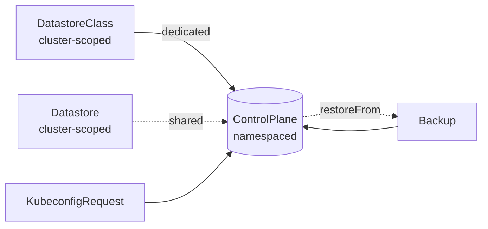
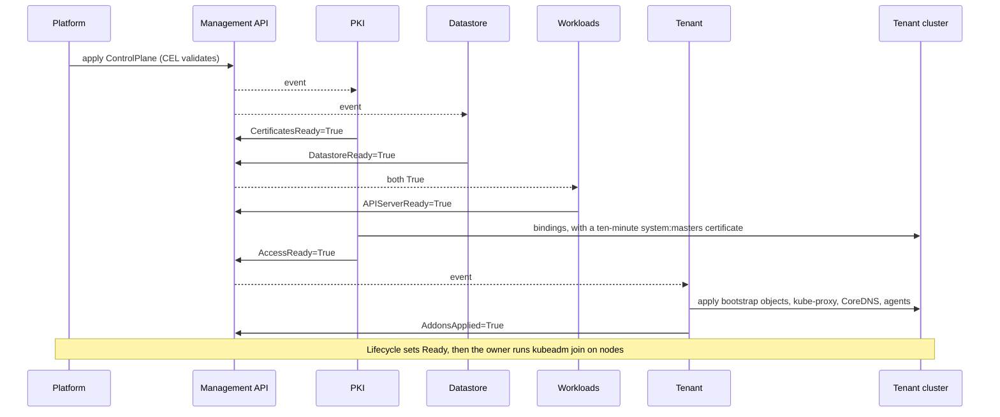
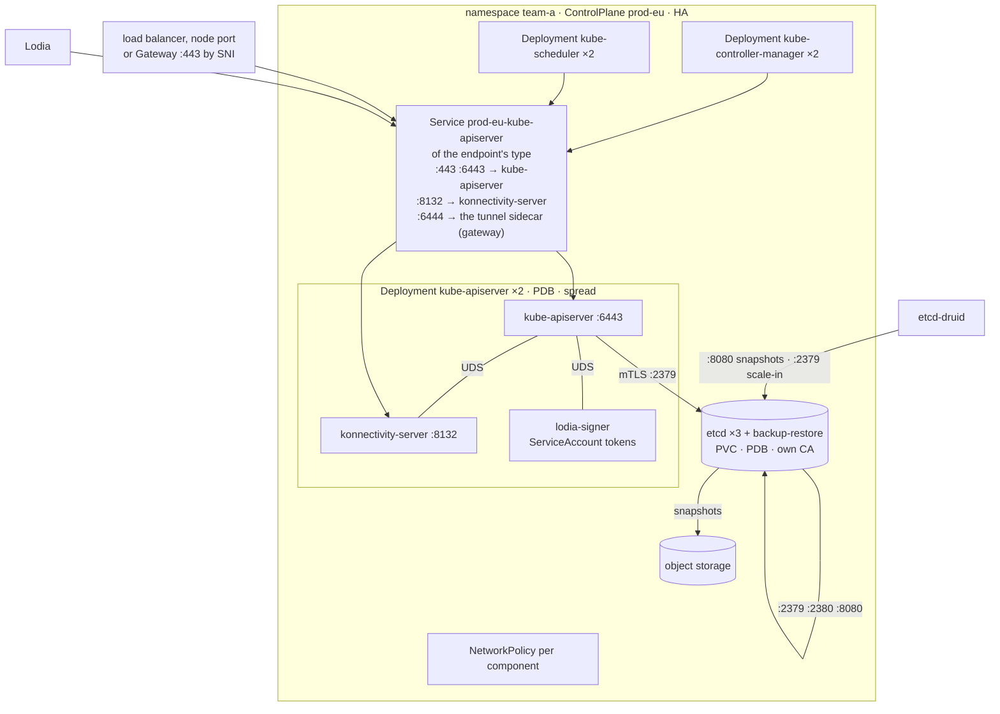
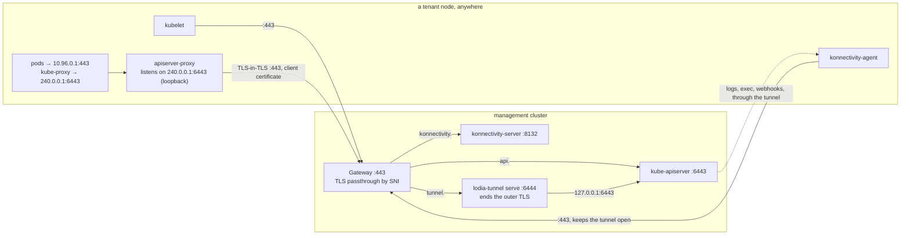
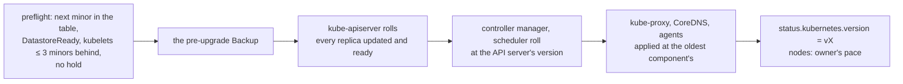
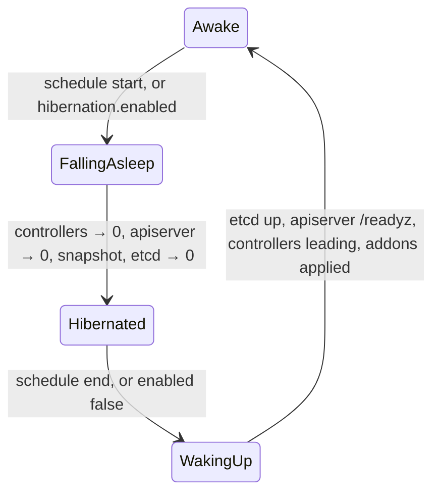
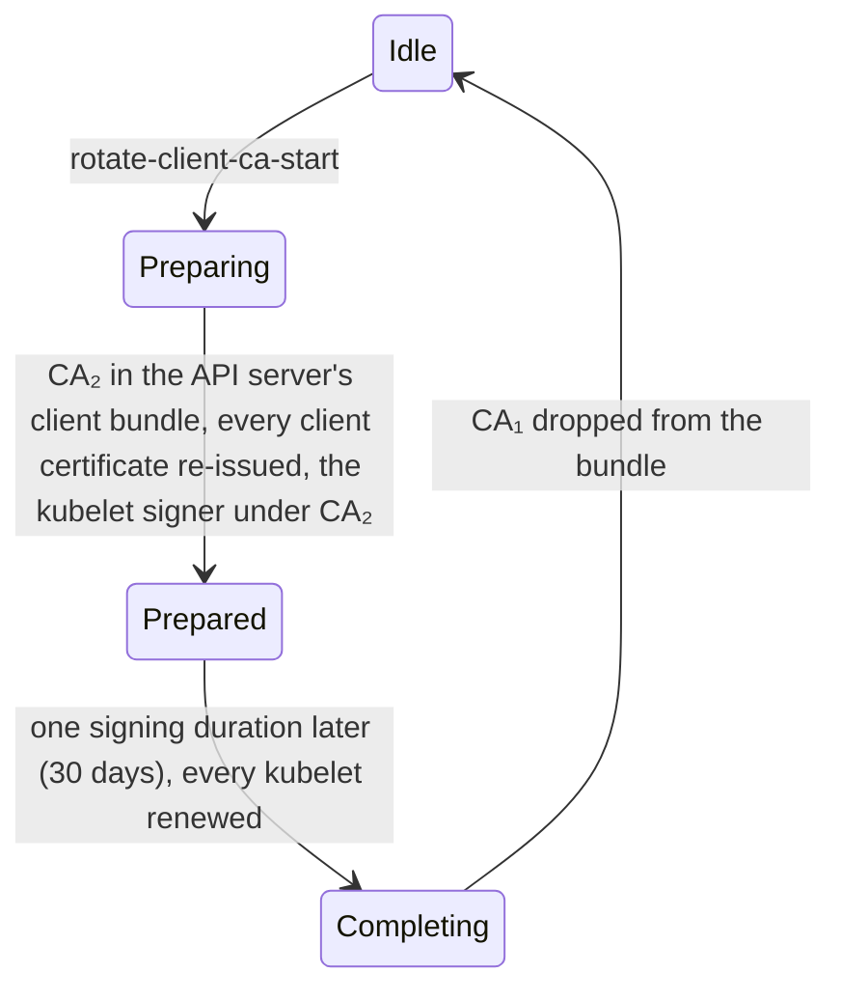

# Lodia docs

Lodia is an operator that runs Kubernetes control planes as pods on a
management cluster, one `ControlPlane` object per tenant cluster. A control
plane is a kube-apiserver with a konnectivity-server at its side, a
kube-controller-manager, a kube-scheduler, each in its own Deployment (or all
in one pod in the Compact layout), and an etcd of its own (or a prefix in a
shared one); the tenant's worker nodes stand anywhere with outbound TCP 443
and join with `kubeadm join`. Six independent controllers keep every
control plane certified, stored, running, reachable and up to date, and talk
to each other only through status conditions.

Go, controller-runtime; runs as a Deployment (`lodia-system`, two replicas,
leader election) on a management cluster with a maintained Kubernetes minor
(1.35 or newer today). Dedicated etcd
clusters are managed through etcd-druid
([decision](decisions/dedicated-etcd-by-default.md)); backups go to
S3-compatible object storage.

**Status: design, 2026-10-23.** This document describes the intended system;
[`roadmap.md`](roadmap.md) says what exists at each phase.

## What it owns

| owns | meaning |
|---|---|
| `ControlPlane` | the desired and observed state of one tenant control plane ([field reference](api/controlplane.md)) |
| `DatastoreClass`, `Datastore` | how a dedicated etcd is built; a shared etcd several tenants use by prefix |
| `KubeconfigRequest`, `Backup` | a short-lived credential for a person; a sealed copy of a tenant's etcd, from which a new `ControlPlane` replaces it |
| the tenant namespace's control plane objects | Deployments, Services, PodDisruptionBudgets, NetworkPolicies, Gateway routes, Secrets, ConfigMaps, the etcd resource; all owned by the `ControlPlane` and labelled `lodia.io/control-plane` |
| the PKI of every tenant | CAs, leaf certificates, kubeconfigs, ServiceAccount keys, encryption keys, their renewal and staged rotation |
| the bootstrap of the tenant cluster | what `kubeadm join` reads and the RBAC it needs, kube-proxy, CoreDNS, konnectivity-agent, apiserver-proxy, the admin group's binding |
| the pace | upgrades in order, maintenance windows, the fleet limit, hibernation |
| the tenant's workloads during an outage | holding the controller manager while most nodes are cut off from the control plane, so nothing evicts healthy pods |

And deliberately not: machines and their operating systems (a Cluster API
provider or a node agent on top), the CNI and every other addon the tenant
chooses, the Gateway itself (the platform installs it; Lodia attaches
routes), the object storage bucket, the monitoring stack (Lodia exposes
metrics), and bootstrap tokens (`kubeadm token create` with the admin
kubeconfig).

## The objects



One `ControlPlane` is the whole cluster from the platform's point of view:
write it, watch `Ready`, read the admin kubeconfig Secret
([decision](decisions/one-controlplane-per-cluster.md)). The field reference
with every rule is [`api/controlplane.md`](api/controlplane.md); examples are
in [`api/examples/`](api/examples/).

## The controllers

| controller | writes | condition | needs |
|---|---|---|---|
| PKI | Secrets with certificates, keys and kubeconfigs; the tenant's bindings for Lodia, the admin group and the kubelet client | `CertificatesReady`, `AccessReady`; `CAValidityAcceptable` outside `Ready` | `status.endpoint`; `APIServerReady` for the bindings |
| Datastore | the `Etcd` of a dedicated etcd and its NetworkPolicy — built — or a user and role in a shared store; backups and defragmentation | `DatastoreReady`; `BackupReady` outside `Ready` from wave 1b | a complete generation of PKI's etcd certificates |
| Workloads | Deployments, Services, PDBs, NetworkPolicies, ConfigMaps, routes | `APIServerReady` | `status.target`, `status.datastore`, `CertificatesReady`, `DatastoreReady`; `AddonsApplied` before it starts a restored `ControlPlane`'s controller manager, from wave 1b |
| Tenant | objects inside the tenant cluster, with an inventory | `AddonsApplied`, `AddonsAvailable` | `AccessReady` |
| Health | status, and from phase 2's wave 2 the controller manager's leader Lease inside the tenant while most nodes are silent | `Reachable`, `ControllersLeading`; `ControllerManagerHeld` outside `Ready` from wave 2 | `status.endpoint` and the CA bundle; `AccessReady` and `<cp>-lodia-kubeconfig` for the leader Leases |
| Lifecycle | `status.target`, `Progressing`, `Ready`; from phase 2's wave 2 `status.kubernetes`, `status.maintenance` and the pre-upgrade `Backup` | `Progressing` | the others |

Each controller has its own queue and field manager, reads `spec`,
`status.target` and the endpoint Workloads publishes, and reports through its
own condition; none calls another
([decision](decisions/independent-controllers.md)). The cache is scoped to
labelled objects, with metadata only for Secrets and ConfigMaps. PKI, the
Datastore controller, a first Lifecycle, the Tenant controller, Health's
external probe and Workloads are built (`internal/controller/pki`,
`datastore`, `lifecycle`, `tenant`, `health` and `workloads`, registered
under those names by `internal/operator`, whose manager `cmd/lodia` runs and
the tests build).



What each example of failure does: an etcd that loses quorum turns `DatastoreReady` False with `QuorumLost`, while a member that rolls or is lost leaves it True as long as the others keep quorum; Workloads leaves the Deployments alone and PKI keeps renewing certificates.
A changed controller-manager flag rolls only its Deployment.
A deleted CoreDNS Deployment inside the tenant returns at the next inventory apply.

## A tenant namespace



Four pods for a single control plane, nine for HA
([decision](decisions/component-per-deployment.md)); the Compact layout puts
the control plane into one pod, two with a dedicated etcd and one with a
shared store ([compact-layout](decisions/compact-layout.md)). The objects of
a tenant namespace, who writes and who reads each, and what a change does;
the names one controller writes and another reads, and the keys of those
Secrets that a reader names, are defined once, in `api/v1alpha1/names.go`,
and every controller takes them from there, while the CA keys and the
ConfigMaps are their writer's alone:

| object | writer | readers | on renewal or change |
|---|---|---|---|
| `<cp>-cakey-cluster`, `-cakey-client`, `-cakey-front-proxy`, `-cakey-etcd` (`kubernetes.io/tls`: each CA's certificate and key) | PKI | PKI alone; never mounted | a CA is renewed only by a rotation, announced a year ahead by `CAValidityAcceptable=False` (`CAExpiring`) outside `Ready`; a lost or unreadable key (`CAMissing`) or an expired CA (`CAExpired`) turns `CertificatesReady` False, and nothing that CA signs is written until it is restored or rotated, since a new CA would cut every client or node off at once; a key Secret restored without its labels is found by name and kept |
| `<cp>-ca-bundle` (`ca.crt`: the cluster CA, two during a trust anchor rotation) | PKI | everything that verifies the API server: PKI, for the kubeconfigs; Workloads, for the controller manager's `--root-ca-file`, which publishes `kube-root-ca.crt`; Tenant, for `cluster-info`; Health, for its probe of the public endpoint | kubeconfigs and `cluster-info` re-rendered; the controller manager restarts, because `--root-ca-file` is read once |
| `<cp>-client-ca` (`ca.crt`: the client CA, the current kubelet signer, and a replaced signer for one signing duration, 30 days) | PKI | Workloads, for the API server's `--client-ca-file` | reloaded |
| `<cp>-kubelet-signer` (`kubernetes.io/tls`: the intermediate under the client CA, `CA:TRUE`, path length 0) | PKI | Workloads, for the controller manager's per-signer signing flags | reloaded |
| `<cp>-apiserver-serving`, `<cp>-apiserver-kubelet-client` (`kubernetes.io/tls`) | PKI | Workloads, for the API server | reloaded (the kubelet client certificate for new connections) |
| `<cp>-front-proxy-ca` (`ca.crt`), `<cp>-front-proxy-client` (`kubernetes.io/tls`) | PKI | Workloads, for the API server and its aggregated APIs | the CA is reloaded; the client certificate restarts the API server until a reload is proven |
| `<cp>-etcd-ca` (`ca.crt`), `<cp>-apiserver-etcd-client` (`kubernetes.io/tls`) | PKI | Workloads, for the API server | the client certificate is read per connection; a new etcd CA restarts the API server (`--etcd-cafile` is read once) |
| `<cp>-etcd-{ca,server,client,peer,backup-restore}-<g>` (`ca.crt` for `ca`, `kubernetes.io/tls` for the rest, all immutable; the profiles of the `Etcd` named `<cp>-etcd`), one generation `g` per renewal, labelled `lodia.io/etcd-certificates: "<g>"` | PKI | the Datastore controller, which names the newest complete generation in the `Etcd`; through the `Etcd`, etcd, its backup-restore sidecar and etcd-druid's client | renewed as the next generation, since the sidecar keeps its first certificate and etcd-druid rolls the members only for a new name: no API outage with three members, about 20 s with one ([etcd spike](etcd-spike-2026-10.md)); a generation with a member missing or being deleted is replaced by the next, never repaired in place; PKI keeps the previous generation and deletes older ones |
| `<cp>-sa-keys` (`signing.key`, a PKCS#8 RSA 2048 key, and the `verify-*.pub` keys published beside it during a rotation) | PKI | Workloads, for the `lodia-signer` sidecar | reloaded by the sidecar; the API server fetches the keys again within the signer's refresh hint and does not restart |
| `<cp>-encryption-config` (`encryption-config.yaml`: an `EncryptionConfiguration` for `secrets` with the provider of `apiServer.encryption.provider` and a random 32-byte key named `key-<unix nanoseconds>`) | PKI | Workloads, for the API server | reloaded every minute (automatic reload) |
| `<cp>-konnectivity-server` (`kubernetes.io/tls`), `<cp>-konnectivity-kubeconfig` (`kubeconfig`, `tls.crt`, `tls.key`, `ca.crt`; server `https://<cp>-kube-apiserver.<ns>.svc:443`) | PKI | Workloads, for konnectivity-server | the API server pod rolls, in the maintenance window |
| `<cp>-controller-manager-kubeconfig`, `<cp>-scheduler-kubeconfig` (`kubeconfig`, `tls.crt`, `tls.key`, `ca.crt`; server `https://<cp>-kube-apiserver.<ns>.svc:443`) | PKI | Workloads, for each its own component; the kubeconfig names its certificates as files beside it | reloaded by client-go |
| `<cp>-admin-kubeconfig` (`kubeconfig`, certificates embedded; server `status.endpoint.apiServer`) | PKI | the platform, through `status.credentials.adminKubeconfigSecretRef`, as `lodia:cluster-admins` | nothing restarts |
| `<cp>-lodia-kubeconfig` (`kubeconfig`, certificates embedded; `lodia:operator`, dialling the in-namespace Service) | PKI | Lodia inside the tenant: PKI, for its bindings; Tenant; Health from phase 2 | nothing restarts |
| `Etcd` `<cp>-etcd` | Datastore | PKI, whose etcd certificates name its members and Services; etcd-druid | etcd-druid rolls the members |
| `<cp>-etcd-backup` (the class's backup credentials, copied) | Datastore | etcd-druid, through the `Etcd`, for the backup sidecar | whether the sidecar reads new keys without a restart is open (`todo.md`) |
| `<backup>.encryption-config` (`encryption-config.yaml`: every key of the source's encryption configuration when the `Backup` was sealed; immutable, owned by the `Backup`), from phase 2's wave 1b | the backup reconciler of the Datastore controller | PKI, once, for each `ControlPlane` restored from the `Backup` | never changes ([restore-replaces-the-source](decisions/restore-replaces-the-source.md)) |
| Service `<cp>-kube-apiserver` | Workloads | PKI, which names it in certificates and kubeconfigs | — |
| ConfigMap `<cp>-authentication-config` (an `AuthenticationConfiguration` whose anonymous section admits only `cluster-info` and the health paths) | Workloads | the API server | the API server restarts: a reload never changes the anonymous section ([authentication.go](https://github.com/kubernetes/kubernetes/blob/v1.37.1/pkg/kubeapiserver/options/authentication.go#L797-L799)) |
| ConfigMap `<cp>-egress-selector` (the cluster's traffic through konnectivity-server's socket); `audit-policy`, `admission-config` / `scheduler-config` from phase 2 | Workloads | the API server / the scheduler | that component restarts |

Sources: the reload behaviour of each flag is in the
[kube-apiserver](https://kubernetes.io/docs/reference/command-line-tools-reference/kube-apiserver/)
and
[kube-controller-manager](https://kubernetes.io/docs/reference/command-line-tools-reference/kube-controller-manager/)
references and their dynamic certificate controllers in
[apiserver](https://github.com/kubernetes/kubernetes/tree/release-1.35/staging/src/k8s.io/apiserver/pkg/server/dynamiccertificates).
Hashes of the restart-only objects sit in the pod template of the component
that mounts them; nothing else does, so a routine renewal of a reloaded
certificate rolls nothing
([staged-credential-rotation](decisions/staged-credential-rotation.md)).
PKI writes the hash of each Secret's data on the Secret, in the annotation
`lodia.io/data-hash`, so Workloads takes a restart-only Secret's hash
from its metadata and never reads the keys it mounts.
Every Secret above but `<cp>-etcd-backup` is PKI's, applied as `lodia/pki`
with an owner reference to the `ControlPlane`; every key is ECDSA P-256
except the ServiceAccount signing key, and a pass over an unchanged
`ControlPlane` writes nothing (`internal/controller/pki`, proven Secret by
Secret in `reconciler_test.go`).
A certificate is valid from five minutes before its issuance, kubeadm's
allowance for a verifier whose clock runs behind
([constants.go](https://github.com/kubernetes/kubernetes/blob/v1.37.1/cmd/kubeadm/app/constants/constants.go#L45-L46)),
and no longer than its CA; renewal comes two thirds of the way from issuance
to expiry, except for a certificate that already ends with its CA, which a
new one would not outlive. A pass issues and verifies every certificate at one
time, the time it started. Each CA and kubelet signer carries the nanosecond
of its issuance in its subject (`cluster-ca@1761350400123456789`), so no
bundle ever holds two certificates with one subject, not even a signer issued
again a moment after a write failed, and every bundle is a set: each certificate
once, in DER order, as library-go writes its CA bundles
([cabundle.go](https://github.com/openshift/library-go/blob/9a2bc12675c2bb37d3799a30786ccee5fa545d57/pkg/operator/certrotation/cabundle.go#L134-L177)).
A new encryption key is named after the nanosecond of its pass
(`key-1761350400123456789`), so no two keys of a tenant share a name, not
even after `apiServer.encryption.provider` returns to a provider used
before: the API server reads a value with every key whose provider and name
prefix it, and AES-CBC tells a wrong key only by its padding, which passes
about once in 256 reads
([transformer.go](https://github.com/kubernetes/kubernetes/blob/v1.37.0/staging/src/k8s.io/apiserver/pkg/storage/value/transformer.go#L102-L169),
[aes.go](https://github.com/kubernetes/kubernetes/blob/v1.37.0/staging/src/k8s.io/apiserver/pkg/storage/value/encrypt/aes/aes.go#L224-L254)).
A key keeps the name it has for good, whatever it is: the API server writes
the provider and the name before every value the key encrypts
([config.go](https://github.com/kubernetes/kubernetes/blob/v1.37.0/staging/src/k8s.io/apiserver/pkg/server/options/encryptionconfig/config.go#L645-L661),
[transformer.go](https://github.com/kubernetes/kubernetes/blob/v1.37.0/staging/src/k8s.io/apiserver/pkg/storage/value/transformer.go#L171-L185)).

PKI finds its Secrets by name, labelled or not, and the names above are its
own in the namespace: a Secret under one of them without a controller is
adopted, so a key restored from a backup without its labels is kept. Restore
such Secrets without `metadata.ownerReferences`: a reference to the old
`ControlPlane`'s UID makes the Secret that `ControlPlane`'s, and the garbage
collector deletes it. A Secret under PKI's names whose controller is not this
`ControlPlane`, or that refers to another `ControlPlane` at all, is neither
read nor written, and while one exists PKI writes nothing
(`CertificatesReady=False`, `SecretsControlledElsewhere`): a `ControlPlane`
recreated under its predecessor's name waits for the garbage collector to
remove the predecessor's Secrets instead of keeping its CA keys, which every
old kubeconfig and node trusts. A `ControlPlane` deleted with
`--cascade=orphan` leaves its Secrets without an owner, and one created under
the name adopts them, keys included; delete them for fresh credentials. The
etcd generations PKI keeps are adopted too, applied whole with their data
unchanged, which an immutable Secret allows
([validation.go](https://github.com/kubernetes/kubernetes/blob/v1.37.1/pkg/apis/core/validation/validation.go#L8164-L8182)),
so none stays without the owner the garbage collector follows or the label
the cache filters on. Key material PKI cannot read is never replaced: an
encryption configuration that is missing from its Secret or that the API
server's own validator refuses
([validation_encryption.go](https://github.com/kubernetes/kubernetes/blob/v1.37.0/staging/src/k8s.io/apiserver/pkg/apis/apiserver/validation/validation_encryption.go#L64-L115)),
and a ServiceAccount key that is not the RSA key PKI writes, turn
`CertificatesReady` False with `SecretUnreadable`: a new key would leave what
the old one encrypted unreadable, or every token it signed invalid.

The labels, annotations and the finalizer they share are defined in
`api/v1alpha1/labels.go`:

| key | on | writer | readers |
|---|---|---|---|
| label `lodia.io/control-plane: <cp>` | every object Lodia creates for a `ControlPlane` | each controller, on its objects | the operator's cache, which holds only labelled objects |
| label `app.kubernetes.io/managed-by: lodia` | every object Lodia writes inside a tenant cluster | PKI, on its bindings; Tenant, on its objects | none in Lodia: Tenant prunes by its inventory, never by the label |
| label `app.kubernetes.io/name: <component>` | the control plane's pods and their Deployments: `kube-apiserver` (`APIServerComponent` in `names.go`), `kube-controller-manager`, `kube-scheduler` | Workloads | Workloads, whose Services, NetworkPolicies and Deployments select the pods by it with `lodia.io/control-plane`; the Datastore controller, whose etcd NetworkPolicy admits the API server's pods by both |
| label `lodia.io/control-plane-uid` | the etcd claims | Datastore | Datastore, which reclaims and starts only on its own claims |
| label `lodia.io/etcd-certificates: <g>` | the etcd certificate Secrets | PKI | Datastore, which counts complete generations |
| annotation `lodia.io/is-default-class: "true"` | a `DatastoreClass` | the platform | Datastore |
| annotation `lodia.io/datastore-class` | the `Etcd` and its claims | Datastore | Datastore, which keeps the class an `Etcd` or its claims record; others read `status.datastore.class` |
| annotation `lodia.io/datastore-class-generation` | the `Etcd` | Datastore | Datastore, for `status.datastore.class` |
| annotation `lodia.io/data-hash` | every Secret PKI writes | PKI: `DataHash` of the Secret's data, a SHA-256 that changes whenever the data does | Workloads, for the restart hashes of its pod templates |
| annotation `lodia.io/operation` | a `ControlPlane` | the platform | Lifecycle and PKI, with rotations in phase 3 |
| annotation `lodia.io/maintain-requested-at` | a `ControlPlane` | the platform: a new value asks for the pending maintenance now | Lifecycle, from phase 2's wave 2, which grants it outside the window, once per value, and records the value in `status.maintenance.lastHandled` |
| annotation `lodia.io/operator-revision` | every object Workloads, Tenant and the Datastore controller render, never a pod template | each of them, from phase 2's wave 2: the operator revision the object was rendered with | each writer, which reports the revision in `status` once the object has rolled out |
| finalizer `lodia.io/datastore` | a `ControlPlane` | Datastore | the API server, which deletes the `ControlPlane` once it is gone |
| finalizer `lodia.io/restore-source` | a `Backup` | the backup reconciler of the Datastore controller, from phase 2's wave 1b | the API server, which deletes the `Backup` once every `ControlPlane` restoring from it has an encryption configuration of its own |

Workloads runs the three Deployments of
[component-per-deployment](decisions/component-per-deployment.md) from the
images of `status.target.version` and the flags of the [hard way](hard-way.md),
once `CertificatesReady` and `DatastoreReady` are True for the generation and
the Datastore controller has published `status.datastore.endpoints`, the API
server's `--etcd-servers`; lodia-signer and then konnectivity-server run
beside the API server as native sidecars, which start before it and stop
after it
([sidecar containers](https://kubernetes.io/docs/concepts/workloads/pods/sidecar-containers/)),
the signer's image a flag of the operator (`--signer-image`), which the
chart sets from `signerImage`. One
Service, `<cp>-kube-apiserver`, of the endpoint's type, takes 443 and 6443 to
the API server and 8132 to konnectivity-server, and Workloads publishes
`status.endpoint` from it before it waits on anything, whole once both
addresses exist: the balancer's IP with 443 and 8132, or, for `nodePort`, a
management node's InternalIP with the node ports of 6443 and 8132; and, as
`inCluster`, where the tenant's pods reach the API server: the balancer's IP
with 6443, or the node's address with the node port of 6443. That
address is the first Ready node's by name when none is published, and then
stays for as long as any node still reports it, Ready or not, since the
serving certificate, the kubeconfigs, the ServiceAccount issuer and every
joined kubelet name it; it is checked every minute, since no event reports a
node. The API server writes no `kubernetes` endpoints
(`--endpoint-reconciler-type=none`): Tenant writes them from `inCluster`
(Networking). Each
pod template carries a hash of what its component reads once
(`lodia.io/restart-hash`): the data hashes of its restart-only Secrets
and, for the API server, its two ConfigMaps, since it reads the egress
selector, and the anonymous section of the authentication configuration,
only at start
([authentication.go](https://github.com/kubernetes/kubernetes/blob/v1.37.1/pkg/kubeapiserver/options/authentication.go#L797-L799));
a renewal of a reloaded certificate rolls nothing. The probes are kubeadm's,
startup probes included
([utils.go](https://github.com/kubernetes/kubernetes/blob/v1.37.1/cmd/kubeadm/app/util/staticpod/utils.go#L255-L296),
[manifests.go](https://github.com/kubernetes/kubernetes/blob/v1.37.1/cmd/kubeadm/app/phases/controlplane/manifests.go#L67-L107));
konnectivity-server's startup probe is its health port, so the API server
starts once its tunnels can. A rollout loses no API request of a client
that follows `Retry-After`, as client-go does; one through the tunnel can
fail for a moment (`todo.md`). Each Deployment starts a full
set of new pods before it stops an old one (`maxSurge: 100%`,
`maxUnavailable: 0`), the API server's once they have been ready for 10
seconds (`minReadySeconds`), time for the konnectivity agents to reach the
new servers. A stopping API server serves for 15 more seconds and drains
its watches for up to 10, and konnectivity-server stops after it, all
within a grace period of 90 seconds
([api-exposure](decisions/api-exposure.md)).
A NetworkPolicy per component, named as its Deployment,
isolates the ingress of its pods: the API server takes its two ports from
anywhere, since they are the public endpoint, and the controller manager and
the scheduler take nothing; the kubelet's probes come from the node, which a
NetworkPolicy does not block
([network policies](https://kubernetes.io/docs/concepts/services-networking/network-policies/)).

With `highAvailability` each component runs two replicas, the API server `apiServer.replicas`.
Each Deployment spreads its replicas over as many nodes as it has, and with `failureTolerance: Zone` over as many zones too, at most three.
The constraints are `DoNotSchedule`, leave out nodes whose taints the pods do not tolerate, and spread a rollout's new pods among themselves ([topology spread](https://github.com/kubernetes/website/blob/snapshot-initial-v1.37/content/en/docs/concepts/scheduling-eviction/topology-spread-constraints.md)).
A PodDisruptionBudget per Deployment, named as it, lets a drain evict one replica at a time, and an unhealthy one always ([configure-pdb.md](https://github.com/kubernetes/website/blob/snapshot-initial-v1.37/content/en/docs/tasks/run-application/configure-pdb.md#L266-L274)); without `highAvailability` there is none.
More than one API server replica runs with `--goaway-chance=0.001`, upstream's suggested start, so that HTTP/2 clients move between replicas ([server_run_options.go](https://github.com/kubernetes/kubernetes/blob/v1.37.1/staging/src/k8s.io/apiserver/pkg/server/options/server_run_options.go#L367-L371)).
With `highAvailability` the API server's readiness probe runs every 2 seconds and allows five failures, so that an etcd leader election leaves it in its Service.
Its liveness probe is `/livez?exclude=etcd`, so that an etcd outage restarts no replica, as HyperShift runs it ([deployment.yaml](https://github.com/openshift/hypershift/blob/v0.1.86/control-plane-operator/controllers/hostedcontrolplane/v2/assets/kube-apiserver/deployment.yaml#L36-L49)).
`APIServerReady` is True while each component has a ready replica, and `status.components` counts each Deployment's replicas ([independent-controllers](decisions/independent-controllers.md)).
A `ControlPlane` that asks for what Workloads does not render yet is `APIServerReady=False` (`Unsupported`) rather than run without it: `endpoint.gateway`, the Compact layout, JWT authentication, an audit policy, an admission or a scheduler configuration, `serviceAccount.publicDiscovery`.
It keeps its endpoint: only gateway mode, which has no Service yet, publishes none.
An orphan under Workloads' names, an object without a controller, is adopted.
An object under its names whose controller is not this `ControlPlane`, or that refers to another `ControlPlane`, is not written: while the Service is held Workloads writes nothing, and while a ConfigMap, NetworkPolicy, Deployment or PodDisruptionBudget is, nothing but the Service (`APIServerReady=False`, `ObjectsControlledElsewhere`, naming each object and its owner).
A predecessor's objects go with the garbage collector, any other owner's with a person.
An object the API server refuses, for a quota on load balancers or an admission policy, makes `APIServerReady` False with `Refused`, the message naming it, and the pass is retried with backoff.

The dedicated etcd is etcd-druid's `Etcd` `<cp>-etcd`, which the Datastore
controller renders from the `DatastoreClass` and the newest complete
generation of the etcd certificates, under the `ControlPlane`'s finalizer
`lodia.io/datastore`, which it holds from before the first `Etcd`
exists. etcd-druid turns it into the StatefulSet `<cp>-etcd`, the client
Service `<cp>-etcd-client` (`https://<cp>-etcd-client.<ns>.svc:2379`, the
address Workloads gives the API server's `--etcd-servers`), the peer Service
`<cp>-etcd-peer`, a ConfigMap, member leases and a PodDisruptionBudget, all
owned by the `Etcd`
([helper.go](https://github.com/gardener/etcd-druid/blob/v0.39.0/api/core/v1alpha1/helper.go)).
With a backup store, the class's credentials Secret is copied into the
namespace as `<cp>-etcd-backup`, since etcd-druid mounts it from the `Etcd`'s
namespace. A pass of the controller refreshes the copy, and a deletion or edit
of the copy brings a pass; nothing watches the class's Secret: an edit of the
class reaches every tenant on it at once, while the Secret edited in place
reaches a tenant only at its next pass, at worst the cache's resync, every 10
hours by default
([cache.go](https://github.com/kubernetes-sigs/controller-runtime/blob/v0.25.2/pkg/cache/cache.go#L93-L97)).
Credentials are therefore rotated with a new Secret that the class is
pointed at ([operations](operations.md#everyday-tasks)). When the copy cannot
be made — the class's Secret is missing, another owner controls
`<cp>-etcd-backup` (a predecessor's the garbage collector has not removed
yet), or the API server refuses the copy — the class is held whole: the
`Etcd` keeps the class fields it has and still takes each new certificate
generation, and `DatastoreReady`'s message ends with `DatastoreClass <c> is
held:` and the cause. A missing Secret or a copy another owner holds is
checked again after a minute; a refused copy is retried with
controller-runtime's backoff, since the refusal is returned as the pass's
error. Held whole, since the rest
of an edit could add a store whose copy cannot be made; before the first
`Etcd` exists, the same cause is `Provisioning`, and nothing is created.

The class is resolved once, when the `Etcd` is created, and
recorded on it in `lodia.io/datastore-class`, with the class
generation it was rendered from in `lodia.io/datastore-class-generation`;
from then on the `Etcd` follows that class, its reclaim policy included, as a
default StorageClass is written into a claim when the claim is created
([storage classes](https://kubernetes.io/docs/concepts/storage/storage-classes/#default-storageclass)).
The claims record the class too, in `lodia.io/datastore-class` alone,
for their reclaim, so an `Etcd` created again over
this `ControlPlane`'s claims, after someone deleted it, takes the class they
record rather than `className` or the current default, which could give it
another bucket and placement; while that class is gone, it is
`DatastoreClassNotFound` and nothing is created. An edit of that class that
changes the `Etcd`'s spec reaches the `Etcd` of every tenant on it at once
and rolls their members, a single member with an outage, until Lifecycle
holds class edits for each tenant's maintenance window in phase 2: etcd-druid
carries every field Lodia renders from the class into the pod template
([builder.go](https://github.com/gardener/etcd-druid/blob/v0.39.0/internal/component/statefulset/builder.go#L161-L203)), the backup sidecar's arguments
([builder.go](https://github.com/gardener/etcd-druid/blob/v0.39.0/internal/component/statefulset/builder.go#L430-L601)) or the etcd ConfigMap, whose checksum is in
the pod template ([builder.go](https://github.com/gardener/etcd-druid/blob/v0.39.0/internal/component/statefulset/builder.go#L220-L227)), and updates the StatefulSet
with `RollingUpdate` ([builder.go](https://github.com/gardener/etcd-druid/blob/v0.39.0/internal/component/statefulset/builder.go#L57)). Edits that roll nothing:
`storage.className` and `storage.size`, which reach only `Etcd`s created
afterwards; `storage.reclaimPolicy` and `backup.retention.afterDelete`,
which no `Etcd` field carries; `backup.store.secretRef` and `.region`,
which change only the data of the copy `<cp>-etcd-backup`, whose name the
`Etcd` keeps. A recorded
class that is deleted stops only its own edits: the `Etcd` keeps every field
the class gave it, still takes each new certificate generation and reports
its readiness as before, and its claims are kept on deletion. The
claims the StatefulSet attaches are found by name, as the StatefulSet finds
them: `<cp>-etcd-<cp>-etcd-<n>`, its claim template named after the `Etcd`
([stateful_set_utils.go](https://github.com/kubernetes/kubernetes/blob/v1.35.0/pkg/controller/statefulset/stateful_set_utils.go#L116-L119),
[builder.go](https://github.com/gardener/etcd-druid/blob/v0.39.0/internal/component/statefulset/builder.go#L233)),
whatever labels they carry. They are labelled with the `ControlPlane`'s UID
(`lodia.io/control-plane-uid`) and annotated with the class, since
they outlive the `Etcd`. What each field of the class becomes
([etcd.go](https://github.com/gardener/etcd-druid/blob/v0.39.0/api/core/v1alpha1/etcd.go),
[store.go](https://github.com/gardener/etcd-druid/blob/v0.39.0/api/core/v1alpha1/store.go));
everything the class does not set is etcd-druid's default:

| `DatastoreClass` | `Etcd` | note |
|---|---|---|
| `etcd.quotaBackendBytes` | `spec.etcd.quota` | |
| `etcd.autoCompaction.mode`, `.retention` | `spec.sharedConfig.autoCompactionMode`, `.autoCompactionRetention` | shared with the sidecar's embedded etcd |
| `etcd.defragmentation.schedule` | `spec.etcd.defragmentationSchedule` | the sidecar defragments only above 3 GiB or with more than 1 GiB free ([etcd spike](etcd-spike-2026-10.md), finding 7) |
| `etcd.resources` | `spec.etcd.resources` | the sidecar's `spec.backup.resources` stay etcd-druid's default: the class has no field for them |
| `storage.className` | `spec.storageClass` | when the `Etcd` is created and not after: the field is immutable in the `Etcd` ([etcd.go](https://github.com/gardener/etcd-druid/blob/v0.39.0/api/core/v1alpha1/etcd.go#L627-L638)) |
| `storage.size` | `spec.storageCapacity` | when the `Etcd` is created and not after: it is the StatefulSet's volume claim template, which cannot change in place ([validation.go](https://github.com/kubernetes/kubernetes/blob/v1.37.1/pkg/apis/apps/validation/validation.go#L262)) |
| `storage.reclaimPolicy` | — | on deletion, `Delete` removes the claims etcd-druid's StatefulSet created and `Retain` leaves them ([deletion](#deletion)) |
| `backup.store.provider`, `.bucket`, `.endpoint` | `spec.backup.store.provider`, `.container`, `.endpointOverride` | Lodia's four providers are among etcd-druid's; most S3-compatible stores also want `s3ForcePathStyle: "true"` in the credentials Secret |
| `backup.store.prefix` | `spec.backup.store.prefix` | `<class prefix>/<namespace UID>/controlplanes/<ControlPlane UID>`: etcd-backup-restore restores an empty member from the newest snapshot under its prefix ([design](https://github.com/gardener/etcd-backup-restore/blob/v0.45.1/docs/proposals/design.md#L27)), so a `ControlPlane` recreated under the same name never restores the old one's; and it takes the last `v1/` anywhere in a key for its layout ([snapshot.go](https://github.com/gardener/etcd-backup-restore/blob/v0.45.1/pkg/snapstore/snapshot.go#L39-L59)), so no name goes into the prefix, where a namespace `team-v1` would hide every snapshot ([dedicated-etcd-by-default](decisions/dedicated-etcd-by-default.md)), and the schema refuses a class prefix that contains `v1/` or ends in `v1` |
| `backup.store.region` | the key `region` of `<cp>-etcd-backup` | where the sidecar reads it |
| `backup.store.secretRef` | `spec.backup.store.secretRef` | `<cp>-etcd-backup`, the copy, with the class Secret's data |
| `backup.fullSnapshotSchedule`, `.deltaSnapshotPeriod` | `spec.backup.fullSnapshotSchedule`, `.deltaSnapshotPeriod` | the delta period bounds what a restore loses ([etcd spike](etcd-spike-2026-10.md), finding 5) |
| `backup.retention.fullSnapshots` | `spec.backup.garbageCollectionPolicy: LimitBased`, `.maxBackupsLimitBasedGC` | the newest full snapshots kept: days, at the default schedule of one a day; only the newest keeps the deltas after it, since neither Lodia nor etcd-druid sets a delta retention period, so an older one restores to its own revision ([dedicated-etcd-by-default](decisions/dedicated-etcd-by-default.md)) |
| `backup.retention.afterDelete` | — | not built: nothing deletes a prefix, so a platform expires old ones with its bucket's lifecycle rules ([dedicated-etcd-by-default](decisions/dedicated-etcd-by-default.md)) |
| `placement.nodeSelector`, `.tolerations`, `.priorityClassName` | `spec.schedulingConstraints.affinity` (as required node affinity), `.tolerations`, `spec.priorityClassName` | the `Etcd` has no node selector |
| the `ControlPlane`'s `highAvailability` | `spec.replicas`, `spec.schedulingConstraints.topologySpreadConstraints`, the annotation `resources.druid.gardener.cloud/allow-unhealthy-pod-eviction` | 3 members with `highAvailability`, 1 without, and a scale etcd-druid has not completed keeps its count, since its schema refuses the opposite direction meanwhile ([etcd.go](https://github.com/gardener/etcd-druid/blob/v0.39.0/api/core/v1alpha1/etcd.go#L72-L74)); the members spread over three nodes, and with `Zone` over three zones too, beside the class's placement; the annotation lets etcd-druid's PodDisruptionBudget evict an unhealthy member always ([poddisruptionbudget.go](https://github.com/gardener/etcd-druid/blob/v0.39.0/internal/component/poddistruptionbudget/poddisruptionbudget.go#L121-L125)); 0 while hibernating comes with phase 3 |
| the etcd certificates, generation `g` | `spec.etcd.clientUrlTls`, `spec.etcd.peerUrlTls`, `spec.backup.tls` | all three name one complete generation, with `dataKey: ca.crt` on the CA; a generation counts only while its five Secrets are this `ControlPlane`'s (its controller reference), so a predecessor's or an orphaned generation, which trusts another etcd CA, never starts an etcd before PKI has checked and adopted it; a newer complete generation is one update of the `Etcd`, so one roll of the members; the `Etcd` never moves below the generation it names: the newest complete one is older while a Secret of the named one is being deleted, and the older generation PKI keeps can have expired |

A class is checked when it is written, since a value refused later stops
more than its own edit: an `Etcd` the API server refuses stops taking
certificate generations, and a backup sidecar that refuses its flags exits at
start, which takes a single member down at its next roll. The fields that
reach the `Etcd` carry the patterns and rules of etcd-druid's CRD, and
`test/api/etcddruid_test.go` fails when an etcd-druid release changes
them. The rest is what the processes accept. The sidecar etcd-druid v0.39.0
runs, etcd-backup-restore v0.41.2
([images.yaml](https://github.com/gardener/etcd-druid/blob/v0.39.0/internal/images/images.yaml#L14-L19)),
parses both schedules with robfig/cron v3.0.1 and exits on an error
([snapshotter.go](https://github.com/gardener/etcd-backup-restore/blob/v0.41.2/pkg/types/snapshotter.go#L68),
[init.go](https://github.com/gardener/etcd-backup-restore/blob/v0.41.2/pkg/server/init.go#L78),
[server.go](https://github.com/gardener/etcd-backup-restore/blob/v0.41.2/cmd/server.go#L29-L32)):
a schedule is five fields separated by single spaces, without lists, its
ranges ascend
([parser.go](https://github.com/robfig/cron/blob/v3.0.1/parser.go#L310-L312)),
and its days of the week run from 1 to 6, since etcd-druid refuses 0 and the
parser 7 ([spec.go](https://github.com/robfig/cron/blob/v3.0.1/spec.go#L40));
`*/7` selects Sunday. The quota is above zero
([restorer.go](https://github.com/gardener/etcd-backup-restore/blob/v0.41.2/pkg/types/restorer.go#L124-L126)),
the compaction retention a number, or in periodic mode a duration
([etcd.go](https://github.com/etcd-io/etcd/blob/v3.5.27/server/embed/etcd.go#L939-L956)),
and every duration one Go parses
([duration.go](https://github.com/kubernetes/apimachinery/blob/v0.37.1/pkg/apis/meta/v1/duration.go#L32-L42)):
the operator decodes classes into Go types, and one it cannot decode fails
the list its cache syncs from, so the Datastore controller fails to start and
the manager with it
([controller.go](https://github.com/kubernetes-sigs/controller-runtime/blob/v0.25.2/pkg/internal/controller/controller.go#L363-L386));
`test/api/durations_test.go` holds every duration of the API to that.

`DatastoreReady` is `Unknown`, reason `Reconciling`, until the controller's first pass has finished, and `WaitingForCertificates` until a complete certificate generation this `ControlPlane` controls exists.
A shared store is `Unsupported` until phase 3.
Every Secret the `Etcd` mounts must exist — the five of its certificate generation and, with a store, `<cp>-etcd-backup` — or the next start of a member fails, and `DatastoreReady` is `Provisioning`, naming them.
A terminating one still counts, since etcd-druid holds its finalizer on every Secret an `Etcd` references until none does ([reconciler.go](https://github.com/gardener/etcd-druid/blob/v0.39.0/internal/controller/secret/reconciler.go#L44-L101)), so a Secret the `Etcd` names is gone only when someone removed that finalizer ([operations](operations.md#a-secret-the-etcd-mounts-is-gone)).
Then `DatastoreReady` is True while the etcd has quorum: while a majority of the members the `Etcd` asks for are ready, as etcd-druid counts them from the StatefulSet ([reconcile_status.go](https://github.com/gardener/etcd-druid/blob/v0.39.0/internal/controller/etcd/reconcile_status.go#L57-L80)).
A member is ready once it answers a linearizable read, which needs a leader with a quorum ([readycheck.go](https://github.com/gardener/etcd-wrapper/blob/v0.8.2/internal/app/readycheck.go#L50-L60)).
One ready member is enough while etcd-druid scales the etcd, whose new members join as learners that do not vote ([member_control.go](https://github.com/gardener/etcd-backup-restore/blob/v0.45.1/pkg/member/member_control.go#L133-L170)), or has not observed a new count yet.
With fewer, the etcd is `QuorumLost` once it has had quorum, and `Provisioning` before, the message saying what is awaited.
`status.datastore.members` counts the members: `ready` from etcd-druid's report, and `updated`, those of the `Etcd`'s current spec that are available, from the StatefulSet, once etcd-druid and the StatefulSet controller have observed that spec.
Datastore does not read etcd-druid's `lastErrors`, which etcd-druid clears at the start of every spec reconcile, every 15 seconds, and sets again on a failure ([etcdstatus.go](https://github.com/gardener/etcd-druid/blob/v0.39.0/internal/controller/utils/etcdstatus.go#L45-L93)).
A persistent failure shows in them alone, and, at a new generation, as `updated` absent, since etcd-druid stamps `observedGeneration` only after the sync ([reconciler.go](https://github.com/gardener/etcd-druid/blob/v0.39.0/internal/controller/etcd/reconciler.go#L127-L144), [operations](operations.md#what-breaks-and-how-it-shows)).

The other reasons: `DatastoreClassNotFound`, before the `Etcd` exists, when
the class is missing or no class is the default, and `DatastoreClassAmbiguous`
when more than one is. `VolumesExist`
when claims `<cp>-etcd-<cp>-etcd-<n>` without this `ControlPlane`'s UID label
stand where its first `Etcd` would be created, since a StatefulSet
re-attaches a claim of that name
([stateful_pod_control.go](https://github.com/kubernetes/kubernetes/blob/v1.37.1/pkg/controller/statefulset/stateful_pod_control.go#L381-L405))
and starting from another tenant's data is a restore, not a start: nothing
is created until they are deleted. `VolumesExist` too when an `Etcd`
`<cp>-etcd` exists whose controller is not this `ControlPlane`, an orphan or
a predecessor's the garbage collector has not removed yet: it is neither
adopted nor written, and the message names it. `Refused` when the API
server refuses the `Etcd` Lodia renders — an admission policy on `Etcd`s, a
class stored before a rule it breaks (validation ratcheting keeps an
unchanged field on update,
[ratcheting](https://kubernetes.io/docs/tasks/extend-kubernetes/custom-resources/custom-resource-definitions/#validation-ratcheting)),
an etcd-druid whose schema moved: the message
names the `Etcd`, the certificate generation and the class generation, and
the refusal is in Lodia's log. `Deleting` while the `ControlPlane` is being
deleted. `status.datastore` says where the API server reaches etcd (the
client Service, `<cp>-etcd-client.<ns>.svc:2379`), the class and the
generation the `Etcd` was built from, and its members, total and ready. Every message is built from the state alone, so a pass that
changes nothing writes nothing; an error of the API server ends the pass,
goes to the log and leaves the status as it was
([independent-controllers](decisions/independent-controllers.md)), unless it
is the server's verdict on the object: any 4xx but a missing object, a
timeout, a conflict, throttling and a namespace being deleted, since an
admission webhook's denial without a code arrives as 400
([statuserror.go](https://github.com/kubernetes/kubernetes/blob/v1.37.1/staging/src/k8s.io/apiserver/pkg/admission/plugin/webhook/errors/statuserror.go#L37-L39)).
Sending the same `Etcd` again cannot change that verdict, and without the
condition its certificate generations would stop with `DatastoreReady` still
True; the refusal is returned as the pass's error too, so the next attempt
follows controller-runtime's backoff.

The etcd's NetworkPolicy, `<cp>-etcd`, is the Datastore controller's too:
applied as `lodia/datastore` in every pass that finds an `Etcd` this
`ControlPlane` controls, labelled `lodia.io/control-plane` and owned by the
`ControlPlane`, so the garbage collector deletes it with the rest once the
finalizer, which outlives the etcd, is gone. It selects the members by the
labels etcd-druid gives the StatefulSet's pods,
`app.kubernetes.io/managed-by: etcd-druid` and `app.kubernetes.io/part-of`
and `app.kubernetes.io/name` `<cp>-etcd`
([builder.go](https://github.com/gardener/etcd-druid/blob/v0.39.0/internal/component/statefulset/builder.go#L132-L138)),
the name keeping out the compaction Job's pods, which carry the first two
([reconciler.go](https://github.com/gardener/etcd-druid/blob/v0.39.0/internal/controller/compaction/reconciler.go#L716-L725)),
and admits, for their ingress alone, what dials them:

| port | from | dialled by |
|---|---|---|
| client, 2379 | the API server's pods: `lodia.io/control-plane: <cp>`, `app.kubernetes.io/name: kube-apiserver` | the API server, through the client Service |
| client, 2379, from phase 2's wave 2, observability | the operator's pods | the Datastore controller, which samples the etcd's `Status` once a minute for Lodia's metrics: the database size, the quota and the leader ([metrics-are-part-of-the-api](decisions/metrics-are-part-of-the-api.md)) |
| client, 2379; peer, 2380 | the members | the members, each other on the peer port ([etcdconfig.go](https://github.com/gardener/etcd-druid/blob/v0.39.0/internal/component/configmap/etcdconfig.go#L150-L166)); their backup-restore sidecars on the client port, through the client Service, to list the members at every start and to add their own as a learner when the cluster grows ([builder.go](https://github.com/gardener/etcd-druid/blob/v0.39.0/internal/component/statefulset/builder.go#L474-L477), [httpAPI.go](https://github.com/gardener/etcd-backup-restore/blob/v0.45.1/pkg/server/httpAPI.go#L452-L455), [member_control.go](https://github.com/gardener/etcd-backup-restore/blob/v0.45.1/pkg/member/member_control.go#L102-L104)) |
| client, 2379, with more than one member | the pods of etcd-druid's namespace, by `kubernetes.io/metadata.name`: the operator's flag `--etcd-druid-namespace`, which the chart sets ([Installation](#installation)) | etcd-druid, to remove a member in a scale-in ([memberremoval.go](https://github.com/gardener/etcd-druid/blob/v0.39.0/internal/component/statefulset/memberremoval.go#L31-L39)) |
| backup-restore, 8080, with a backup store and more than one member | the members | a sidecar that is not the backup leader, which forwards a snapshot request to the leader's ([httpAPI.go](https://github.com/gardener/etcd-backup-restore/blob/v0.45.1/pkg/server/httpAPI.go#L281-L288)) |
| backup-restore, 8080, only with a backup store | the pods of etcd-druid's namespace | etcd-druid, for snapshots: an `EtcdOpsTask`'s, the one it takes before it rolls the members for a new image or replica count, and compaction's, none of them without a store ([ondemandsnapshot.go](https://github.com/gardener/etcd-druid/blob/v0.39.0/internal/controller/etcdopstask/handler/ondemandsnapshot/ondemandsnapshot.go#L103), [statefulset.go](https://github.com/gardener/etcd-druid/blob/v0.39.0/internal/component/statefulset/statefulset.go#L108-L150), [snapshot.go](https://github.com/gardener/etcd-druid/blob/v0.39.0/internal/controller/compaction/snapshot.go#L117-L124)) |

Nothing else dials them.
The wrapper and the sidecar reach their own etcd and each other through the pod's loopback, by the host alias `<cp>-etcd-local` ([builder.go](https://github.com/gardener/etcd-druid/blob/v0.39.0/internal/component/statefulset/builder.go#L211-L218), [builder.go](https://github.com/gardener/etcd-druid/blob/v0.39.0/internal/component/statefulset/builder.go#L626-L627)), and the kubelet probes them from the node, neither of which a NetworkPolicy blocks ([network policies](https://github.com/kubernetes/website/blob/snapshot-initial-v1.37/content/en/docs/concepts/services-networking/network-policies.md#L467-L468)); a compaction Job restores the snapshots into an etcd of its own ([reconciler.go](https://github.com/gardener/etcd-druid/blob/v0.39.0/internal/controller/compaction/reconciler.go#L812-L857)).
The ports are etcd-druid's defaults, which the `Etcd` leaves unset ([client](https://github.com/gardener/etcd-druid/blob/v0.39.0/api/common/constants.go#L15-L16), [the others](https://github.com/gardener/etcd-druid/blob/v0.39.0/internal/common/constants.go#L55-L60)), named by number, since the peer port and the sidecar's share the container port name `server` ([builder.go](https://github.com/gardener/etcd-druid/blob/v0.39.0/internal/component/statefulset/builder.go#L376-L387), [builder.go](https://github.com/gardener/etcd-druid/blob/v0.39.0/internal/component/statefulset/builder.go#L414-L420)).
A policy under the name is found uncached too, as the `Etcd` is; one without a controller is adopted, and one another owner keeps is never written over.
The `Etcd` meanwhile takes each certificate generation as before, and `DatastoreReady`, once the etcd is otherwise ready, is False with `ObjectsControlledElsewhere`, naming the policy and its owner, and checked again every minute: a previous `ControlPlane`'s goes with the garbage collector, any other owner's with a person.
A policy the API server refuses is `Refused` the same way, and retried with backoff.

Identities: no root CA key is mounted into a control plane pod; the
controller manager holds only the kubelet signer, an intermediate that signs
kubelet client certificates for 30 days. No long-lived certificate carries
`system:masters`. The API server's kubelet client is
`kube-apiserver-kubelet-client` in the group
`lodia:kubelet-api-admins`, bound to the built-in `system:kubelet-api-admin`
role, the less privileged option the
[certificate best practices](https://kubernetes.io/docs/setup/best-practices/certificates/)
recommend; konnectivity-server runs as `system:konnectivity-server`, allowed
to create TokenReviews and nothing else; the controller manager and scheduler
use their standard identities; Lodia reaches the tenant as `lodia:operator`,
bound to `cluster-admin` because it manages RBAC; people and platforms use the
admin group or a `KubeconfigRequest`
([decision](decisions/short-lived-kubeconfigs.md)). The bindings themselves
are created once with a `system:masters` certificate that PKI issues for ten
minutes and never stores, the way kubeadm uses `super-admin.conf` only to bind
`kubeadm:cluster-admins`.

In phase 1 a NetworkPolicy per component isolates its pods' ingress: the
API server's two ports are open to all, since they are the public endpoint,
the etcd's members take only the API server, each other and etcd-druid, as
above, and nothing reaches the controller manager or the scheduler but the
kubelet's probes, which come from the node. Phase 2 default-denies the namespace,
egress included, and allows exactly the arrows above: the endpoint → API
server and konnectivity-server, controller manager and scheduler and Lodia
→ the API Service, API server → etcd, Lodia → etcd's client port (wave 2,
observability), etcd ↔ etcd, etcd-druid → etcd and its backup-restore
sidecar, etcd and its compaction Jobs → object storage, and every pod → the
cluster DNS; a platform that scrapes the components admits its scraper
itself ([metrics-are-part-of-the-api](decisions/metrics-are-part-of-the-api.md)).

## Networking



Three ways to expose a control plane
([decision](decisions/api-exposure.md)):

| `spec.endpoint` | what Lodia creates | endpoint | in-cluster access |
|---|---|---|---|
| `gateway` | three TLS passthrough routes (API, konnectivity, tunnel) on the platform's Gateway | `https://api.<cp>:443` | the `kubernetes` Service's endpoint is the API server's advertise address, `240.0.0.1:6443` by default; the apiserver-proxy DaemonSet owns that address on every node's loopback and wraps each connection in an outer TLS session with the tunnel's SNI and client certificate, which the Gateway passes through to a sidecar of every API server pod that ends it and forwards the inner stream to the API server untouched |
| `loadBalancer` | one Service of type LoadBalancer with ports 443 and 6443 (API) and 8132 (konnectivity) | the LB address | the `kubernetes` Service's endpoint is the LB address and 6443; no proxy |
| `nodePort` | one Service of type NodePort | a management node address and port | the `kubernetes` Service's endpoint is the node's address and the node port of 6443; no proxy |

The default is `gateway`: one address and one certificate story for a whole
fleet, and nothing per tenant on the load balancer. A node needs outbound
443 and nothing inbound: the API server reaches kubelets, and the webhooks
and aggregated APIs that run in the tenant, through the konnectivity tunnel
the agent opens from inside. On the node, the kubelet binds its node IP;
the agents' admin endpoint binds loopback, and their health endpoint the pod
IP.

Inside the tenant, the `kubernetes` Service keeps its ClusterIP (the first
address of the service CIDR), CoreDNS gets the tenth, and the controller
manager allocates pod CIDRs per node from `network.podCIDRs`. The API server
runs with `--endpoint-reconciler-type=none`: Workloads publishes the
`kubernetes` Service's endpoint as `status.endpoint.inCluster`, and Tenant
writes it into the tenant (Inside the tenant). Every API server replica
serves that address, so a rollout never empties the endpoints, which the
API server's own reconciler did whenever a replica stopped, since every
replica advertises the same address
([api-exposure](decisions/api-exposure.md)).

## Inside the tenant

What the Tenant controller applies to every tenant cluster, with an
inventory and prune ([decision](decisions/tenant-resources-by-inventory.md)).
The kubeadm objects use kubeadm's own names, so `kubeadm join` and
`kubeadm token create` work unchanged
([nodes-join-with-kubeadm](decisions/nodes-join-with-kubeadm.md)):

| objects | purpose |
|---|---|
| ConfigMap `kube-public/cluster-info` (a kubeconfig with the endpoint and the cluster CA, no users); Role and RoleBinding `kubeadm:bootstrap-signer-clusterinfo` for `system:anonymous` | discovery: `kubeadm join` reads it without credentials; the controller manager's bootstrap signer adds a `jws-kubeconfig-<token id>` signature for every bootstrap token |
| ClusterRoleBindings `kubeadm:kubelet-bootstrap` (→ `system:node-bootstrapper`) and `kubeadm:node-autoapprove-bootstrap` (→ `…:nodeclient`) for the group `system:bootstrappers:kubeadm:default-node-token`; `kubeadm:node-autoapprove-certificate-rotation` (→ `…:selfnodeclient`) for `system:nodes`; ClusterRole and binding `kubeadm:get-nodes` | TLS bootstrap of a kubelet with a bootstrap token, and its later certificate rotation |
| ConfigMap `kube-system/kubeadm-config` (`ClusterConfiguration` v1beta4: version, service subnet, DNS domain, endpoint); Role and RoleBinding `kubeadm:nodes-kubeadm-config` | what a joining node reads about the cluster |
| ConfigMap `kube-system/kubelet-config` (`KubeletConfiguration`: cluster DNS at the tenth service address, cluster domain, systemd cgroups, certificate rotation, webhook authentication and authorization, the client CA at the node's `/etc/kubernetes/pki/ca.crt`, anonymous off, read-only port off, health on loopback); Role and RoleBinding `kubeadm:kubelet-config` | the kubelet configuration every node starts with |
| kube-proxy: ServiceAccount, ConfigMap `kube-proxy` (kubeconfig to the public endpoint, mode, metrics and health on loopback, `conntrack.maxPerCore` when `addons.kubeProxy.conntrack.maxPerCore` is set), DaemonSet, ClusterRoleBinding `kubeadm:node-proxier`, Role and RoleBinding `kube-proxy` | Services on nodes; off with `addons.kubeProxy.enabled: false` |
| CoreDNS: ServiceAccount, ClusterRole and binding, ConfigMap, Deployment, Service `kube-dns` at the tenth service address | cluster DNS, the version kubeadm pins for the minor |
| konnectivity-agent: ServiceAccount, DaemonSet, Role to list and watch server leases in `kube-system` | the tunnel to every API server replica: agents count the servers from their leases, dial only for one they lack, and send a keepalive after 30 seconds without traffic |
| Endpoints and EndpointSlice `default/kubernetes` (`status.endpoint.inCluster`, port `https`; the Endpoints labelled `endpointslice.kubernetes.io/skip-mirror: "true"`, the slice `kubernetes.io/service-name: kubernetes` and `endpointslice.kubernetes.io/managed-by: lodia.io`) | the `kubernetes` Service's endpoint, which the API server leaves alone (`--endpoint-reconciler-type=none`) |
| `apiserver-proxy` DaemonSet (`lodia-tunnel` in its `addr` and `proxy` modes), and the Secret with its client certificate, from `<cp>-tunnel-client` | in-cluster API access in `gateway` mode ([api-exposure](decisions/api-exposure.md)); phase 2's wave 1b, Gateway |
| ClusterRoleBinding for `system:konnectivity-server` (→ `system:auth-delegator`) with its lease Role; the bindings of `lodia:operator` and `lodia:cluster-admins` (→ `cluster-admin`) and `lodia:kubelet-api-admins` (→ `system:kubelet-api-admin`) are PKI's, since nothing can apply them before they exist (`AccessReady`) | the identities above |
| `ValidatingAdmissionPolicy` and binding `lodia-write-lock`, only while a lock is requested | refusing writes during a migration, without a webhook |
| ConfigMap `kube-system/lodia-inventory` | what to prune next time |

The control plane side of the same contract: the API server runs with
`--enable-bootstrap-token-auth` and a structured authentication
configuration that allows anonymous requests only to `cluster-info` and the
health paths
([authentication](https://kubernetes.io/docs/reference/access-authn-authz/authentication/));
the controller manager runs with
`--controllers=*,bootstrap-signer-controller,token-cleaner-controller` (both
are off by default), `--use-service-account-credentials`, and no cloud
provider
([kube-controller-manager](https://kubernetes.io/docs/reference/command-line-tools-reference/kube-controller-manager/),
[bootstrap tokens](https://kubernetes.io/docs/reference/access-authn-authz/bootstrap-tokens/)).
The pinned component versions per minor are those kubeadm pins: CoreDNS
v1.13.1 and etcd 3.6.6 for 1.35, CoreDNS v1.14.2 for 1.36, CoreDNS v1.14.6 for
1.37, and konnectivity 0.NN for Kubernetes 1.NN (kubeadm's constants at
[v1.35.0](https://github.com/kubernetes/kubernetes/blob/v1.35.0/cmd/kubeadm/app/constants/constants.go),
[v1.36.0](https://github.com/kubernetes/kubernetes/blob/v1.36.0/cmd/kubeadm/app/constants/constants.go)
and
[v1.37.1](https://github.com/kubernetes/kubernetes/blob/v1.37.1/cmd/kubeadm/app/constants/constants.go)).

Built for phase 1, without `apiserver-proxy` and the write lock
(`internal/controller/tenant`, the templates in its `manifests/`, taken from
[kubeadm v1.35.0](https://github.com/kubernetes/kubernetes/tree/v1.35.0/cmd/kubeadm/app/phases)
and [the hard way](hard-way.md)). Once `AccessReady` is True for the
generation, the controller applies every object as `lodia/tenant` through
`<cp>-lodia-kubeconfig`, on a change of the inputs it reads and every 10
minutes; until then both conditions are `WaitingForAccess`, and it uses
`<cp>-lodia-kubeconfig` and `<cp>-ca-bundle` only while no other owner
keeps them, looking again every minute. It leaves another owner's objects
as they are: an object no inventory names yet is read before its first
apply and left alone when it exists without `lodia/tenant` among its field
managers, and the prune deletes an entry that left the render only when
`lodia/tenant` applied it, under the UID and resourceVersion it read, and
otherwise drops the entry. The inventory names an object before it is first written,
and is rewritten to what the render holds once the objects that left it are
deleted, so a pass that stops anywhere leaves nothing to leak; an object at
another API version is the same entry, pruned at the version the tenant
serves, and one of a kind it no longer serves is gone. `AddonsApplied` is
True once every object is applied and pruned; False with `Refused` names
the object, or the inventory read, the tenant refused, and with `Applying`
another owner's object, an inventory it cannot read, or a tenant that never
answered, while a tenant that stops answering leaves a True as it was. `AddonsAvailable` reads the
DaemonSets and Deployments Lodia applied, every minute until they are
rolled out; it keeps a rollout it read before while none can be read, and
until one is, says what stopped the pass.

## Lifecycle

Built so far: Lifecycle sets `status.target.version` to `spec.version` when its minor is one Lodia runs — 1.35, 1.36 and 1.37, whose images are in `internal/versions` — and within that minor only, since a minor upgrade needs the order below, which phase 2 builds; otherwise the target stays and `Progressing` says why (`Unsupported`).
`Progressing` is True, `RollingOut`, while `status.components` or `status.datastore.members` count a replica or member not updated, or do not report how many are, naming each; else `Idle`, or `Paused`.
`Ready` is True when the seven readiness conditions are True at the current generation; otherwise it takes the status, reason and message of the first that is not, in the order `CertificatesReady`, `DatastoreReady`, `APIServerReady`, `AccessReady`, `AddonsApplied`, `Reachable`, `ControllersLeading`, and is `Unknown`, `LatestGenerationNotObserved`, while that one is missing or reported for an older generation; while the `ControlPlane` is being deleted it is False, `Deleting`.
`status.observedGeneration` follows once all seven are reported for the current generation.

### Upgrades and windows

From phase 2's wave 2: one minor at a time, in the order the version skew
policy allows: backup → API server → controller manager and scheduler →
in-tenant components → nodes by their owner. Lifecycle moves one target,
`status.target.version`, and each renderer follows what runs: the controller
manager and the scheduler the API server's reported version, the in-tenant
components the oldest component's. The owner's changes roll now; changes
Lodia initiates (patch updates, a new operator revision, an edit of a
`DatastoreClass`, a restart-only renewal) wait for the tenant's maintenance
window and the fleet limit, and `Progressing` says where a change stands
([decision](decisions/upgrades-and-maintenance-windows.md)).



### Hibernation



Volumes stay; snapshots continue to exist; rotations and patch updates wait
until the control plane is awake, and `Progressing` says so.
Nodes are not Lodia's to stop; their owner scales them down or lets them
sit (kubelets retry the API without harm).

### Credential rotation

Each tenant has a CA per purpose: the cluster CA that every client and node
trusts, a client CA that only the API server trusts, a front-proxy CA and an
etcd CA. Credentials rotate in stages, the old and the new valid together
between stages, as Gardener does
([shoot credentials rotation](https://github.com/gardener/gardener/blob/master/docs/usage/shoot-operations/shoot_credentials_rotation.md)),
and the routine rotations never touch a node: the client CA, the
ServiceAccount key (signed by the `lodia-signer` sidecar, so the API server
does not restart), the etcd encryption key, the etcd and front-proxy CAs.
Only the trust anchor, the cluster CA, waits for node owners. The
ServiceAccount key rotates through three states of `<cp>-sa-keys`: K₂
published beside K₁, then K₂ signing with K₁ still published, then K₁ dropped
once the owner confirms that no client holds a K₁ token. Started and
completed through the `lodia.io/operation` annotation; the phases are
in `status.credentials.rotation`
([decision](decisions/staged-credential-rotation.md)).



Leaf certificates renew on their own at two thirds of their lifetime and
need no stages and no rollout: the API server reloads its serving and kubelet
client certificates and client CA bundles from disk, and components read
their certificates from files their kubeconfigs reference.

### Backup, restore, migration

A `DatastoreClass` with a backup store gives every dedicated etcd continuous
snapshots: a full snapshot daily, at a time inside the tenant's window, and
a delta every few minutes, with retention in the class (the schedule Gardener
runs, [backup and restore](https://github.com/gardener/gardener/blob/master/docs/concepts/backup-restore.md)).
A `Backup` is a sealed copy: the snapshots of a moment, copied under a
prefix of their own that nothing writes again, with the source's encryption
keys kept beside it in the management cluster, never in the bucket. A new
`ControlPlane` with `restoreFrom` starts its etcd from that copy and replaces
the source: it serves the data from the start, with new CAs and keys, and
runs its controller manager once it is released, the source is gone and
Tenant has applied the cluster's objects, `AddonsApplied`
([restore-replaces-the-source](decisions/restore-replaces-the-source.md)).
A clone beside a live source is for tools that restore through the API.
Restoring in place over a running cluster is a documented runbook, not an
API, because clients with caches see resource versions go backwards.

Migration between stores (shared → dedicated, or between classes): Tenant
applies a `ValidatingAdmissionPolicy` that refuses writes, Datastore takes a
final snapshot and restores it into the target, Workloads rolls the API
server onto the new endpoints, Tenant lifts the lock. Reads work throughout;
writes stop for the copy.

### Deletion

The Datastore controller holds the `ControlPlane`'s finalizer
`lodia.io/datastore`; while `spec.paused` is true it touches
nothing, so the deletion of a paused `ControlPlane` waits until it is
unpaused. On deletion it deletes the `Etcd` and waits
for etcd-druid to let it go, then reclaims the volumes, which etcd-druid
keeps: of the PersistentVolumeClaims named `<cp>-etcd-<cp>-etcd-<n>`, which
the StatefulSet attaches by that name
([stateful_pod_control.go](https://github.com/kubernetes/kubernetes/blob/v1.37.1/pkg/controller/statefulset/stateful_pod_control.go#L381-L405)),
those labelled with the `ControlPlane`'s
UID are deleted when the class each records says `Delete`, and left when it
says `Retain` or no longer exists. While the `Etcd` exists, each pass of the
deletion first labels the claims no earlier pass has labelled, which can only
be its own, since `VolumesExist` kept it from being created while anything
else stood there; a claim that appears after the last such pass stays
unlabelled and is kept. A claim of another `ControlPlane` is never
touched, and neither is an `Etcd` `<cp>-etcd` this `ControlPlane` does not
control, nor the claims its StatefulSet uses. Then the finalizer goes and the
owner references garbage-collect the rest of the namespace objects. The
final snapshot when a backup store exists comes with backups in phase 2;
nothing deletes the snapshots of a deleted `ControlPlane`
(`retention.afterDelete` is not built,
[dedicated-etcd-by-default](decisions/dedicated-etcd-by-default.md)).

## Health

Built so far: the probe through the public endpoint and the leader Leases.
Every 10 seconds Health asks `https://<status.endpoint.apiServer>/readyz` without credentials, which the API server's authentication allows for its health paths, and verifies it against `<cp>-ca-bundle`.
`Reachable` is True on a 200 and False, `ExternalProbeFailed`, after three probes in a row that fail, so one blip does not drop `Ready`; before the endpoint is published it is False, `WaitingForEndpoint`, and before the bundle is written, `WaitingForCertificates`.
In the same pass, once `AccessReady` is True for the generation, Health reads the leader Leases of the controller manager and the scheduler through the in-namespace Service, as `<cp>-lodia-kubeconfig`, each with a consistent GET.
`ControllersLeading` is True while each Lease has a holder and has changed, by the operator's clock, within its own `leaseDurationSeconds` and one period; the clock lives in memory, so a Lease seen first, or again after a read that failed, counts as changed then.
A read that fails leaves `ControllersLeading` as it was, since reaching the API server is `Reachable`'s to report.
The rest of this section comes with phase 2.

Every 5 seconds, its period, Health probes `/readyz` through the public endpoint and through the in-namespace Service, on a new connection each time; three failed passes of either turn `Reachable` False, with `InternalProbeFailed` first, since then the API server itself does not answer.
From inside the management cluster the public probe reaches a load balancer's or a Gateway's address through kube-proxy, which captures traffic to such an address on every node, so it proves the cloud load balancer only in `nodePort` mode ([serviceport.go](https://github.com/kubernetes/kubernetes/blob/v1.37.1/pkg/proxy/serviceport.go#L222-L235)); the end-to-end signal from the nodes' side is their leases.
Through the Service, Health reads the Leases in `kube-node-lease` every pass and the nodes every 30 seconds, and writes `status.nodes` only when it changes (wave 2).
When 60% or more of the counted nodes have been silent for 20 seconds while the API server answers, the nodes are cut off from the control plane, not dead: Health takes the controller manager's leader Lease inside the tenant and keeps renewing it, the controller manager steps down and waits, and nothing marks the nodes or evicts their pods.
Two minutes after the nodes are back, Health lets the lease go.
It works the same in both layouts, rolls nothing, and never takes a lease another component holds ([controller-manager-hold](decisions/controller-manager-hold.md)).
This is what Gardener's dependency-watchdog does for its clusters, built into the operator.
Health reports a hold in `ControllerManagerHeld`, outside `Ready`: the nodes are cut off, not the control plane, and `Reachable` stays about the control plane.

## Identity and tenancy

- A `ControlPlane` is namespaced; the platform's RBAC on the namespace
  decides who creates clusters and who reads their Secrets. Lodia's
  ClusterRoles, one per controller, are limited to its kinds, the workload
  kinds it renders, Secrets and ConfigMaps, the management nodes, Gateway API
  `TLSRoute`s and the Gateways they attach to, etcd-druid's `Etcd`, the StatefulSet etcd-druid
  runs for it and the claims of that StatefulSet, and `get` on the
  namespaces, whose UIDs go into the backup prefix; where they come from is
  below.
- Every field Lodia writes has a field manager `lodia/<controller>`;
  another manager's fields on the same object are left alone.
- Inside a tenant, Lodia is `lodia:operator`; its objects carry
  `app.kubernetes.io/managed-by: lodia`. Tenant's are listed in its
  inventory, and its prune reads the inventory alone, never the label: PKI's
  three bindings carry the label too, and PKI is their one writer.
- No cross-tenant object: every Secret, Service and route is in the tenant's
  namespace, and NetworkPolicies keep its pods to their own arrows. A
  shared `Datastore` is the one deliberate exception, labelled as such.
- A class's backup credentials reach every tenant's snapshots on that class:
  `<cp>-etcd-backup` puts them into every tenant namespace, and they read
  every tenant's prefix, though not the encryption keys, which stay in the
  management cluster. Whoever reads Secrets in one tenant namespace therefore
  reads every tenant's snapshots on that class. Two rules bound it until the
  credentials are scoped to one tenant's prefix: Secrets in tenant
  namespaces are readable by Lodia and the platform's administrators only,
  so automation gets `get` on `<cp>-admin-kubeconfig` by `resourceNames` and
  never the namespace's Secrets; and a class per trust boundary.

Each controller declares the verbs it calls with `+kubebuilder:rbac` markers
in its package; `make generate` writes them into one ClusterRole per
controller in [`charts/lodia/files/rbac/`](../charts/lodia/files/rbac/), and
the chart binds the operator's ServiceAccount to every one. Each controller's
envtest suite runs it as a user bound to its generated ClusterRole and
nothing else (PKI's direct passes read the `ControlPlane` through the envtest
admin, standing in for the manager's cache), with the `OwnerReferencesPermissionEnforcement` admission
plugin on for PKI, the Datastore controller and Workloads. For the Datastore
controller, leaving out any one verb fails a test, except `list` on the five
kinds the cache holds: client-go fills the cache with a streaming watch where
the API server offers one, on by default since 1.35, and falls back to `list`
where it does not
([known_features.go](https://github.com/kubernetes/kubernetes/blob/v1.37.1/staging/src/k8s.io/client-go/features/known_features.go#L141-L144),
[reflector.go](https://github.com/kubernetes/kubernetes/blob/v1.37.1/staging/src/k8s.io/client-go/tools/cache/reflector.go#L470-L509)).

The verbs nobody would guess from the calls:

- `create` beside `patch` wherever a controller applies: the API server
  authorizes an apply that creates the object as `create`
  ([patch.go](https://github.com/kubernetes/kubernetes/blob/v1.35.0/staging/src/k8s.io/apiserver/pkg/endpoints/handlers/patch.go#L203-L232)).
- `update` on `controlplanes/finalizers` for PKI, the Datastore controller and
  Workloads: they set `blockOwnerDeletion` on the owner references of what
  they create, which that admission plugin allows only with `update` on the
  owner's `finalizers`
  ([gc_admission.go](https://github.com/kubernetes/kubernetes/blob/v1.35.0/plugin/pkg/admission/gc/gc_admission.go#L122-L152)).
- `delete` on every kind a controller adopts: that plugin lets only who may
  delete an object set an owner reference on it when it is updated, which
  adopting an object with no owner does
  ([gc_admission.go](https://github.com/kubernetes/kubernetes/blob/v1.37.1/plugin/pkg/admission/gc/gc_admission.go#L103-L119)).
- `patch` on `controlplanes` for the Datastore controller: its finalizer,
  held and released with a patch.

## Installation

Prerequisites on the management cluster:

| need | for |
|---|---|
| Kubernetes ≥ 1.35 | a maintained minor that has the CEL libraries (semver, 1.34) and validation ratcheting (GA 1.33) the schema uses |
| a StorageClass | etcd volumes; local or network, with low fsync latency |
| etcd-druid | dedicated etcd (installed by the chart as a dependency, or separately) |
| Gateway API ≥ 1.5 (where `TLSRoute` became GA) and an implementation that supports `TLSRoute` in passthrough, its core feature | `endpoint.gateway` only, from phase 2's wave 1b ([api-exposure](decisions/api-exposure.md)) |
| an S3-compatible bucket and credentials | backups, strongly recommended |
| a metrics stack | optional: from phase 2's wave 2 the chart ships a metrics Service, a ServiceMonitor, alert rules and dashboards, each behind a value and off by default |

The chart is [`charts/lodia`](../charts/lodia). The release workflow that
publishes it to `oci://ghcr.io/lodia-io/charts/lodia` with the images is not
built yet ([releases-and-support](decisions/releases-and-support.md)); until
it is, build both images with ko and install from a checkout, into
`lodia-system` or any namespace:

```sh
KO_DOCKER_REPO=<registry> go run github.com/google/ko@v0.19.1 build \
  --base-import-paths --platform=linux/amd64,linux/arm64 ./cmd/lodia ./cmd/lodia-signer
helm dependency build charts/lodia
helm install lodia charts/lodia -n lodia-system --create-namespace \
  --set image.repository=<registry>/lodia,image.digest=sha256:… \
  --set signerImage.repository=<registry>/lodia-signer,signerImage.digest=sha256:…
```

The phase 1 chart installs:

- the CRDs, as templates of the ones `make generate` writes, so they upgrade
  with the chart: `crds.enabled` (default `true`) leaves them out for those
  who manage CRDs themselves, and `crds.keep` (default `true`) keeps them on
  uninstall with `helm.sh/resource-policy: keep`;
- etcd-druid v0.39.0 as a dependency, the chart etcd-druid's release workflow
  publishes to `oci://europe-docker.pkg.dev/gardener-project/releases/charts/gardener/etcd-druid`
  ([base.yaml](https://github.com/gardener/etcd-druid/blob/v0.39.0/.github/workflows/base.yaml#L60-L84)),
  with `enableEtcdSpecAutoReconcile` on until phase 2's wave 2 turns it off
  ([dedicated-etcd-by-default](decisions/dedicated-etcd-by-default.md));
  `etcdDruid.enabled=false` skips it
  where etcd-druid is already installed, and `etcdDruidNamespace` then names
  the namespace it runs in. The operator gets etcd-druid's namespace, the
  release's or that one, as `--etcd-druid-namespace`, for each etcd's
  NetworkPolicy ([A tenant namespace](#a-tenant-namespace)). etcd-druid's
  CRDs are in its chart's `crds/` directory, which Helm applies only when it
  installs a release, skipping a CRD that exists, and never on an upgrade
  ([install.go](https://github.com/helm/helm/blob/v4.3.1/pkg/action/install.go#L206-L218),
  [L329-L338](https://github.com/helm/helm/blob/v4.3.1/pkg/action/install.go#L329-L338));
- the operator: two replicas with leader election on the Lease `lodia.io` in
  the release namespace, spread across nodes by hostname, at
  `system-cluster-critical` priority, with a securityContext that passes Pod
  Security `restricted` (the release namespace cannot enforce it while
  `etcdDruid.enabled`: etcd-druid's pod sets only
  `allowPrivilegeEscalation: false`,
  [deployment.yaml](https://github.com/gardener/etcd-druid/blob/v0.39.0/charts/templates/deployment.yaml#L112-L113)),
  liveness and readiness probes on port 8081, the
  metrics endpoint on 8443 behind controller-runtime's authentication and
  authorization filter, and a PodDisruptionBudget with `maxUnavailable: 1`
  and `unhealthyPodEvictionPolicy: AlwaysAllow`;
- its RBAC: a ClusterRole per controller from
  [`charts/lodia/files/rbac/`](../charts/lodia/files/rbac/)
  ([Identity and tenancy](#identity-and-tenancy)), the ClusterRole the
  metrics filter needs (`create` on TokenReviews and SubjectAccessReviews),
  and a Role in the release namespace for the Lease and events.

`image` and `signerImage` each take a `repository`
(`ghcr.io/lodia-io/lodia` and `ghcr.io/lodia-io/lodia-signer`), a `digest`
and a `tag`, which defaults to the chart's `appVersion`: with a digest the
chart renders `repository@digest`, otherwise `repository:tag`. The signer's
image reaches the operator as `--signer-image`; from phase 2's wave 1b,
Gateway, `tunnelImage` (`ghcr.io/lodia-io/lodia-tunnel`) brings
`lodia-tunnel`'s as `--tunnel-image`.

Then a `DatastoreClass` with the bucket, and the first `ControlPlane`. Later
phases bring the rest: the metrics Service, the ServiceMonitor, the alert
rules and the dashboards in phase 2's wave 2, each behind a value of
`metrics.*` and off by default, with the metrics they read
([metrics-are-part-of-the-api](decisions/metrics-are-part-of-the-api.md)); the operator configuration below,
which the operator does not read yet, in phase 2, whose fleet limit,
controller manager hold and `KubeconfigRequest`s it configures; signed and
attested images, and how to verify them, in phase 4
([roadmap](roadmap.md), [releases-and-support](decisions/releases-and-support.md)).

Operator configuration (a file, mounted from a ConfigMap; the chart renders
it from values):

| key | meaning | default |
|---|---|---|
| `versions` | the Kubernetes versions Lodia runs and, per minor, the images of kube-apiserver, controller manager, scheduler, kube-proxy, CoreDNS, konnectivity, etcd, the `latest` patch, which patch updates move to, and the end-of-support date | the table shipped with the release |
| `registry` | a mirror prefix for every image, for air-gapped sites | `registry.k8s.io` |
| `controllers.<name>.workers` | concurrent reconciles per controller | 10 |
| `fleet.maxConcurrentRollouts` | tenants rolling a change Lodia started at once; a tenant whose such change failed keeps its slot, so failures halt maintenance across the fleet | 5 |
| `tenant.applyInterval` | the inventory re-apply period | 10m |
| `health.period` | how often Health probes each control plane and reads its leases; 10 seconds until the operator reads this file | 5s |
| `health.failuresBeforeFalse` | failed passes in a row that turn `Reachable` False | 3 |
| `health.silentAfter`, `health.holdFraction`, `health.releaseAfter` | when a node counts as silent, the share of silent nodes that starts the hold, how long the nodes must be back before it ends; the operator refuses to start when they break the margin of [controller-manager-hold](decisions/controller-manager-hold.md) | 20s, 0.6, 2m |
| `pki.leafLifetime`, `pki.caLifetime`, `pki.trustAnchorLifetime` | leaf certificates and the kubelet signer; every CA but the cluster CA; the cluster CA ([staged-credential-rotation](decisions/staged-credential-rotation.md)) | 1 year, 5 years, 10 years |
| `kubeconfigRequests.maxExpiration` | | 24h |
| `defaults.resources.<component>` | requests and limits per component | from the idle usage measured in phase 1 ([Capacity](operations.md#capacity)) |

Upgrading Lodia: `helm upgrade`; Lodia's CRDs upgrade with the chart,
etcd-druid's do not (above). From phase 2's wave 2 a tenant renders with the
new release only once Lifecycle grants it the operator revision, in its
window and within the fleet limit, or at once when its owner edits its spec;
before wave 2, at once. The release notes say what changes
([decision](decisions/upgrades-and-maintenance-windows.md)).

## Operations

[`operations.md`](operations.md): what breaks and how it shows, the
runbooks (restore, lost quorum, forced rotation, stuck upgrade, nodes cut
off), capacity planning, the alert rules and what each means.

## Conventions

- Decisions in [`decisions/`](decisions/) in the handbook format; a
  behaviour change updates this file and the decision in the same commit.
- Names: `<cp>-<component>` for workloads and Services, `<cp>-<purpose>` for
  Secrets, `lodia.io/*` for labels, annotations and the finalizer.
- Fields: a field named `<x>Ref` names an object its reader follows, by name
  in the namespace (`backupRef`, `secretRef`, `parentRef`); an identity
  record, `{name, uid}`, says which object a fact is about and is not
  followed, since the object may be gone: a `Backup`'s `status.source`,
  `status.datastore.restore.{backup, source}`.
- Every reconcile is idempotent and uses server-side apply; no controller
  reads an object it did not render except through status, or by a name in
  `api/v1alpha1/names.go`.
- Every claim about Kubernetes or a neighbour carries a source.

## Deliberately not offered — and owed

- No machines, no node agent, no VPN, no SQL or NATS store (see the
  [roadmap](roadmap.md)).
- No in-place restore API; a runbook.
- No kubelet serving certificates from the cluster: the controller manager
  holds only the kubelet client signer, and starts no signer for
  `kubernetes.io/kubelet-serving`
  ([certificates.go](https://github.com/kubernetes/kubernetes/blob/v1.37.1/cmd/kube-controller-manager/app/certificates.go#L74-L86)),
  so a kubelet with `serverTLSBootstrap: true` never gets one.
- No legacy ServiceAccount token Secrets: lodia-signer holds the
  ServiceAccount key, and the controller manager's token controller does not
  start without one
  ([service_accounts.go](https://github.com/kubernetes/kubernetes/blob/v1.37.1/cmd/kube-controller-manager/app/service_accounts.go#L49-L52)),
  so a Secret of type `kubernetes.io/service-account-token` stays empty.
- No multi-cluster operator: one Lodia per management cluster; sharding
  across replicas is phase 4.
- Owed before phase 2: the reclaim and retention defaults; measured
  resource defaults; whether konnectivity agents can share the passthrough
  listener on 443 ([`todo.md`](../todo.md), [roadmap](roadmap.md)).

## Decisions

- [project-home](decisions/project-home.md) — Lodia, Apache-2.0, `go.lodia.io/lodia`, API group `lodia.io`.
- [one-controlplane-per-cluster](decisions/one-controlplane-per-cluster.md) — five kinds; `ControlPlane` is the whole cluster; operations through an annotation.
- [independent-controllers](decisions/independent-controllers.md) — six controllers, one object, conditions as the only coupling.
- [component-per-deployment](decisions/component-per-deployment.md) — a Deployment per component, konnectivity as the API server's sidecar, 4 or 9 pods.
- [compact-layout](decisions/compact-layout.md) — every component in one pod for development and free tiers; one pod per tenant with a shared store.
- [dedicated-etcd-by-default](decisions/dedicated-etcd-by-default.md) — an etcd per tenant through etcd-druid; a shared store as an option.
- [restore-replaces-the-source](decisions/restore-replaces-the-source.md) — a `Backup` is a sealed copy; a `ControlPlane` restored from it replaces its source and stays inert until released.
- [no-admission-webhooks](decisions/no-admission-webhooks.md) — CEL in the schema; conditions for what a schema cannot check.
- [nodes-join-with-kubeadm](decisions/nodes-join-with-kubeadm.md) — `kubeadm join`; Lodia writes the bootstrap objects; no `k8s.io/kubernetes` import.
- [tenant-resources-by-inventory](decisions/tenant-resources-by-inventory.md) — apply with inventory and prune; no informers in tenants.
- [api-exposure](decisions/api-exposure.md) — Gateway by SNI as the default; in-cluster access through apiserver-proxy.
- [staged-credential-rotation](decisions/staged-credential-rotation.md) — a CA per purpose and a signer sidecar, so routine rotations never touch a node.
- [upgrades-and-maintenance-windows](decisions/upgrades-and-maintenance-windows.md) — the upgrade order; Lodia-initiated changes roll in windows, N tenants at a time.
- [controller-manager-hold](decisions/controller-manager-hold.md) — while most nodes are silent, Health holds the controller manager's leader lease, so an outage evicts nothing.
- [metrics-are-part-of-the-api](decisions/metrics-are-part-of-the-api.md) — `lodia_*` metrics per tenant, built from status at scrape time; conditions one-hot; the chart's monitoring off by default.
- [short-lived-kubeconfigs](decisions/short-lived-kubeconfigs.md) — `KubeconfigRequest`; the admin group is revocable.
- [e2e-on-a-named-cluster](decisions/e2e-on-a-named-cluster.md) — e2e refuses the current context; conformance nightly.
- [releases-and-support](decisions/releases-and-support.md) — ko, cosign, attestations, the chart in GHCR; the three maintained Kubernetes minors.
