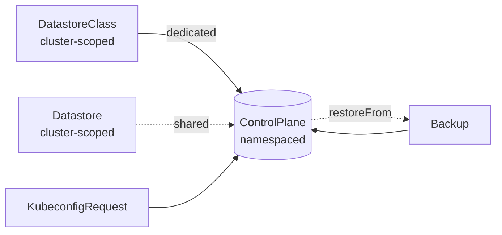
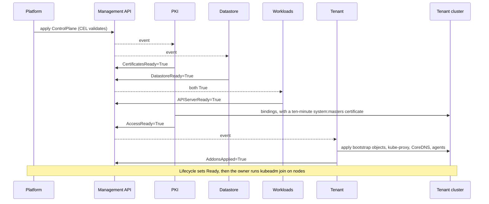
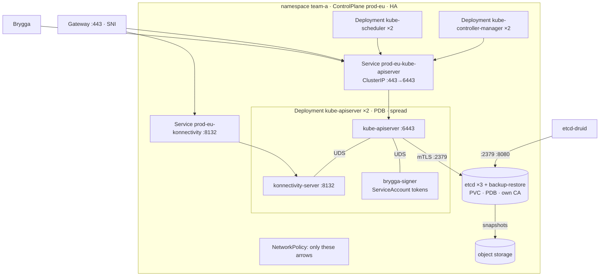
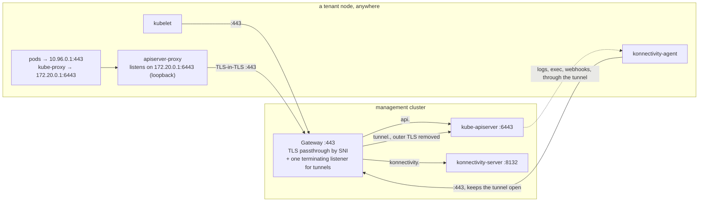
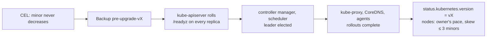
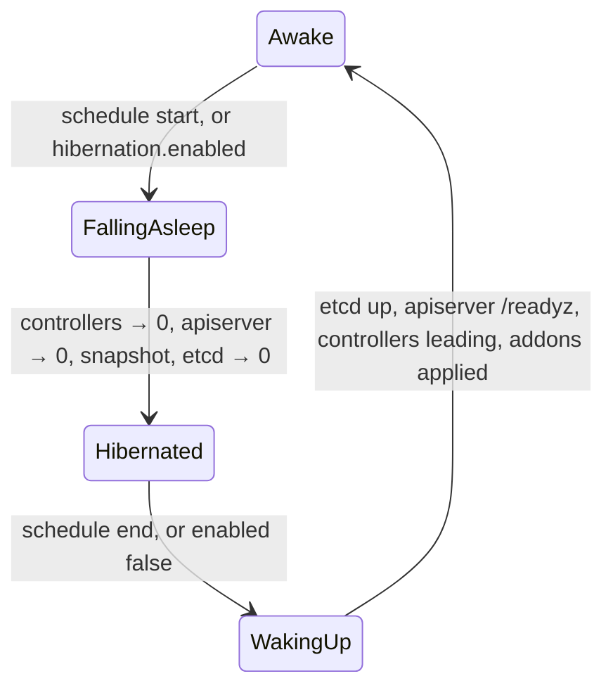
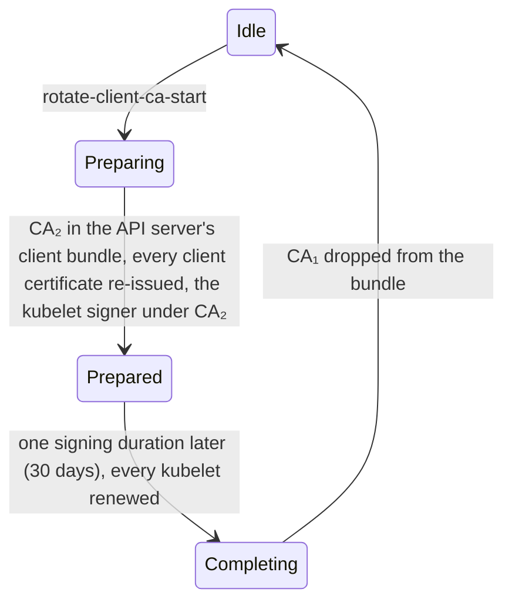

# Brygga docs

Brygga is an operator that runs Kubernetes control planes as pods on a
management cluster, one `ControlPlane` object per tenant cluster. A control
plane is a kube-apiserver with a konnectivity-server at its side, a
kube-controller-manager, a kube-scheduler, each in its own Deployment (or all
in one pod in the Compact layout), and an etcd of its own (or a prefix in a
shared one); the tenant's worker nodes stand anywhere with outbound TCP 443
and join with `kubeadm join`. Six independent controllers keep every
control plane certified, stored, running, reachable and up to date, and talk
to each other only through status conditions.

Go, controller-runtime; runs as a Deployment (`brygga-system`, two replicas,
leader election) on a management cluster with a maintained Kubernetes minor
(1.35 or newer today). Dedicated etcd
clusters are managed through etcd-druid
([decision](decisions/dedicated-etcd-by-default.md)); backups go to
S3-compatible object storage.

**Status: design, 2026-10-23.** This document describes the intended system;
[`roadmap.md`](roadmap.md) says what exists at each phase.

## What it owns

| owns | meaning |
|---|---|
| `ControlPlane` | the desired and observed state of one tenant control plane ([field reference](api/controlplane.md)) |
| `DatastoreClass`, `Datastore` | how a dedicated etcd is built; a shared etcd several tenants use by prefix |
| `KubeconfigRequest`, `Backup` | a short-lived credential for a person; an on-demand snapshot |
| the tenant namespace's control plane objects | Deployments, Services, PodDisruptionBudgets, NetworkPolicies, Gateway routes, Secrets, ConfigMaps, the etcd resource; all owned by the `ControlPlane` and labelled `brygga.segla.io/control-plane` |
| the PKI of every tenant | CAs, leaf certificates, kubeconfigs, ServiceAccount keys, encryption keys, their renewal and staged rotation |
| the bootstrap of the tenant cluster | what `kubeadm join` reads and the RBAC it needs, kube-proxy, CoreDNS, konnectivity-agent, apiserver-proxy, the admin group's binding |
| the pace | upgrades in order, maintenance windows, the fleet limit, hibernation |
| the tenant's workloads during an outage | holding the controller manager while most nodes are cut off from the control plane, so nothing evicts healthy pods |

And deliberately not: machines and their operating systems (a Cluster API
provider or a node agent on top), the CNI and every other addon the tenant
chooses, the Gateway itself (the platform installs it; Brygga attaches
routes), the object storage bucket, the monitoring stack (Brygga exposes
metrics), and bootstrap tokens (`kubeadm token create` with the admin
kubeconfig).

## The objects

One `ControlPlane` is the whole cluster from the platform's point of view:
write it, watch `Ready`, read the admin kubeconfig Secret
([decision](decisions/one-controlplane-per-cluster.md)). The field reference
with every rule is [`api/controlplane.md`](api/controlplane.md); examples are
in [`api/examples/`](api/examples/).

## The controllers

| controller | writes | condition | needs |
|---|---|---|---|
| PKI | Secrets with certificates, keys and kubeconfigs; the tenant's bindings for Brygga, the admin group and the kubelet client | `CertificatesReady`, `AccessReady` | `status.endpoint`; `APIServerReady` for the bindings |
| Datastore | the `Etcd` of a dedicated etcd — built, for one member — or a user and role in a shared store; backups and defragmentation | `DatastoreReady` | — |
| Workloads | Deployments, Services, PDBs, NetworkPolicies, ConfigMaps, routes | `APIServerReady` | `CertificatesReady`, `DatastoreReady` |
| Tenant | objects inside the tenant cluster, with an inventory | `AddonsApplied`, `AddonsAvailable` | `AccessReady` |
| Health | status, and the controller manager's leader Lease inside the tenant while most nodes are silent | `Reachable` | `AccessReady` |
| Lifecycle | `status.target`, `Progressing`, `Ready`; the pre-upgrade `Backup` | `Progressing` | the others |

Each controller has its own queue and field manager, reads `spec`,
`status.target` and the endpoint Workloads publishes, and reports through its
own condition; none calls another
([decision](decisions/independent-controllers.md)). The cache is scoped to
labelled objects, with metadata only for Secrets.

What each example of failure does: an etcd that loses quorum turns
`DatastoreReady` False with `QuorumLost`; Workloads leaves the Deployments
alone and PKI keeps renewing certificates. A changed controller-manager flag
rolls only its Deployment. A deleted CoreDNS Deployment inside the tenant
returns at the next inventory apply.

## A tenant namespace

Four pods for a single control plane, nine for HA
([decision](decisions/component-per-deployment.md)); the Compact layout puts
the control plane into one pod, two with a dedicated etcd and one with a
shared store ([compact-layout](decisions/compact-layout.md)). The Secrets and
ConfigMaps, who consumes them, and what a change does:

| object | consumer | on renewal or change |
|---|---|---|
| `<cp>-ca-bundle` (the cluster CA, two during a trust anchor rotation) | everything that verifies the API server: kubeconfigs, `cluster-info`, `kube-root-ca.crt` | kubeconfigs and `cluster-info` re-rendered; the controller manager restarts, because `--root-ca-file` is read once |
| `<cp>-client-ca-bundle` (the client CA and the current kubelet signer) | API server `--client-ca-file` | reloaded |
| `<cp>-kubelet-signer` | controller manager, per-signer signing flags | reloaded |
| `<cp>-apiserver-serving`, `<cp>-apiserver-kubelet-client` | API server | reloaded (the kubelet client certificate for new connections) |
| `<cp>-front-proxy-ca`, `<cp>-front-proxy-client` | API server, aggregated APIs | the CA is reloaded; the client certificate restarts the API server until a reload is proven |
| `<cp>-etcd-ca`, `<cp>-apiserver-etcd-client` | API server | the client certificate is read per connection; a new etcd CA restarts the API server (`--etcd-cafile` is read once) |
| `<cp>-etcd-{ca,server,client,peer,backup-restore}-<g>`, one generation `g` per renewal, labelled `brygga.segla.io/etcd-certificates: "<g>"` | etcd, its backup-restore sidecar and etcd-druid's client, through the `Etcd`, which Datastore points at the newest complete generation | renewed as the next generation, since the sidecar keeps its first certificate and etcd-druid rolls the members only for a new name: no API outage with three members, about 20 s with one ([etcd spike](etcd-spike-2026-10.md)); PKI keeps the previous generation and deletes older ones |
| `<cp>-sa-keys` (`signing.key` and the `verify-*.pub` keys published beside it) | `brygga-signer` sidecar | reloaded by the sidecar; the API server fetches the keys again within the signer's refresh hint and does not restart |
| `<cp>-encryption-config` | API server | reloaded every minute (automatic reload) |
| `<cp>-konnectivity-server`, `<cp>-konnectivity-kubeconfig` | konnectivity-server | the API server pod rolls, in the maintenance window |
| `<cp>-controller-manager-kubeconfig`, `<cp>-scheduler-kubeconfig` | each its own; certificates referenced as files | reloaded by client-go |
| `<cp>-admin-kubeconfig` | the platform; `brygga:cluster-admins` | nothing restarts |
| `<cp>-brygga-kubeconfig` (`brygga:operator`, dialling the in-namespace Service) | Brygga's PKI, Tenant and Health inside the tenant | nothing restarts |
| ConfigMap `authentication-config` | API server | reloaded, except its anonymous section |
| ConfigMaps `egress-selector`, `audit-policy`, `admission-config` / `scheduler-config` | API server / scheduler | that component restarts |

Sources: the reload behaviour of each flag is in the
[kube-apiserver](https://kubernetes.io/docs/reference/command-line-tools-reference/kube-apiserver/)
and
[kube-controller-manager](https://kubernetes.io/docs/reference/command-line-tools-reference/kube-controller-manager/)
references and their dynamic certificate controllers in
[apiserver](https://github.com/kubernetes/kubernetes/tree/release-1.35/staging/src/k8s.io/apiserver/pkg/server/dynamiccertificates).
Hashes of the restart-only objects sit in the pod template of the component
that mounts them; nothing else does, so a routine renewal of a reloaded
certificate rolls nothing
([staged-credential-rotation](decisions/staged-credential-rotation.md)).

The dedicated etcd is etcd-druid's `Etcd` `<cp>-etcd`, which the Datastore
controller renders from the `DatastoreClass` and the newest complete
generation of the etcd certificates, under the `ControlPlane`'s finalizer
`brygga.segla.io/controlplane`, which it holds from before the first `Etcd`
exists. etcd-druid turns it into the StatefulSet `<cp>-etcd`, the client
Service `<cp>-etcd-client` (`https://<cp>-etcd-client.<ns>.svc:2379`, the
address Workloads gives the API server's `--etcd-servers`), the peer Service
`<cp>-etcd-peer`, a ConfigMap, member leases and a PodDisruptionBudget, all
owned by the `Etcd`
([helper.go](https://github.com/gardener/etcd-druid/blob/v0.39.0/api/core/v1alpha1/helper.go)).
With a backup store, the class's credentials Secret is copied into the
namespace as `<cp>-etcd-backup`, since etcd-druid mounts it from the `Etcd`'s
namespace. The class is resolved once, when the `Etcd` is created, and
recorded on it in `brygga.segla.io/datastore-class`, with the class
generation it was rendered from in `brygga.segla.io/datastore-class-generation`;
from then on the `Etcd` follows that class, its reclaim policy included, as a
default StorageClass is written into a claim when the claim is created. The
claims the StatefulSet creates are labelled with the `ControlPlane`'s UID
(`brygga.segla.io/control-plane-uid`) and annotated with the class, since
they outlive the `Etcd`. What each field of the class becomes
([etcd.go](https://github.com/gardener/etcd-druid/blob/v0.39.0/api/core/v1alpha1/etcd.go),
[store.go](https://github.com/gardener/etcd-druid/blob/v0.39.0/api/core/v1alpha1/store.go));
everything the class does not set is etcd-druid's default:

| `DatastoreClass` | `Etcd` | note |
|---|---|---|
| `etcd.quotaBackendBytes` | `spec.etcd.quota` | |
| `etcd.autoCompaction.mode`, `.retention` | `spec.sharedConfig.autoCompactionMode`, `.autoCompactionRetention` | shared with the sidecar's embedded etcd |
| `etcd.defragmentation.schedule` | `spec.etcd.defragmentationSchedule` | the sidecar defragments only above 3 GiB or with more than 1 GiB free ([etcd spike](etcd-spike-2026-10.md), finding 7) |
| `etcd.resources` | `spec.etcd.resources` | the sidecar's `spec.backup.resources` stay etcd-druid's default: the class has no field for them |
| `storage.className` | `spec.storageClass` | when the `Etcd` is created and not after: the field is immutable in the `Etcd` |
| `storage.size` | `spec.storageCapacity` | when the `Etcd` is created and not after: a StatefulSet field that cannot change in place |
| `storage.reclaimPolicy` | — | on deletion, `Delete` removes the claims etcd-druid's StatefulSet created and `Retain` leaves them ([deletion](#deletion)) |
| `backup.store.provider`, `.bucket`, `.endpoint` | `spec.backup.store.provider`, `.container`, `.endpointOverride` | Brygga's four providers are among etcd-druid's; most S3-compatible stores also want `s3ForcePathStyle: "true"` in the credentials Secret |
| `backup.store.prefix` | `spec.backup.store.prefix` | `<class prefix>/<namespace>/<cp>/<uid>`: etcd-backup-restore restores an empty member from the newest snapshot under its prefix, so a `ControlPlane` recreated under the same name never restores the old one's |
| `backup.store.region` | the key `region` of `<cp>-etcd-backup` | where the sidecar reads it |
| `backup.store.secretRef` | `spec.backup.store.secretRef` | `<cp>-etcd-backup`, the copy, with the class Secret's data |
| `backup.fullSnapshotSchedule`, `.deltaSnapshotPeriod` | `spec.backup.fullSnapshotSchedule`, `.deltaSnapshotPeriod` | the delta period bounds what a restore loses ([etcd spike](etcd-spike-2026-10.md), finding 5) |
| `backup.retention.days` | `spec.backup.garbageCollectionPolicy: LimitBased`, `.maxBackupsLimitBasedGC` | counts full snapshots, one a day |
| `backup.retention.afterDelete` | — | phase 2, with the final snapshot |
| `placement.nodeSelector`, `.tolerations`, `.priorityClassName` | `spec.schedulingConstraints.affinity` (as required node affinity), `.tolerations`, `spec.priorityClassName` | the `Etcd` has no node selector |
| the `ControlPlane`'s availability | `spec.replicas` | 1 today; 3 with `highAvailability` and 0 while hibernating come with later phases |
| the etcd certificates, generation `g` | `spec.etcd.clientUrlTls`, `spec.etcd.peerUrlTls`, `spec.backup.tls` | all three name one complete generation, with `dataKey: ca.crt` on the CA; a newer complete generation is one update of the `Etcd`, so one roll of the members |

`DatastoreReady` is `Provisioning` until a complete certificate generation
exists and etcd-druid reports the `Etcd` for its current generation, checked
in the order Gardener waits for an `Etcd`
([waiter.go](https://github.com/gardener/gardener/blob/v1.154.0/pkg/component/etcd/etcd/waiter.go#L21-L97)):
not being deleted, no `lastErrors` (they go into the message),
`observedGeneration` current, `AllMembersUpdated` True, `ready`; then the
StatefulSet itself, read from the API server, must mount the certificate
generation with every replica updated and ready, since etcd-druid computes
`ready` from its cached StatefulSet before it stamps the observed generation
and would otherwise report a generation switch ready before the member
rolled. `DatastoreClassNotFound` when the class is
missing or more than one class is the default; `VolumesExist` when claims of
`<cp>-etcd` without this `ControlPlane`'s UID label stand where its first
`Etcd` would be created, since a StatefulSet re-attaches a claim of that
name and starting from another tenant's data is a restore, not a start —
nothing is created until they are deleted; `Deleting` while the
`ControlPlane` is being deleted; True once every check above holds. `status.datastore` is `kind: Dedicated`, the `Etcd`'s
name and its member count.

Identities: no root CA key is mounted into a control plane pod; the
controller manager holds only the kubelet signer, an intermediate that signs
kubelet client certificates for 30 days. No long-lived certificate carries
`system:masters`. The API server's kubelet client is
`kube-apiserver-kubelet-client` in the group
`brygga:kubelet-api-admins`, bound to the built-in `system:kubelet-api-admin`
role, the less privileged option the
[certificate best practices](https://kubernetes.io/docs/setup/best-practices/certificates/)
recommend; konnectivity-server runs as `system:konnectivity-server`, allowed
to create TokenReviews and nothing else; the controller manager and scheduler
use their standard identities; Brygga reaches the tenant as `brygga:operator`,
bound to `cluster-admin` because it manages RBAC; people and platforms use the
admin group or a `KubeconfigRequest`
([decision](decisions/short-lived-kubeconfigs.md)). The bindings themselves
are created once with a `system:masters` certificate that PKI issues for ten
minutes and never stores, the way kubeadm uses `super-admin.conf` only to bind
`kubeadm:cluster-admins`.

NetworkPolicies default-deny the namespace and allow exactly the arrows
above: Gateway → API server and konnectivity-server, controller manager and
scheduler and Brygga → the API Service, API server → etcd, etcd ↔ etcd,
etcd-druid → etcd and its backup-restore sidecar, etcd and its compaction
Jobs → object storage, metrics scrapers → the health ports, and every pod →
the cluster DNS.

## Networking

Three ways to expose a control plane
([decision](decisions/api-exposure.md)):

| `spec.endpoint` | what Brygga creates | endpoint | in-cluster access |
|---|---|---|---|
| `gateway` | two TLS passthrough routes (API, konnectivity) on the platform's Gateway, and a `ListenerSet` with a terminating listener and route for the tunnel | `https://api.<cp>:443` | the API server advertises `172.20.0.1`, so the `kubernetes` Service's endpoint is `172.20.0.1:6443`; the apiserver-proxy DaemonSet owns that address on every node's loopback and wraps each connection in an outer TLS session with the tunnel's SNI, which the Gateway terminates and forwards to the API server untouched |
| `loadBalancer` | one Service of type LoadBalancer with ports 443 and 8132 | the LB address | the API server advertises the LB address; `kubernetes` Endpoints point at it; no proxy |
| `nodePort` | one Service of type NodePort | a management node address and port | as loadBalancer |

The default is `gateway`: one address and one certificate story for a whole
fleet, and nothing per tenant on the load balancer. A node needs outbound
443 and nothing inbound: the API server reaches kubelets, and the webhooks
and aggregated APIs that run in the tenant, through the konnectivity tunnel
the agent opens from inside. On the node, the kubelet binds its node IP,
and the agents' health and admin endpoints bind loopback.

Inside the tenant, the `kubernetes` Service keeps its ClusterIP (the first
address of the service CIDR), CoreDNS gets the tenth, and the controller
manager allocates pod CIDRs per node from `network.podCIDRs`.

## Inside the tenant

What the Tenant controller applies to every tenant cluster, with an
inventory and prune ([decision](decisions/tenant-resources-by-inventory.md)).
The kubeadm objects use kubeadm's own names, so `kubeadm join` and
`kubeadm token create` work unchanged
([nodes-join-with-kubeadm](decisions/nodes-join-with-kubeadm.md)):

| objects | purpose |
|---|---|
| ConfigMap `kube-public/cluster-info` (a kubeconfig with the endpoint and the cluster CA, no users); Role and RoleBinding `kubeadm:bootstrap-signer-clusterinfo` for `system:anonymous` | discovery: `kubeadm join` reads it without credentials; the controller manager's bootstrap signer adds a `jws-kubeconfig-<token id>` signature for every bootstrap token |
| ClusterRoleBindings `kubeadm:kubelet-bootstrap` (→ `system:node-bootstrapper`) and `kubeadm:node-autoapprove-bootstrap` (→ `…:nodeclient`) for the group `system:bootstrappers:kubeadm:default-node-token`; `kubeadm:node-autoapprove-certificate-rotation` (→ `…:selfnodeclient`) for `system:nodes`; ClusterRole and binding `kubeadm:get-nodes` | TLS bootstrap of a kubelet with a bootstrap token, and its later certificate rotation |
| ConfigMap `kube-system/kubeadm-config` (`ClusterConfiguration` v1beta4: version, service subnet, DNS domain, endpoint); Role and RoleBinding `kubeadm:nodes-kubeadm-config` | what a joining node reads about the cluster |
| ConfigMap `kube-system/kubelet-config` (`KubeletConfiguration`: cluster DNS at the tenth service address, cluster domain, systemd cgroups, certificate rotation, webhook authentication and authorization, the client CA at the node's `/etc/kubernetes/pki/ca.crt`, anonymous off, read-only port off, health on loopback); Role and RoleBinding `kubeadm:kubelet-config` | the kubelet configuration every node starts with |
| kube-proxy: ServiceAccount, ConfigMap `kube-proxy` (kubeconfig to the public endpoint, mode, metrics and health on loopback), DaemonSet, ClusterRoleBinding `kubeadm:node-proxier`, Role and RoleBinding `kube-proxy` | Services on nodes; off with `addons.kubeProxy.enabled: false` |
| CoreDNS: ServiceAccount, ClusterRole and binding, ConfigMap, Deployment, Service `kube-dns` at the tenth service address | cluster DNS, the version kubeadm pins for the minor |
| konnectivity-agent: ServiceAccount, DaemonSet, Role to list and watch server leases in `kube-system` | the tunnel to every API server replica |
| `apiserver-proxy` DaemonSet | in-cluster API access in `gateway` mode ([api-exposure](decisions/api-exposure.md)) |
| ClusterRoleBinding for `system:konnectivity-server` (→ `system:auth-delegator`) with its lease Role; the bindings of `brygga:operator` and `brygga:cluster-admins` (→ `cluster-admin`) and `brygga:kubelet-api-admins` (→ `system:kubelet-api-admin`) are PKI's, since nothing can apply them before they exist (`AccessReady`) | the identities above |
| `ValidatingAdmissionPolicy` and binding `brygga-write-lock`, only while a lock is requested | refusing writes during a migration, without a webhook |
| ConfigMap `kube-system/brygga-inventory` | what to prune next time |

The control plane side of the same contract: the API server runs with
`--enable-bootstrap-token-auth` and a structured authentication
configuration that allows anonymous requests only to `cluster-info` and the
health paths
([authentication](https://kubernetes.io/docs/reference/access-authn-authz/authentication/));
the controller manager runs with
`--controllers=*,bootstrap-signer-controller,token-cleaner-controller` (both
are off by default), `--use-service-account-credentials`, and no cloud
provider
([kube-controller-manager](https://kubernetes.io/docs/reference/command-line-tools-reference/kube-controller-manager/),
[bootstrap tokens](https://kubernetes.io/docs/reference/access-authn-authz/bootstrap-tokens/)).
The pinned component versions per minor are those kubeadm pins: CoreDNS
v1.13.1 and etcd 3.6.6 for 1.35, CoreDNS v1.14.2 for 1.36, CoreDNS v1.14.6 for
1.37, and konnectivity 0.NN for Kubernetes 1.NN
([kubeadm constants](https://github.com/kubernetes/kubernetes/blob/release-1.37/cmd/kubeadm/app/constants/constants.go)).

## Lifecycle

### Upgrades and windows

One minor at a time, in the order the version skew policy allows: backup →
API server → controller manager and scheduler → in-tenant components →
nodes by their owner. User changes roll now; changes Brygga initiates
(patch updates, a new Brygga release, a restart-only renewal) wait for the
tenant's maintenance window and the fleet limit
([decision](decisions/upgrades-and-maintenance-windows.md)).

### Hibernation

Volumes stay; snapshots continue to exist; rotations and patch updates wait
until the control plane is awake and say so in `status.target.reason`.
Nodes are not Brygga's to stop; their owner scales them down or lets them
sit (kubelets retry the API without harm).

### Credential rotation

Each tenant has a CA per purpose: the cluster CA that every client and node
trusts, a client CA that only the API server trusts, a front-proxy CA and an
etcd CA. Credentials rotate in stages, the old and the new valid together
between stages, as Gardener does
([shoot credentials rotation](https://github.com/gardener/gardener/blob/master/docs/usage/shoot-operations/shoot_credentials_rotation.md)),
and the routine rotations never touch a node: the client CA, the
ServiceAccount key (signed by the `brygga-signer` sidecar, so the API server
does not restart), the etcd encryption key, the etcd and front-proxy CAs.
Only the trust anchor, the cluster CA, waits for node owners. The
ServiceAccount key rotates through three states of `<cp>-sa-keys`: K₂
published beside K₁, then K₂ signing with K₁ still published, then K₁ dropped
once the owner confirms that no client holds a K₁ token. Started and
completed through the `brygga.segla.io/operation` annotation; the phases are
in `status.credentials.rotation`
([decision](decisions/staged-credential-rotation.md)).

Leaf certificates renew on their own at two thirds of their lifetime and
need no stages and no rollout: the API server reloads its serving and kubelet
client certificates and client CA bundles from disk, and components read
their certificates from files their kubeconfigs reference.

### Backup, restore, migration

A `DatastoreClass` with a backup store gives every dedicated etcd continuous
snapshots: a full snapshot daily, at a time inside the tenant's window, and
a delta every few minutes, with retention in the class (the schedule Gardener
runs, [backup and restore](https://github.com/gardener/gardener/blob/master/docs/concepts/backup-restore.md)).
A `Backup` object asks for a full snapshot now and records where it went. A
new `ControlPlane` with `restoreFrom` starts its etcd from that snapshot: a
clone, or the recovery of a cluster whose store was lost. Restoring in place
over a running cluster is a documented runbook, not an API, because clients
with caches see resource versions go backwards.

Migration between stores (shared → dedicated, or between classes): Tenant
applies a `ValidatingAdmissionPolicy` that refuses writes, Datastore takes a
final snapshot and restores it into the target, Workloads rolls the API
server onto the new endpoints, Tenant lifts the lock. Reads work throughout;
writes stop for the copy.

### Deletion

The Datastore controller holds the `ControlPlane`'s finalizer
`brygga.segla.io/controlplane`. On deletion it deletes the `Etcd` and waits
for etcd-druid to let it go, then reclaims the volumes, which etcd-druid
keeps: of the PersistentVolumeClaims the StatefulSet created
(`<cp>-etcd-<cp>-etcd-<n>`, found by the labels the StatefulSet controller
copies from etcd-druid's selector) those labelled with the `ControlPlane`'s
UID are deleted when the class each records says `Delete`, and left when it
says `Retain` or no longer exists; a claim of another `ControlPlane` is never
touched. Then the finalizer goes and the owner references garbage-collect
the rest of the namespace objects. The final snapshot when a backup store
exists, and the snapshots' retention after deletion, come with backups in
phase 2.

## Health

Health probes `/readyz` through the public endpoint, the way a kubelet
reaches it, and through the in-namespace Service, and every 5 seconds reads
the tenant's nodes and their leases through that Service. When 60% or more of
the counted nodes have been silent for 20 seconds while the API server
answers, the nodes are cut off from the control plane, not dead: Health takes
the controller manager's leader Lease inside the tenant and keeps renewing
it, the controller manager steps down and waits, and nothing marks the nodes
or evicts their pods. Two minutes after the nodes are back, Health lets the
lease go. It works the same in both layouts, rolls nothing, and never takes a
lease another component holds
([controller-manager-hold](decisions/controller-manager-hold.md)). This is
what Gardener's dependency-watchdog does for its clusters, built into the
operator.

## Identity and tenancy

- A `ControlPlane` is namespaced; the platform's RBAC on the namespace
  decides who creates clusters and who reads their Secrets. Brygga's own
  ClusterRole is limited to its kinds, the workload kinds it renders, Secrets
  and ConfigMaps by label, Gateway API routes and listener sets, etcd-druid's
  `Etcd`, and the PersistentVolumeClaims of a deleted tenant's etcd.
- Every field Brygga writes has a field manager `brygga/<controller>`;
  another manager's fields on the same object are left alone.
- Inside a tenant, Brygga is `brygga:operator`; its objects carry
  `app.kubernetes.io/managed-by: brygga` and are listed in the inventory.
- No cross-tenant object: every Secret, Service and route is in the tenant's
  namespace, and NetworkPolicies keep its pods to their own arrows. A
  shared `Datastore` is the one deliberate exception, labelled as such.

## Installation

Prerequisites on the management cluster:

| need | for |
|---|---|
| Kubernetes ≥ 1.35 | a maintained minor that has the CEL libraries (semver, 1.34) and validation ratcheting (GA 1.33) the schema uses |
| a StorageClass | etcd volumes; local or network, with low fsync latency |
| etcd-druid | dedicated etcd (installed by the chart as a dependency, or separately) |
| Gateway API ≥ 1.5 (where `TLSRoute` and `ListenerSet` became GA) and an implementation reporting `TLSRoute`, `TLSRouteModeTerminate` and `TLSRouteModeMixed` | `endpoint.gateway` only; the terminate modes only for in-cluster access through the tunnel |
| an S3-compatible bucket and credentials | backups, strongly recommended |
| a metrics stack | optional: the chart ships ServiceMonitors, a dashboard and alert rules |

Install: `helm install brygga oci://ghcr.io/segla-io/charts/brygga -n
brygga-system --create-namespace`. The chart installs etcd-druid as a
dependency (or skips it when `etcdDruid.enabled=false` because it is already
there), the CRDs (upgraded with the chart, kept on uninstall), the operator
with two replicas, leader election, a PodDisruptionBudget with
`maxUnavailable: 1` and `unhealthyPodEvictionPolicy: AlwaysAllow`, topology
spread, a `system-cluster-critical` priority, the metrics endpoint behind
controller-runtime's authentication and authorization filter, and the
operator configuration. Then a `DatastoreClass` with the bucket, and the
first `ControlPlane`. Images are signed and attested; how to verify them and
which versions are supported is in
[releases-and-support](decisions/releases-and-support.md).

Operator configuration (a file, mounted from a ConfigMap; the chart renders
it from values):

| key | meaning | default |
|---|---|---|
| `versions` | the Kubernetes versions Brygga runs and, per minor, the images of kube-apiserver, controller manager, scheduler, kube-proxy, CoreDNS, konnectivity, etcd; each with an end-of-support date | the table shipped with the release |
| `registry` | a mirror prefix for every image, for air-gapped sites | `registry.k8s.io` |
| `controllers.<name>.workers` | concurrent reconciles per controller | 10 |
| `fleet.maxConcurrentRollouts` | tenants rolling Brygga-initiated changes at once | 5 |
| `tenant.applyInterval` | the inventory re-apply period | 10m |
| `health.silentAfter`, `health.holdFraction`, `health.releaseAfter` | when a node counts as silent, the share of silent nodes that starts the hold, how long the nodes must be back before it ends | 20s, 0.6, 2m |
| `pki.leafLifetime`, `pki.caLifetime`, `pki.trustAnchorLifetime` | leaf certificates and the kubelet signer; every CA but the cluster CA; the cluster CA ([staged-credential-rotation](decisions/staged-credential-rotation.md)) | 1 year, 5 years, 10 years |
| `kubeconfigRequests.maxExpiration` | | 24h |
| `defaults.resources.<component>` | requests and limits per component | measured in phase 1 |

Upgrading Brygga: `helm upgrade`; CRDs upgrade with the chart; tenants'
pod templates re-render in their windows, the release notes say what changes
([decision](decisions/upgrades-and-maintenance-windows.md)).

## Operations

[`operations.md`](operations.md): what breaks and how it shows, the
runbooks (restore, lost quorum, forced rotation, stuck upgrade, nodes cut
off), capacity planning, the alert rules and what each means.

## Conventions

- Decisions in [`decisions/`](decisions/) in the handbook format; a
  behaviour change updates this file and the decision in the same commit.
- Names: `<cp>-<component>` for workloads and Services, `<cp>-<purpose>` for
  Secrets, `brygga.segla.io/*` for labels, annotations and the finalizer.
- Every reconcile is idempotent and uses server-side apply; no controller
  reads an object it did not render except through status.
- Every claim about Kubernetes or a neighbour carries a source.

## Deliberately not offered — and owed

- No machines, no node agent, no VPN, no SQL or NATS store (see the
  [roadmap](roadmap.md)).
- No in-place restore API; a runbook.
- No multi-cluster operator: one Brygga per management cluster; sharding
  across replicas is phase 4.
- Owed before phase 2: the reclaim and retention defaults; measured
  resource defaults; whether konnectivity agents can share the passthrough
  listener on 443 ([`todo.md`](../todo.md), [roadmap](roadmap.md)).

## Decisions

- [project-home](decisions/project-home.md) — Brygga, Apache-2.0, `github.com/segla-io/brygga`, API group `brygga.segla.io`.
- [one-controlplane-per-cluster](decisions/one-controlplane-per-cluster.md) — five kinds; `ControlPlane` is the whole cluster; operations through an annotation.
- [independent-controllers](decisions/independent-controllers.md) — six controllers, one object, conditions as the only coupling.
- [component-per-deployment](decisions/component-per-deployment.md) — a Deployment per component, konnectivity as the API server's sidecar, 4 or 9 pods.
- [compact-layout](decisions/compact-layout.md) — every component in one pod for development and free tiers; one pod per tenant with a shared store.
- [dedicated-etcd-by-default](decisions/dedicated-etcd-by-default.md) — an etcd per tenant through etcd-druid; a shared store as an option.
- [no-admission-webhooks](decisions/no-admission-webhooks.md) — CEL in the schema; conditions for what a schema cannot check.
- [nodes-join-with-kubeadm](decisions/nodes-join-with-kubeadm.md) — `kubeadm join`; Brygga writes the bootstrap objects; no `k8s.io/kubernetes` import.
- [tenant-resources-by-inventory](decisions/tenant-resources-by-inventory.md) — apply with inventory and prune; no informers in tenants.
- [api-exposure](decisions/api-exposure.md) — Gateway by SNI as the default; in-cluster access through apiserver-proxy.
- [staged-credential-rotation](decisions/staged-credential-rotation.md) — a CA per purpose and a signer sidecar, so routine rotations never touch a node.
- [upgrades-and-maintenance-windows](decisions/upgrades-and-maintenance-windows.md) — the upgrade order; Brygga-initiated changes roll in windows, N tenants at a time.
- [controller-manager-hold](decisions/controller-manager-hold.md) — while most nodes are silent, Health holds the controller manager's leader lease, so an outage evicts nothing.
- [short-lived-kubeconfigs](decisions/short-lived-kubeconfigs.md) — `KubeconfigRequest`; the admin group is revocable.
- [e2e-on-a-named-cluster](decisions/e2e-on-a-named-cluster.md) — e2e refuses the current context; conformance nightly.
- [releases-and-support](decisions/releases-and-support.md) — ko, cosign, attestations, the chart in GHCR; the three maintained Kubernetes minors.
