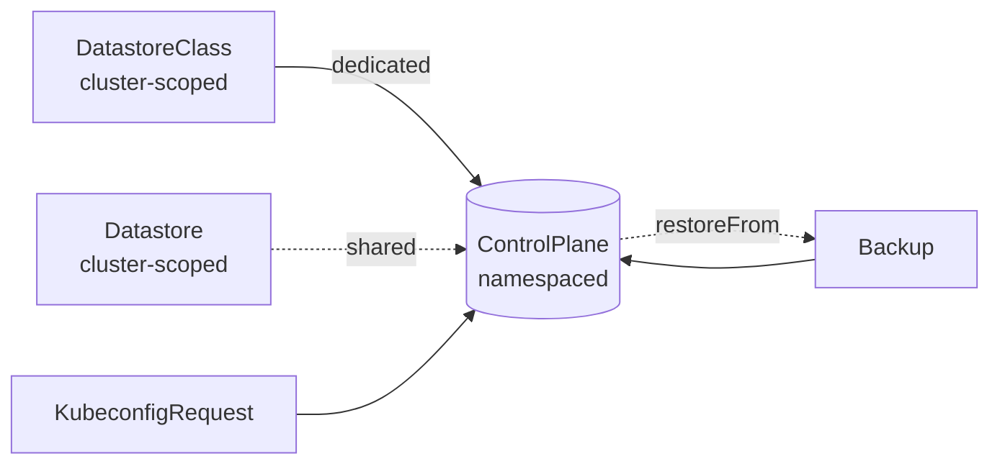
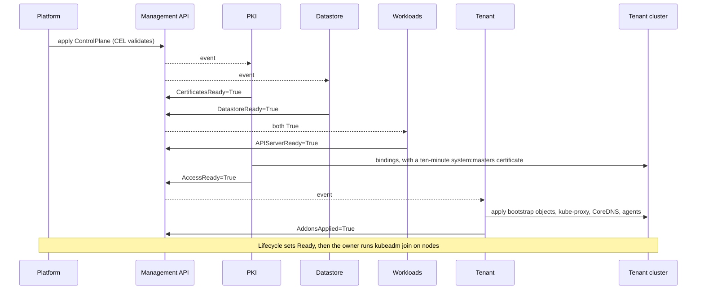
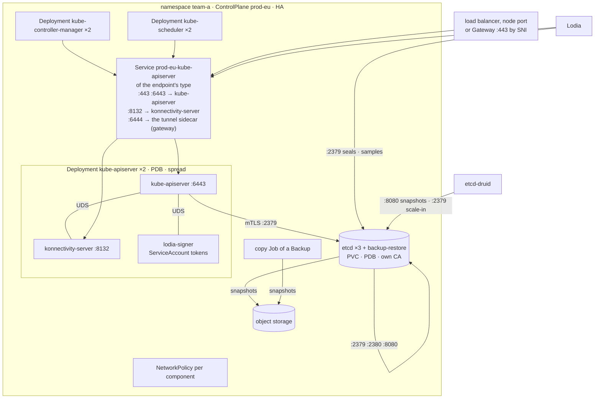
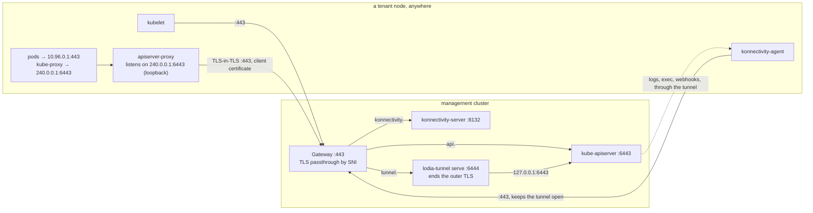
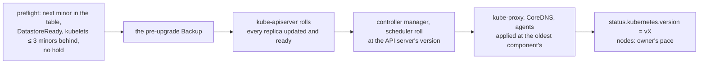
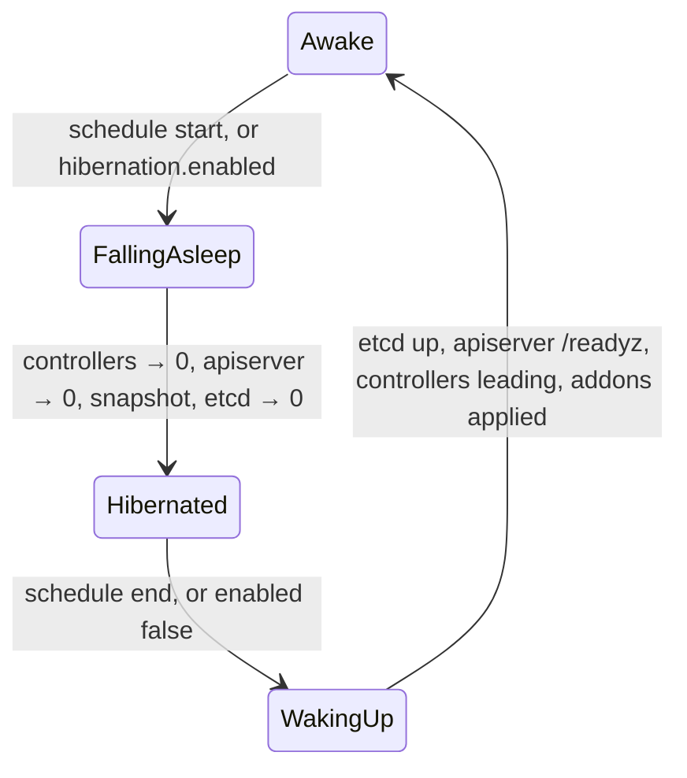
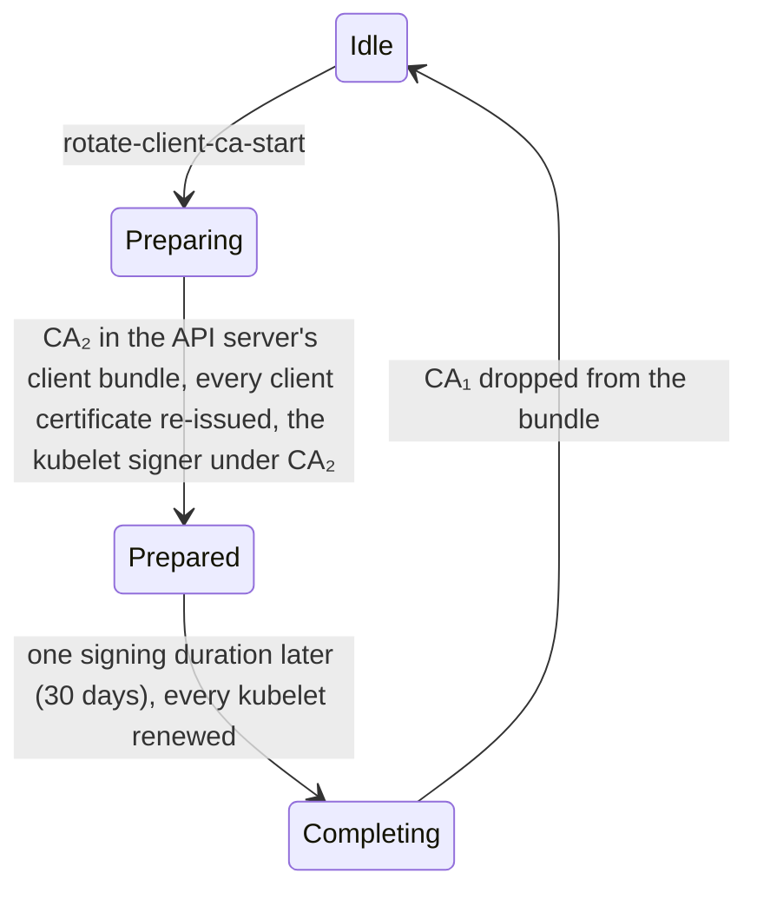

# Lodia docs

Lodia is an operator that runs Kubernetes control planes as pods on a management cluster, one `ControlPlane` object per tenant cluster.
A control plane is a kube-apiserver with a konnectivity-server at its side, a kube-controller-manager, a kube-scheduler, each in its own Deployment (or all in one pod in the Compact layout), and an etcd of its own (or a prefix in a shared one); the tenant's worker nodes stand anywhere with outbound TCP 443 and join with `kubeadm join`.
Six independent controllers keep every control plane certified, stored, running, reachable and up to date, and talk to each other only through status conditions.

Go, controller-runtime; runs as a Deployment (`lodia-system`, two replicas, leader election) on a management cluster with a maintained Kubernetes minor (1.35 or newer today).
Dedicated etcd clusters are managed through etcd-druid ([decision](decisions/dedicated-etcd-by-default.md)); backups go to S3-compatible object storage.

A wave or a phase named beside a feature is where it is built, and until then it is not; [`roadmap.md`](roadmap.md) says what exists at each phase.

## What it owns

| owns | meaning |
|---|---|
| `ControlPlane` | the desired and observed state of one tenant control plane ([field reference](api/controlplane.md)) |
| `DatastoreClass`, `Datastore` | how a dedicated etcd is built; a shared etcd several tenants use by prefix |
| `KubeconfigRequest`, `Backup` | a short-lived credential for a person; a sealed copy of a tenant's etcd, from which a new `ControlPlane` replaces it |
| the tenant namespace's control plane objects | Deployments, Services, PodDisruptionBudgets, NetworkPolicies, Gateway routes, Secrets, ConfigMaps, the etcd resource; all owned by the `ControlPlane` and labelled `lodia.io/control-plane` |
| the PKI of every tenant | CAs, leaf certificates, kubeconfigs, ServiceAccount keys, encryption keys, their renewal and staged rotation |
| the bootstrap of the tenant cluster | what `kubeadm join` reads and the RBAC it needs, kube-proxy, CoreDNS, konnectivity-agent, apiserver-proxy, the admin group's binding |
| the pace | upgrades in order, maintenance windows, the fleet limit, hibernation |
| the tenant's workloads during an outage | holding the controller manager while most nodes are cut off from the control plane, so nothing evicts healthy pods |

And deliberately not: machines and their operating systems (a Cluster API provider or a node agent on top), the CNI and every other addon the tenant chooses, the Gateway itself (the platform installs it; Lodia attaches routes), the object storage bucket, the monitoring stack (Lodia exposes metrics), and bootstrap tokens (`kubeadm token create` with the admin kubeconfig).

## The objects



One `ControlPlane` is the whole cluster from the platform's point of view: write it, watch `Ready`, read the admin kubeconfig Secret ([decision](decisions/one-controlplane-per-cluster.md)).
The field reference with every rule is [`api/controlplane.md`](api/controlplane.md); examples are in [`api/examples/`](api/examples/).

## The controllers

| controller | writes | condition | needs |
|---|---|---|---|
| PKI | Secrets with certificates, keys and kubeconfigs; the tenant's bindings for Lodia, the admin group and the kubelet client; the answers to `KubeconfigRequest`s, which it deletes at their deadline | `CertificatesReady`, `AccessReady`; `CAValidityAcceptable` outside `Ready`; a `KubeconfigRequest`'s `Ready` | `status.endpoint`; `APIServerReady` for the bindings; the admission policy `kubeconfigrequests.lodia.io` for requests; for a restore without an encryption configuration, its `Backup` |
| Datastore | the `Etcd` of a dedicated etcd and its NetworkPolicy, or a user and role in a shared store; backups and defragmentation; a `Backup`'s seal, its copy and its encryption keys | `DatastoreReady`; `BackupReady` outside `Ready`; a `Backup`'s `Ready` | a complete generation of PKI's etcd certificates; for a `Backup`, its source's `DatastoreReady` |
| Workloads | Deployments, Services, PDBs, NetworkPolicies, ConfigMaps, routes | `APIServerReady`; `RoutesReady` in `gateway` mode | `status.target`, `status.datastore`, `CertificatesReady`, `DatastoreReady`; `status.restore` and `AddonsApplied` before it starts a restored `ControlPlane`'s controller manager |
| Tenant | objects inside the tenant cluster, with an inventory | `AddonsApplied`, `AddonsAvailable` | `AccessReady` |
| Health | status, and the controller manager's leader Lease inside the tenant while most nodes are silent | `Reachable`, `ControllersLeading`; `ControllerManagerHeld` outside `Ready`; `status.nodes` | `status.endpoint`, the CA bundle and, in `gateway` mode, `<cp>-tunnel-client`; `AccessReady` and `<cp>-lodia-kubeconfig` for `ControllersLeading`'s leader Leases, the node Leases and a held restore's lists; the kubeconfig alone to read the controller manager's Lease and to renew or release a hold of it |
| Lifecycle | `status.target`, `status.kubernetes`, `status.maintenance`, `Progressing`, `Ready`, the pre-upgrade `Backup` | `Progressing` | the others |

How they meet is [independent-controllers](decisions/independent-controllers.md).
PKI, the Datastore controller, a first Lifecycle, the Tenant controller, Health and Workloads are built (`internal/controller/pki`, `datastore`, `lifecycle`, `tenant`, `health` and `workloads`).



An etcd that loses quorum turns `DatastoreReady` False with `QuorumLost`; Workloads leaves the Deployments alone and PKI keeps renewing certificates.

## A tenant namespace



The pods of each layout are in [component-per-deployment](decisions/component-per-deployment.md) and [compact-layout](decisions/compact-layout.md).
The objects of a tenant namespace, who writes and who reads each, and what a change does; the names one controller writes and another reads are in `api/v1alpha1/names.go` ([decision](decisions/independent-controllers.md)), while the CA keys, the staged kubelet signer and the ConfigMaps are their writer's alone:

| object | writer | readers | on renewal or change |
|---|---|---|---|
| `<cp>-cakey-cluster`, `-cakey-client`, `-cakey-front-proxy`, `-cakey-etcd` (`kubernetes.io/tls`: each CA's certificate and key) | PKI | PKI alone; never mounted | a CA is renewed only by a rotation; a lost, unreadable or expired one is not replaced, since a new CA would cut every client or node off at once ([reasons](api/controlplane.md#conditions-and-their-reasons)) |
| `<cp>-ca-bundle` (`ca.crt`: the cluster CA, two during a trust anchor rotation) | PKI | everything that verifies the API server: PKI, for the kubeconfigs; Workloads, for the controller manager's `--root-ca-file`, which publishes `kube-root-ca.crt`; Tenant, for `cluster-info`; Health, for its probe of the public endpoint; the Datastore controller, which starts no first etcd under a CA older than the `ControlPlane` (`CAPredatesControlPlane`) | kubeconfigs and `cluster-info` re-rendered; the controller manager restarts, because `--root-ca-file` is read once |
| `<cp>-client-ca` (`ca.crt`: the client CA and the kubelet signers and request CAs that [staged-credential-rotation](decisions/staged-credential-rotation.md) keeps) | PKI | Workloads, for the API server's `--client-ca-file`; PKI's kubeconfig request reconciler, which signs only with a request CA it holds | reloaded |
| `<cp>-kubelet-signer` (`kubernetes.io/tls`: the intermediate under the client CA, `CA:TRUE`, path length 0) | PKI | Workloads, for the controller manager's per-signer signing flags | reloaded; a new signer is staged in `<cp>-kubelet-signer-next` until `<cp>-client-ca` has trusted it long enough ([staged-credential-rotation](decisions/staged-credential-rotation.md)) |
| `<cp>-kubelet-signer-next` (`kubernetes.io/tls`: the next kubelet signer) | PKI | PKI alone; never mounted | exists only during a replacement of the signer |
| `<cp>-cakey-kubeconfig-requests` (`kubernetes.io/tls`: the request CA, a root of its own) | PKI | PKI alone, for `KubeconfigRequest` certificates; never mounted | renewed at two thirds like a leaf, and replaced at once when missing or unreadable ([staged-credential-rotation](decisions/staged-credential-rotation.md)) |
| `<cp>-apiserver-serving`, `<cp>-apiserver-kubelet-client` (`kubernetes.io/tls`) | PKI | Workloads, for the API server | reloaded (the kubelet client certificate for new connections) |
| `<cp>-front-proxy-ca` (`ca.crt`), `<cp>-front-proxy-client` (`kubernetes.io/tls`) | PKI | Workloads, for the API server and its aggregated APIs | the CA is reloaded; the client certificate restarts the API server until a reload is proven |
| `<cp>-etcd-ca` (`ca.crt`), `<cp>-apiserver-etcd-client` (`kubernetes.io/tls`) | PKI | Workloads, for the API server | the client certificate is read per connection; a new etcd CA restarts the API server (`--etcd-cafile` is read once) |
| `<cp>-etcd-{ca,server,client,peer,backup-restore}-<g>` (`ca.crt` for `ca`, `kubernetes.io/tls` for the rest, all immutable; the profiles of the `Etcd` named `<cp>-etcd`), one generation `g` per renewal, labelled `lodia.io/etcd-certificates: "<g>"` | PKI | the Datastore controller, which names the newest complete generation in the `Etcd`; through the `Etcd`, etcd, its backup-restore sidecar and etcd-druid's client | renewed as the next generation, since the sidecar keeps its first certificate and etcd-druid rolls the members only for a new name: no API outage with three members, about 20 s with one ([etcd spike](etcd-spike-2026-10.md)); a generation with a member missing or being deleted is replaced by the next, never repaired in place; PKI keeps the previous generation and deletes older ones |
| `<cp>-sa-keys` (`signing.key`, a PKCS#8 RSA 2048 key, and the `verify-*.pub` keys published beside it during a rotation) | PKI | Workloads, for the `lodia-signer` sidecar | reloaded by the sidecar; the API server fetches the keys again within the signer's refresh hint and does not restart |
| `<cp>-encryption-config` (`encryption-config.yaml`: an `EncryptionConfiguration` for `secrets` with the provider of `apiServer.encryption.provider` and a random 32-byte key named `key-<unix nanoseconds>`) | PKI | Workloads, for the API server; the backup reconciler, which copies a source's into a `Backup` and holds a sealed `Backup` until each `ControlPlane` restoring from it has its own and a completed restore, or lacks it once the `Backup`'s keys are gone | reloaded every minute (automatic reload) |
| `<cp>-konnectivity-server` (`kubernetes.io/tls`), `<cp>-konnectivity-kubeconfig` (`kubeconfig`, `tls.crt`, `tls.key`, `ca.crt`; server `https://<cp>-kube-apiserver.<ns>.svc:443`) | PKI | Workloads, for konnectivity-server | the API server pod rolls, in the maintenance window |
| `<cp>-cakey-tunnel` (`kubernetes.io/tls`: the tunnel CA's certificate and key), in `gateway` mode | PKI | PKI alone; never mounted | like the CA keys above |
| `<cp>-tunnel-ca` (`ca.crt`: the tunnel CA), in `gateway` mode | PKI | Workloads, for the tunnel sidecar | reloaded by the sidecar |
| `<cp>-tunnel-serving` (`kubernetes.io/tls`: from the cluster CA, its one SAN `status.endpoint.tunnel`'s host), in `gateway` mode, once that exists | PKI | Workloads, for the tunnel sidecar, as above | reloaded by the sidecar |
| `<cp>-tunnel-client` (`kubernetes.io/tls`: from the tunnel CA, 90 days), in `gateway` mode | PKI | Tenant, which delivers it to `apiserver-proxy`, and Health, which presents it through the tunnel | reloaded by `apiserver-proxy` ([api-exposure](decisions/api-exposure.md)) |
| `<cp>-controller-manager-kubeconfig`, `<cp>-scheduler-kubeconfig` (`kubeconfig`, `tls.crt`, `tls.key`, `ca.crt`; server `https://<cp>-kube-apiserver.<ns>.svc:443`) | PKI | Workloads, for each its own component; the kubeconfig names its certificates as files beside it | reloaded by client-go |
| `<cp>-admin-kubeconfig` (`kubeconfig`, certificates embedded; server `status.endpoint.apiServer`) | PKI | the platform, through `status.credentials.adminKubeconfigSecretRef`, as `lodia:cluster-admins` | nothing restarts |
| `<cp>-lodia-kubeconfig` (`kubeconfig`, certificates embedded; `lodia:operator`, dialling the in-namespace Service) | PKI | Lodia inside the tenant: PKI, for its bindings; Tenant; Health | nothing restarts |
| `Etcd` `<cp>-etcd` | Datastore | PKI, whose etcd certificates name its members and Services; etcd-druid | etcd-druid rolls the members |
| `<cp>-etcd-backup` (the class's backup credentials, copied) | Datastore | etcd-druid, through the `Etcd`, for the backup sidecar, and through the `EtcdCopyBackupsTask` of a `Backup` or a restore, for its copy Job; the backup reconciler and the Datastore controller, for the keys that name the store ([`status.snapshots.fromSecret`](api/controlplane.md#backup)) | the sidecar rebuilds its store client with the new keys before its next snapshot ([snapshotter.go](https://github.com/gardener/etcd-backup-restore/blob/v0.45.1/pkg/snapshot/snapshotter/snapshotter.go#L313-L326)) and at every garbage collection ([garbagecollector.go](https://github.com/gardener/etcd-backup-restore/blob/v0.45.1/pkg/snapshot/snapshotter/garbagecollector.go#L38-L44)); a copy Job reads them when it starts |
| `<backup>.encryption-config` (`encryption-config.yaml`: every key of the source's encryption configuration when the `Backup` was sealed; immutable, owned by the `Backup`) | the backup reconciler of the Datastore controller | PKI, once, for each `ControlPlane` restored from the `Backup` | never changes ([restore-replaces-the-source](decisions/restore-replaces-the-source.md)) |
| `EtcdOpsTask` and `EtcdCopyBackupsTask` `backup-<Backup UID>` (a full snapshot of the source, then the copy; owned by the `Backup`) | the backup reconciler of the Datastore controller | etcd-druid | deleted once the `Backup` is sealed; a failed copy's task stays for a person to read |
| `EtcdCopyBackupsTask` and `EtcdOpsTask` `restore-<ControlPlane UID>` (the `Backup`'s copy into the prefix of a `ControlPlane` with `restoreFrom`, then a full snapshot of the cleaned data; owned by the `ControlPlane`) | Datastore | etcd-druid | deleted once the restore is complete; a failed copy is deleted a minute after it fails and made again |
| Service `<cp>-kube-apiserver` | Workloads | PKI, which names it in certificates and kubeconfigs | — |
| TLSRoutes `<cp>-kube-apiserver`, `<cp>-konnectivity` and `<cp>-tunnel`, in `gateway` mode: each one hostname to its port of the Service, on the listener `parentRef` names | Workloads | the Gateway | written only when one differs from its render, and while Workloads holds its writes only when it is missing, and deleted while another `ControlPlane` owns one of the hostnames ([api-exposure](decisions/api-exposure.md)) |
| ConfigMap `<cp>-authentication-config` (an `AuthenticationConfiguration` whose anonymous section admits only `cluster-info` and the health paths) | Workloads | the API server | the API server restarts: a reload never changes the anonymous section ([authentication.go](https://github.com/kubernetes/kubernetes/blob/v1.37.1/pkg/kubeapiserver/options/authentication.go#L797-L799)) |
| ConfigMap `<cp>-egress-selector` (the cluster's traffic through konnectivity-server's socket); `audit-policy`, `admission-config` / `scheduler-config` later | Workloads | the API server / the scheduler | that component restarts |

Sources: the reload behaviour of each flag is in the [kube-apiserver](https://kubernetes.io/docs/reference/command-line-tools-reference/kube-apiserver/) and [kube-controller-manager](https://kubernetes.io/docs/reference/command-line-tools-reference/kube-controller-manager/) references and their dynamic certificate controllers in [apiserver](https://github.com/kubernetes/kubernetes/tree/release-1.35/staging/src/k8s.io/apiserver/pkg/server/dynamiccertificates).
Every key is ECDSA P-256 except the ServiceAccount signing key, and a PKI pass over an unchanged `ControlPlane` writes nothing.
A certificate is valid from five minutes before its issuance, kubeadm's allowance for a verifier whose clock runs behind ([constants.go](https://github.com/kubernetes/kubernetes/blob/v1.37.1/cmd/kubeadm/app/constants/constants.go#L45-L46)), and no longer than its CA; renewal comes two thirds of the way from issuance to expiry, except for a certificate that already ends with its CA, which a new one would not outlive.
A pass issues and verifies every certificate at one time, the time it started.
Each CA and kubelet signer carries the nanosecond of its issuance in its subject (`cluster-ca@1761350400123456789`), so no bundle ever holds two certificates with one subject, not even a signer issued again a moment after a write failed, and every bundle is a set: each certificate once, in DER order, as library-go writes its CA bundles ([cabundle.go](https://github.com/openshift/library-go/blob/9a2bc12675c2bb37d3799a30786ccee5fa545d57/pkg/operator/certrotation/cabundle.go#L134-L177)).
A new encryption key is named after the nanosecond of its pass (`key-1761350400123456789`), so no two keys of a tenant share a name, not even after `apiServer.encryption.provider` returns to a provider used before: the API server reads a value with every key whose provider and name prefix it, and AES-CBC tells a wrong key only by its padding, which passes about once in 256 reads ([transformer.go](https://github.com/kubernetes/kubernetes/blob/v1.37.0/staging/src/k8s.io/apiserver/pkg/storage/value/transformer.go#L102-L169), [aes.go](https://github.com/kubernetes/kubernetes/blob/v1.37.0/staging/src/k8s.io/apiserver/pkg/storage/value/encrypt/aes/aes.go#L224-L254)).
A key keeps the name it has for good, whatever it is: the API server writes the provider and the name before every value the key encrypts ([config.go](https://github.com/kubernetes/kubernetes/blob/v1.37.0/staging/src/k8s.io/apiserver/pkg/server/options/encryptionconfig/config.go#L645-L661), [transformer.go](https://github.com/kubernetes/kubernetes/blob/v1.37.0/staging/src/k8s.io/apiserver/pkg/storage/value/transformer.go#L171-L185)).

PKI finds its Secrets by name, labelled or not, and the names above are its own in the namespace: a Secret under one of them without a controller is adopted, so a key restored from a backup without its labels is kept.
Restore such Secrets without `metadata.ownerReferences`: a reference to the old `ControlPlane`'s UID makes the Secret that `ControlPlane`'s, and the garbage collector deletes it.
The tunnel's four are its own in `gateway` mode only: a `ControlPlane` of another mode can never use them, since `endpoint` is immutable, so PKI neither reads nor reports a Secret under one.
A Secret under PKI's names whose controller is not this `ControlPlane`, or that refers to another `ControlPlane` at all, is neither read nor written, and while one exists PKI writes nothing (`CertificatesReady=False`, `SecretsControlledElsewhere`): a `ControlPlane` recreated under its predecessor's name waits for the garbage collector to remove the predecessor's Secrets instead of keeping its CA keys, which every old kubeconfig and node trusts.
A `ControlPlane` deleted with `--cascade=orphan` leaves its Secrets without an owner, and one created under the name adopts them, keys included; delete them for fresh credentials.
It never gets an etcd under them, though: the old `Etcd` is not its own (`VolumesExist`), and a new one under an older cluster CA is refused (`CAPredatesControlPlane`, [restore-replaces-the-source](decisions/restore-replaces-the-source.md)).
The etcd generations PKI keeps are adopted too, applied whole with their data unchanged, which an immutable Secret allows ([validation.go](https://github.com/kubernetes/kubernetes/blob/v1.37.1/pkg/apis/core/validation/validation.go#L8164-L8182)), so none stays without the owner the garbage collector follows or the label the cache filters on.
A `ControlPlane` with `restoreFrom` adopts no Secret ([restore-replaces-the-source](decisions/restore-replaces-the-source.md)): while a Secret under PKI's names is not its own and no other owner controls it, PKI writes nothing (`CertificatesReady=False`, `SecretsExist`).
Key material PKI cannot read is never replaced: an encryption configuration that is missing from its Secret or that the API server's own validator refuses ([validation_encryption.go](https://github.com/kubernetes/kubernetes/blob/v1.37.0/staging/src/k8s.io/apiserver/pkg/apis/apiserver/validation/validation_encryption.go#L64-L115)), and a ServiceAccount key that is not the RSA key PKI writes, turn `CertificatesReady` False with `SecretUnreadable`: a new key would leave what the old one encrypted unreadable, or every token it signed invalid.

The labels, annotations and the finalizer they share are defined in `api/v1alpha1/labels.go`:

| key | on | writer | readers |
|---|---|---|---|
| label `lodia.io/control-plane: <cp>` | every object Lodia creates for a `ControlPlane` | each controller, on its objects | the operator's cache, which holds only labelled objects |
| label `app.kubernetes.io/managed-by: lodia` | every object Lodia writes inside a tenant cluster | PKI, on its bindings; Tenant, on its objects | none in Lodia: Tenant prunes by its inventory, never by the label |
| label `app.kubernetes.io/name: <component>` | the control plane's pods and their Deployments: `kube-apiserver` (`APIServerComponent` in `names.go`), `kube-controller-manager`, `kube-scheduler` | Workloads | Workloads, whose Services, NetworkPolicies and Deployments select the pods by it with `lodia.io/control-plane`; the Datastore controller, whose etcd NetworkPolicy admits the API server's pods by both |
| label `lodia.io/control-plane-uid` | the etcd claims | Datastore | Datastore, which reclaims and starts only on its own claims |
| label `lodia.io/etcd-certificates: <g>` | the etcd certificate Secrets | PKI | Datastore, which counts complete generations |
| annotation `lodia.io/is-default-class: "true"` | a `DatastoreClass` | the platform | Datastore |
| annotation `lodia.io/datastore-class` | the `Etcd` and its claims | Datastore | Datastore, which keeps the class an `Etcd` or its claims record; others read `status.datastore.class` |
| annotation `lodia.io/datastore-class-uid` | the `Etcd` | Datastore | Datastore, for `status.datastore.class` |
| annotation `lodia.io/datastore-class-generation` | the `Etcd` | Datastore | Datastore, for `status.datastore.class` |
| annotation `lodia.io/etcd-formed` | the `Etcd` | Datastore, set to the `Etcd`'s UID once `DatastoreReady` first sees a ready member, and on every render after | Datastore, which reports `QuorumLost` only for an `Etcd` whose UID it holds |
| annotation `lodia.io/etcd-reconcile-requested` | the `Etcd` | Datastore: `<generation>/<operator revision>/<run ID>` of its last request that etcd-druid reconcile the `Etcd`, written with that request, the run ID being that of etcd-druid's `status.lastOperation` | Datastore, which asks again until etcd-druid has served the request for the `Etcd`'s generation and `lodia.io/operator-revision` |
| annotation `lodia.io/data-hash` | every Secret PKI writes | PKI: `DataHash` of the Secret's data, a SHA-256 that changes whenever the data does | Workloads, for the restart hashes of its pod templates |
| annotation `lodia.io/operation` | a `ControlPlane` | the platform | Lifecycle and PKI, with rotations in phase 3 |
| annotation `lodia.io/maintain-requested-at` | a `ControlPlane` | the platform: a new value asks for the pending maintenance now | Lifecycle, which grants it outside the window, once per value, and records the value in `status.maintenance.lastHandled` |
| annotation `lodia.io/operator-revision` | the Deployments Workloads renders and the `Etcd` the Datastore controller renders, never a pod template | Workloads and the Datastore controller: the operator revision the object was rendered with | each writer, which reports the revision in `status` once the object has rolled out |
| annotation `lodia.io/sealed-uid` | a `Backup` | the backup reconciler of the Datastore controller: the `Backup`'s UID, once it is `Completed` | the backup reconciler, which never seals a `Backup` that carries it under another UID or without its `Completed` status (`SealLost`, [restore-replaces-the-source](decisions/restore-replaces-the-source.md)) |
| finalizer `lodia.io/datastore` | a `ControlPlane` | Datastore | the API server, which deletes the `ControlPlane` once it is gone |
| finalizer `lodia.io/restore-source` | a `Backup` and its `<backup>.encryption-config` | the backup reconciler of the Datastore controller | the API server, which deletes a sealed `Backup` once every `ControlPlane` restoring from it has an encryption configuration of its own and a completed restore, or lacks the configuration once the `Backup`'s keys are gone, after its keys are let go, and one deleted before it is `Completed` at once ([Backup](api/controlplane.md#backup)) |

Workloads runs the three Deployments of [component-per-deployment](decisions/component-per-deployment.md) from the flags of the [hard way](hard-way.md), the API server and konnectivity-server at the images of `status.target.version`, the controller manager and the scheduler at those of `status.components.apiServer.version`, or of the target while that is absent ([decision](decisions/upgrades-and-maintenance-windows.md)); lodia-signer, konnectivity-server and, in `gateway` mode, the tunnel's `lodia-tunnel serve` run beside the API server as native sidecars, in that order, which start before it and stop after it ([sidecar containers](https://kubernetes.io/docs/concepts/workloads/pods/sidecar-containers/)).
It renders with the running operator once Lifecycle grants that revision; until then it creates what is missing and writes nothing that exists but the deletions [`target.operatorRevision`'s row](api/controlplane.md#status) names ([decision](decisions/upgrades-and-maintenance-windows.md)).
One Service, `<cp>-kube-apiserver`, of the endpoint's type or `ClusterIP` in `gateway` mode, takes 443 and 6443 to the API server, 8132 to konnectivity-server and, in `gateway` mode, 6444 to the tunnel sidecar.
Workloads publishes [`status.endpoint`](api/controlplane.md#status) from the Service, or in `gateway` mode from the Gateway's listener, and keeps a published one ([api-exposure](decisions/api-exposure.md)).
In `nodePort` mode its address is the first Ready node's by name when none is published, and then stays for as long as any node still reports it, Ready or not, since the serving certificate, the kubeconfigs, the ServiceAccount issuer and every joined kubelet name it.
Each pod template carries a hash of what its component reads once (`lodia.io/restart-hash`): the data hashes of its restart-only Secrets and, for the API server, its two ConfigMaps; a renewal of a reloaded certificate rolls nothing.
The probes are kubeadm's, startup probes included ([utils.go](https://github.com/kubernetes/kubernetes/blob/v1.37.1/cmd/kubeadm/app/util/staticpod/utils.go#L255-L296), [manifests.go](https://github.com/kubernetes/kubernetes/blob/v1.37.1/cmd/kubeadm/app/phases/controlplane/manifests.go#L67-L107)); konnectivity-server's startup probe is its health port, so the API server starts once its tunnels can.
A rollout loses no API request of a client that follows `Retry-After`, as client-go does; one through the tunnel can fail for a moment (`todo.md`).
Each Deployment starts a full set of new pods before it stops an old one (`maxSurge: 100%`, `maxUnavailable: 0`), the API server's once they have been ready for 10 seconds (`minReadySeconds`), time for the konnectivity agents to reach the new servers.
A stopping API server drains as [api-exposure](decisions/api-exposure.md) says, and konnectivity-server stops after it, all within a grace period of 90 seconds.
Its first 15 seconds are a `preStop` sleep rather than `--shutdown-delay-duration`, since kube-apiserver closes its connection to lodia-signer on SIGTERM and could sign no ServiceAccount token during a delay after it.
A NetworkPolicy per component, named as its Deployment, isolates the ingress of its pods: the API server takes its two ports, and the tunnel's in `gateway` mode, from anywhere, since they are the public endpoint, and the controller manager and the scheduler take nothing; the kubelet's probes come from the node, which a NetworkPolicy does not block ([network policies](https://kubernetes.io/docs/concepts/services-networking/network-policies/)).

With `highAvailability` each component runs two replicas, the API server `apiServer.replicas`.
Each Deployment spreads its replicas over as many nodes as it has, and with `failureTolerance: Zone` over as many zones too, at most three.
The constraints are `DoNotSchedule`, leave out nodes whose taints the pods do not tolerate, and spread a rollout's new pods among themselves ([topology spread](https://github.com/kubernetes/website/blob/snapshot-initial-v1.37/content/en/docs/concepts/scheduling-eviction/topology-spread-constraints.md)).
A PodDisruptionBudget per Deployment, named as it, lets a drain evict one replica at a time, and an unhealthy one always ([configure-pdb.md](https://github.com/kubernetes/website/blob/snapshot-initial-v1.37/content/en/docs/tasks/run-application/configure-pdb.md#L266-L274)); without `highAvailability` there is none.
An orphan budget under that name that sets `minAvailable` is not adopted: the API server refuses Lodia's `maxUnavailable` beside it, and `APIServerReady` is `Refused` until a person deletes the budget.
More than one API server replica runs with `--goaway-chance=0.001`, upstream's suggested start, so that HTTP/2 clients move between replicas ([server_run_options.go](https://github.com/kubernetes/kubernetes/blob/v1.37.1/staging/src/k8s.io/apiserver/pkg/server/options/server_run_options.go#L367-L371)).
With `highAvailability` the API server's readiness probe runs every 2 seconds and allows five failures, so that an etcd leader election leaves it in its Service.
Its liveness probe is `/livez?exclude=etcd`, so that an etcd outage restarts no replica, as HyperShift runs it ([deployment.yaml](https://github.com/openshift/hypershift/blob/v0.1.86/control-plane-operator/controllers/hostedcontrolplane/v2/assets/kube-apiserver/deployment.yaml#L36-L49)).
`APIServerReady` is True while each component has a ready replica, but for a controller manager held by Lodia ([controller-manager-hold](decisions/controller-manager-hold.md)), and `status.components` counts each Deployment's replicas ([independent-controllers](decisions/independent-controllers.md)).
A restored `ControlPlane`'s controller manager runs at 0 replicas until its release, which `APIServerReady` counts as available ([restore-replaces-the-source](decisions/restore-replaces-the-source.md)).
Adding `highAvailability` keeps the etcd's quorum, its new members joining as learners; removing it restarts the remaining member, since etcd-druid rolls the members whenever their count changes: its pod template carries a checksum of the ConfigMap ([builder.go](https://github.com/gardener/etcd-druid/blob/v0.39.0/internal/component/statefulset/builder.go#L219-L226)) whose `initial-cluster` names every member ([etcdconfig.go](https://github.com/gardener/etcd-druid/blob/v0.39.0/internal/component/configmap/etcdconfig.go#L150-L160)).
That restart leaves `Ready` False for about 20 seconds, in which the controller manager and the scheduler usually lose their leases and restart, since each exits when it loses its lease ([controllermanager.go](https://github.com/kubernetes/kubernetes/blob/v1.37.1/cmd/kube-controller-manager/app/controllermanager.go#L412-L416), [server.go](https://github.com/kubernetes/kubernetes/blob/v1.37.1/cmd/kube-scheduler/app/server.go#L328-L339)).
A `ControlPlane` that asks for what Workloads does not render yet is `APIServerReady=False` (`Unsupported`, [reasons](api/controlplane.md#conditions-and-their-reasons)) rather than run without it.

The dedicated etcd is etcd-druid's `Etcd` `<cp>-etcd`, which the Datastore controller renders from the `DatastoreClass` and the newest complete generation of the etcd certificates, under the `ControlPlane`'s finalizer `lodia.io/datastore`, which it holds from before the first `Etcd` exists.
etcd-druid turns it into the StatefulSet `<cp>-etcd`, the client Service `<cp>-etcd-client` (`https://<cp>-etcd-client.<ns>.svc:2379`, the address Workloads gives the API server's `--etcd-servers`), the peer Service `<cp>-etcd-peer`, a ConfigMap, member leases and a PodDisruptionBudget, all owned by the `Etcd` ([helper.go](https://github.com/gardener/etcd-druid/blob/v0.39.0/api/core/v1alpha1/helper.go)).
With a backup store, the class's credentials Secret is copied into the namespace as `<cp>-etcd-backup`, since etcd-druid mounts it from the `Etcd`'s namespace.
A pass of the controller refreshes the copy, and a deletion or edit of the copy brings a pass; nothing watches the class's Secret: an edit of the class brings a pass of every tenant on it at once, while the Secret edited in place reaches a tenant only at its next pass, at worst the cache's resync, every 10 hours by default ([cache.go](https://github.com/kubernetes-sigs/controller-runtime/blob/v0.25.2/pkg/cache/cache.go#L93-L97)).
Credentials are therefore rotated with a new Secret that the class is pointed at ([operations](operations.md#everyday-tasks)).
When the copy cannot be made — the class's Secret is missing, another owner controls `<cp>-etcd-backup` (a predecessor's the garbage collector has not removed yet), or the API server refuses the copy — the class is held whole ([dedicated-etcd-by-default](decisions/dedicated-etcd-by-default.md)): the `Etcd` keeps the class fields it has and still takes each new certificate generation, and `DatastoreReady`, True while the etcd serves, takes the cause's reason and notes `DatastoreClass <c> is held:` and the cause ([reasons](api/controlplane.md#conditions-and-their-reasons)).
A missing Secret or a copy another owner holds is checked again after a minute; a refused copy is retried with controller-runtime's backoff, since the refusal is returned as the pass's error.
Before the first `Etcd` exists, the same cause is `Provisioning`, and nothing is created.

Before the first `Etcd` of a `ControlPlane`, while none of its claims is left, Datastore checks what that etcd would start on ([restore-replaces-the-source](decisions/restore-replaces-the-source.md)).
With `restoreFrom`, it waits for the `Backup`'s copy in the `ControlPlane`'s prefix unless `status.restore` says the restore completed, and an `Etcd` that starts on the store runs one member until its etcd holds the cleaned data and a full snapshot of it is in the store; `DatastoreReady`'s reasons say what it waits for ([reasons](api/controlplane.md#conditions-and-their-reasons)).
Without, it refuses an empty etcd while `<cp>-ca-bundle` holds a CA older than the `ControlPlane` (`CAPredatesControlPlane`).
With `restoreFrom`, an `Etcd` created again over the `ControlPlane`'s claims asks for as many members as they held, since each member restarts with the members its data names ([server.go](https://github.com/etcd-io/etcd/blob/v3.5.27/server/etcdserver/server.go#L474-L539)).

An `Etcd` follows the class recorded on it when it was created ([dedicated-etcd-by-default](decisions/dedicated-etcd-by-default.md)), and one created again over this `ControlPlane`'s claims, after someone deleted it, takes the class they record rather than `className` or the current default, which could give it another bucket and placement.
An edit of that class that changes the `Etcd`'s spec rolls its members, a single member with an outage, since etcd-druid carries the class's store, prefix and schedules into the backup sidecar's arguments ([builder.go](https://github.com/gardener/etcd-druid/blob/v0.39.0/internal/component/statefulset/builder.go#L430-L601)) and updates the StatefulSet with `RollingUpdate` ([builder.go](https://github.com/gardener/etcd-druid/blob/v0.39.0/internal/component/statefulset/builder.go#L57)), so it reaches an `Etcd` only once Lifecycle grants the class's UID and generation, in the tenant's maintenance window, on `lodia.io/maintain-requested-at` or in a slot the tenant holds ([`target.datastoreClass`](api/controlplane.md#status)); a new `Etcd` takes the class as it is.
Until then, and while the class is held or gone, a pass applies the class fields of the `Etcd` it read under that `Etcd`'s `resourceVersion`, so that a pass on a stale cache writes no older class back.
What each field of the class becomes ([etcd.go](https://github.com/gardener/etcd-druid/blob/v0.39.0/api/core/v1alpha1/etcd.go), [store.go](https://github.com/gardener/etcd-druid/blob/v0.39.0/api/core/v1alpha1/store.go)); everything the class does not set is etcd-druid's default:

| `DatastoreClass` | `Etcd` | note |
|---|---|---|
| `etcd.quotaBackendBytes` | `spec.etcd.quota` | 4Gi when absent; capped at half the `Etcd`'s volume ([dedicated-etcd-by-default](decisions/dedicated-etcd-by-default.md)) |
| `etcd.autoCompaction.mode`, `.retention` | `spec.sharedConfig.autoCompactionMode`, `.autoCompactionRetention` | shared with the sidecar's embedded etcd |
| `etcd.defragmentation.schedule` | `spec.etcd.defragmentationSchedule` | the sidecar defragments only above 3 GiB or with more than 1 GiB free ([etcd spike](etcd-spike-2026-10.md), finding 7) |
| `etcd.resources` | `spec.etcd.resources` | the sidecar's `spec.backup.resources` stay etcd-druid's default: the class has no field for them |
| `storage.className` | `spec.storageClass` | when the `Etcd` is created and not after: the field is immutable in the `Etcd` ([etcd.go](https://github.com/gardener/etcd-druid/blob/v0.39.0/api/core/v1alpha1/etcd.go#L627-L638)) |
| `storage.size` | `spec.storageCapacity` | when the `Etcd` is created and not after: it is the StatefulSet's volume claim template, which cannot change in place ([validation.go](https://github.com/kubernetes/kubernetes/blob/v1.37.1/pkg/apis/apps/validation/validation.go#L262)); an `Etcd` created again over this `ControlPlane`'s claims takes the smallest size of those not being deleted instead |
| `storage.reclaimPolicy` | — | on deletion, `Delete` removes the claims etcd-druid's StatefulSet created and `Retain` leaves them ([deletion](#deletion)) |
| `backup.store.provider`, `.bucket`, `.endpoint` | `spec.backup.store.provider`, `.container`, `.endpointOverride` | Lodia's four providers are among etcd-druid's; most S3-compatible stores also want `s3ForcePathStyle: "true"` in the credentials Secret |
| `backup.store.prefix` | `spec.backup.store.prefix` | `<class prefix>/<namespace UID>/controlplanes/<ControlPlane UID>`; the schema refuses a class prefix that contains `v1/` or ends in `v1` ([dedicated-etcd-by-default](decisions/dedicated-etcd-by-default.md)) |
| `backup.store.region` | the key `region` of `<cp>-etcd-backup` | where the sidecar reads it |
| `backup.store.secretRef` | `spec.backup.store.secretRef` | `<cp>-etcd-backup`, the copy, with the class Secret's data |
| `backup.fullSnapshotSchedule`, `.deltaSnapshotPeriod` | `spec.backup.fullSnapshotSchedule`, `.deltaSnapshotPeriod` | the delta period bounds what a restore loses ([etcd spike](etcd-spike-2026-10.md), finding 5) |
| `backup.retention.fullSnapshots` | `spec.backup.garbageCollectionPolicy: LimitBased`, `.maxBackupsLimitBasedGC` | the newest full snapshots kept, whatever took them ([garbagecollector.go](https://github.com/gardener/etcd-backup-restore/blob/v0.45.1/pkg/snapshot/snapshotter/garbagecollector.go#L171-L203)): the schedule's, each `Backup`'s, each that etcd-druid takes before it rolls the members ([statefulset.go](https://github.com/gardener/etcd-druid/blob/v0.39.0/internal/component/statefulset/statefulset.go#L285)) and each of compaction's, so they span fewer days than the schedule alone gives; only the newest keeps the deltas after it ([dedicated-etcd-by-default](decisions/dedicated-etcd-by-default.md)) |
| `backup.retention.afterDelete` | — | not built ([dedicated-etcd-by-default](decisions/dedicated-etcd-by-default.md)) |
| `placement.nodeSelector`, `.tolerations`, `.priorityClassName` | `spec.schedulingConstraints.affinity` (as required node affinity), `.tolerations`, `spec.priorityClassName` | the `Etcd` has no node selector |
| the `ControlPlane`'s `highAvailability` | `spec.replicas`, `spec.schedulingConstraints.topologySpreadConstraints`, the annotation `resources.druid.gardener.cloud/allow-unhealthy-pod-eviction` | 3 members with `highAvailability`, 1 without; neither change starts while etcd-druid's last scale is incomplete, since its schema refuses the opposite direction meanwhile ([etcd.go](https://github.com/gardener/etcd-druid/blob/v0.39.0/api/core/v1alpha1/etcd.go#L72-L74)); adding it also waits until every member runs the `Etcd`'s current spec and is available, since the StatefulSet controller replaces at once a member of etcd-druid's Parallel pods that is not available when the spec changes ([stateful_set_control.go](https://github.com/kubernetes/kubernetes/blob/v1.37.0/pkg/controller/statefulset/stateful_set_control.go#L875-L894), [builder.go](https://github.com/gardener/etcd-druid/blob/v0.39.0/internal/component/statefulset/builder.go#L43)), which would restart a member still restarting after a removal and start the new members with none to join through; removing it waits for etcd-druid to list `<cp>-etcd-0`, the one member it keeps ([helper.go](https://github.com/gardener/etcd-druid/blob/v0.39.0/api/core/v1alpha1/helper.go#L146-L153)), as ready, and for no other member, so it backs out of one that never comes up, as etcd-druid removes one surplus member per pass, only while that keeps quorum, and moves the leadership off it first ([memberremoval.go](https://github.com/gardener/etcd-druid/blob/v0.39.0/internal/component/statefulset/memberremoval.go#L31-L96)); the members spread over three nodes, and with `Zone` over three zones too, beside the class's placement; the annotation lets etcd-druid's PodDisruptionBudget evict an unhealthy member always ([poddisruptionbudget.go](https://github.com/gardener/etcd-druid/blob/v0.39.0/internal/component/poddistruptionbudget/poddisruptionbudget.go#L121-L125)); 0 while hibernating comes with phase 3 |
| the etcd certificates, generation `g` | `spec.etcd.clientUrlTls`, `spec.etcd.peerUrlTls`, `spec.backup.tls` | all three name one complete generation, with `dataKey: ca.crt` on the CA; a generation counts only while its five Secrets are this `ControlPlane`'s (its controller reference), so a predecessor's or an orphaned one never starts an etcd before PKI has checked and adopted it; the `Etcd` never moves below the generation it names: the newest complete one is older while a Secret of the named one is being deleted ([dedicated-etcd-by-default](decisions/dedicated-etcd-by-default.md)) |

A class is checked when it is written, since a value refused later stops more than its own edit: an `Etcd` the API server refuses stops taking certificate generations, and a backup sidecar that refuses its flags exits at start, which takes a single member down at its next roll.
The fields that reach the `Etcd` carry the patterns and rules of etcd-druid's CRD, and `test/api/etcddruid_test.go` fails when an etcd-druid release changes them.
The rest is what the processes accept.
etcd-druid v0.39.0 runs etcd-wrapper v0.8.2 and the sidecar etcd-backup-restore v0.45.1, since its `UpgradeEtcdVersion` gate, beta, is on by default and in its chart ([images.yaml](https://github.com/gardener/etcd-druid/blob/v0.39.0/internal/images/images.yaml#L8-L25), [image.go](https://github.com/gardener/etcd-druid/blob/v0.39.0/internal/utils/image.go#L39-L44), [features.go](https://github.com/gardener/etcd-druid/blob/v0.39.0/api/config/v1alpha1/features.go#L87), [features.go](https://github.com/gardener/etcd-druid/blob/v0.39.0/api/config/v1alpha1/features.go#L37-L39), [values.yaml](https://github.com/gardener/etcd-druid/blob/v0.39.0/charts/values.yaml#L22-L24), the etcd spike's finding 9).
The sidecar parses both schedules with robfig/cron v3.0.1 and exits on an error ([snapshotter.go](https://github.com/gardener/etcd-backup-restore/blob/v0.45.1/pkg/types/snapshotter.go#L68), [defragmentation.go](https://github.com/gardener/etcd-backup-restore/blob/v0.45.1/pkg/types/defragmentation.go#L59), [server.go](https://github.com/gardener/etcd-backup-restore/blob/v0.45.1/cmd/server.go#L29-L32)): a schedule is five fields separated by single spaces, without lists, its ranges ascend ([parser.go](https://github.com/robfig/cron/blob/v3.0.1/parser.go#L310-L312)), and its days of the week run from 1 to 6, since etcd-druid refuses 0 and the parser 7 ([spec.go](https://github.com/robfig/cron/blob/v3.0.1/spec.go#L40)); `*/7` selects Sunday.
The quota is above zero ([restorer.go](https://github.com/gardener/etcd-backup-restore/blob/v0.45.1/pkg/types/restorer.go#L121-L123)), the compaction retention a number, or in periodic mode a duration ([etcd.go](https://github.com/etcd-io/etcd/blob/v3.5.27/server/embed/etcd.go#L939-L956)), and every duration one Go parses ([duration.go](https://github.com/kubernetes/apimachinery/blob/v0.37.1/pkg/apis/meta/v1/duration.go#L32-L42)): the operator decodes classes into Go types, and one it cannot decode fails the list its cache syncs from, so the Datastore controller fails to start and the manager with it ([controller.go](https://github.com/kubernetes-sigs/controller-runtime/blob/v0.25.2/pkg/internal/controller/controller.go#L363-L386)); `test/api/durations_test.go` holds every duration of the API to that.

`DatastoreReady`'s reasons are in [`api/controlplane.md`](api/controlplane.md#conditions-and-their-reasons), and how each shows in [`operations.md`](operations.md#what-breaks-and-how-it-shows).
Every Secret the `Etcd` mounts must exist — the five of its certificate generation and, with a store, `<cp>-etcd-backup` — or the next start of a member fails; a terminating one still counts ([operations](operations.md#a-secret-the-etcd-mounts-is-gone)).
Then `DatastoreReady` is True while the etcd has quorum, which one ready member shows, as etcd-druid counts them from the StatefulSet ([reconcile_status.go](https://github.com/gardener/etcd-druid/blob/v0.39.0/internal/controller/etcd/reconcile_status.go#L57-L80)).
etcd-druid counts them when it reconciles the `Etcd`, every 15 seconds, and watches no StatefulSet ([reconciler.go](https://github.com/gardener/etcd-druid/blob/v0.39.0/internal/controller/etcd/reconciler.go#L147), [values.yaml](https://github.com/gardener/etcd-druid/blob/v0.39.0/charts/values.yaml#L63), [register.go](https://github.com/gardener/etcd-druid/blob/v0.39.0/internal/controller/etcd/register.go#L32)), so `DatastoreReady` trails the members by up to 15 seconds.
A member is ready only while the wrapper's read of it succeeds ([readycheck.go](https://github.com/gardener/etcd-wrapper/blob/v0.8.2/internal/app/readycheck.go#L50-L60)), a linearizable read ([op.go](https://github.com/etcd-io/etcd/blob/v3.5.27/client/v3/op.go#L421-L426)), which needs a leader with a quorum and which a learner refuses ([util.go](https://github.com/etcd-io/etcd/blob/v3.5.27/server/etcdserver/api/v3rpc/util.go#L140-L149)).
New members join as learners ([member_control.go](https://github.com/gardener/etcd-backup-restore/blob/v0.45.1/pkg/member/member_control.go#L133-L170)), so the count of ready members trails a scale-out until they are promoted.
Without a ready member, the etcd is `QuorumLost` once it has had one, which Datastore records on the `Etcd` with `lodia.io/etcd-formed`, and `Provisioning` before, the message saying what is awaited; a recreated `Etcd`, whose UID is new, starts without the mark.
`status.datastore.members` counts the members: `ready` from etcd-druid's report, at most `total`, and `updated`, those of the `Etcd`'s current spec that are available, from the StatefulSet, once etcd-druid and the StatefulSet controller have observed that spec.
Datastore does not read etcd-druid's `lastErrors`, which etcd-druid clears at the start of every spec reconcile and sets again on a failure ([etcdstatus.go](https://github.com/gardener/etcd-druid/blob/v0.39.0/internal/controller/utils/etcdstatus.go#L45-L93)); a reconcile that fails keeps the request and is retried at most 15 seconds apart ([reconciler.go](https://github.com/gardener/etcd-druid/blob/v0.39.0/internal/controller/etcd/reconciler.go#L127-L129), [register.go](https://github.com/gardener/etcd-druid/blob/v0.39.0/internal/controller/etcd/register.go#L30)).
A persistent failure shows in them alone, and, at a new generation, as `updated` absent, since etcd-druid stamps `observedGeneration` only after the sync ([reconciler.go](https://github.com/gardener/etcd-druid/blob/v0.39.0/internal/controller/etcd/reconciler.go#L127-L144), [operations](operations.md#what-breaks-and-how-it-shows)).

etcd-druid reconciles an `Etcd`'s spec when the `Etcd` is new and otherwise only on request ([reconcile_spec.go](https://github.com/gardener/etcd-druid/blob/v0.39.0/internal/controller/etcd/reconcile_spec.go#L200-L224)).
After every apply of the `Etcd` the Datastore controller asks, with `druid.gardener.cloud/operation: reconcile` and its record `lodia.io/etcd-reconcile-requested: <generation>/<operator revision>/<run ID>` in one merge patch under the `resourceVersion` the apply returned, while etcd-druid's annotation is gone and the request for the `Etcd`'s generation and stamp, its `lodia.io/operator-revision`, is not served ([dedicated-etcd-by-default](decisions/dedicated-etcd-by-default.md)).
The run ID is that of etcd-druid's `status.lastOperation` in the apply's response, empty when it has written none, and the lock makes it the one current when the annotation lands.
The request is served once etcd-druid's annotation is gone and `status.lastOperation` says a create or reconcile succeeded under another run ID: etcd-druid writes a new run ID at the start of every spec reconcile and syncs the `Etcd` that write returns ([reconcile_spec.go](https://github.com/gardener/etcd-druid/blob/v0.39.0/internal/controller/etcd/reconcile_spec.go#L33-L42), [etcdstatus.go](https://github.com/gardener/etcd-druid/blob/v0.39.0/internal/controller/utils/etcdstatus.go#L83-L93)), so that reconcile read the request's spec, while one under the recorded run ID started before the request and can remove the annotation without having synced it.
While the annotation is gone and `status.lastOperation` is `Processing` under a run ID other than the recorded one, a reconcile that started after the last request runs, and the pass does not ask: a request then would record that run ID, which removes the annotation at its end, and etcd-druid's next pass, queued by the status writes that carried the annotation and started from its cache, would repeat that for as long as requests follow ([register.go](https://github.com/gardener/etcd-druid/blob/v0.39.0/internal/controller/etcd/register.go#L61-L64), [reconciler.go](https://github.com/gardener/etcd-druid/blob/v0.39.0/internal/controller/etcd/reconciler.go#L106-L107)).
That wait ends when the reconcile leaves `Processing`, on success at `RecordSuccess`, its last spec step, before its status pass and the annotation's removal ([reconcile_spec.go](https://github.com/gardener/etcd-druid/blob/v0.39.0/internal/controller/etcd/reconcile_spec.go#L33-L42), [reconciler.go](https://github.com/gardener/etcd-druid/blob/v0.39.0/internal/controller/etcd/reconciler.go#L118-L145)), so a pass in that tail can ask under the ending run's ID, and that run can remove the request it did not read: at most one more request and one more reconcile.
It lasts at most three minutes after the operator first saw that run `Processing`, longer than a spec reconcile runs between its first and its last write of `lastOperation` ([reconcile_spec.go](https://github.com/gardener/etcd-druid/blob/v0.39.0/internal/controller/etcd/reconcile_spec.go#L33-L49)): a reconcile an etcd-druid stopped in holds a request until then and up to a 15-second requeue more, and etcd-druid takes it at its next periodic pass, up to 15 seconds later, since its predicate drops the update while `lastOperation` is `Processing` ([register.go](https://github.com/gardener/etcd-druid/blob/v0.39.0/internal/controller/etcd/register.go#L61-L64), [reconciler.go](https://github.com/gardener/etcd-druid/blob/v0.39.0/internal/controller/etcd/reconciler.go#L147)).
The operator measures the three minutes on its own clock, as client-go's leader election measures a lease from when it observed the record ([leaderelection.go](https://github.com/kubernetes/client-go/blob/v0.37.1/tools/leaderelection/leaderelection.go#L548-L564)), since etcd-druid stamps `lastUpdateTime` from its own ([etcdstatus.go](https://github.com/gardener/etcd-druid/blob/v0.39.0/internal/controller/utils/etcdstatus.go#L89)); an operator restart forgets what it saw, so after a restart those three minutes run from the new operator's first sight.
The annotation's removal brings the next pass; a patch that conflicts, or one an operator restart cut off, is made by the next pass, since the request is still not served, and a pass requeues after 15 seconds until it is.
A request under a revision the record does not name waits until etcd-druid's Deployment runs the version the operator was given in every replica and has no terminating pod, which reconciles until it stops, read without the cache, and `DatastoreReady`'s message ends with the wait meanwhile ([upgrades-and-maintenance-windows](decisions/upgrades-and-maintenance-windows.md)).
The Deployment counts terminating pods only while the feature gate `DeploymentReplicaSetTerminatingReplicas` is on ([types.go](https://github.com/kubernetes/kubernetes/blob/v1.37.1/staging/src/k8s.io/api/apps/v1/types.go#L554-L559)), which it is by default from Kubernetes 1.35, the oldest the chart installs on ([kube_features.go](https://github.com/kubernetes/kubernetes/blob/v1.37.1/pkg/features/kube_features.go#L1554-L1557)); where it is off, the wait does not see a terminating etcd-druid pod.
A new `Etcd` is reconciled unasked by whichever etcd-druid runs when it is created, past that wait; its report waits all the same, and a tenant created during an etcd-druid rollout rolls once more when its request is served.
`status.datastore.operatorRevision` and `status.datastore.class` are the `Etcd`'s stamp and class once the request for its generation and stamp is served and every member is updated, which the pass reads from the StatefulSet after the request, since etcd-druid syncs the StatefulSet before it removes its annotation ([reconciler.go](https://github.com/gardener/etcd-druid/blob/v0.39.0/internal/controller/etcd/reconciler.go#L119-L142)), and the previous value, read live, until then; while no revision is reported, or the applied `Etcd` records a class the report does not name, as after an `Etcd` was created again from another class, the class is the one the `Etcd` was applied with, so that a class edit can still reach it.

The Datastore controller renders with the running operator once Lifecycle grants that revision ([decision](decisions/upgrades-and-maintenance-windows.md)).
Until then it applies the `Etcd` it finds, with the newest complete certificate generation and nothing else changed, carrying its stamp, class and eviction annotation and setting the formed mark as a render does, under that `Etcd`'s `resourceVersion`, so that a pass on a stale cache writes nothing.
That apply makes the Datastore controller co-own every spec field another manager set until the grant releases it, so another server-side applier's change of such a field conflicts meanwhile unless it forces it ([Server-Side Apply](https://kubernetes.io/docs/reference/using-api/server-side-apply/#field-management)).
It creates a missing `Etcd` from the full render, writes the etcd's NetworkPolicy only when it is missing, and copies the class's backup credentials only into a missing `<cp>-etcd-backup` or while the store the class renders is the one the `Etcd` names, since the backup-restore sidecar mounts that copy.
The `Etcd`'s store reaches the sidecar only once etcd-druid serves its request, so a store move granted while that request waits for etcd-druid's Deployment gives the sidecar the new store's keys before its store, for as long as the wait lasts.
`DatastoreReady` and `BackupReady` then report what runs at the generation they describe; before Lifecycle has granted any revision both are `WaitingForTarget`, and nothing but the finalizer is written.

An error of the API server ends the pass, goes to the log and leaves the status as it was ([independent-controllers](decisions/independent-controllers.md)), unless it is the server's verdict on the object, which is `Refused`: any 4xx but a missing object, a timeout, a conflict, throttling and a namespace being deleted, since an admission webhook's denial without a code arrives as 400 ([statuserror.go](https://github.com/kubernetes/kubernetes/blob/v1.37.1/staging/src/k8s.io/apiserver/pkg/admission/plugin/webhook/errors/statuserror.go#L37-L39)).
Sending the same `Etcd` or the same request to etcd-druid again cannot change that verdict, and without the condition its certificate generations would stop with `DatastoreReady` still True; the refusal is returned as the pass's error too, so the next attempt follows controller-runtime's backoff.
Every apply of the `Etcd` names the UID it was rendered from, so a pass whose cache still holds a deleted `Etcd` creates nothing from that state: the API server answers with a conflict ([patch.go](https://github.com/kubernetes/kubernetes/blob/v1.37.1/staging/src/k8s.io/apiserver/pkg/endpoints/handlers/patch.go#L608-L618)).
When another `Etcd` has replaced the deleted one, the server refuses the UID as immutable ([objectmeta.go](https://github.com/kubernetes/kubernetes/blob/v1.37.1/staging/src/k8s.io/apimachinery/pkg/api/validation/objectmeta.go#L358)); that is not `Refused`, since the next pass reads the new `Etcd`.

The etcd's NetworkPolicy, `<cp>-etcd`, is the Datastore controller's too: applied as `lodia/datastore` in every pass that finds an `Etcd` this `ControlPlane` controls, labelled `lodia.io/control-plane` and owned by the `ControlPlane`, so the garbage collector deletes it with the rest once the finalizer, which outlives the etcd, is gone.
It selects the members by the labels etcd-druid gives the StatefulSet's pods, `app.kubernetes.io/managed-by: etcd-druid` and `app.kubernetes.io/part-of` and `app.kubernetes.io/name` `<cp>-etcd` ([builder.go](https://github.com/gardener/etcd-druid/blob/v0.39.0/internal/component/statefulset/builder.go#L132-L138)), the name keeping out the compaction Job's pods, which carry the first two ([reconciler.go](https://github.com/gardener/etcd-druid/blob/v0.39.0/internal/controller/compaction/reconciler.go#L716-L725)), and admits, for their ingress alone, what dials them:

| port | from | dialled by |
|---|---|---|
| client, 2379 | the API server's pods: `lodia.io/control-plane: <cp>`, `app.kubernetes.io/name: kube-apiserver` | the API server, through the client Service |
| client, 2379 | the pods of the operator's namespace, by `kubernetes.io/metadata.name`: the operator's flag `--operator-namespace`, which the chart sets to the release's; no rule of its own when it is etcd-druid's | the backup reconciler, which puts a `Backup`'s seal into its source's etcd, and with the restore the Datastore controller, which checks the seal and cleans up a restored etcd ([restore-replaces-the-source](decisions/restore-replaces-the-source.md)); and the etcd sampler, `datastore-sample`, which lists the members through the client Service and reads each one's `Status` at the client URL it advertises, its pod's name on the peer Service ([etcdconfig.go](https://github.com/gardener/etcd-druid/blob/v0.39.0/internal/component/configmap/etcdconfig.go#L196-L202)), once a minute for Lodia's metrics: the database size, the leader and the alarms ([metrics-are-part-of-the-api](decisions/metrics-are-part-of-the-api.md)) |
| client, 2379; peer, 2380 | the members | the members, each other on the peer port ([etcdconfig.go](https://github.com/gardener/etcd-druid/blob/v0.39.0/internal/component/configmap/etcdconfig.go#L150-L166)); their backup-restore sidecars on the client port, through the client Service, to list the members at every start and to add their own as a learner when the cluster grows ([builder.go](https://github.com/gardener/etcd-druid/blob/v0.39.0/internal/component/statefulset/builder.go#L474-L477), [httpAPI.go](https://github.com/gardener/etcd-backup-restore/blob/v0.45.1/pkg/server/httpAPI.go#L452-L455), [member_control.go](https://github.com/gardener/etcd-backup-restore/blob/v0.45.1/pkg/member/member_control.go#L102-L104)) |
| client, 2379 | the pods of etcd-druid's namespace, by `kubernetes.io/metadata.name`: the operator's flag `--etcd-druid-namespace`, which the chart sets ([Installation](#installation)) | etcd-druid, to remove members in a scale-in and to list them before it completes it ([memberremoval.go](https://github.com/gardener/etcd-druid/blob/v0.39.0/internal/component/statefulset/memberremoval.go#L45-L100), [reconcile_spec.go](https://github.com/gardener/etcd-druid/blob/v0.39.0/internal/controller/etcd/reconcile_spec.go#L129-L139)), at any member count, since its status lists only the members the spec asks for from the start of a scale-in ([helper.go](https://github.com/gardener/etcd-druid/blob/v0.39.0/api/core/v1alpha1/helper.go#L146-L154)) |
| backup-restore, 8080, with a backup store | the members | a sidecar that is not the backup leader, which forwards a snapshot request to the leader's ([httpAPI.go](https://github.com/gardener/etcd-backup-restore/blob/v0.45.1/pkg/server/httpAPI.go#L281-L288)) |
| backup-restore, 8080, only with a backup store | the pods of etcd-druid's namespace | etcd-druid, for snapshots: an `EtcdOpsTask`'s, the one it takes before it rolls the members for a new image or replica count, and compaction's, none of them without a store ([ondemandsnapshot.go](https://github.com/gardener/etcd-druid/blob/v0.39.0/internal/controller/etcdopstask/handler/ondemandsnapshot/ondemandsnapshot.go#L103), [statefulset.go](https://github.com/gardener/etcd-druid/blob/v0.39.0/internal/component/statefulset/statefulset.go#L108-L150), [snapshot.go](https://github.com/gardener/etcd-druid/blob/v0.39.0/internal/controller/compaction/snapshot.go#L117-L124)) |

Nothing else dials them.
The wrapper and the sidecar reach their own etcd and each other through the pod's loopback, by the host alias `<cp>-etcd-local` ([builder.go](https://github.com/gardener/etcd-druid/blob/v0.39.0/internal/component/statefulset/builder.go#L211-L218), [builder.go](https://github.com/gardener/etcd-druid/blob/v0.39.0/internal/component/statefulset/builder.go#L626-L627)), and the kubelet probes them from the node, neither of which a NetworkPolicy blocks ([network policies](https://github.com/kubernetes/website/blob/snapshot-initial-v1.37/content/en/docs/concepts/services-networking/network-policies.md#L467-L468)); a compaction Job restores the snapshots into an etcd of its own ([reconciler.go](https://github.com/gardener/etcd-druid/blob/v0.39.0/internal/controller/compaction/reconciler.go#L812-L857)); and etcd-druid dials the client port only to remove a member in a scale-in ([memberremoval.go](https://github.com/gardener/etcd-druid/blob/v0.39.0/internal/component/statefulset/memberremoval.go#L31-L39)), which one member never has: phase 2 admits it with three members.
The ports are etcd-druid's defaults, which the `Etcd` leaves unset ([constants.go](https://github.com/gardener/etcd-druid/blob/v0.39.0/api/common/constants.go#L15-L16) for the client port, [constants.go](https://github.com/gardener/etcd-druid/blob/v0.39.0/internal/common/constants.go#L55-L60) for the others), named by number, since the peer port and the sidecar's share the container port name `server` ([builder.go](https://github.com/gardener/etcd-druid/blob/v0.39.0/internal/component/statefulset/builder.go#L376-L387), [builder.go](https://github.com/gardener/etcd-druid/blob/v0.39.0/internal/component/statefulset/builder.go#L414-L420)).
A policy under the name is found uncached too, as the `Etcd` is; one without a controller is adopted, and one another owner keeps is never written over ([reasons](api/controlplane.md#conditions-and-their-reasons)).
A policy the API server refuses is retried with backoff.

Identities ([short-lived-kubeconfigs](decisions/short-lived-kubeconfigs.md), [staged-credential-rotation](decisions/staged-credential-rotation.md)): the API server's kubelet client is `kube-apiserver-kubelet-client` in the group `lodia:kubelet-api-admins`; konnectivity-server runs as `system:konnectivity-server`, bound to a Role on the Leases in `kube-system` and to `system:auth-delegator`, which lets it create TokenReviews and SubjectAccessReviews; the controller manager and scheduler use their standard identities; Lodia reaches the tenant as `lodia:operator`, bound to `cluster-admin` because it manages RBAC; a person with a `KubeconfigRequest`'s kubeconfig is `lodia:user:<user>`, in `lodia:cluster-admins` only with `access: ClusterAdmin`.

Later, a default-deny of the namespace, egress included, allows exactly the arrows above: the endpoint → API server and konnectivity-server, controller manager and scheduler and Lodia → the API Service, API server → etcd, Lodia → etcd's client port, etcd ↔ etcd, etcd-druid → etcd and its backup-restore sidecar, etcd, its compaction Jobs and the copy Job a `Backup`'s `EtcdCopyBackupsTask` runs in the namespace ([reconciler.go](https://github.com/gardener/etcd-druid/blob/v0.39.0/internal/controller/etcdcopybackupstask/reconciler.go#L325-L330)) → object storage, and every pod → the cluster DNS; a platform that scrapes the components admits its scraper itself ([metrics-are-part-of-the-api](decisions/metrics-are-part-of-the-api.md), [the etcd's](operations.md#scraping-a-tenants-etcd)).

## Networking



Three ways to expose a control plane, `gateway` by default ([decision](decisions/api-exposure.md)): one address and one certificate story for a whole fleet, and nothing per tenant on the load balancer.

## Inside the tenant

What the Tenant controller applies to every tenant cluster, with an inventory and prune ([decision](decisions/tenant-resources-by-inventory.md)).
The kubeadm objects use kubeadm's own names, so `kubeadm join` and `kubeadm token create` work unchanged ([nodes-join-with-kubeadm](decisions/nodes-join-with-kubeadm.md)):

| objects | purpose |
|---|---|
| ConfigMap `kube-public/cluster-info` (a kubeconfig with the endpoint and the cluster CA, no users); Role and RoleBinding `kubeadm:bootstrap-signer-clusterinfo` for `system:anonymous` | discovery: `kubeadm join` reads it without credentials; the controller manager's bootstrap signer adds a `jws-kubeconfig-<token id>` signature for every bootstrap token |
| ClusterRoleBindings `kubeadm:kubelet-bootstrap` (→ `system:node-bootstrapper`) and `kubeadm:node-autoapprove-bootstrap` (→ `…:nodeclient`) for the group `system:bootstrappers:kubeadm:default-node-token`; `kubeadm:node-autoapprove-certificate-rotation` (→ `…:selfnodeclient`) for `system:nodes`; ClusterRole and binding `kubeadm:get-nodes` | TLS bootstrap of a kubelet with a bootstrap token, and its later certificate rotation |
| ConfigMap `kube-system/kubeadm-config` (`ClusterConfiguration` v1beta4); Role and RoleBinding `kubeadm:nodes-kubeadm-config` | what a joining node reads about the cluster |
| ConfigMap `kube-system/kubelet-config` (`KubeletConfiguration`); Role and RoleBinding `kubeadm:kubelet-config` | the kubelet configuration every node starts with |
| kube-proxy: ServiceAccount, ConfigMap `kube-proxy`, DaemonSet, ClusterRoleBinding `kubeadm:node-proxier`, Role and RoleBinding `kube-proxy` | Services on nodes; off with `addons.kubeProxy.enabled: false` |
| CoreDNS: ServiceAccount, ClusterRole and binding, ConfigMap, Deployment, Service `kube-dns` at the tenth service address | cluster DNS, the version kubeadm pins for the minor |
| konnectivity-agent: ServiceAccount, DaemonSet, Role to list and watch server leases in `kube-system`; in `gateway` mode a ConfigMap `konnectivity-agent-kubeconfig` | the tunnel to every API server replica ([api-exposure](decisions/api-exposure.md)) |
| Endpoints and EndpointSlice `default/kubernetes` (`status.endpoint.inCluster`, port `https`) | the `kubernetes` Service's endpoint, which the API server leaves alone (`--endpoint-reconciler-type=none`) |
| `apiserver-proxy` DaemonSet (`lodia-tunnel` in its `addr` and `proxy` modes), and the Secret with its client certificate, from `<cp>-tunnel-client` | in-cluster API access in `gateway` mode ([api-exposure](decisions/api-exposure.md)) |
| ClusterRoleBinding for `system:konnectivity-server` (→ `system:auth-delegator`) with its lease Role; the bindings of `lodia:operator` and `lodia:cluster-admins` (→ `cluster-admin`) and `lodia:kubelet-api-admins` (→ `system:kubelet-api-admin`) are PKI's, since nothing can apply them before they exist (`AccessReady`) | the identities above |
| `ValidatingAdmissionPolicy` and binding `lodia-write-lock`, only while a lock is requested | refusing writes during a migration, without a webhook |
| ConfigMap `kube-system/lodia-inventory` | what to prune next time |

The controller manager runs with `--use-service-account-credentials` and no cloud provider ([kube-controller-manager](https://kubernetes.io/docs/reference/command-line-tools-reference/kube-controller-manager/)).
Tenant renders every object at the oldest version the three components report, `status.target.version` for one that reports none ([decision](decisions/upgrades-and-maintenance-windows.md)).
It renders with the running operator once Lifecycle grants that revision; until then it creates only what the stored inventory lists and the tenant lacks, and writes nothing else but what [`target.operatorRevision`'s row](api/controlplane.md#status) names ([decision](decisions/upgrades-and-maintenance-windows.md)).
The pinned component versions per minor are those kubeadm pins: CoreDNS v1.13.1 and etcd 3.6.6 for 1.35, CoreDNS v1.14.2 for 1.36, CoreDNS v1.14.6 for 1.37, and konnectivity 0.NN for Kubernetes 1.NN (kubeadm's constants at [v1.35.0](https://github.com/kubernetes/kubernetes/blob/v1.35.0/cmd/kubeadm/app/constants/constants.go), [v1.36.0](https://github.com/kubernetes/kubernetes/blob/v1.36.0/cmd/kubeadm/app/constants/constants.go) and [v1.37.1](https://github.com/kubernetes/kubernetes/blob/v1.37.1/cmd/kubeadm/app/constants/constants.go)).

Built without the write lock, which is phase 3's (`internal/controller/tenant`, the templates in its `manifests/`, taken from [kubeadm v1.35.0](https://github.com/kubernetes/kubernetes/tree/v1.35.0/cmd/kubeadm/app/phases) and [the hard way](hard-way.md)).
Once `AccessReady` is True for the generation, the controller applies every object as `lodia/tenant` through `<cp>-lodia-kubeconfig`, on a change of the inputs it reads and every 10 minutes; until then both conditions stay as they were at an earlier generation, or are `WaitingForAccess` at the generation they describe, but for an `AddonsApplied` that is `Refused`, `ObjectsControlledElsewhere` or `Applying`, which stays, and it uses `<cp>-lodia-kubeconfig`, `<cp>-ca-bundle` and, in `gateway` mode, `<cp>-tunnel-client` only once they exist and this `ControlPlane` controls them, looking again every minute.
In `gateway` mode a pass first delivers `<cp>-tunnel-client`, under the same rule, before it reads any condition, and every 10 minutes while it waits: none of them proves the API server cannot take the renewal, and an expired certificate takes every pod's API.
With a 10-second timeout on each request, it applies the pair to `kube-system/apiserver-proxy-client` if that exists and `lodia/tenant` applied it, so the first write stays the inventory's and another owner's Secret stays theirs; a failure is logged and the pass goes on.
It leaves another owner's objects as they are: an object no inventory names yet is read before its first apply and left alone when it exists without `lodia/tenant` among its field managers, and the prune deletes an entry that left the render only when `lodia/tenant` applied it, under the UID and resourceVersion it read, and otherwise drops the entry.
The inventory names an object before it is first written, and is rewritten to what the render holds once the objects that left it are deleted, so a pass that stops anywhere leaves nothing to leak; an object at another API version is the same entry, pruned at the version the tenant serves, and one of a kind it no longer serves is gone.
A tenant that stops answering leaves a True `AddonsApplied` as it was.
`AddonsAvailable` reads the DaemonSets and Deployments Lodia applied, or while it holds those the inventory lists, every minute until they are rolled out, and keeps a rollout it read before while none can be read ([reasons](api/controlplane.md#conditions-and-their-reasons)).

## Lifecycle

Built so far: the version steps below, a minor at a time through a preflight and a `Backup`, the grant of a new operator revision, of a patch update and of an edit of the `DatastoreClass` in each tenant's window within the fleet limit, `status.kubernetes`, `Progressing` and `Ready`, as [`api/controlplane.md`](api/controlplane.md#status) defines them.

### Upgrades and windows

One minor at a time, in the order the version skew policy allows ([decision](decisions/upgrades-and-maintenance-windows.md)).
Changes Lodia initiates, a new operator revision, a patch update and an edit of the tenant's `DatastoreClass`, roll in each tenant's window, within the fleet limit, each keeping its slot for a settling time once it has rolled out, all of them at once on a new `lodia.io/maintain-requested-at`, and the revision also on an edit of the tenant's spec ([the rules](decisions/upgrades-and-maintenance-windows.md#decision)).



### Hibernation

Phase 3; `spec.hibernation` is not in the API until then.



Volumes stay; snapshots continue to exist; rotations and patch updates wait until the control plane is awake, and `Progressing` says so.
Nodes are not Lodia's to stop; their owner scales them down or lets them sit (kubelets retry the API without harm).

### Credential rotation

Credentials rotate in stages, and the routine rotations never touch a node ([decision](decisions/staged-credential-rotation.md)).
The client CA's rotation:



### Backup, restore, migration

A `DatastoreClass` with a backup store gives every dedicated etcd continuous snapshots: a full snapshot on the class's schedule, `0 0 * * *` by default, and a delta every few minutes, with retention in the class; placing the full snapshot inside the tenant's maintenance window, as Gardener does for its shoots ([backup and restore](https://github.com/gardener/gardener/blob/master/docs/concepts/backup-restore.md)), is owed with phase 2's wave 2 (`todo.md`).
A `Backup` is a sealed copy ([restore-replaces-the-source](decisions/restore-replaces-the-source.md)), and a new `ControlPlane` with `restoreFrom` replaces its source.

Migration between stores (shared → dedicated, or between classes): Tenant applies a `ValidatingAdmissionPolicy` that refuses writes, Datastore takes a final snapshot and restores it into the target, Workloads rolls the API server onto the new endpoints, Tenant lifts the lock.
Reads work throughout; writes stop for the copy.

### Deletion

On deletion the Datastore controller deletes the `Etcd` and waits for etcd-druid to let it go, then reclaims the volumes, which etcd-druid keeps: of the PersistentVolumeClaims named `<cp>-etcd-<cp>-etcd-<n>`, which the StatefulSet attaches by that name ([stateful_pod_control.go](https://github.com/kubernetes/kubernetes/blob/v1.37.1/pkg/controller/statefulset/stateful_pod_control.go#L381-L405)), those labelled with the `ControlPlane`'s UID (the labelling is in [dedicated-etcd-by-default](decisions/dedicated-etcd-by-default.md#consequences)) are deleted when the class each records says `Delete`, and left when it says `Retain` or no longer exists.
A claim of another `ControlPlane` is never touched, and neither is an `Etcd` `<cp>-etcd` this `ControlPlane` does not control, nor the claims its StatefulSet uses.
Deletion reads the `Etcd` from the API server, not the cache: a deleted `Etcd` the cache still held would have the claims of one standing under the name since labelled as this `ControlPlane`'s, and reclaimed.
Each delete, of the `Etcd` and of a claim, names the UID it read, so what stands under the name since is not deleted: the API server answers with a conflict ([delete.go](https://github.com/kubernetes/kubernetes/blob/v1.37.1/staging/src/k8s.io/apiserver/pkg/registry/rest/delete.go#L83-L87)).
Then the finalizer goes and the owner references garbage-collect the rest of the namespace objects.
Deletion takes no final snapshot, so the last snapshots of a deleted `ControlPlane` are the continuous ones, and nothing deletes them (`retention.afterDelete` is not built, [dedicated-etcd-by-default](decisions/dedicated-etcd-by-default.md)).

## Health

Built so far: the probes of the public endpoint and the in-namespace Service, the leader Leases, a restored `ControlPlane`'s release, the sampling of the nodes and Health's metrics.
Every `health.period`, 5 seconds by default, Health asks `https://<status.endpoint.apiServer>/readyz` without credentials, which the API server's authentication allows for its health paths, and verifies it against `<cp>-ca-bundle`.
It asks `https://<cp>-kube-apiserver.<namespace>.svc/readyz` the same way, through the in-namespace Service, which tells an API server that is down from a broken path to it.
In `gateway` mode a probe also reads `/readyz` through the tunnel, the outer TLS with `<cp>-tunnel-client`, the inner verified against the bundle, and completes a TLS handshake with the konnectivity host; a tenant whose `<cp>-tunnel-client` is missing or another owner's reads `WaitingForCertificates`.
The probes of a pass run at once, each within the timeout, the dial and the TLS handshake included, so a dead path holds a worker for one timeout.
`Reachable` is True while every probe succeeds, and turns False after three passes in a row in which one fails, so one blip does not drop `Ready`.
The reason is `InternalProbeFailed` when the Service failed in the last of them, `ExternalProbeFailed` otherwise, and the message names each path that failed ([reasons](api/controlplane.md#conditions-and-their-reasons)).
In the same pass, once `AccessReady` is True, at any generation, Health reads the leader Leases of the controller manager and the scheduler through the in-namespace Service, as `<cp>-lodia-kubeconfig`, each with a consistent GET.
`ControllersLeading` is True while each Lease has changed, by the operator's clock, within its own `leaseDurationSeconds` and 10 seconds, a Lease its holder released too, which client-go leaves without a holder and with a duration of 1 second ([leaderelection.go](https://github.com/kubernetes/client-go/blob/v0.37.1/tools/leaderelection/leaderelection.go#L341-L347)); the clock lives in memory, so a Lease seen first counts as changed then, and what Health has seen goes only with `AccessReady`, with `<cp>-lodia-kubeconfig` missing or kept by another owner, or with the `ControlPlane`.
A read that fails leaves `ControllersLeading` as it was, since reaching the API server is `Reachable`'s to report.
For a restored `ControlPlane` Health reports `AwaitingRelease` or `SourceExists` in place of the Leases until the release ([reasons](api/controlplane.md#conditions-and-their-reasons)).
Both reconcilers read a tenant through clients whose transport cuts every response body at 8 MiB and its headers at 64 KiB: a longer body fails its request with an error that names the bound, whatever the status of the response, before anything is decoded.
They ask for JSON, send each request once and read every answer with a scanner that decodes only the scalars Health keeps, each within a bound of its raw size, and each array one element at a time up to a bound; no object or array reaches `encoding/json` ([operations](operations.md#capacity)).
A second reconciler, `health-nodes`, with a queue of its own and 100 workers, samples the tenant's nodes once `AccessReady` is True.
Every period it lists the Leases of `kube-node-lease` through the in-namespace Service with a list that sets no `resourceVersion`, which the API server must serve as a consistent read ([api-concepts.md](https://github.com/kubernetes/website/blob/snapshot-initial-v1.37/content/en/docs/reference/using-api/api-concepts.md#L1652-L1654)), and every 30 seconds the Nodes.
Both lists read a page at a time and stop at `health.maxNodes` items, past the pages they fill and one more, at a page of more items than its limit, at a Node of more than 64 conditions, at a field Health keeps that is longer than its bound, a `continue` token of more than 4,096 bytes among them, or at a response over the bound above; the tenant is then not counted: `ControllerManagerHeld` reads `TooManyNodes`, no hold is taken or kept, and `status.nodes.truncated` is true when it was the Nodes that stopped ([controller-manager-hold](decisions/controller-manager-hold.md)).
It never touches the public endpoint, so one that does not answer, which holds a `health` worker for the timeout, delays no sample.
It reports `status.nodes`, and in `ControllerManagerHeld` how many of the nodes that count are silent ([controller-manager-hold](decisions/controller-manager-hold.md)).
Health's metrics are `lodia_health_nodes_sample_lag_seconds`, `lodia_health_probe_failures_total`, `lodia_health_hold_threshold_ratio` and each tenant's `lodia_controlplane_nodes_silent` and `lodia_controlplane_nodes_counted` ([metrics-are-part-of-the-api](decisions/metrics-are-part-of-the-api.md)).

From inside the management cluster the public probe reaches a load balancer's or a Gateway's address through kube-proxy, which captures traffic to such an address on every node, so it proves the cloud load balancer only in `nodePort` mode ([serviceport.go](https://github.com/kubernetes/kubernetes/blob/v1.37.1/pkg/proxy/serviceport.go#L222-L235)); the end-to-end signal from the nodes' side is their leases.
While most nodes are silent and the API server answers, Health holds the controller manager's leader Lease inside the tenant ([controller-manager-hold](decisions/controller-manager-hold.md)), so nothing evicts their pods.

## Identity and tenancy

- A `ControlPlane` is namespaced; the platform's RBAC on the namespace decides who creates clusters and who reads their Secrets.
  Lodia's ClusterRoles, one per controller, are limited to its kinds, the workload kinds it renders, Secrets and ConfigMaps, the management nodes, a cluster-wide `list` on pods, to match a leader Lease's holder to a pod of the `ControlPlane`, Gateway API `TLSRoute`s and the Gateways they attach to, etcd-druid's `Etcd`, the StatefulSet etcd-druid runs for it and the claims of that StatefulSet, `get` on the namespaces, whose UIDs go into the backup prefix, and `get` on the admission policy `kubeconfigrequests.lodia.io` and its binding, by name; where they come from is below.
- Every field Lodia writes has a field manager `lodia/<controller>`; another manager's fields on the same object are left alone.
- No cross-tenant object: every Secret, Service and route is in the tenant's namespace, and NetworkPolicies keep its pods to their own arrows.
  A shared `Datastore` is the one deliberate exception, labelled as such.
- A class's backup credentials reach every tenant's snapshots on that class: `<cp>-etcd-backup` puts them into every tenant namespace, and they read every tenant's prefix, though not the encryption keys, which stay in the management cluster.
  Whoever reads Secrets in one tenant namespace therefore reads every tenant's snapshots on that class.
  Two rules bound it until the credentials are scoped to one tenant's prefix: Secrets in tenant namespaces are readable by Lodia and the platform's administrators only, so automation gets `get` on `<cp>-admin-kubeconfig` by `resourceNames` and never the namespace's Secrets; and a class per trust boundary.

Each controller declares the verbs it calls with `+kubebuilder:rbac` markers in its package; `make generate` writes them into one ClusterRole per controller in [`charts/lodia/files/rbac/`](../charts/lodia/files/rbac/), and the chart binds the operator's ServiceAccount to every one.
Each controller's envtest suite runs it as a user bound to its generated ClusterRole and nothing else (PKI's direct passes read the `ControlPlane` through the envtest admin, standing in for the manager's cache), with the `OwnerReferencesPermissionEnforcement` admission plugin on for PKI, the Datastore controller and Workloads.
For the Datastore controller, leaving out any one verb fails a test, except `list` on the five kinds the cache holds: client-go fills the cache with a streaming watch where the API server offers one, on by default since 1.35, and falls back to `list` where it does not ([known_features.go](https://github.com/kubernetes/kubernetes/blob/v1.37.1/staging/src/k8s.io/client-go/features/known_features.go#L141-L144), [reflector.go](https://github.com/kubernetes/kubernetes/blob/v1.37.1/staging/src/k8s.io/client-go/tools/cache/reflector.go#L470-L509)).

The verbs nobody would guess from the calls:

- `create` beside `patch` wherever a controller applies: the API server authorizes an apply that creates the object as `create` ([patch.go](https://github.com/kubernetes/kubernetes/blob/v1.35.0/staging/src/k8s.io/apiserver/pkg/endpoints/handlers/patch.go#L203-L232)).
- `update` on `controlplanes/finalizers` for PKI, the Datastore controller and Workloads: they set `blockOwnerDeletion` on the owner references of what they create, which that admission plugin allows only with `update` on the owner's `finalizers` ([gc_admission.go](https://github.com/kubernetes/kubernetes/blob/v1.35.0/plugin/pkg/admission/gc/gc_admission.go#L122-L152)).
- `delete` on every kind a controller adopts: that plugin lets only who may delete an object set an owner reference on it when it is updated, which adopting an object with no owner does ([gc_admission.go](https://github.com/kubernetes/kubernetes/blob/v1.37.1/plugin/pkg/admission/gc/gc_admission.go#L103-L119)).
- `patch` on `controlplanes` for the Datastore controller: its finalizer, held and released with a patch.

## Installation

Prerequisites on the management cluster:

| need | for |
|---|---|
| Kubernetes ≥ 1.35 | a maintained minor with the CEL features the schema uses ([releases-and-support](decisions/releases-and-support.md)) |
| a StorageClass | etcd volumes; local or network, with low fsync latency |
| etcd-druid | dedicated etcd (installed by the chart as a dependency, or separately) |
| Gateway API ≥ 1.5 and an implementation that supports `TLSRoute` in passthrough ([which](operations.md#gateway-implementations)) | `endpoint.gateway` only ([api-exposure](decisions/api-exposure.md)); its CRDs installed before the operator starts, since it looks for `TLSRoute` and `Gateway` only then, or the operator restarted after |
| an S3-compatible bucket and credentials | backups, strongly recommended |
| prometheus-operator and a Prometheus | optional: the chart's ServiceMonitor and PrometheusRule ([what scraping needs](#scraping-the-operator), [what the alerts need](#alerting-on-the-operator)) |

The chart is [`charts/lodia`](../charts/lodia).
The release workflow that publishes it to `oci://ghcr.io/lodia-io/charts/lodia` with the images is not built yet ([releases-and-support](decisions/releases-and-support.md)); until it is, build the images with ko and install from a checkout, into `lodia-system` or any namespace.
`VERSION` is the operator's build version, which `.ko.yaml` passes to `cmd/lodia`; ko fails a build of it without `VERSION` ([applyTemplating](https://github.com/google/ko/blob/v0.19.1/pkg/build/gobuild.go#L936-L944)), and the operator refuses to start with an empty one.

```sh
VERSION="$(git describe --tags --always --dirty)" KO_DOCKER_REPO=<registry> go run github.com/google/ko@v0.19.1 build \
  --base-import-paths --platform=linux/amd64,linux/arm64 ./cmd/lodia ./cmd/lodia-signer ./cmd/lodia-tunnel
helm dependency build charts/lodia
helm install lodia charts/lodia -n lodia-system --create-namespace \
  --set image.repository=<registry>/lodia,image.digest=sha256:… \
  --set signerImage.repository=<registry>/lodia-signer,signerImage.digest=sha256:… \
  --set tunnelImage.repository=<registry>/lodia-tunnel,tunnelImage.digest=sha256:…
```

The chart installs:

- the CRDs, as templates of the ones `make generate` writes, so they upgrade with the chart: `crds.enabled` (default `true`) leaves them out for those who manage CRDs themselves, and `crds.keep` (default `true`) keeps them on uninstall with `helm.sh/resource-policy: keep`;
- etcd-druid v0.39.0 as a dependency, the chart etcd-druid's release workflow publishes to `oci://europe-docker.pkg.dev/gardener-project/releases/charts/gardener/etcd-druid` ([base.yaml](https://github.com/gardener/etcd-druid/blob/v0.39.0/.github/workflows/base.yaml#L60-L84)), with `enableEtcdSpecAutoReconcile` off, so that etcd-druid reconciles a new `Etcd` at once and any other only when the Datastore controller asks, and with leader election on, so that one etcd-druid reconciles at a time ([dedicated-etcd-by-default](decisions/dedicated-etcd-by-default.md)); `etcdDruid.enabled=false` skips it where etcd-druid is already installed, which must run with both settings, and `etcdDruidNamespace`, `etcdDruidVersion` and `etcdDruidDeployment` then name the namespace it runs in, the version it runs and its Deployment.
  The operator gets etcd-druid's namespace, the release's or that one, as `--etcd-druid-namespace`, and its own as `--operator-namespace`, for each etcd's NetworkPolicy ([A tenant namespace](#a-tenant-namespace)).
  It gets etcd-druid's version, `etcdDruid.image.tag` or `etcdDruidVersion`, what follows the repository and its `:` in etcd-druid's image, a digest included, as `--etcd-druid-version`, one of the inputs of the operator revision ([upgrades-and-maintenance-windows](decisions/upgrades-and-maintenance-windows.md)).
  It gets etcd-druid's Deployment, `etcd-druid` or `etcdDruidDeployment`, as `--etcd-druid-deployment`, and waits for it to run that version in every replica before it asks etcd-druid to reconcile an `Etcd` under a new revision ([A tenant namespace](#a-tenant-namespace)).
  etcd-druid's CRDs are in its chart's `crds/` directory, which Helm applies only when it installs a release, skipping a CRD that exists, and never on an upgrade ([install.go](https://github.com/helm/helm/blob/v4.3.1/pkg/action/install.go#L206-L218), [install.go](https://github.com/helm/helm/blob/v4.3.1/pkg/action/install.go#L329-L338));
- the operator: two replicas with leader election on the Lease `lodia.io` in the release namespace, spread across nodes by hostname, at `system-cluster-critical` priority, with a securityContext that passes Pod Security `restricted` (the release namespace cannot enforce it while `etcdDruid.enabled`: etcd-druid's pod sets only `allowPrivilegeEscalation: false`, [deployment.yaml](https://github.com/gardener/etcd-druid/blob/v0.39.0/charts/templates/deployment.yaml#L112-L113)), liveness and readiness probes on port 8081, the metrics endpoint on 8443 behind controller-runtime's authentication and authorization filter, and a PodDisruptionBudget with `maxUnavailable: 1` and `unhealthyPodEvictionPolicy: AlwaysAllow`;
- its configuration: the ConfigMap `<release>-config` renders the `health` and `fleet` values, with the keys and defaults of the table below, as `config.yaml`; the operator mounts it at `/etc/lodia` and reads it as `--config`, and a `checksum/config` annotation on its pods rolls it when a value changes;
- its RBAC: a ClusterRole per controller from [`charts/lodia/files/rbac/`](../charts/lodia/files/rbac/) ([Identity and tenancy](#identity-and-tenancy)), the ClusterRole the metrics filter needs (`create` on TokenReviews and SubjectAccessReviews), a Role in the release namespace for the Lease and events, and a Role in etcd-druid's namespace with `get` on etcd-druid's Deployment alone;
- the ValidatingAdmissionPolicy `kubeconfigrequests.lodia.io` and its binding of the same name from [`charts/lodia/files/policies/`](../charts/lodia/files/policies/), which decide who may ask for a kubeconfig ([short-lived-kubeconfigs](decisions/short-lived-kubeconfigs.md)); they keep their names in every release and stay with `crds.enabled=false`;
- off by default, a metrics Service and a ServiceMonitor ([Scraping the operator](#scraping-the-operator)), a PrometheusRule ([Alerting on the operator](#alerting-on-the-operator)) and three Grafana dashboards ([Dashboards](#dashboards)).

`image`, `signerImage` and `tunnelImage` each take a `repository` (`ghcr.io/lodia-io/lodia`, `ghcr.io/lodia-io/lodia-signer` and `ghcr.io/lodia-io/lodia-tunnel`), a `digest` and a `tag`, which defaults to the chart's `appVersion`: with a digest the chart renders `repository@digest`, otherwise `repository:tag`.
The signer's image reaches the operator as `--signer-image`, and `lodia-tunnel`'s as `--tunnel-image`.
Lodia reaches a tenant's API server through its in-namespace Service and ignores `HTTPS_PROXY` for that connection, so a site that sets a proxy on every pod needs no exception for it.

Then a `DatastoreClass` with the bucket, and the first `ControlPlane`.
Phase 4 brings signed and attested images, and how to verify them ([roadmap](roadmap.md), [releases-and-support](decisions/releases-and-support.md)).

Operator configuration (a file, passed as `--config`, mounted from a ConfigMap; the chart renders it from values).
Without `--config` the defaults apply.
A key outside the first table, or a missing file, stops the operator from starting.

| key | meaning | default |
|---|---|---|
| `health.period` | how often Health probes each control plane and reads its leases | 5s |
| `health.failuresBeforeFalse` | failed passes in a row that turn `Reachable` False | 3 |
| `health.silentAfter`, `health.holdFraction`, `health.releaseAfter` | when a node counts as silent, the share of silent nodes that starts the hold, how long the nodes must be back before it ends; the operator refuses to start when they break the margin of [controller-manager-hold](decisions/controller-manager-hold.md) | 20s, 0.6, 2m |
| `health.maxNodes` | the most Nodes, and the most Leases of `kube-node-lease`, of a tenant that Lodia counts; at least 1, or the operator refuses to start ([controller-manager-hold](decisions/controller-manager-hold.md)) | 5000 |
| `fleet.maxConcurrentRollouts` | tenants that hold a slot of the fleet at once, rolling a change Lodia started or failed in it; at least 1, or the operator refuses to start ([upgrades-and-maintenance-windows](decisions/upgrades-and-maintenance-windows.md)) | 5 |

The keys below are owed: nothing reads them yet, and the operator refuses to start with one until the feature that reads it is built.

| key | meaning | default |
|---|---|---|
| `versions` | the Kubernetes versions Lodia runs and, per minor, the images of kube-apiserver, controller manager, scheduler, kube-proxy, CoreDNS, konnectivity, etcd, the `latest` patch, which patch updates move to, and the end-of-support date | the table shipped with the release |
| `registry` | a mirror prefix for every image, for air-gapped sites | `registry.k8s.io` |
| `controllers.<name>.workers` | concurrent reconciles per controller | 10, and 100 for `health-nodes` |
| `tenant.applyInterval` | the inventory re-apply period | 10m |
| `pki.leafLifetime`, `pki.caLifetime`, `pki.trustAnchorLifetime` | leaf certificates, the kubelet signer and the request CA; every other CA but the cluster CA; the cluster CA ([staged-credential-rotation](decisions/staged-credential-rotation.md)) | 1 year, 5 years, 10 years |
| `kubeconfigRequests.maxExpiration` | the longest a `KubeconfigRequest`'s certificate lives, at most the schema's 24 h ([fields](api/controlplane.md#kubeconfigrequest)) | 24h |
| `defaults.resources.<component>` | requests and limits per component | from the idle usage measured in phase 1 ([Capacity](operations.md#capacity)) |

Upgrading Lodia: [`operations.md`](operations.md#upgrading-lodia); etcd-druid's CRDs do not upgrade with the chart (above).

### Scraping the operator

`metrics.service.enabled` renders the Service `<release>-metrics` over both replicas, port `metrics` on 8443; the standby answers with controller-runtime's series alone ([metrics-are-part-of-the-api](decisions/metrics-are-part-of-the-api.md)).
`metrics.serviceMonitor.enabled`, which needs that Service, renders the ServiceMonitor `<release>`, with `metrics.serviceMonitor.labels` beside the chart's for a Prometheus that selects ServiceMonitors by label, as kube-prometheus-stack's selects `release: <its release>` ([prometheus.yaml](https://github.com/prometheus-community/helm-charts/blob/kube-prometheus-stack-92.10.0/charts/kube-prometheus-stack/templates/prometheus/prometheus.yaml#L206-L209)).
It keeps the scraped labels (`honorLabels`, [why](decisions/metrics-are-part-of-the-api.md#decision)) and names the job after the Service's `app.kubernetes.io/name`, `lodia` ([servicemonitor_types.go](https://github.com/prometheus-operator/prometheus-operator/blob/v0.94.2/pkg/apis/monitoring/v1/servicemonitor_types.go#L73-L84)).
It does not verify the server certificate, which controller-runtime generates for `localhost` ([server.go](https://github.com/kubernetes-sigs/controller-runtime/blob/v0.25.2/pkg/metrics/server/server.go#L323-L338)), and sends Prometheus's own ServiceAccount token, which Prometheus reads from its file at every scrape ([http_config.go](https://github.com/prometheus/common/blob/v0.71.0/config/http_config.go#L805-L811), [http_config.go](https://github.com/prometheus/common/blob/v0.71.0/config/http_config.go#L881)), so the chart renders no reader identity and no token.
With `metrics.serviceMonitor.scrapeClass` it names that scrape class instead and sends no token of its own: the class's authorization applies ([prometheus_types.go](https://github.com/prometheus-operator/prometheus-operator/blob/v0.94.2/pkg/apis/monitoring/v1/prometheus_types.go#L2675-L2678)).

The Prometheus needs:

- `get` on the non-resource URL `/metrics`, which kube-prometheus-stack's ClusterRole holds ([clusterrole.yaml](https://github.com/prometheus-community/helm-charts/blob/kube-prometheus-stack-92.10.0/charts/kube-prometheus-stack/templates/prometheus/clusterrole.yaml#L30-L41)); a ClusterRole grants it ([rbac.md](https://github.com/kubernetes/website/blob/snapshot-initial-v1.37/content/en/docs/reference/access-authn-authz/rbac.md#L85-L89)), and it holds for every `/metrics` that authorizes against the management API server, that server's own included;
- its ServiceAccount token mounted, which prometheus-operator does unless told otherwise ([prometheus_types.go](https://github.com/prometheus-operator/prometheus-operator/blob/v0.94.2/pkg/apis/monitoring/v1/prometheus_types.go#L467-L473));
- file access through ServiceMonitors, which `arbitraryFSAccessThroughSMs.deny` takes away ([types.go](https://github.com/prometheus-operator/prometheus-operator/blob/v0.94.2/pkg/apis/monitoring/v1/types.go#L213-L228)), or else a scrape class whose authorization reads that token, named in `scrapeClass`;
- `scrapeClass` set wherever its default scrape class carries an authorization, naming that class or another: the default class applies to every ServiceMonitor that names none ([prometheus_types.go](https://github.com/prometheus-operator/prometheus-operator/blob/v0.94.2/pkg/apis/monitoring/v1/prometheus_types.go#L2651-L2657)), prometheus-operator renders its authorization beside the token file ([promcfg.go](https://github.com/prometheus-operator/prometheus-operator/blob/v0.94.2/pkg/prometheus/promcfg.go#L2042-L2061)), and Prometheus refuses the two together ([http_config.go](https://github.com/prometheus/common/blob/v0.71.0/config/http_config.go#L405-L408));
- no `overrideHonorLabels`, which turns `honorLabels` off ([promcfg.go](https://github.com/prometheus-operator/prometheus-operator/blob/v0.94.2/pkg/prometheus/promcfg.go#L500-L507)), and no `enforcedNamespaceLabel`, which writes the ServiceMonitor's namespace into the label it names on every scraped series, a tenant's `namespace` included ([prometheus_types.go](https://github.com/prometheus-operator/prometheus-operator/blob/v0.94.2/pkg/apis/monitoring/v1/prometheus_types.go#L656-L669)), unless the ServiceMonitor is in `excludedFromEnforcement` ([prometheus_types.go](https://github.com/prometheus-operator/prometheus-operator/blob/v0.94.2/pkg/apis/monitoring/v1/prometheus_types.go#L872-L878)).

The chart renders no NetworkPolicy for the operator: a platform whose default-deny covers the release namespace admits its scraper to 8443 there; scraping a tenant's etcd is the platform's choice ([an example](operations.md#scraping-a-tenants-etcd)).

### Alerting on the operator

`metrics.rules.enabled` renders the PrometheusRule `<release>`, the [alerts](operations.md#alerts-shipped-in-the-chart) of [`files/rules/lodia.yaml`](../charts/lodia/files/rules/lodia.yaml), each linking its section of `operations.md` at the release's tag, or at `main` while the chart's `appVersion` ends in `-dev`.
It carries `metrics.rules.labels` beside the chart's, for a Prometheus that selects rules by label, as kube-prometheus-stack's selects `release: <its release>` ([prometheus.yaml](https://github.com/prometheus-community/helm-charts/blob/kube-prometheus-stack-92.10.0/charts/kube-prometheus-stack/templates/prometheus/prometheus.yaml#L290-L293)).
The rules read controller-runtime's series of the job `lodia`, which the chart's ServiceMonitor names.
An alert on a tenant carries the tenant's `namespace`, which `honorLabels` keeps; `LodiaReconcileErrors` and `LodiaHealthSamplingLate` carry the release namespace, and `LodiaOperatorDown` and `LodiaMaintenanceHalted` none.
Under prometheus-operator's default matcher strategy, `OnNamespace`, an `AlertmanagerConfig` routes only the alerts of its own namespace ([alertmanager_types.go](https://github.com/prometheus-operator/prometheus-operator/blob/v0.94.2/pkg/apis/monitoring/v1/alertmanager_types.go#L470-L499)), so one in the release namespace routes those two alone: route the others from Alertmanager's own configuration, from an `AlertmanagerConfig` under the strategy `None`, or from one in the Alertmanager's namespace under `OnNamespaceExceptForAlertmanagerNamespace`.

The rules need of the Prometheus, beside what scraping needs:

- scrapes and rule evaluations every 30 seconds, prometheus-operator's defaults ([prometheus_types.go](https://github.com/prometheus-operator/prometheus-operator/blob/v0.94.2/pkg/apis/monitoring/v1/prometheus_types.go#L331-L336), [prometheus_types.go](https://github.com/prometheus-operator/prometheus-operator/blob/v0.94.2/pkg/apis/monitoring/v1/prometheus_types.go#L1358-L1362)): `LodiaEtcdNoLeader` and `LodiaEtcdAlarm` then fire on two samples of the etcd, a minute apart, and never on one, and the 4 minutes every alert keeps firing outlast the failovers of a `helm upgrade` of Lodia;
- a `ruleQueryOffset` above the leader's scrape duration where its scrapes take long ([prometheus_types.go](https://github.com/prometheus-operator/prometheus-operator/blob/v0.94.2/pkg/apis/monitoring/v1/prometheus_types.go#L1364-L1367), [configuration.md](https://github.com/prometheus/prometheus/blob/v3.15.1/docs/configuration/configuration.md#L78-L83)), since scrape durations that differ widen the window in which a sample is seen, and can fire those two alerts on one sample;
- the PrometheusRule in `excludedFromEnforcement` wherever `enforcedNamespaceLabel` is set, which adds the PrometheusRule's namespace to every selector of its rules, so that they read no tenant's series ([prometheus_types.go](https://github.com/prometheus-operator/prometheus-operator/blob/v0.94.2/pkg/apis/monitoring/v1/prometheus_types.go#L656-L669), [prometheus_types.go](https://github.com/prometheus-operator/prometheus-operator/blob/v0.94.2/pkg/apis/monitoring/v1/prometheus_types.go#L872-L878));
- Prometheus 3, which stores a histogram's `le` of `10` as `10.0` ([migration.md](https://github.com/prometheus/prometheus/blob/v3.15.1/docs/migration.md#L211-L225)), as `LodiaHealthSamplingLate` reads it.

### Dashboards

`metrics.dashboards.enabled` renders a ConfigMap `<release>-dashboard-<name>` for each file of [`files/dashboards/`](../charts/lodia/files/dashboards/), with `metrics.dashboards.labels` beside the chart's.
It holds the file under the key `lodia-<name>.json`, since the Grafana sidecar names each file it writes after its key, in one folder unless told otherwise ([resources.py](https://github.com/kiwigrid/k8s-sidecar/blob/2.14.1/src/resources.py#L352-L366)), and another chart's `fleet.json` would replace Lodia's.
The label `grafana_dashboard: "1"` is the one the Grafana sidecar of kube-prometheus-stack looks for, in every namespace ([values.yaml](https://github.com/prometheus-community/helm-charts/blob/kube-prometheus-stack-92.10.0/charts/kube-prometheus-stack/values.yaml#L1566-L1571)); a Grafana whose sidecar selects another label needs it in `metrics.dashboards.labels`.
Each dashboard queries the Prometheus data source chosen in its `Data source` variable.

| dashboard | shows |
|---|---|
| `Lodia / Fleet` | the tenants by `Ready` and its reason, the slots against `fleet.maxConcurrentRollouts`, the queue for a slot, the release's reach, the upgrades under way, the controller manager holds, the backups and the datastores at risk |
| `Lodia / Control plane` | the tenant chosen by its `Namespace` and `Control plane` variables: its conditions and since when, replicas, etcd's members, size and leader, nodes, silent nodes against the hold's fraction as Lodia serves it in `lodia_health_hold_threshold_ratio`, and certificate expiry |
| `Lodia / Operator` | the replicas and which leads, reconciles, errors, durations and queue depth per controller, Health's sampling lag and failed probes, and memory; the `Job` and `Instance` variables pick the replicas, since controller-runtime's series come from both |

## Operations

[`operations.md`](operations.md): what breaks and how it shows, the runbooks (restore, lost quorum, forced rotation, stuck upgrade, nodes cut off), capacity planning, the alert rules and what each means.

Lodia's metrics come from a collector that builds them at scrape time from status, from each dedicated etcd's last sample and from what Health counts and observes, and that the leader alone serves ([metrics-are-part-of-the-api](decisions/metrics-are-part-of-the-api.md)).
Each controller records an event for every transition of a condition it writes ([metrics-are-part-of-the-api](decisions/metrics-are-part-of-the-api.md)).

## Conventions

- Names: `<cp>-<component>` for workloads and Services, `<cp>-<purpose>` for Secrets, `lodia.io/*` for labels, annotations and the finalizer.
- Fields: a field named `<x>Ref` names an object its reader follows, by name in the namespace (`backupRef`, `secretRef`, `parentRef`); an identity record, `{name, uid}`, says which object a fact is about and is not followed, since the object may be gone: a `Backup`'s `status.source`, `status.restore.{backup, source}`.
- Every reconcile is idempotent and uses server-side apply; no controller reads an object it did not render except through status, or by a name in `api/v1alpha1/names.go`.

## Deliberately not offered — and owed

- No machines, no node agent, no VPN, no SQL or NATS store (see the [roadmap](roadmap.md)).
- No in-place restore API, because clients with caches see resource versions go backwards; a runbook.
- No kubelet serving certificates from the cluster: the controller manager holds only the kubelet client signer, and starts no signer for `kubernetes.io/kubelet-serving` ([certificates.go](https://github.com/kubernetes/kubernetes/blob/v1.37.1/cmd/kube-controller-manager/app/certificates.go#L74-L86)), so a kubelet with `serverTLSBootstrap: true` never gets one.
- No legacy ServiceAccount token Secrets: lodia-signer holds the ServiceAccount key, and the controller manager's token controller does not start without one ([service_accounts.go](https://github.com/kubernetes/kubernetes/blob/v1.37.1/cmd/kube-controller-manager/app/service_accounts.go#L49-L52)), so a Secret of type `kubernetes.io/service-account-token` stays empty.
- No multi-cluster operator: one Lodia per management cluster; sharding across replicas is phase 4.
- What is owed: the [roadmap](roadmap.md) and [`todo.md`](../todo.md).

## Decisions

- [project-home](decisions/project-home.md) — Lodia, Apache-2.0, `go.lodia.io/lodia`, API group `lodia.io`.
- [one-controlplane-per-cluster](decisions/one-controlplane-per-cluster.md) — five kinds; `ControlPlane` is the whole cluster; operations through an annotation.
- [independent-controllers](decisions/independent-controllers.md) — six controllers, one object, conditions as the only coupling.
- [component-per-deployment](decisions/component-per-deployment.md) — a Deployment per component, konnectivity as the API server's sidecar, 4 or 9 pods.
- [compact-layout](decisions/compact-layout.md) — every component in one pod for development and free tiers; one pod per tenant with a shared store.
- [dedicated-etcd-by-default](decisions/dedicated-etcd-by-default.md) — an etcd per tenant through etcd-druid; a shared store as an option.
- [restore-replaces-the-source](decisions/restore-replaces-the-source.md) — a `Backup` is a sealed copy; a `ControlPlane` restored from it replaces its source and stays inert until released.
- [no-admission-webhooks](decisions/no-admission-webhooks.md) — CEL in the schema; conditions for what a schema cannot check; an admission policy for what it cannot see, the requester.
- [nodes-join-with-kubeadm](decisions/nodes-join-with-kubeadm.md) — `kubeadm join`; Lodia writes the bootstrap objects; no `k8s.io/kubernetes` import.
- [tenant-resources-by-inventory](decisions/tenant-resources-by-inventory.md) — apply with inventory and prune; no informers in tenants.
- [api-exposure](decisions/api-exposure.md) — Gateway by SNI as the default; in-cluster access through apiserver-proxy.
- [staged-credential-rotation](decisions/staged-credential-rotation.md) — a CA per purpose and a signer sidecar, so routine rotations never touch a node.
- [upgrades-and-maintenance-windows](decisions/upgrades-and-maintenance-windows.md) — the upgrade order; Lodia-initiated changes roll in windows, N tenants at a time.
- [controller-manager-hold](decisions/controller-manager-hold.md) — while most nodes are silent, Health holds the controller manager's leader lease, so an outage evicts nothing.
- [metrics-are-part-of-the-api](decisions/metrics-are-part-of-the-api.md) — `lodia_*` metrics per tenant, built from status at scrape time by the leader; conditions one-hot; an event per transition of a condition; the chart's monitoring off by default.
- [short-lived-kubeconfigs](decisions/short-lived-kubeconfigs.md) — `KubeconfigRequest` for the requester's own key and name, from a CA of its own; the standing admin credential is a group RBAC governs, not `system:masters`.
- [e2e-on-a-named-cluster](decisions/e2e-on-a-named-cluster.md) — e2e refuses the current context; conformance nightly.
- [releases-and-support](decisions/releases-and-support.md) — ko, cosign, attestations, the chart in GHCR; the three maintained Kubernetes minors.
