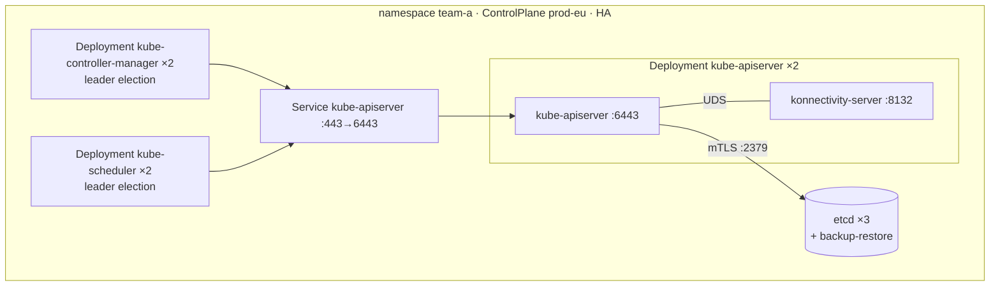

# Each control plane component runs in its own Deployment; etcd in its own StatefulSet

Decided 2026-10-25.
The `Split` layout with one replica of each component is built; high availability, PodDisruptionBudgets and the `Compact` layout are not.

## Decision

A tenant namespace holds:

| workload | containers | replicas: single | replicas: HA | notes |
|---|---|---|---|---|
| Deployment `<name>-kube-apiserver` | `kube-apiserver`, `konnectivity-server`, `lodia-signer` | 1 | 2 | the sidecars talk to the API server over Unix sockets, so they share its pod; one PodDisruptionBudget, spread across nodes (or zones) |
| Deployment `<name>-kube-controller-manager` | `kube-controller-manager` | 1 | 2 | leader election; reaches the API through the namespace Service |
| Deployment `<name>-kube-scheduler` | `kube-scheduler` | 1 | 2 | leader election; same path to the API |
| etcd (a `StatefulSet` managed by etcd-druid) | `etcd`, `backup-restore` | 1 | 3 | own CA, quota, continuous snapshots to object storage |

This is the `Split` layout, the default; `Compact` puts every component in one pod for development clusters and free tiers ([compact-layout](compact-layout.md)).

Four pods for a single control plane, nine for a highly available one.
Each Deployment has its own readiness: the API server on `/readyz`, the two controllers on their secure health endpoints; none waits on another through init containers.

## Why

- A change to one component should roll only that component.
  With separate Deployments, a controller-manager flag, a scheduler profile or a renewed controller certificate restarts one pod with a leader election failover and leaves the API server alone; the API server rolls only for its own changes.
- A rolling update of the API server with two replicas and a PDB keeps the API up during upgrades; with every component in one pod, the smallest change restarts the API server too.
- The API server reloads its serving certificate and client CA from disk, so a routine certificate renewal is no rollout at all once nothing else lives in its pod.
- This is the shape Gardener and HyperShift use for their hosted control planes ([Gardener](https://github.com/gardener/gardener/blob/master/docs/development/high-availability-of-components.md), [HyperShift](https://github.com/openshift/hypershift/blob/main/ARCHITECTURE.md)).

## Rejected

- One pod with every component — fewest pods, simplest wiring, but one rollout for any change and no independent scaling.
- konnectivity-server as its own Deployment — the API server reaches it over a Unix socket (the egress selector's `UDS` transport); a separate pod would need TCP with its own TLS and one more hop.
- Three API server replicas in HA by default — two already give zero-downtime rollouts and node-failure tolerance; the third is memory for nothing unless load asks for it (`spec.apiServer.replicas` can raise it).

## Consequences

- Secrets and ConfigMaps whose change requires a restart are hashed into the pod template of the component that mounts them, and only that component rolls: for the API server the etcd CA, the front-proxy client certificate, the konnectivity server's certificate and kubeconfig, the egress selector and the authentication configuration, and from phase 2 the audit policy and the admission configuration; for the controller manager the cluster CA bundle; for the scheduler, from phase 2, its configuration.
  Files that are reloaded are not hashed: serving certificates, client CA bundles, the kubelet client certificate, the encryption configuration, the certificates the controller manager's and the scheduler's kubeconfigs reference, and the ServiceAccount keys behind the signer sidecar.
  A Secret's hash is PKI's annotation `lodia.io/data-hash` on it, so Workloads reads the metadata of the Secrets it mounts and never their keys.

## Code

- `internal/controller/workloads` — `render.go` renders the three Deployments, their restart hashes and a NetworkPolicy for each; `workloads.go` applies them once the certificates and the datastore are ready and reports `APIServerReady`.
  `test/e2e/workloads_test.go` runs a tenant API server on kind.
