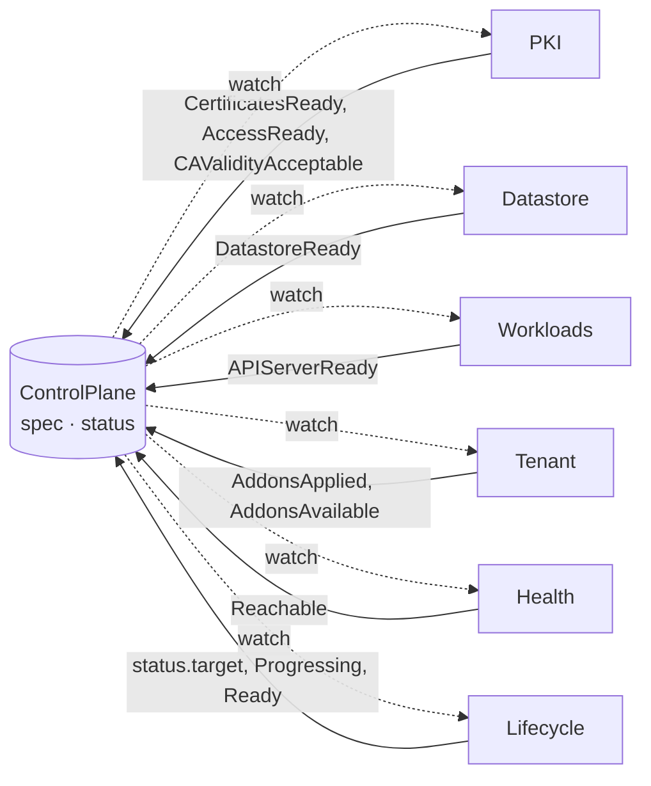

# Six controllers share one object and communicate only through status conditions

Decided 2026-10-25. The manager, PKI and the Datastore controller, for a
dedicated etcd of one member, are built; the other four controllers are
not.

## Decision

One operator binary, one controller-runtime manager, six controllers that all
watch `ControlPlane`:

| controller | owns | writes condition | waits on |
|---|---|---|---|
| **PKI** | CAs, leaf certificates, kubeconfigs, ServiceAccount keys, encryption keys; renewal and staged rotation; the tenant's bindings for Brygga, the admin group and the kubelet client | `CertificatesReady`, `AccessReady`; `CAValidityAcceptable` outside `Ready` | `status.endpoint`; `APIServerReady` for the bindings |
| **Datastore** | the tenant's etcd (dedicated through etcd-druid, or a user and prefix in a shared store), backups, defragmentation; the only controller that talks to etcd | `DatastoreReady` | nothing |
| **Workloads** | Deployments, Services, PodDisruptionBudgets, NetworkPolicies, ConfigMaps, Gateway routes in the tenant namespace | `APIServerReady` | `CertificatesReady`, `DatastoreReady` |
| **Tenant** | objects inside the tenant cluster: kubeadm bootstrap objects, kube-proxy, CoreDNS, konnectivity-agent, apiserver-proxy, RBAC | `AddonsApplied`, `AddonsAvailable` | `AccessReady` |
| **Health** | probes the API from outside and inside, samples node leases; holds the controller manager's leader lease inside the tenant while most nodes cannot reach the API ([controller-manager-hold](controller-manager-hold.md)) | `Reachable` | `AccessReady` |
| **Lifecycle** | the pace: which version to run now, whether to hibernate, which rotation stage is active, when a tenant's maintenance window is open and how many tenants roll at once | `status.target` and `Progressing` | the others' conditions |

Rules:

- A controller never calls another controller and never writes another
  controller's objects. It reads `spec` and `status.target`, writes its own
  objects with server-side apply under its own field manager, and reports
  through its own condition. Blocked work is a condition with a reason, not a
  retry loop.
- The public address is known only once Workloads' Service has one (a load
  balancer's, a node's), so Workloads publishes `status.endpoint` from the
  Service before it waits on anything, and PKI and Tenant read it: the
  serving certificate's addresses, the kubeconfigs' server, `cluster-info`.
- Each controller has its own work queue, worker count and rate limiter; a
  failure in one tenant's datastore does not delay certificate renewal in
  another.
- The cache holds Brygga's own kinds and, of every other kind, only objects
  with the label `brygga.segla.io/control-plane` (a default label selector);
  it strips `managedFields` and keeps metadata only for Secrets and
  ConfigMaps; a controller reads a payload, or an object someone else created
  for a tenant, with the uncached
  API reader when it needs it. Tests run the client with
  `ReaderFailOnMissingInformer`, so an accidental cluster-wide informer fails
  a test instead of filling memory
  ([controller-runtime cache](https://pkg.go.dev/sigs.k8s.io/controller-runtime/pkg/cache)).
- `status.conditions` is a map list keyed by `type`, and each controller
  applies only its own condition through the status subresource with its own
  field manager, so six writers never conflict on the list; one condition
  type has exactly one writer, and an envtest case enforces it.
- A condition counts only while its `observedGeneration` is the object's
  generation; a controller waiting on an older one treats it as Unknown. Each
  controller applies every condition it owns on every generation, Unknown on
  its first visit, as the API conventions ask
  ([conventions](https://github.com/kubernetes/community/blob/a434040a92edf60f10a29879026845d0ed891c9a/contributors/devel/sig-architecture/api-conventions.md#L378-L386)),
  with `lastTransitionTime` moving only when the status does and a message
  that depends on nothing but the state, so a pass that changes nothing
  writes nothing.
- Each controller is registered under its own name (`pki`, `datastore`, …)
  with its own `MaxConcurrentReconciles` and a reconcile timeout; the
  priority queue that controller-runtime enables by default puts resyncs
  behind real changes
  ([priority queue design](https://github.com/kubernetes-sigs/controller-runtime/blob/main/designs/priorityqueue.md)).
- `Ready` on the `ControlPlane` is computed by Lifecycle from the others:
  `CertificatesReady ∧ DatastoreReady ∧ APIServerReady ∧ AccessReady ∧ AddonsApplied ∧ Reachable`,
  and `Hibernated` when asleep. Nothing in it waits for the tenant's nodes:
  the owner joins them once the control plane is `Ready`, so
  `AddonsAvailable`, the addons' pods on those nodes, is reported beside it;
  so is `CAValidityAcceptable`, a CA in its last year, since every
  certificate is still valid then and its rotation is started by someone.

## Why

- In the solutions we studied, a common shape is one reconcile per cluster
  that runs every step in sequence; any failing step stops the rest, and a
  slow dependency (a datastore connection, a webhook) slows everything behind
  it. Independent queues keep failures local and make each controller small
  enough to test alone.
- Conditions are the Kubernetes way to express "this part is done" to other
  parts without coupling them, and they are what a platform on top watches
  anyway.
- Server-side apply with one field manager per controller makes ownership
  visible in `managedFields` and lets several controllers write the same
  object (each its own condition in the `ControlPlane`'s status, for
  instance) without overwriting each other.

## Rejected

- One reconcile with ordered handlers — simple to read, but every failure is
  global and the function grows without bound.
- One operator process per tenant (the HyperShift shape) — strong isolation
  and per-tenant versions of the renderer, at the cost of one more pod per
  tenant; maintenance windows give most of the benefit
  ([upgrades-and-maintenance-windows](upgrades-and-maintenance-windows.md)).
- Informers inside every tenant cluster — see
  [tenant-resources-by-inventory](tenant-resources-by-inventory.md).

## Consequences

- Two or more controllers may hold a `ControlPlane` in a partially ready state
  for a while; `status` says exactly which part and why.
- Two controllers know about time: Lifecycle (windows, the fleet limit,
  rotation stages) and Health (how long nodes have been silent); the other
  four are pure functions of `spec` and `status.target`.
- The layout (`Split` or `Compact`) is known to Workloads alone
  ([compact-layout](compact-layout.md)).
- Metrics come per controller: queue depth, reconcile duration and errors,
  labelled by controller and tenant.
- No controller uses the content of, or writes over, an object whose
  controller is not its `ControlPlane`. A controller-less object is adopted,
  except where adopting it would start a tenant on another's data (the
  Datastore's `Etcd` and claims). A predecessor's objects, left when a
  `ControlPlane` is recreated under the same name, are the garbage
  collector's: the controller waits with a condition, PKI with
  `SecretsControlledElsewhere`, the Datastore with `VolumesExist`.
- A condition that waits on an object outside the cache comes with a bounded
  requeue, since no event reports that object's change; the condition still
  says what it waits on. PKI has one: Secrets under its names that another
  owner keeps, which the cache does not show when they are unlabelled, after
  10 seconds while they are a previous `ControlPlane`'s, which the garbage
  collector deletes, and after a minute otherwise. The Datastore
  controller's: `VolumesExist`, for claims, which nothing labels for the
  cache, and for an `Etcd` without the control-plane label; a class held
  because its credentials copy cannot be made (the class's Secret, which
  belongs to the platform, is missing, or another owner holds the copy, which
  may lack the label); and `DatastoreClassNotFound` for a class the claims
  record, since deleting them to start empty brings no event; all after a
  minute. A StatefulSet that lags etcd-druid's report, read uncached, after
  15 seconds; and an `Etcd` being deleted, which has left the cache if its
  label was removed, after 10 seconds.

## Code

- `cmd/brygga/main.go` — the manager with the cache rules above, PKI
  registered as `pki` with ten workers, and the Datastore controller as
  `datastore` with ten.
- `internal/controller/pki` — reads `spec` and `status.endpoint`, writes its
  Secrets with server-side apply as `brygga/pki`, applies `CertificatesReady`,
  `CAValidityAcceptable` and `AccessReady` alone through the status
  subresource (`Unknown` at the start of its first visit, then with messages
  from the state alone, so a pass that changes nothing writes nothing; a
  failed read leaves them as they were, and a failed write stops the pass's
  writes and reports what it had to change and could not write as
  `Issuing`), counts
  `APIServerReady` only at the current generation, and requeues in whole
  seconds, rounded up, at the earliest renewal, or when a CA enters its last
  year or expires.
  `reconciler_test.go` runs it under a manager whose cache is the one
  `main.go` builds, with `ReaderFailOnMissingInformer`, and holds the first
  visit and the stale `APIServerReady` cases; `ownership_test.go` holds the
  Secrets another owner keeps and the reads that fail.
- `internal/controller/datastore` — reads `spec`, writes the `Etcd` and the
  credentials copy with server-side apply as `brygga/datastore`, applies
  `DatastoreReady` alone through the status subresource (`Unknown` at the
  start of its first pass, messages from the state alone, an API error left
  to the log unless the server refuses an object it is sent: the `Etcd`,
  which is `EtcdRefused`, or the credentials copy, which holds the class),
  sets a reconcile timeout of a minute, and stops for a paused
  `ControlPlane`. `datastore_test.go`
  runs it under the same cache with `ReaderFailOnMissingInformer`, as a user
  bound to exactly its rules, and holds the first visit and the pass that
  leaves the status alone on an API error (`TestConditionsFromState`)
  ([dedicated-etcd-by-default](dedicated-etcd-by-default.md)).
