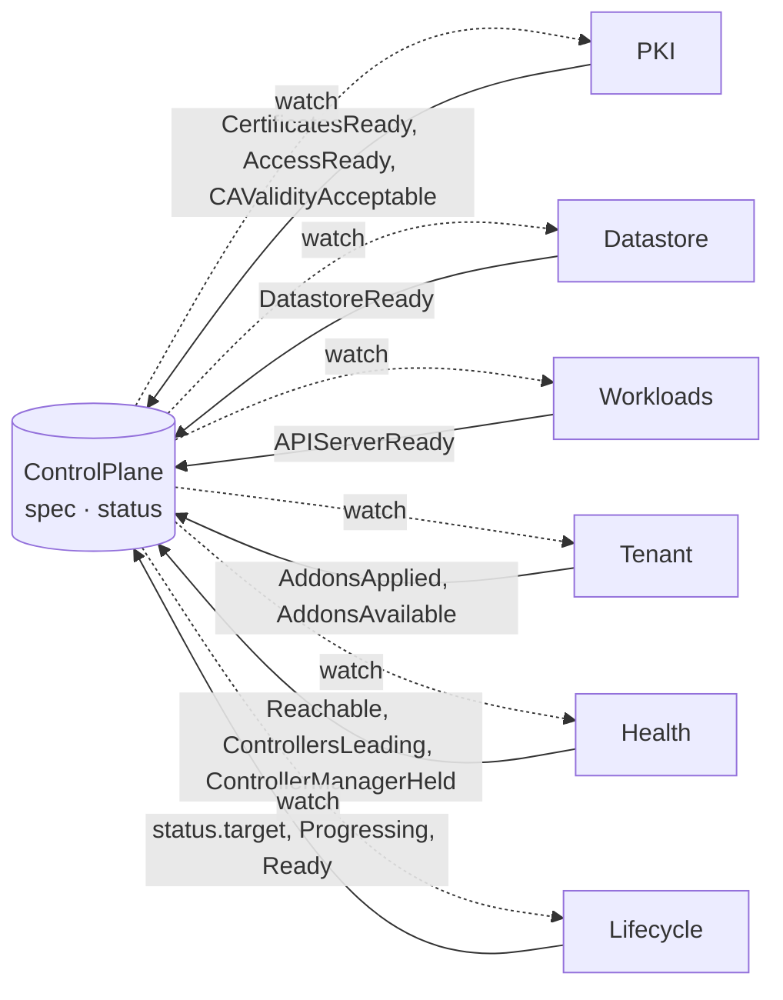

# Six controllers share one object and communicate only through status conditions

Decided 2026-10-25.
The manager, PKI, the Datastore controller, for a dedicated etcd of one member, Lifecycle, for the target within a minor and `Ready`, Tenant, without the apiserver-proxy, Health, for the probe through the public endpoint, and Workloads, for one replica behind a `loadBalancer` or `nodePort` endpoint, are built.

## Decision

One operator binary, one controller-runtime manager, six controllers that all watch `ControlPlane`:

| controller | owns | writes condition | waits on |
|---|---|---|---|
| **PKI** | CAs, leaf certificates, kubeconfigs, ServiceAccount keys, encryption keys; renewal and staged rotation; the tenant's bindings for Lodia, the admin group and the kubelet client | `CertificatesReady`, `AccessReady`; `CAValidityAcceptable` outside `Ready` | `status.endpoint`; `APIServerReady` for the bindings |
| **Datastore** | the tenant's etcd (dedicated through etcd-druid, with its NetworkPolicy, or a user and prefix in a shared store), backups, defragmentation; the only controller that talks to etcd | `DatastoreReady`; `BackupReady` outside `Ready` | a complete generation of PKI's etcd certificates |
| **Workloads** | Deployments, Services, PodDisruptionBudgets, NetworkPolicies, ConfigMaps, Gateway routes in the tenant namespace | `APIServerReady` | `CertificatesReady`, `DatastoreReady`; `AddonsApplied` before it starts a restored `ControlPlane`'s controller manager |
| **Tenant** | objects inside the tenant cluster: kubeadm bootstrap objects, kube-proxy, CoreDNS, konnectivity-agent, apiserver-proxy, RBAC | `AddonsApplied`, `AddonsAvailable` | `AccessReady` |
| **Health** | probes the API from outside and inside, samples the components' leader leases and the node leases; holds the controller manager's leader lease inside the tenant while most nodes cannot reach the API ([controller-manager-hold](controller-manager-hold.md)) | `Reachable`, `ControllersLeading`; `ControllerManagerHeld` outside `Ready` | `AccessReady` |
| **Lifecycle** | the pace: which version to run now, whether to hibernate, which rotation stage is active, when a tenant's maintenance window is open and how many tenants roll at once | `status.target` and `Progressing` | the others' conditions |

Rules:

- A controller never calls another controller and never writes another controller's objects.
  It reads `spec` and `status.target`, writes its own objects with server-side apply under its own field manager, and reports through its own condition.
  Blocked work is a condition with a reason, not a retry loop.
  An object one controller writes and another reads, a Secret PKI writes and Workloads mounts for instance, is named once, in `api/v1alpha1/names.go`, with the keys of a Secret that its readers name.
- The public address is known only once Workloads' Service has one (a load balancer's, a node's), so Workloads publishes `status.endpoint` from the Service, whole, before it waits on anything, and PKI, Tenant and Health read it: the serving certificate's addresses, the kubeconfigs' server, `cluster-info`, the agents' server, the external probe.
- Each controller has its own work queue, worker count and rate limiter; a failure in one tenant's datastore does not delay certificate renewal in another.
- The cache holds Lodia's own kinds and, of every other kind, only objects with the label `lodia.io/control-plane` (a default label selector); it strips `managedFields` and keeps metadata only for Secrets and ConfigMaps; a controller reads a payload, or an object someone else created for a tenant, with the uncached API reader when it needs it.
  Tests run the client with `ReaderFailOnMissingInformer`, so an accidental cluster-wide informer fails a test instead of filling memory ([controller-runtime cache](https://pkg.go.dev/sigs.k8s.io/controller-runtime/pkg/cache)).
- `status.conditions` is a map list keyed by `type`, and each controller applies only its own condition through the status subresource with its own field manager, so six writers never conflict on the list; one condition type, and one top-level status field, has exactly one writer.
  `internal/controller/writers_test.go` runs the controllers of `internal/operator` in one manager against one `ControlPlane`, watches every update of it, and checks, from the `managedFields` of each, that each condition type and each status field has had exactly the field manager of the test's table, so a second writer for a single update fails it too; the writer columns of [`api/controlplane.md`](../api/controlplane.md) mirror the table, and a controller that lands adds its rows.
- A condition counts only while its `observedGeneration` is the object's generation; a controller waiting on an older one treats it as Unknown.
  Each controller applies every condition it owns on every generation, Unknown on its first visit, as the API conventions ask ([conventions](https://github.com/kubernetes/community/blob/a434040a92edf60f10a29879026845d0ed891c9a/contributors/devel/sig-architecture/api-conventions.md#L378-L386)), with `lastTransitionTime` moving only when the status does and a message that depends on nothing but the state, so a pass that changes nothing writes nothing.
- Each controller is registered under its own name (`pki`, `datastore`, …) with its own `MaxConcurrentReconciles` and a reconcile timeout; the priority queue that controller-runtime enables by default puts resyncs behind real changes ([priority queue design](https://github.com/kubernetes-sigs/controller-runtime/blob/main/designs/priorityqueue.md)).
- **A readiness condition reports availability**, not how far a change has rolled out: `APIServerReady` is True while each component has a ready replica, `DatastoreReady` while etcd has quorum, `ControllersLeading` while the controller manager and the scheduler each have a leader.
  A replica that rolls or is lost shows in the counts of `status.components` and `status.datastore.members` and in the condition's message, and Lifecycle sums the rollout in `Progressing`, reason `RollingOut`.
  Cluster API separates the two the same way, in `Available` and `RollingOut` ([kubeadm_control_plane_types.go](https://github.com/kubernetes-sigs/cluster-api/blob/v1.14.3/api/controlplane/kubeadm/v1beta2/kubeadm_control_plane_types.go#L73-L88), [#L239-L242](https://github.com/kubernetes-sigs/cluster-api/blob/v1.14.3/api/controlplane/kubeadm/v1beta2/kubeadm_control_plane_types.go#L239-L242)), Gardener's checks tell a healthy Deployment from a fully rolled-out one ([deployment.go](https://github.com/gardener/gardener/blob/v1.154.0/pkg/utils/kubernetes/health/deployment.go#L46-L109)), and HyperShift calls etcd available at quorum ([hostedcontrolplane_controller.go](https://github.com/openshift/hypershift/blob/v0.1.86/control-plane-operator/controllers/hostedcontrolplane/hostedcontrolplane_controller.go#L2648-L2654)).
  A rollout that surges never stops serving, so `Ready` that dropped for it would report an outage that is not there.
  A component Lodia runs at 0 on purpose counts as available ([restore-replaces-the-source](restore-replaces-the-source.md)).
  Built with HA in phase 2's wave 1b; until then `APIServerReady` and `DatastoreReady` want every replica updated and ready.
- `Ready` on the `ControlPlane` is computed by Lifecycle from the others ([which](../api/controlplane.md#conditions-and-their-reasons)), and `Hibernated` when asleep.
  Nothing in it waits for the tenant's nodes: the owner joins them once the control plane is `Ready`.

## Why

- In the solutions we studied, a common shape is one reconcile per cluster that runs every step in sequence; any failing step stops the rest, and a slow dependency (a datastore connection, a webhook) slows everything behind it.
  Independent queues keep failures local and make each controller small enough to test alone.
- Conditions are the Kubernetes way to express "this part is done" to other parts without coupling them, and they are what a platform on top watches anyway.
- Server-side apply with one field manager per controller makes ownership visible in `managedFields` and lets several controllers write the same object (each its own condition in the `ControlPlane`'s status, for instance) without overwriting each other.

## Rejected

- One reconcile with ordered handlers — simple to read, but every failure is global and the function grows without bound.
- One operator process per tenant (the HyperShift shape) — strong isolation and per-tenant versions of the renderer, at the cost of one more pod per tenant; maintenance windows give most of the benefit ([upgrades-and-maintenance-windows](upgrades-and-maintenance-windows.md)).
- Informers inside every tenant cluster — see [tenant-resources-by-inventory](tenant-resources-by-inventory.md).

## Consequences

- Two or more controllers may hold a `ControlPlane` in a partially ready state for a while; `status` says exactly which part and why.
- Three controllers know about time: PKI (certificate lifetimes and renewal), Lifecycle (windows, the fleet limit, rotation stages) and Health (how long nodes have been silent); the other three are pure functions of `spec` and `status.target`.
- The layout (`Split` or `Compact`) is known to Workloads alone ([compact-layout](compact-layout.md)).
- Metrics come per controller, labelled by the controller alone: queue depth, reconcile duration and errors; the per-tenant ones and the events are [metrics-are-part-of-the-api](metrics-are-part-of-the-api.md)'s.
- No controller uses the content of, or writes over, an object whose controller is not its `ControlPlane`, or that refers to another `ControlPlane` at all; `internal/ownership` is the one place that rule is written, and every controller asks it.
  A controller-less object is adopted, except where adopting it would start a tenant on another's data (the Datastore's `Etcd` and claims).
  A predecessor's objects, left when a `ControlPlane` is recreated under the same name, are the garbage collector's: the controller waits with a condition, PKI with `SecretsControlledElsewhere`, the Datastore with `VolumesExist` for its `Etcd` and `ObjectsControlledElsewhere` for the etcd's NetworkPolicy, Workloads with `ObjectsControlledElsewhere`.
  Inside a tenant cluster, where no object has a `ControlPlane` for controller, the Tenant controller carries the rule over with `managedFields` as the signal: it reads an object before its first apply and leaves another owner's as it is, and deletes only what `lodia/tenant` has applied ([tenant-resources-by-inventory](tenant-resources-by-inventory.md)).
- A condition that waits on an object outside the cache comes with a bounded requeue, since no event reports that object's change; the condition still says what it waits on.
  PKI has one: Secrets under its names that another owner keeps, which the cache does not show when they are unlabelled, after 10 seconds while they are a previous `ControlPlane`'s, which the garbage collector deletes, and after a minute otherwise.
  The Datastore controller's: `VolumesExist`, for claims, which nothing labels for the cache, and for an `Etcd` without the control-plane label; a class held because its credentials copy cannot be made (the class's Secret, which belongs to the platform, is missing, or another owner holds the copy, which may lack the label); a NetworkPolicy `<cp>-etcd` another owner keeps, which may lack it too; and `DatastoreClassNotFound` for a class the claims record, since deleting them to start empty brings no event; all after a minute.
  A StatefulSet that lags etcd-druid's report, read uncached, after 15 seconds; and an `Etcd` being deleted, which has left the cache if its label was removed, after 10 seconds.
  The Tenant controller's: the addons' rollout in the tenant, which Lodia does not watch, every minute until it is complete, and `<cp>-ca-bundle` or `<cp>-lodia-kubeconfig` while another owner keeps it, every minute.
  Workloads': a `nodePort` endpoint's management node, which no event reports, every minute; and an object under its names that another owner keeps, whose deletion reaches this `ControlPlane`'s queue only when that owner is a previous `ControlPlane` of the same name, after 10 seconds while it is one and after a minute otherwise.

## Code

- `internal/operator` — the scheme, the cache rules above and the controllers: PKI registered as `pki`, the Datastore controller as `datastore`, Lifecycle as `lifecycle`, Tenant as `tenant`, Health as `health` and Workloads as `workloads`, each with ten workers and a one-minute reconcile timeout.
  `cmd/lodia/main.go` runs them in one manager; every controller's tests take the cache from it.
- `internal/controller/pki` — reads `spec` and `status.endpoint`, writes its Secrets with server-side apply as `lodia/pki`, applies `CertificatesReady`, `CAValidityAcceptable` and `AccessReady` alone through the status subresource (a failed read leaves them as they were, and a failed write stops the pass's writes), and requeues in whole seconds, rounded up, at the earliest renewal, or when a CA enters its last year or expires.
  `reconciler_test.go` runs it as a user bound to exactly its rules (its direct passes read the `ControlPlane` through the envtest admin, standing in for the manager's cache), with the `OwnerReferencesPermissionEnforcement` admission plugin on, once under a manager whose cache is the one `internal/operator` builds, with `ReaderFailOnMissingInformer`, and holds the first visit and the stale `APIServerReady` cases; `ownership_test.go` holds the Secrets another owner keeps and the reads that fail.
- `internal/controller/datastore` — reads `spec`, writes the `Etcd`, the credentials copy and the etcd's NetworkPolicy with server-side apply as `lodia/datastore`, applies `DatastoreReady` alone through the status subresource (an API error left to the log unless the server refuses an object it is sent: the `Etcd` or the NetworkPolicy, which are `Refused`, or the credentials copy, which holds the class), and stops for a paused `ControlPlane`.
  `datastore_test.go` runs it under the same cache with `ReaderFailOnMissingInformer`, as a user bound to exactly its rules, and holds the first visit and the pass that leaves the status alone on an API error (`TestConditionsFromState`) ([dedicated-etcd-by-default](dedicated-etcd-by-default.md)).
- `internal/controller/lifecycle` — reads the `ControlPlane` alone and applies `status.target` (`version`), `Progressing`, `Ready` and `status.observedGeneration` as `lodia/lifecycle`, all of them on every write and only on a change; its pass reads nothing that can fail midway, so its first visit writes the conditions it computes rather than a separate `Unknown`.
  `lifecycle_test.go` runs it under the same cache with `ReaderFailOnMissingInformer`, as a user bound to exactly its rules; `internal/versions` holds the minors it supports.
- `internal/controller/tenant` — waits on `AccessReady` at the current generation, applies the tenant's objects as `lodia/tenant` with the inventory in the tenant, and applies `AddonsApplied` and `AddonsAvailable`; a pass runs only when the target, the endpoint, `AccessReady` or the generation changes, and on its timers.
  `tenant_test.go` runs it under the same cache with `ReaderFailOnMissingInformer`, as a user bound to exactly its rules, against a tenant kube-apiserver started from PKI's certificates ([tenant-resources-by-inventory](tenant-resources-by-inventory.md)).
- `internal/controller/health` — reads the `ControlPlane` from the cache and `<cp>-ca-bundle` uncached, probes the public endpoint, and applies `Reachable` as `lodia/health`, only on a change: a failed read leaving it as it was, and the failed probes counted in memory, so a restart counts afresh.
  Only a change of the endpoint, the bundle or the generation brings a pass between the periodic ones, so the failures counted are probes a period apart.
  `health_test.go` runs it under the same cache with `ReaderFailOnMissingInformer`, as a user bound to exactly its rules.
- `internal/controller/workloads` — reads `spec`, `status.target`, `status.datastore.endpoints` and the conditions it waits on, the data hash of each restart-only Secret from its metadata in the cache, and a `nodePort` endpoint's nodes uncached; writes the Service, the ConfigMaps, the NetworkPolicies and the Deployments with server-side apply as `lodia/workloads`, none over an object another owner keeps, and applies `APIServerReady` and `status.endpoint` through the status subresource (an API error left to the log unless the server refuses an object it is sent, which is `Refused`).
  `workloads_test.go` runs it under the same cache with `ReaderFailOnMissingInformer`, as a user bound to exactly its rules.
