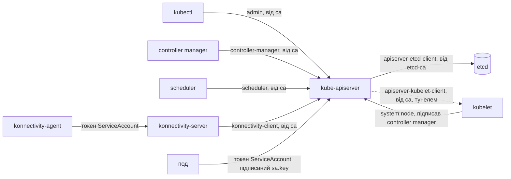

# Hard way: супутник українською

Супутник до [`hard-way.md`](hard-way.md), щоб пройти його з наставником.
Команди лишаються в оригіналі; тут для кожного кроку — що й навіщо будуємо, які сертифікати й облікові дані працюють, що робить Lodia замість тебе і як перевірити результат.
Позначка «Розбіжність:» стоїть там, де `hard-way.md` або його скрипти розходяться із сьогоднішньою Lodia, між собою чи з upstream.
Звірено з `main` на коміті `b405d2b`.

## Карта

Компоненти — на схемі на початку [`hard-way.md`](hard-way.md).
У керуючому кластері, у namespace `tenant-a`: etcd, под API server (kube-apiserver і konnectivity-server на спільному Unix-сокеті), controller manager, scheduler і NodePort Service на API (30443) та konnectivity (30132).
На ноді тенанта: kubelet, konnectivity-agent, kube-proxy, kindnet і CoreDNS.
Нода не приймає з'єднань від control plane: до kubelet API server іде тунелем, який відкрив агент.

Ланцюжок довіри — хто кому що пред'являє і хто це підписав:



Сервери доводять себе так само: API server і konnectivity-server — сертифікатами від `ca`, etcd — від `etcd-ca`, kubelet — самопідписаним (крок 11).
Першу довіру до `ca` нода бере з `cluster-info`, підписаного bootstrap-токеном і звіреного з хешем CA (кроки 9 і 11).
У Lodia ланцюжок той самий, але корінь розщеплено: cluster CA засвідчує сервери і API server перед kubelet'ами, а ідентичності клієнтів підписує client CA, якого ноди не знають (крок 3).

## 1. Перед стартом

`env.sh` задає версії, імена й діапазони тенанта — те, що Lodia бере з `ControlPlane` і таблиці версій, — і функції `mk`, `tk`, `render` ([оригінал](hard-way.md#1-before-you-start)).
Ланка: параметри ланцюжка — з діапазону сервісів беруться SAN `10.32.0.1` (крок 3) і адреса DNS `10.32.0.10` (крок 9).

**Lodia.** Діапазони — `spec.network`, незмінні після створення ([spec](api/controlplane.md#spec)).
Образи — з таблиці `internal/versions` за `status.target.version`, яку Lifecycle тримає в межах мінорної версії `spec.version`.
Для 1.35.8 образи ті самі, крім etcd: Lodia запускає 3.5.27 з обгортки etcd-druid, а не kubeadm'івську 3.6.6 ([dedicated-etcd-by-default](decisions/dedicated-etcd-by-default.md#consequences)).
Правило «ніколи поточний kube-контекст» у Lodia — перевірка в коді: e2e відмовляється працювати з кластером, якого не названо явно ([e2e-on-a-named-cluster](decisions/e2e-on-a-named-cluster.md)).

**Розбіжність:** «a 1.34 or newer client works with the 1.35 cluster» — kubectl підтримується в межах однієї мінорної версії від kube-apiserver, тобто 1.34–1.36 ([version skew policy](https://kubernetes.io/releases/version-skew-policy/#kubectl)).

**Перевірка.** `type mk tk`: обидві функції передають kubectl свій `--kubeconfig`.

## 2. Керуючий кластер

Один вузол kind, на якому control plane тенанта — звичайні поди ([оригінал](hard-way.md#2-the-management-cluster)).
`MGMT_IP` — його адреса в docker-мережі `kind`: через неї ноди тенанта дійдуть до NodePort, а `extraPortMappings` відкриває 30443 на `127.0.0.1` для твого kubectl.
Ланка: точка входу, яку назвуть serving-сертифікат (крок 3), kubeconfig'и (крок 4) і `cluster-info` (крок 9).

**Lodia (Workloads).** Керуючий кластер не її: вона працює в ньому Deployment'ом ([Installation](README.md#installation)).
Точку входу Workloads бере зі `spec.endpoint` і публікує в `status.endpoint` раніше за все, бо від неї залежать PKI, Tenant і Health ([independent-controllers](decisions/independent-controllers.md)).
У режимі `nodePort` це InternalIP першої за іменем Ready-ноди керуючого кластера, як `MGMT_IP` тут, і він лишається, поки його звітує хоч одна нода, бо його вже назвали сертифікат, kubeconfig'и й kubelet'и ([A tenant namespace](README.md#a-tenant-namespace)).
`loadBalancer` дає адресу балансувальника, `gateway` (хвиля 1b) — спільний Gateway за SNI ([api-exposure](decisions/api-exposure.md)).

**Перевірка.** `mk get nodes -o wide`: INTERNAL-IP дорівнює `MGMT_IP`.

## 3. PKI

Корені довіри й усі ідентичності ланцюжка, по рядку `pki.sh` на сертифікат ([оригінал](hard-way.md#3-the-pki)).
Ланка: наступні кроки лише розкладають ці файли по прапорцях.

| файл | підписав | хто → кому | прапорець | без нього |
|---|---|---|---|---|
| `ca` (`kubernetes`) | сам себе | корінь: його `ca.crt` перевіряють усі | API server і controller manager: `--client-ca-file`; kubeconfig'и: `certificate-authority`; controller manager: `--cluster-signing-cert-file`, `--root-ca-file`; kubelet: `clientCAFile` | ніхто нікого не впізнає |
| `apiserver` | `ca` | API server → kubectl, компоненти, kubelet'и, поди | `--tls-cert-file`, `--tls-private-key-file` | клієнт, що дзвонить на ім'я поза SAN, рве з'єднання: `x509: certificate is valid for …` |
| `apiserver-kubelet-client` | `ca` | API server → kubelet, тунелем | `--kubelet-client-certificate`, `--kubelet-client-key` | `logs`, `exec`, `port-forward` отримують від kubelet 401; без прив'язки з кроку 9 — 403 |
| `front-proxy-ca`, `front-proxy-client` | `front-proxy-ca` | API server → агреговані API | `--proxy-client-cert-file`, `--proxy-client-key-file`, `--requestheader-client-ca-file`, `--requestheader-allowed-names` | агреговані API (metrics-server) не вірять ідентичності, яку API server передає заголовками; у цьому тенанті їх немає |
| `etcd-ca`, `etcd-server` | `etcd-ca` | etcd → API server і `etcdctl` | etcd: `--cert-file`, `--key-file`, `--trusted-ca-file`; API server: `--etcd-cafile` | API server не дістається etcd і не стає ready |
| `apiserver-etcd-client` | `etcd-ca` | API server → etcd | `--etcd-certfile`, `--etcd-keyfile`; etcd: `--client-cert-auth` | те саме |
| `controller-manager`, `scheduler` | `ca` | компонент → API server | `--kubeconfig`, `--authentication-kubeconfig`, `--authorization-kubeconfig` | 401: немає лідера, ReplicaSet'ів, планування |
| `super-admin` (`O=system:masters`) | `ca` | ти → API server, один раз (крок 7) | `--client-ca-file`; група обходить RBAC | нікому створити першу прив'язку |
| `admin` (`O=kubeadm:cluster-admins`) | `ca` | ти → API server | `--client-ca-file`; права — від прив'язки групи (крок 7) | 403 на все, крім discovery |
| `konnectivity-server` | `ca` | konnectivity-server → агенти | `--cluster-cert`, `--cluster-key`; агент: `--ca-cert` | агент не встановлює TLS, тунелю немає |
| `konnectivity-client` (`system:konnectivity-server`) | `ca` | konnectivity-server → API server | `--kubeconfig` konnectivity-server | сервер не може перевірити токени агентів (TokenReview) і відкидає їх |
| `sa.key`, `sa.pub` | — | API server підписує й перевіряє токени ServiceAccount | `--service-account-signing-key-file`, `--service-account-key-file` | API server не стартує: ключ підпису й issuer обов'язкові ([validation.go](https://github.com/kubernetes/kubernetes/blob/v1.35.8/pkg/controlplane/apiserver/options/validation.go#L43-L45)) |

**Lodia (PKI).**
- CA чотири (п'ятий, для тунелю, — з хвилі 1b), і кожен — окремий самопідписаний корінь ([staged-credential-rotation](decisions/staged-credential-rotation.md)).
- Cluster CA (10 років) — корінь довіри: підписує serving-сертифікати API server і konnectivity та `apiserver-kubelet-client`, тобто те, що перевіряють клієнти, агенти й kubelet'и.
- Client CA (5 років) підписує всі клієнтські ідентичності, і ноди йому не довіряють, тож ротація ідентичностей не торкається жодної ноди.
- Front-proxy CA і etcd CA — як тут.
- Ключі CA лежать у `<cp>-cakey-*`, яких не монтує жоден под; controller manager отримує лише проміжний kubelet signer (крок 8).
- Збереженого `system:masters` немає (крок 7).
- `apiserver-kubelet-client` — у групі `lodia:kubelet-api-admins`, адмін — `kubernetes-admin` у `lodia:cluster-admins`, сама Lodia — `lodia:operator`.
- Ключі — ECDSA P-256, крім ключа ServiceAccount (RSA 2048), який тримає `lodia-signer` (крок 14d).
- Листові сертифікати живуть рік і оновлюються на двох третинах терміну; сертифікати etcd — поколіннями (крок 5).
- Що в якому Secret і хто його читає — [A tenant namespace](README.md#a-tenant-namespace); стан — `CertificatesReady`.

**Розбіжність:** врізка «the same files» неточна: `super-admin` немає, групи адміна й `apiserver-kubelet-client` інші, ключі ECDSA, сертифікати etcd — поколіннями.

**Перевірка.**

```bash
openssl verify -CAfile "$PKI/ca.crt" "$PKI"/{apiserver,apiserver-kubelet-client,admin,konnectivity-server}.crt
openssl verify -CAfile "$PKI/etcd-ca.crt" "$PKI/etcd-server.crt" "$PKI/apiserver-etcd-client.crt"
openssl x509 -in "$PKI/apiserver.crt" -noout -ext subjectAltName
```

## 4. Kubeconfig'и

Kubeconfig — це CA, адреса сервера і клієнтський сертифікат з кроку 3 ([оригінал](hard-way.md#4-kubeconfigs)).
Адреса — та, якою користувач бачить API server звідти, де працює, і кожну з них мусить назвати SAN `apiserver`.
Ланка: зв'язує ідентичності кроку 3 з точками входу кроку 2.

| kubeconfig | хто ним користується | адреса |
|---|---|---|
| `controller-manager.conf`, `scheduler.conf` | поди в керуючому кластері | Service `tenant-a-apiserver.tenant-a.svc:30443` |
| `konnectivity-server.conf` | konnectivity-server у поді API server | `127.0.0.1:30443` |
| `super-admin.conf`, `admin.conf` | ти, через `extraPortMappings` | `127.0.0.1:30443` |
| `admin-net.conf` | контейнер kubeadm у мережі `kind` (крок 9) | `MGMT_IP:30443` |

**Lodia (PKI).** Kubeconfig'и controller manager, scheduler і konnectivity-server дзвонять на Service `https://<cp>-kube-apiserver.<ns>.svc:443`, а сертифікати лежать файлами поруч із ними.
controller manager і scheduler перечитують оновлені сертифікат і ключ без рестарту, а konnectivity-server — ні (крок 14a).
`<cp>-admin-kubeconfig` дивиться на `status.endpoint.apiServer`, `<cp>-lodia-kubeconfig` (`lodia:operator`) — на Service; в обох сертифікати вбудовано.
Людям — `KubeconfigRequest` з терміном дії, з фази 2 ([short-lived-kubeconfigs](decisions/short-lived-kubeconfigs.md)).

**Перевірка.**

```bash
for f in "$WORK"/*.conf; do echo "$f $(kubectl config view --kubeconfig "$f" -o jsonpath='{.clusters[0].cluster.server}')"; done
```

## 5. etcd

Сховище тенанта: один член, клієнтський TLS під власним `etcd-ca`, дані на PVC ([оригінал](hard-way.md#5-etcd)).
Peer-трафік — HTTP на `127.0.0.1`: з одним членом говорити нема з ким.
Secret `tenant-a-pki` — уся тека `$PKI`, разом з `ca.key`, `etcd-ca.key`, `front-proxy-ca.key` і `sa.key`, і його монтують etcd, API server і controller manager.
Ланка: API server → etcd; інших клієнтів, крім `etcdctl` для перевірки, немає.

**Lodia (Datastore).**
- Замість StatefulSet — ресурс `Etcd` для etcd-druid, з якого той розгортає StatefulSet `<cp>-etcd`, клієнтський Service `<cp>-etcd-client`, peer Service і sidecar backup-restore ([dedicated-etcd-by-default](decisions/dedicated-etcd-by-default.md)).
- TLS на клієнті, peer і backup-restore увімкнено разом, навіть з одним членом.
- PKI випускає сертифікати etcd поколіннями з п'яти незмінних Secrets `<cp>-etcd-{ca,server,client,peer,backup-restore}-<g>`, бо etcd-druid перекочує членів лише на нове ім'я Secret; `Etcd` називає найновіше повне покоління.
- Кожен под монтує лише свої Secrets.
- Квота, компакція, том і бекапи — з `DatastoreClass`; у прикладі квота 4 GiB на томі 20Gi ([datastoreclass.yaml](api/examples/datastoreclass.yaml)).
- NetworkPolicy `<cp>-etcd` пускає на 2379 лише поди API server цього тенанта і самих членів ([A tenant namespace](README.md#a-tenant-namespace)).
- При видаленні Datastore під фіналізатором `lodia.io/datastore` видаляє `Etcd`, а томи видаляє чи лишає за `reclaimPolicy` класу ([Deletion](README.md#deletion)).
- Три члени — з HA у хвилі 1b; стан — `DatastoreReady`.

**Розбіжність:** квота 2 GiB у `10-etcd.yaml` більша за PVC, який він просить, — 1Gi.

**Перевірка.** `etcdctl … endpoint status` з оригіналу; `endpoint health` з тими самими прапорцями каже `is healthy`.
У Lodia: `DatastoreReady=True` і `kubectl get etcd -n <ns>`.

## 6. API server і konnectivity-server

Центр ланцюжка: API server приймає всіх клієнтів, до etcd ходить напряму, а до нод — лише через konnectivity-server ([оригінал](hard-way.md#6-the-api-server-and-konnectivity-server)).
Egress selector шле в сокет лише контекст `cluster`: виклики kubelet, проксі-субресурси, агреговані API і вебхуки, задані через Service; вебхуки за URL ідуть напряму ([server.go](https://github.com/kubernetes/kubernetes/blob/v1.35.8/cmd/kube-apiserver/app/server.go#L249-L261), [authentication.go](https://github.com/kubernetes/kubernetes/blob/v1.35.8/staging/src/k8s.io/apiserver/pkg/util/webhook/authentication.go#L54-L104)).
Стандартний `lease`-reconciler пише в endpoints Service `kubernetes` пару `--advertise-address` і `--secure-port`, тобто `MGMT_IP:30443`; тому secure port і дорівнює NodePort, інакше поди йшли б на порт `MGMT_IP`, де API server тенанта не слухає.
Анонімний доступ увімкнено за замовчуванням, і обмежує його лише RBAC; так kubeadm і прочитає `cluster-info` (крок 9).
Issuer токенів — `https://kubernetes.default.svc.cluster.local`, видимий лише зсередини кластера.
konnectivity-server не слухає TCP для API server (`--server-port=0` з `--uds-name`), а агентів приймає на 8132 із сертифікатом `--cluster-cert` (крок 10).
Ланка: тут сходяться всі стрілки ланцюжка; сертифікати — з таблиці кроку 3.

**Lodia (Workloads).** Той самий под, але:
- konnectivity-server і `lodia-signer` — native sidecars, init-контейнери з `restartPolicy: Always`, які стартують до API server і зупиняються після нього ([sidecar containers](https://kubernetes.io/docs/concepts/workloads/pods/sidecar-containers/)).
- API server слухає 6443 у будь-якому режимі; Service `<cp>-kube-apiserver` веде 443 і 6443 на API, 8132 — на konnectivity.
- `--endpoint-reconciler-type=none`: endpoints `kubernetes` пише Tenant зі `status.endpoint.inCluster`, бо `lease`-reconciler при кожному rollout на мить їх спорожнює ([api-exposure](decisions/api-exposure.md)).
- Rollout не губить запитів клієнта, який слухається `Retry-After`, як client-go; запит через тунель ще може на мить упасти ([A tenant namespace](README.md#a-tenant-namespace)).
- Для цього `--shutdown-delay-duration=15s`, `--shutdown-watch-termination-grace-period=10s`, у konnectivity `--graceful-shutdown-timeout=10s`, grace period 90 с і rollout з `maxSurge: 100%`, `maxUnavailable: 0` та `minReadySeconds: 10`.
- `--authentication-config` пускає анонімів лише до `/healthz`, `/livez`, `/readyz` і `cluster-info`.
- `--encryption-provider-config` з автоматичним перечитуванням шифрує Secrets в etcd, за замовчуванням `secretbox`.
- Ключів ServiceAccount API server не має: `--service-account-signing-endpoint` веде на сокет `lodia-signer` (крок 14d).
- Issuer за замовчуванням — публічна адреса, а `--service-account-jwks-uri` — `https://<status.endpoint.apiServer>/openid/v1/jwks`, бо без нього kube-apiserver склеїть адресу з advertise-адреси і порту 6443, недосяжну ззовні в режимі `nodePort` ([serviceAccount.issuer](api/controlplane.md#spec)).
- konnectivity-server — з `--enable-lease-controller` і `--keepalive-time=30s`, а його kubeconfig дзвонить на Service.
- Probes — kubeadm'івські, зі startup probe; NetworkPolicy на кожен компонент; токена ServiceAccount керуючого кластера поди не монтують.
- Що компонент читає лише раз, входить у хеш шаблону пода (`lodia.io/restart-hash`), тож оновлення такого Secret перекочує лише цей компонент ([component-per-deployment](decisions/component-per-deployment.md)).
- HA з хвилі 1b: дві репліки з PDB, рознесені по нодах.
- Стан — `APIServerReady`; Health кожні 10 с питає `/readyz` на публічній точці входу без облікових даних, і `Reachable` падає після трьох невдач поспіль ([Health](README.md#health)).

**Розбіжність:** врізка «the same pod plus the `lodia-signer` sidecar» застаріла: konnectivity-server теж став native sidecar, а порт і endpoints — інші.

**Перевірка.** Три команди оригіналу; у `/readyz?verbose` є `[+]etcd ok`.
`openssl s_client -connect "127.0.0.1:$APISERVER_PORT" </dev/null 2>/dev/null | openssl x509 -noout -subject -issuer` показує `kube-apiserver` від `kubernetes`.

## 7. Група адмінів і super-admin

`super-admin` (`system:masters`, обходить RBAC) один раз застосовує `00-rbac.yaml` ([оригінал](hard-way.md#7-bind-the-admin-group-then-put-super-admin-away)).
Той прив'язує групу `kubeadm:cluster-admins` до `cluster-admin`, а `system:konnectivity-server` — до `system:auth-delegator`, яка дозволяє створювати TokenReview і SubjectAccessReview.
Ланка: людина отримує права, які можна відкликати, а konnectivity-server — право перевіряти агентів.

**Lodia (PKI, Tenant).** Прив'язки — робота PKI: коли `APIServerReady` уже True, він застосовує три ClusterRoleBinding — `lodia:operator` і групу `lodia:cluster-admins` до `cluster-admin`, групу `lodia:kubelet-api-admins` до `system:kubelet-api-admin`.
Застосовує він їх від імені `lodia:operator`, а якщо це заборонено, то десятихвилинним сертифікатом `system:masters` ([short-lived-kubeconfigs](decisions/short-lived-kubeconfigs.md)).
Стан — `AccessReady`, і на нього чекає Tenant, а з хвилі 1b — і Health.
Видалена `lodia:cluster-admins` повертається на наступному проході PKI, тож відкликати адмінські kubeconfig'и можна лише ротацією client CA, фаза 3 ([Forced CA rotation](operations.md#forced-ca-rotation)).
Прив'язку `system:konnectivity-server` і її Role на Lease пише Tenant (`internal/controller/tenant/manifests/konnectivity.yaml`).

**Розбіжність:** таблиця на початку `hard-way.md` віддає крок 7 Tenant'у; сьогодні прив'язка адмінів — PKI, а в Tenant'а лише konnectivity.

**Перевірка.** `tk auth whoami` і `tk auth can-i '*' '*'` з оригіналу; `kubectl --kubeconfig "$WORK/super-admin.conf" auth whoami` показує групу `system:masters`.

## 8. Controller manager і scheduler

Контролери тенанта і планувальник — звичайні клієнти API, які обирають лідера через Lease у тенанті ([оригінал](hard-way.md#8-the-controller-manager-and-the-scheduler)).
Ланка: тут з'являються підписувач для нод і місце, з якого поди дізнаються CA.
Для ланцюжка controller manager робить три речі:

- `--cluster-signing-cert-file` і `--cluster-signing-key-file` дають йому `ca.key`, яким він підписує схвалені CSR усіх вбудованих підписувачів, зокрема клієнтські сертифікати kubelet'ів (крок 11) ([certificates.go](https://github.com/kubernetes/kubernetes/blob/v1.35.8/cmd/kube-controller-manager/app/certificates.go#L163-L169)).
- `--root-ca-file` публікує `ca.crt` як ConfigMap `kube-root-ca.crt` у кожному namespace; за ним поди й агенти перевіряють API server.
- `bootstrapsigner` підписує `cluster-info` кожним bootstrap-токеном, а `tokencleaner` прибирає прострочені; обидва за замовчуванням вимкнені.

`--use-service-account-credentials` дає кожному контролеру власний ServiceAccount, а `--allocate-node-cidrs` роздає нодам `podCIDR` з `10.200.0.0/16`.

**Lodia (Workloads).**
- Підписувач лише один, для клієнтів kubelet: `--cluster-signing-kubelet-client-cert-file` і `-key-file` ведуть на kubelet signer під client CA, а `--cluster-signing-duration` — 30 днів ([staged-credential-rotation](decisions/staged-credential-rotation.md)).
- Підписати ним можна будь-яку ідентичність, яку прийме API server, але ні клієнти, ні kubelet'и сертифікатам від нього не вірять, бо знають лише cluster CA ([staged-credential-rotation](decisions/staged-credential-rotation.md#why)).
- Serving-сертифікатів kubelet кластер не підписує ([Deliberately not offered](README.md#deliberately-not-offered--and-owed)).
- `--root-ca-file` — з `<cp>-ca-bundle`, і його зміна перезапускає controller manager, бо файл читається раз.
- Імена контролерів канонічні: `*,bootstrap-signer-controller,token-cleaner-controller`, а `bootstrapsigner` і `tokencleaner` — їхні аліаси ([bootstrap.go](https://github.com/kubernetes/kubernetes/blob/v1.35.8/cmd/kube-controller-manager/app/bootstrap.go#L27-L62)).
- З хвилі 2 Workloads рендерить таймінги лідерства і `--node-monitor-grace-period` з констант, на яких стоїть утримання (крок 14b); HA з хвилі 1b — по дві репліки.

**Перевірка.** `tk -n kube-system get leases` з оригіналу; `tk -n default get configmap kube-root-ca.crt` знаходить ConfigMap.

## 9. Що потрібно `kubeadm join`

Нова нода знає лише адресу, токен і хеш CA, а решту читає з кластера; kubeadm записує все це в API server, який не він створив ([оригінал](hard-way.md#9-what-kubeadm-join-needs)).
Ланка: перша довіра ноди до кластера; як нода нею користується — крок 11.

- Bootstrap-токен `<id>.<secret>` — Secret `kube-system/bootstrap-token-<id>` з usages `signing` і `authentication` та групою `system:bootstrappers:kubeadm:default-node-token` ([bootstrap tokens](https://kubernetes.io/docs/reference/access-authn-authz/bootstrap-tokens/)).
- `cluster-info` — kubeconfig без користувача, адресу і CA якого kubeadm копіює з `--kubeconfig`, тобто з `admin-net.conf`, тому там `MGMT_IP` ([clusterinfo.go](https://github.com/kubernetes/kubernetes/blob/v1.35.8/cmd/kubeadm/app/phases/bootstraptoken/clusterinfo/clusterinfo.go#L56-L63)).
- Role `kubeadm:bootstrap-signer-clusterinfo` дає `system:anonymous` читати `cluster-info`, і нічого більше.
- Групі токена прив'язки дають подати CSR (`kubeadm:kubelet-bootstrap`), отримати автосхвалення (`kubeadm:node-autoapprove-bootstrap`), читати ноди, `kubeadm-config`, `kubelet-config` і ConfigMap kube-proxy; групі `system:nodes` — автосхвалення ротації (`kubeadm:node-autoapprove-certificate-rotation`).
- Фаза `bootstrap-token` також прив'язує користувача `kube-apiserver-kubelet-client` до `system:kubelet-api-admin` (`kubeadm:apiserver-kubelet-client`): так API server отримує права на kubelet API ([bootstraptoken.go](https://github.com/kubernetes/kubernetes/blob/v1.35.8/cmd/kubeadm/app/cmd/phases/init/bootstraptoken.go#L111-L114)).
- У `kubelet-config` kubeadm вимикає анонімів і вмикає вебхук-автентифікацію та `authorization.mode: Webhook` ([kubelet.go](https://github.com/kubernetes/kubernetes/blob/v1.35.8/cmd/kubeadm/app/componentconfigs/kubelet.go#L152-L171)); `clientCAFile` — шлях на ноді (рядок 11 у «What we learned»), а `cgroupRoot`, `failSwapOn`, `evictionHard` і `imageGCHighThresholdPercent` потрібні kubelet'у в контейнері.
- `controlPlaneEndpoint` з `kubeadm-config` стає адресою в kubeconfig kube-proxy ([proxy.go](https://github.com/kubernetes/kubernetes/blob/v1.35.8/cmd/kubeadm/app/phases/addons/proxy/proxy.go#L192-L196)), тож kube-proxy ходить на API не через Service `kubernetes`, правила якого сам і програмує.

**Lodia (Tenant).**
- Ті самі об'єкти з власних шаблонів (`internal/controller/tenant/manifests/`), без імпорту `k8s.io/kubernetes`, через server-side apply як `lodia/tenant` з інвентарем `kube-system/lodia-inventory` і prune, повторно кожні 10 хвилин ([tenant-resources-by-inventory](decisions/tenant-resources-by-inventory.md), [Inside the tenant](README.md#inside-the-tenant)).
- `cluster-info` — зі `status.endpoint.apiServer` і `<cp>-ca-bundle`; kube-proxy дзвонить на ту саму публічну адресу.
- `kubelet-config` містить лише спільне: вебхук-автентифікацію й авторизацію без анонімів, `healthzBindAddress: 127.0.0.1`, `readOnlyPort: 0`, `rotateCertificates: true`.
- Налаштування конкретної ноди її власник передає `kubeadm join --patches`, як e2e передає налаштування kind ([kubeadm-patches](../test/e2e/testdata/kubeadm-patches/kubeletconfiguration+merge.yaml)).
- Токенів Lodia не створює: їх робить власник через `kubeadm token create --print-join-command` з адмінським kubeconfig ([nodes-join-with-kubeadm](decisions/nodes-join-with-kubeadm.md)).
- Замість `kubeadm:apiserver-kubelet-client` — прив'язка групи `lodia:kubelet-api-admins` від PKI (крок 7).
- Стан — `AddonsApplied` і `AddonsAvailable`; другий у `Ready` не входить, бо подам потрібні ноди й CNI власника.

**Розбіжність:** «This list is the Tenant controller's job» включає Secrets bootstrap-токенів, яких Lodia не створює; врізка «the same objects» мовчить і про це, і про `kubeadm:apiserver-kubelet-client`, який у Lodia замінює прив'язка PKI.

**Перевірка.** Команди оригіналу; `tk -n kube-public get configmap cluster-info -o jsonpath='{.data.kubeconfig}' | grep server` показує `MGMT_IP:30443`.

## 10. konnectivity agents

Агент на кожній ноді сам дзвонить до konnectivity-server і тримає тунель, яким API server доходить до kubelet, подів і Service ([оригінал](hard-way.md#10-konnectivity-agents)).
Ланка: зворотний канал від control plane до ноди.

**Облікові дані.**
- Сервер агент перевіряє за `--ca-cert`, тобто `ca.crt` з тому ServiceAccount, який приходить з `kube-root-ca.crt` (крок 8), і за SAN `MGMT_IP` сертифіката `konnectivity-server`.
- Себе агент доводить projected-токеном ServiceAccount `konnectivity-agent` з аудиторією `system:konnectivity-server` на годину.
- Сервер перевіряє токен TokenReview'ом від імені `system:konnectivity-server` (крок 7) і звіряє його з `--agent-namespace`, `--agent-service-account` і `--authentication-audience`.
- `--agent-identifiers=ipv4=$(HOST_IP)` разом із `destHost` на сервері ведуть трафік до ноди через агента саме цієї ноди.

**Lodia (Tenant).**
- Агенти з `--count-server-leases` рахують сервери за їхніми Lease (сервер з `--enable-lease-controller`) і тримають тунель до кожної репліки API server; Role на читання Lease мають агенти, на запис — сервери ([api-exposure](decisions/api-exposure.md)).
- `--keepalive-time=30s` з обох боків, щоб idle-таймаут по дорозі не рвав тунель.
- Пріоритет `system-node-critical` і толерування будь-яких taint'ів; режим `Deployment` — за `addons.konnectivity.agent.mode`.
- Адреса — `status.endpoint.konnectivity`; у режимі `gateway` агенти йдуть на `konnectivity.<cp>:443` за SNI (крок 14c).

**Розбіжність:** «They stay `Pending`» — агентів розгортає DaemonSet, а він без нод не створює жодного пода ([DaemonSet](https://kubernetes.io/docs/concepts/workloads/controllers/daemonset/)).

**Перевірка.** `tk -n kube-system get daemonset konnectivity-agent` показує `DESIRED 0` до кроку 11.

## 11. Приєднати ноду

Нода отримує власну ідентичність і довіру до кластера, маючи наперед лише адресу, токен і хеш CA ([оригінал](hard-way.md#11-join-a-node)).
Ланка: kubelet ↔ API server, в обидва боки.

| облікові дані | звідки | хто → кому | прапорець | без них |
|---|---|---|---|---|
| bootstrap-токен | крок 9 | kubeadm і kubelet → API server як `system:bootstrap:<id>` | API server: `--enable-bootstrap-token-auth`; нода: `--token` | нода не подасть CSR |
| `jws-kubeconfig-<id>` у `cluster-info` | `bootstrapsigner` підписав секретом токена | API server → kubeadm, анонімно | controller manager: `--controllers=…,bootstrapsigner` | kubeadm не прийме `cluster-info` |
| хеш CA `sha256:…` | ти, з SubjectPublicKeyInfo `ca.crt` | нода звіряє з CA в `cluster-info` | `--discovery-token-ca-cert-hash` | kubeadm відмовляється без `--discovery-token-unsafe-skip-ca-verification` ([validation.go](https://github.com/kubernetes/kubernetes/blob/v1.35.8/cmd/kubeadm/app/apis/kubeadm/validation/validation.go#L183)) |
| `/etc/kubernetes/pki/ca.crt` | копія `ca` з `cluster-info` | — | kubelet: `clientCAFile` і CA в `kubelet.conf` | kubelet не довіряє ні API server, ні його `apiserver-kubelet-client` |
| клієнтський сертифікат kubelet `system:node:<ім'я>`, `O=system:nodes` | controller manager ключем `ca.key`, за CSR на `kubernetes.io/kube-apiserver-client-kubelet` | kubelet → API server | `kubelet.conf`; API server: `--client-ca-file`, `--authorization-mode=Node,RBAC`, `NodeRestriction` | нода не реєструється |
| serving-сертифікат kubelet | сам kubelet | kubelet → API server, тунелем | API server його не перевіряє: `--kubelet-certificate-authority` не задано ([kubelet_client.go](https://github.com/kubernetes/kubernetes/blob/v1.35.8/pkg/kubelet/client/kubelet_client.go#L125-L127)) | — |

JWS доводить, що `cluster-info` дав хтось із токеном, а хеш — що CA той самий, бо токен знає кожна нода, яка ним приєднується ([kubeadm join](https://kubernetes.io/docs/reference/setup-tools/kubeadm/implementation-details/)).
Node-авторизатор і `NodeRestriction` дають kubelet'у змінювати лише свою ноду і свої поди ([Node authorization](https://kubernetes.io/docs/reference/access-authn-authz/node/)).

**Lodia.**
- Той самий `kubeadm join` на `status.endpoint.apiServer` ([nodes-join-with-kubeadm](decisions/nodes-join-with-kubeadm.md), [Everyday tasks](operations.md#everyday-tasks)).
- CSR підписує kubelet signer на 30 днів, і kubelet сам ротує сертифікат; API server довіряє йому, бо signer у bundle `<cp>-client-ca`, а нода, як і тут, знає лише cluster CA ([staged-credential-rotation](decisions/staged-credential-rotation.md)).
- CA Lodia — ECDSA, і `openssl rsa -pubin` з оригіналу на ньому падає з `Not an RSA key`: бери `openssl pkey -pubin -outform der` або хеш з `kubeadm token create --print-join-command`.
- e2e ігнорує лише preflight-перевірку `SystemVerification`, а не всі ([test/e2e](../test/e2e/README.md)).

**Розбіжність:** «posted a CSR, got it auto-approved, wrote `kubelet.conf`, and started the kubelet» — порядок інший: kubeadm пише `bootstrap-kubelet.conf` і запускає kubelet, а CSR подає вже kubelet і сам перетворює той файл на `kubelet.conf` ([kubelet.go](https://github.com/kubernetes/kubernetes/blob/v1.35.8/cmd/kubeadm/app/cmd/phases/join/kubelet.go#L277-L295)).

**Перевірка.** `tk get csr`: SIGNERNAME `kubernetes.io/kube-apiserver-client-kubelet`, REQUESTOR `system:bootstrap:<id>`, CONDITION `Approved,Issued`.
`docker exec "$NODE" cat /var/lib/kubelet/pki/kubelet-client-current.pem | openssl x509 -noout -subject -issuer` показує `system:node:tenant-a-node-1` від `kubernetes`.

## 12. CNI

CNI — kindnet з образу ноди, з діапазоном подів тенанта; з ним нода стає `Ready`, і на ній піднімаються CoreDNS і агент ([оригінал](hard-way.md#12-the-cni)).
Ланка: мережа подів; нових облікових даних немає.

**Lodia.** CNI — вибір тенанта, і Lodia його не ставить ([What it owns](README.md#what-it-owns)); e2e ставить kindnet так само.
`AddonsAvailable` стає True, коли kube-proxy, CoreDNS і агенти готові.

**Перевірка.** Команди оригіналу; рядок про агента в логах konnectivity-server означає, що тунель відкрито.

## 13. Перевірка — gate вправи

Увесь ланцюжок разом: под на ноді, його логи, exec і port-forward через тунель, DNS і доступ пода до API ([оригінал](hard-way.md#13-check-it--the-gate-of-this-exercise)).
Ланка: остання, под.

- `tk logs`, `exec`, `port-forward`: ти (`admin`) → API server → тунель → kubelet з `apiserver-kubelet-client`.
- Под `api` іде на `10.32.0.1:443`, і kube-proxy веде його на endpoint `MGMT_IP:30443`; `curl -k` сервера не перевіряє і ходить анонімно, а `/version` RBAC дозволяє всім.
- Справжній под перевірив би сервер за `kube-root-ca.crt` (SAN `10.32.0.1`) і пред'явив би токен ServiceAccount, підписаний `sa.key`.

**Lodia.**
- Endpoint `kubernetes` (крок 6): у `nodePort` — InternalIP ноди і NodePort порту 6443, у `loadBalancer` — адреса балансувальника і 6443, у `gateway` — `240.0.0.1:6443`, яку на кожній ноді обслуговує `apiserver-proxy` ([api-exposure](decisions/api-exposure.md)).
- Анонімно відповідають лише health-шляхи і `cluster-info`, тож `curl -sk …/version` без токена отримає 401 ([test/e2e](../test/e2e/README.md)).
- Цей gate автоматизує `TestPhase1Gate`: нода, под, `logs`, `exec` і `port-forward`, кожен з лічильником dial'ів konnectivity, і rollout API server без жодного втраченого запиту ([roadmap](roadmap.md#phase-1--walking-skeleton)).

**Перевірка.** Команди оригіналу разом із доказом через iptables: `tk logs` працює, коли керуючий вузол не пересилає нічого на 10250 ноди.

## 14. Експерименти

### a. Оновлений сертифікат без рестарту

API server перечитує `--tls-cert-file` з диска, і на цьому стоїть оновлення сертифікатів у Lodia ([оригінал](hard-way.md#a-a-renewed-certificate-without-a-restart)).
Ланка: оновити ланку, не розірвавши її.

**Lodia (PKI).** Листові сертифікати оновлюються на двох третинах терміну; перечитувані не перекочують нічого, а ті, що компонент читає раз, перекочують його под ([A tenant namespace](README.md#a-tenant-namespace)).

**Перевірка.** Серійний номер змінюється, лічильники рестартів лишаються 0; у «What we learned» — за 81 с.

### b. Утримати controller manager

Чужий holder у Lease `kube-controller-manager` змушує лідера вийти, а новий чекає; ноди ніхто не позначає й поди не виселяє ([оригінал](hard-way.md#b-hold-the-controller-manager)).
Ланка: не довіра, а захист навантажень, коли ланка «нода → API server» обірвалася.

**Lodia (Health, хвиля 2).** Те саме робить Health, коли 60% нод мовчать, а API відповідає: holder `lodia`, тривалість 60 с, поновлення щоперіоду; таймінги controller manager Lodia рендерить сама, щоб лідер виходив раніше, ніж позначать першу ноду ([controller-manager-hold](decisions/controller-manager-hold.md)).

**Перевірка.** Як в оригіналі; у Lodia — `ControllerManagerHeld=True`, `NodesSilent`.

### c. Спайк: чи шле агент SNI

Якщо шле, агенти ділять з API passthrough-слухач Gateway на 443 ([оригінал](hard-way.md#c-spike-does-the-konnectivity-agent-send-sni)).
Для цього в `konnectivity-server` з кроку 3 і є SAN `konnectivity.tenant-a.example`.

**Lodia.** Відповідь «так» («What we learned»), тож у режимі `gateway` агенти дзвонять на `hostnames.konnectivity` за іменем, бо Go не шле SNI для IP ([api-exposure](decisions/api-exposure.md)); хвиля 1b.

**Перевірка.** `sni="konnectivity.tenant-a.example"` у логах nginx.

### d. Спайк: токени ServiceAccount від зовнішнього підписувача

KEP-740: API server не тримає ключа, а просить підпис у sidecar через Unix-сокет, тож ключ міняється в три етапи без рестарту ([оригінал](hard-way.md#d-spike-serviceaccount-tokens-from-an-external-signer)).
Ланка: остання ланка, токен пода, більше не залежить від файлу, який API server читає лише при старті.
`signing.key` підписує, `verify-*.pub` лише публікуються в `/openid/v1/jwks`, а ID ключа рахується як у kube-apiserver, тож токени від `sa.key` переживають перемикання.

**Lodia (Workloads, PKI).**
- Workloads ставить `lodia-signer` у кожен под API server, а PKI пише `<cp>-sa-keys` з одним `signing.key` RSA 2048 ([staged-credential-rotation](decisions/staged-credential-rotation.md)).
- EC-ключ підписувач прийме, але PKI вважає не-RSA `signing.key` нечитаним: `CertificatesReady=False`, `SecretUnreadable`.
- Етапи — операція `rotate-serviceaccount-key-*` фази 3 ([Everyday tasks](operations.md#everyday-tasks)); як PKI дізнається, що кожна репліка вже має новий набір, — відкрите питання з «What we learned».

**Перевірка.** Як в оригіналі: 0 `FAIL`, той самий под API server, чотири набори ключів у логах `lodia-signer`.

## 15. Виміри

Lodia міряє idle control plane щоночі (`TestConformance`), і таблиця в [Capacity](operations.md#capacity) замінила ціль фази 0; там є ще `lodia-signer` і `backup-restore` ([оригінал](hard-way.md#15-measure)).

## 16. Прибирання

Тут — видалити ноду і кластер kind ([оригінал](hard-way.md#16-clean-up)).
У Lodia — видалити `ControlPlane`: Datastore прибирає `Etcd` і томи за `reclaimPolicy`, решту — збирач сміття ([Deletion](README.md#deletion)).

## Що далі

### Який контролер автоматизує який крок

| контролер | кроки | умови | звідки читати |
|---|---|---|---|
| PKI | 3, 4, прив'язки з 7, 14a, ключ з 14d | `CertificatesReady`, `AccessReady`, `CAValidityAcceptable` | `pki/secrets.go` (`issue`), `pki/access.go`, `internal/certs` |
| Datastore | 5 | `DatastoreReady` | `datastore/datastore.go`, `etcd.go`, `networkpolicy.go` |
| Workloads | точка входу з 2, 6, 8 | `APIServerReady`, `status.endpoint` | `workloads/workloads.go`, `render.go` |
| Tenant | 9, 10, konnectivity з 7, endpoints з 13 | `AddonsApplied`, `AddonsAvailable` | `tenant/tenant.go`, `render.go`, `manifests/`, `inventory.go` |
| Health | `/readyz` з 6; 14b з хвилі 2 | `Reachable` | `health/health.go` |
| Lifecycle | версії з `env.sh`; рішення «готово» | `Progressing`, `Ready`, `status.target` | `lifecycle/lifecycle.go`, `internal/versions` |

Шляхи — від `internal/controller/`, крім `internal/certs` і `internal/versions`.
Кроки 11 і 12 — справа власника нод, крок 13 — `TestPhase1Gate`.
Зустрічаються контролери лише через умови ([independent-controllers](decisions/independent-controllers.md)).

### Запустити Lodia на kind і зламати

Кластер, який лишається між запусками, — як у [`test/e2e/README.md`](../test/e2e/README.md); набір тестів ставить чарт і лишає його:

```bash
mkdir -p work/e2e
go tool kind create cluster --name lodia-e2e-dev --kubeconfig work/e2e/dev.kubeconfig
E2E_KUBECONFIG=$PWD/work/e2e/dev.kubeconfig go test -tags e2e -count=1 ./test/e2e/... -run TestOperatorFromTheChart
lk() { kubectl --kubeconfig "$PWD/work/e2e/dev.kubeconfig" "$@"; }
```

Тенант — як `createTenant` у `test/e2e/gate_test.go`, з діапазонами hard way; збережи як `work/e2e/tenant-a.yaml`:

```yaml
apiVersion: lodia.io/v1alpha1
kind: DatastoreClass
metadata:
  name: kind
spec:
  storage: {size: 1Gi, reclaimPolicy: Delete}
---
apiVersion: lodia.io/v1alpha1
kind: ControlPlane
metadata:
  name: tenant-a
  namespace: tenant-a
spec:
  version: v1.35.8
  datastore:
    dedicated: {className: kind}
  endpoint:
    nodePort: {}
  network:
    serviceCIDRs: [10.32.0.0/16]
    podCIDRs: [10.200.0.0/16]
  addons:
    kubeProxy:
      conntrack: {maxPerCore: 0}
```

```bash
lk create namespace tenant-a && lk apply -f work/e2e/tenant-a.yaml
lk -n tenant-a get cp tenant-a -w
lk -n tenant-a get secret tenant-a-admin-kubeconfig -o jsonpath='{.data.kubeconfig}' | base64 -d > work/e2e/tenant-a.conf
lk -n tenant-a port-forward deploy/tenant-a-kube-apiserver 16443:6443 >/dev/null &
lt() { kubectl --kubeconfig "$PWD/work/e2e/tenant-a.conf" --server https://127.0.0.1:16443 "$@"; }
```

Адреса з kubeconfig — у docker-мережі `kind`, а `extraPortMappings`, яким hard way ходив з машини, тут немає; serving-сертифікат називає `127.0.0.1`, і e2e ходить так само.
Нода — після кроку 16 hard way:

1. Після `source hack/hard-way/env.sh` запусти контейнер ноди, як у кроці 11, і скопіюй у нього `test/e2e/testdata/kubeadm-patches` як `/etc/kubernetes/patches`.
2. Поклади `tenant-a.conf` у `$WORK`, і `kubeadm token create --print-join-command --kubeconfig /work/tenant-a.conf` з контейнера kubeadm кроку 9 надрукує команду join.
3. Виконай її в контейнері ноди з `--patches /etc/kubernetes/patches --ignore-preflight-errors=SystemVerification`.
4. CNI — як у кроці 12, через `lt`.

Що зламати і на що дивитися ([What breaks](operations.md#what-breaks-and-how-it-shows)):
- `lt -n kube-system delete deployment coredns` — повертається за період застосування Tenant, до 10 хвилин.
- `lt -n kube-system delete daemonset konnectivity-agent` — `lt logs` перестає працювати, а `lt get pods` працює; DaemonSet повертається так само.
- `lt delete clusterrolebinding lodia:cluster-admins` — адмін отримує 403, доки PKI не застосує прив'язку знову, до 10 хвилин.
- `lk -n tenant-a delete secret tenant-a-etcd-server-1` — Secret висить на фіналізаторі etcd-druid, PKI випускає покоління 2, і поки etcd-druid перекочує єдиного члена, API тенанта зникає приблизно на 20 с ([etcd spike](etcd-spike-2026-10.md)).
- `lk -n tenant-a patch cp tenant-a --type merge -p '{"spec":{"apiServer":{"extraArgs":{"event-ttl":"1h0m0s"}}}}'` — новий под API server стає ready раніше, ніж зникає старий, а port-forward до старого рветься.
- `lk -n tenant-a patch cp tenant-a --type merge -p '{"spec":{"paused":true}}'` — Lodia нічого не чіпає, і видалений CoreDNS не повертається, доки пауза не скінчиться.

### Читати контролери: PKI → Datastore → Workloads → Tenant → Health → Lifecycle

1. PKI: `reconciler.go` — прохід і три умови; `secrets.go` — `issue` у порядку CA, bundles, листові, kubeconfig'и, покоління etcd, ключ ServiceAccount, шифрування; `access.go` — прив'язки і тимчасовий `system:masters`; далі `apiserver_test.go`.
2. Datastore: `datastore.go` — фіналізатор, клас, найновіше повне покоління, томи; `etcd.go` — `DatastoreClass` → `Etcd`; `networkpolicy.go`.
3. Workloads: `workloads.go` — спершу `status.endpoint`, потім очікування `CertificatesReady` і `DatastoreReady`, restart-хеші; `render.go` — прапорці, які варто покласти поруч із `hack/hard-way/management/`.
4. Tenant: `tenant.go` — очікування `AccessReady`; `render.go` і `manifests/` поруч із кроками 9 і 10; `inventory.go` — чужі об'єкти і prune.
5. Health: `health.go` — анонімний `/readyz` і три невдачі поспіль.
6. Lifecycle: `lifecycle.go` — ціль у межах мінорної версії і `Ready` як перша не-True з шести умов.

Склеює їх `internal/operator/operator.go`, а `internal/controller/writers_test.go` перевіряє, що в кожного поля статусу один автор.
