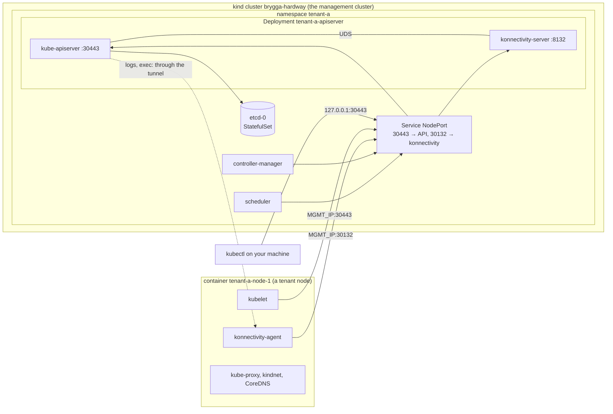

# The hard way: a hosted control plane by hand

Phase 0 of the [roadmap](roadmap.md): build one tenant control plane in a kind
cluster with nothing but openssl, kubectl and stock images, join a real node to
it, and watch every piece work. Each step is something Brygga will automate;
the callouts say which controller, and what Brygga will do differently. What
surprises us goes into [What we learned](#what-we-learned) and, from there,
into decisions.

Time: about two hours. Files: [`hack/hard-way/`](../hack/hard-way/).



| step | what you build | Brygga's controller |
|---|---|---|
| 3, 4 | certificates, keys, kubeconfigs | PKI |
| 5 | the tenant's etcd | Datastore |
| 6, 8 | API server with konnectivity, controller manager, scheduler, Services | Workloads |
| 7, 9, 10, 12 | RBAC, kubeadm bootstrap objects, kube-proxy, CoreDNS, agents, CNI | Tenant (CNI excepted: the tenant's choice) |
| 13 | checks | the e2e gate |
| 14b | holding the controller manager | Health |

## 1. Before you start

- Docker Desktop with at least 6 GB of memory, kind ≥ v0.33, kubectl (a
  1.34 or newer client works with the 1.35 cluster), openssl 3, perl (macOS
  ships it); Go for spike d.
- In every new terminal, from the repository root:

  ```bash
  source hack/hard-way/env.sh
  ```

  It sets the versions (Kubernetes 1.35.8 and what kubeadm pins for it), the
  names, the tenant's ranges (services `10.32.0.0/16`, pods `10.200.0.0/16`,
  unlike kind's own), and three helpers: `mk` talks to the management cluster,
  `tk` to the tenant cluster, `render` fills `${VARS}` in a manifest. **Neither
  helper ever uses your current kube context**; every kubeconfig lives in
  `work/hard-way/`, which git ignores.

## 2. The management cluster

```bash
kind create cluster --name "$MGMT" --image "$KIND_NODE_IMAGE" \
  --config "$HW/kind-management.yaml" --kubeconfig "$WORK/management.kubeconfig"
source hack/hard-way/env.sh   # now sets MGMT_IP
echo "$MGMT_IP"; mk get nodes
```

`MGMT_IP` is the management node's address on the docker network `kind`. The
tenant's nodes, which are containers on the same network, reach the control
plane through it; your machine reaches it through the port mapping on
`127.0.0.1:30443`.

## 3. The PKI

```bash
bash "$HW/pki.sh"
```

Three CAs and the certificates under them, named as kubeadm names them:

| file | CN / O | signed by | for |
|---|---|---|---|
| `ca` | kubernetes | itself | the cluster CA: everything below except etcd and aggregation |
| `apiserver` | kube-apiserver | ca | serving; SANs for every name a client dials: `kubernetes.default…`, the Service name in the management cluster, `10.32.0.1`, `127.0.0.1`, `MGMT_IP` |
| `apiserver-kubelet-client` | kube-apiserver-kubelet-client | ca | the API server calling kubelets; kubeadm binds this user name to `system:kubelet-api-admin` |
| `front-proxy-ca`, `front-proxy-client` | front-proxy-client | front-proxy-ca | aggregated API servers (metrics-server) trust requests the API server forwards |
| `etcd-ca`, `etcd-server`, `apiserver-etcd-client` | … | etcd-ca | etcd's own trust: only the API server is its client |
| `controller-manager`, `scheduler` | system:kube-controller-manager, system:kube-scheduler | ca | identities Kubernetes' bootstrap RBAC already knows |
| `super-admin` | O=system:masters | ca | used once, to bind the admin group; cannot be revoked |
| `admin` | O=kubeadm:cluster-admins | ca | everyday admin; revoked by deleting one binding |
| `konnectivity-server` | konnectivity-server | ca | serving for agents: `MGMT_IP` and the name the SNI spike uses |
| `konnectivity-client` | system:konnectivity-server | ca | the server's identity for TokenReviews |
| `sa.key`, `sa.pub` | — | — | signs and verifies ServiceAccount tokens |

Look at one: `openssl x509 -in "$PKI/apiserver.crt" -noout -text | less`.

> **Brygga (PKI controller):** the same files, plus a CA per purpose: a client
> CA only the API server trusts, so rotating identities never touches nodes;
> the controller manager gets an intermediate instead of `ca.key`; tokens are
> signed by a sidecar instead of `sa.key`
> ([staged-credential-rotation](decisions/staged-credential-rotation.md)).

## 4. Kubeconfigs

```bash
bash "$HW/kubeconfigs.sh"
```

Each kubeconfig points where its user runs: the controller manager and the
scheduler at the Service by name inside the management cluster, the
konnectivity server at `127.0.0.1` in its own pod, you at `127.0.0.1:30443`,
and `admin-net.conf` at `MGMT_IP:30443` for the kubeadm container on the
docker network.

## 5. etcd

```bash
render "$HW/management/00-namespace.yaml" | mk apply -f -
mk -n "$CP" create secret generic "$CP-pki" --from-file="$PKI"
mk -n "$CP" create secret generic "$CP-kubeconfigs" \
  --from-file="$WORK/controller-manager.conf" --from-file="$WORK/scheduler.conf" \
  --from-file="$WORK/konnectivity-server.conf"
render "$HW/management/10-etcd.yaml" | mk apply -f -
mk -n "$CP" rollout status statefulset/"$CP-etcd"
mk -n "$CP" exec "$CP-etcd-0" -- etcdctl --endpoints=https://127.0.0.1:2379 \
  --cacert=/pki/etcd-ca.crt --cert=/pki/apiserver-etcd-client.crt --key=/pki/apiserver-etcd-client.key \
  endpoint status -w table
```

One member, client TLS with its own CA, data on a PVC from kind's default
StorageClass, a 2 GiB quota, periodic compaction.

> **Brygga (Datastore):** an `Etcd` resource for etcd-druid instead of this
> StatefulSet, with continuous snapshots and the peer TLS three members need
> ([dedicated-etcd-by-default](decisions/dedicated-etcd-by-default.md)).

## 6. The API server and konnectivity-server

```bash
render "$HW/management/20-apiserver.yaml" | mk apply -f -
mk -n "$CP" rollout status deployment/"$CP-apiserver"
kubectl --kubeconfig "$WORK/super-admin.conf" get --raw '/readyz?verbose' | tail -3
kubectl --kubeconfig "$WORK/super-admin.conf" get namespaces
kubectl --kubeconfig "$WORK/super-admin.conf" get endpoints kubernetes
```

The API server creates `default`, `kube-system`, `kube-public` and
`kube-node-lease` itself. The `kubernetes` endpoint is `MGMT_IP:30443`: the
advertise address and the secure port, which is why the port is the same as
the NodePort. Read the flags in
[`20-apiserver.yaml`](../hack/hard-way/management/20-apiserver.yaml): the
egress selector sends only `cluster` traffic (kubelets, pods, webhooks)
through the konnectivity socket; etcd is dialled directly.

> **Brygga (Workloads):** the same pod plus the `brygga-signer` sidecar; in
> gateway mode the advertise address is `172.20.0.1`, served on every node by
> apiserver-proxy ([api-exposure](decisions/api-exposure.md)).

## 7. Bind the admin group, then put super-admin away

```bash
kubectl --kubeconfig "$WORK/super-admin.conf" apply -f "$HW/tenant/00-rbac.yaml"
tk auth whoami          # kubernetes-admin, groups kubeadm:cluster-admins, system:authenticated
tk auth can-i '*' '*'   # yes
```

From here on, `tk` (admin) is enough. `system:masters` short-circuits
authorization and can only be revoked by rotating the CA; the group can be
revoked by deleting the binding.

## 8. The controller manager and the scheduler

```bash
render "$HW/management/30-controller-manager.yaml" | mk apply -f -
render "$HW/management/40-scheduler.yaml" | mk apply -f -
mk -n "$CP" rollout status deployment/"$CP-controller-manager"
mk -n "$CP" rollout status deployment/"$CP-scheduler"
tk -n kube-system get leases
```

Two leases, `kube-controller-manager` and `kube-scheduler`, each held by its
pod: leader election works through the tenant's API. Note
`--controllers=*,bootstrapsigner,tokencleaner`: the two controllers `kubeadm
join` depends on are off by default.

## 9. What `kubeadm join` needs

kubeadm can write the bootstrap objects into an API server it did not create.
Run its phases from a container on the docker network, with the admin
kubeconfig that dials `MGMT_IP`:

```bash
export BOOTSTRAP_TOKEN="$(LC_ALL=C tr -dc a-z0-9 </dev/urandom | head -c 6).$(LC_ALL=C tr -dc a-z0-9 </dev/urandom | head -c 16)"
render "$HW/kubeadm.yaml" > "$WORK/kubeadm.yaml"
kubeadm() { docker run --rm --network kind -v "$WORK:/work" --entrypoint kubeadm "$KIND_NODE_IMAGE" "$@"; }
kubeadm init phase upload-config kubeadm --config /work/kubeadm.yaml --kubeconfig /work/admin-net.conf
kubeadm init phase upload-config kubelet --config /work/kubeadm.yaml --kubeconfig /work/admin-net.conf
kubeadm init phase bootstrap-token --config /work/kubeadm.yaml --kubeconfig /work/admin-net.conf
kubeadm init phase addon kube-proxy --config /work/kubeadm.yaml --kubeconfig /work/admin-net.conf
kubeadm init phase addon coredns --config /work/kubeadm.yaml --kubeconfig /work/admin-net.conf
```

Now look at what it wrote. **This list is the Tenant controller's job**:

```bash
tk -n kube-public get configmap cluster-info -o yaml   # a kubeconfig with no user, and jws-kubeconfig-<token id>
tk -n kube-system get configmap kubeadm-config kubelet-config kube-proxy coredns
tk -n kube-system get secrets --field-selector type=bootstrap.kubernetes.io/token
tk get clusterrolebindings | grep -E 'kubeadm|node-proxier'
tk -n kube-public get roles,rolebindings
```

The `jws-kubeconfig-…` key appears only once the controller manager's bootstrap
signer has signed `cluster-info` with the token: that signature is how a
joining node knows the CA it downloaded came from someone holding the token.

> **Brygga (Tenant):** the same objects, rendered from its own templates
> (no `k8s.io/kubernetes` import), applied with an inventory and pruned
> ([nodes-join-with-kubeadm](decisions/nodes-join-with-kubeadm.md)).

## 10. konnectivity agents

```bash
render "$HW/tenant/10-konnectivity-agent.yaml" | tk apply -f -
```

They stay `Pending`: there is no node yet.

## 11. Join a node

A tenant node is a kind node container on the same docker network, started
the way kind starts its nodes, then joined with a plain `kubeadm join`:

```bash
docker run --detach --tty --name "$NODE" --hostname "$NODE" --network kind \
  --privileged --security-opt seccomp=unconfined --security-opt apparmor=unconfined \
  --cgroupns=private --tmpfs /tmp --tmpfs /run --volume /var \
  --volume /lib/modules:/lib/modules:ro --restart=on-failure:1 "$KIND_NODE_IMAGE"
CA_HASH="sha256:$(openssl x509 -pubkey -in "$PKI/ca.crt" | openssl rsa -pubin -outform der 2>/dev/null | openssl dgst -sha256 -hex | sed 's/^.* //')"
docker exec "$NODE" kubeadm join "$MGMT_IP:$APISERVER_PORT" \
  --token "$BOOTSTRAP_TOKEN" --discovery-token-ca-cert-hash "$CA_HASH" \
  --ignore-preflight-errors=all
tk get nodes -o wide   # NotReady until a CNI runs
tk get csr             # the kubelet's client certificate, approved by the controller manager
```

What happened: kubeadm read `cluster-info` anonymously, checked its signature
with the token and its CA against the hash, logged in with the token, posted a
CSR, got it auto-approved, wrote `kubelet.conf`, and started the kubelet.

## 12. The CNI

The kind node image carries kindnet's manifest, a template for the pod range:

```bash
docker exec "$NODE" cat /kind/manifests/default-cni.yaml | sed "s#{{ .PodSubnet }}#$POD_CIDR#" | tk apply -f -
tk get nodes
tk -n kube-system get pods -o wide
mk -n "$CP" logs deploy/"$CP-apiserver" -c konnectivity-server | grep -i agent | tail -3
```

The node turns `Ready`; kube-proxy, kindnet, CoreDNS and the agent run; the
konnectivity server logs the agent's connection.

## 13. Check it — the gate of this exercise

```bash
tk run web --image=nginx:1.27-alpine --port=80
tk wait --for=condition=Ready pod/web --timeout=180s
tk logs web | head -3                          # API server → kubelet: through the tunnel
tk exec web -- nginx -v
tk port-forward pod/web 8080:80 >/dev/null & sleep 2; curl -s localhost:8080 | head -4; kill %1
tk run dns --image=busybox:1.36 --rm -it --restart=Never -- nslookup kubernetes.default
tk run api --image=curlimages/curl:8.10.1 --rm -it --restart=Never -- curl -sk https://kubernetes.default/version
```

The last line goes pod → `10.32.0.1:443` → kube-proxy → `MGMT_IP:30443`: the
in-cluster path to a hosted API server.

Prove that logs and exec really go through the tunnel: forbid the management
node to forward anything to the kubelet's port, and try again.

```bash
NODE_IP="$(docker inspect -f '{{(index .NetworkSettings.Networks "kind").IPAddress}}' "$NODE")"
docker exec "$MGMT-control-plane" iptables -I FORWARD -d "$NODE_IP" -p tcp --dport 10250 -j REJECT
tk logs web | head -1                          # still works
docker exec "$MGMT-control-plane" iptables -D FORWARD -d "$NODE_IP" -p tcp --dport 10250 -j REJECT
```

## 14. Experiments

### a. A renewed certificate without a restart

The API server watches its serving certificate on disk
([staged-credential-rotation](decisions/staged-credential-rotation.md) rests
on this):

```bash
openssl s_client -connect "127.0.0.1:$APISERVER_PORT" </dev/null 2>/dev/null | openssl x509 -noout -serial
bash "$HW/pki.sh" apiserver
mk -n "$CP" create secret generic "$CP-pki" --from-file="$PKI" --dry-run=client -o yaml | mk apply -f -
for i in $(seq 1 24); do openssl s_client -connect "127.0.0.1:$APISERVER_PORT" </dev/null 2>/dev/null | openssl x509 -noout -serial; sleep 5; done
mk -n "$CP" get pods -l app="$CP-apiserver" -o jsonpath='{.items[0].status.containerStatuses[*].restartCount}'
```

Expected: the serial changes within about two minutes (the kubelet syncs the
Secret, then the API server notices the file); the restart counts stay 0.

### b. Hold the controller manager

What [controller-manager-hold](decisions/controller-manager-hold.md) does,
by hand:

```bash
hold() { tk -n kube-system patch lease kube-controller-manager --type merge \
  -p "{\"spec\":{\"holderIdentity\":\"brygga\",\"leaseDurationSeconds\":60,\"renewTime\":\"$(date -u +%Y-%m-%dT%H:%M:%S.000000Z)\"}}" >/dev/null; }
hold
mk -n "$CP" get pods -l app="$CP-controller-manager" -w   # it restarts within ~15 s; Ctrl-C
while true; do hold; sleep 20; done &                       # keep holding
tk create deployment held --image=nginx:1.27-alpine
sleep 30; tk get replicasets -l app=held                   # nothing: no controller runs
kill %1                                                     # let go
sleep 75; tk get replicasets -l app=held                   # the ReplicaSet appears
```

### c. Spike: does the konnectivity agent send SNI?

If it does, agents can share the Gateway's TLS passthrough listener on 443
([api-exposure](decisions/api-exposure.md)). An nginx in front of the
konnectivity port logs the server name of every ClientHello:

```bash
render "$HW/sni-logger.conf" > "$WORK/sni-logger.conf"
docker run -d --name sni-logger --network kind -v "$WORK/sni-logger.conf:/etc/nginx/nginx.conf:ro" nginx:1.27-alpine
SNI_IP="$(docker inspect -f '{{(index .NetworkSettings.Networks "kind").IPAddress}}' sni-logger)"
tk -n kube-system patch daemonset konnectivity-agent --type json -p "[
  {\"op\":\"add\",\"path\":\"/spec/template/spec/hostAliases\",\"value\":[{\"ip\":\"$SNI_IP\",\"hostnames\":[\"konnectivity.$CP.example\"]}]},
  {\"op\":\"replace\",\"path\":\"/spec/template/spec/containers/0/command/3\",\"value\":\"--proxy-server-host=konnectivity.$CP.example\"},
  {\"op\":\"replace\",\"path\":\"/spec/template/spec/containers/0/command/4\",\"value\":\"--proxy-server-port=443\"}]"
tk -n kube-system rollout status daemonset/konnectivity-agent
tk logs web | head -1                                         # the tunnel works through nginx
tk -n kube-system delete pod -l k8s-app=konnectivity-agent    # a stream is logged when it closes
sleep 5; docker logs sni-logger
```

`sni="konnectivity.tenant-a.example"` means the agent sends SNI; `sni=""`
means it does not, and Brygga needs a dedicated konnectivity port on the
Gateway. Put the agent back with `tk -n kube-system delete daemonset
konnectivity-agent` and step 10.

### d. Spike: ServiceAccount tokens from an external signer

[staged-credential-rotation](decisions/staged-credential-rotation.md) signs
ServiceAccount tokens with `brygga-signer`, a sidecar that implements
kube-apiserver's external signer API on a Unix socket
([KEP-740](https://github.com/kubernetes/enhancements/blob/master/keps/sig-auth/740-service-account-external-signing/README.md)),
so the signing key can rotate in three stages while the API server keeps
running. This spike switches the hard way's API server from its static
`sa.key` to the signer, then rotates the key while a pod calls the API. It
needs Go as well (ko builds the image), and a node: steps 11 and 12.

The signer reads the Secret `$CP-sa-keys`: `signing.key`, the one private key
that signs, and any number of `verify-*.pub`, public keys published for
verification only. Every key's ID is kube-apiserver's own: the unpadded
base64url SHA-256 of its PKIX DER
([`keyIDFromPublicKey`](https://github.com/kubernetes/kubernetes/blob/v1.35.0/pkg/serviceaccount/jwt.go#L99)).
`kid` prints it for a key file:

```bash
kid() { openssl pkey -in "$1" -pubout -outform der 2>/dev/null | openssl dgst -sha256 -binary | openssl base64 -A | tr '+/' '-_' | tr -d '='; echo; }
jwt() { cut -d. -f"$1" | tr '_-' '/+' | awk '{while (length($0) % 4) $0 = $0 "="; print}' | openssl base64 -d -A; echo; }   # jwt 1: header, jwt 2: claims
kid "$PKI/sa.key"                                          # K₁: the static key of step 3
openssl genpkey -algorithm EC -pkeyopt ec_paramgen_curve:P-256 -out "$WORK/sa-k2.key"
openssl pkey -in "$WORK/sa-k2.key" -pubout -out "$WORK/sa-k2.pub"
kid "$WORK/sa-k2.key"                                      # K₂: ES256 this time
```

**Build the image into the management cluster** and remember its name:

```bash
export SIGNER_IMAGE="$(KO_DOCKER_REPO=kind.local KIND_CLUSTER_NAME="$MGMT" go tool ko build --base-import-paths ./cmd/brygga-signer)"
echo "$SIGNER_IMAGE"                                       # kind.local/brygga-signer:<digest>
```

**A token from the static key**, minted before the switch, must stay valid
after it: K₁'s ID does not change.

```bash
tk -n default create serviceaccount token-caller
tk -n default create token token-caller --duration=2h > "$WORK/static.token"
satk() { kubectl --kubeconfig /dev/null --server "https://127.0.0.1:$APISERVER_PORT" --certificate-authority "$PKI/ca.crt" --token "$(cat "$1")" auth whoami; }
jwt 1 < "$WORK/static.token"; satk "$WORK/static.token"     # kid of K₁; system:serviceaccount:default:token-caller
```

**Switch the API server to the signer.** The Secret holds K₁ alone; the
patch adds the signer as a native sidecar (an init container with
`restartPolicy: Always` and a startup probe on `/readyz`, so the API server
starts only once the socket serves a key set) on a shared `emptyDir` at
`/run/signer`, and replaces `--service-account-key-file` and
`--service-account-signing-key-file`, which the endpoint excludes
([authentication.go](https://github.com/kubernetes/kubernetes/blob/v1.35.0/pkg/kubeapiserver/options/authentication.go#L624)),
with `--service-account-signing-endpoint=/run/signer/signer.sock`
([`50-signer-patch.yaml`](../hack/hard-way/management/50-signer-patch.yaml)):

```bash
mk -n "$CP" create secret generic "$CP-sa-keys" --from-file=signing.key="$PKI/sa.key"
mk -n "$CP" patch deployment "$CP-apiserver" --type json -p "$(render "$HW/management/50-signer-patch.yaml")"
mk -n "$CP" rollout status deployment/"$CP-apiserver"
mk -n "$CP" logs deploy/"$CP-apiserver" -c brygga-signer   # "key set loaded", signing = K₁
tk get --raw /openid/v1/jwks; echo                         # one key, K₁'s kid
satk "$WORK/static.token"                                  # still the ServiceAccount
```

That rollout is the last restart of the API server in this spike. Note the
pod and its restart counts, and start the caller: a pod that calls the API
every three seconds with a projected token of `expirationSeconds: 600`
([`20-token-caller.yaml`](../hack/hard-way/tenant/20-token-caller.yaml)):

```bash
apiserver() { mk -n "$CP" get pods -l app="$CP-apiserver" -o jsonpath='{range .items[*]}{.metadata.name} restarts:{.status.initContainerStatuses[*].restartCount} {.status.containerStatuses[*].restartCount}{"\n"}{end}'; }
apiserver                                                  # one pod, every count 0
tk apply -f "$HW/tenant/20-token-caller.yaml"
tk -n default wait --for=condition=Ready pod/token-caller --timeout=120s
tk -n default logs -f token-caller &                       # "ok" every three seconds; leave it running
pod_kid() { tk -n default exec token-caller -- cat /var/run/secrets/tokens/token | jwt 1; }
```

Each stage is one state of the Secret. The kubelet updates the mounted
Secret within about a minute, the signer reloads it at once, and the API
server fetches the keys again within the signer's refresh hint, one minute.

**Stage 1 — K₂ published.** K₁ still signs.

```bash
mk -n "$CP" create secret generic "$CP-sa-keys" --from-file=signing.key="$PKI/sa.key" \
  --from-file=verify-k2.pub="$WORK/sa-k2.pub" --dry-run=client -o yaml | mk apply -f -
until [ "$(tk get --raw /openid/v1/jwks | grep -o '"kid"' | wc -l)" -eq 2 ]; do sleep 5; done
tk get --raw /openid/v1/jwks; echo                         # K₁ and K₂
tk -n default create token token-caller | jwt 1             # still K₁
tk -n default exec token-caller -- cat /var/run/secrets/tokens/token > "$WORK/captured.token"
jwt 1 < "$WORK/captured.token"                             # the pod's token of now: K₁
```

**Stage 2 — K₂ signs.** Brygga does this only once every API server replica
serves K₂; with one replica, the `jwks` above is that proof.

```bash
mk -n "$CP" create secret generic "$CP-sa-keys" --from-file=signing.key="$WORK/sa-k2.key" \
  --from-file=verify-k1.pub="$PKI/sa.pub" --dry-run=client -o yaml | mk apply -f -
until tk -n default create token token-caller | jwt 1 | grep -q '"ES256"'; do sleep 5; done
tk -n default create token token-caller | jwt 1             # K₂
satk "$WORK/captured.token"; satk "$WORK/static.token"     # both K₁ tokens still valid
```

Now wait for the kubelet to refresh the pod's token: it requests a new one
once the old one is older than 80% of its lifetime, so within about eight
minutes plus the volume's resync
([token manager](https://github.com/kubernetes/kubernetes/blob/v1.35.0/pkg/kubelet/token/token_manager.go#L172-L193)).
This is what the owner's confirmation stands for: no client holds a K₁
token any more.

```bash
until pod_kid | grep -q '"ES256"'; do sleep 15; done
pod_kid                                                    # K₂'s kid
tk -n default exec token-caller -- cat /var/run/secrets/tokens/token | jwt 2   # a new iat
```

**Stage 3 — K₁ dropped.**

```bash
mk -n "$CP" create secret generic "$CP-sa-keys" --from-file=signing.key="$WORK/sa-k2.key" \
  --dry-run=client -o yaml | mk apply -f -
until [ "$(tk get --raw /openid/v1/jwks | grep -o '"kid"' | wc -l)" -eq 1 ]; do sleep 5; done
sleep 70                                                   # one refresh hint, and the API server's 10 s token cache
satk "$WORK/captured.token"                                # error: You must be logged in to the server (Unauthorized)
satk "$WORK/static.token"                                  # the same
kill %1
tk -n default logs token-caller | grep -c FAIL             # 0
apiserver                                                  # the same pod, every count still 0
mk -n "$CP" logs deploy/"$CP-apiserver" -c brygga-signer | grep 'key set loaded'   # four sets: K₁; K₁+K₂; K₂ signs; K₂
```

The API server caches a successful token authentication for ten seconds
([`TokenSuccessCacheTTL`](https://github.com/kubernetes/kubernetes/blob/v1.35.0/pkg/kubeapiserver/options/authentication.go#L168)),
so a K₁ token that was used in those ten seconds outlives K₁ by that much.

Put the API server back with `render "$HW/management/20-apiserver.yaml" | mk
replace -f -` (the patch is not reversible by `apply`) and delete
`$CP-sa-keys`.

## 15. Measure

The numbers phase 1 needs, from the management cluster:

```bash
mk apply -f "https://github.com/kubernetes-sigs/metrics-server/releases/download/$METRICS_SERVER_VERSION/components.yaml"
mk -n kube-system patch deployment metrics-server --type json \
  -p '[{"op":"add","path":"/spec/template/spec/containers/0/args/-","value":"--kubelet-insecure-tls"}]'
sleep 90; mk -n "$CP" top pods --containers
```

## 16. Clean up

```bash
docker rm -f "$NODE" sni-logger
kind delete cluster --name "$MGMT" --kubeconfig "$WORK/management.kubeconfig"
rm -rf "$WORK"
```

## What we learned

Filled in while doing it; each line that changes the design becomes a
decision or a `todo.md` entry.

| step | what happened | what it means for Brygga |
|---|---|---|
| 14d | Found while building the signer, before running the spike: a K₁ token authenticated in the last ten seconds is still accepted that long after K₁ is dropped, because the API server caches successful token authentications for 10 s ([`TokenSuccessCacheTTL`](https://github.com/kubernetes/kubernetes/blob/v1.35.0/pkg/kubeapiserver/options/authentication.go#L168), applied to every token authenticator in [config.go](https://github.com/kubernetes/kubernetes/blob/v1.35.0/pkg/kubeapiserver/authenticator/config.go#L207-L210)); `TestRotationUnderARunningAPIServer` shows it | K₁ is gone one refresh hint plus ten seconds after stage 3 reaches every replica; the phase 3 gate waits that long, not one refresh hint |
| 14d | Found while building the signer: the kubelet swaps a Secret volume by repointing `..data` and only then adds the links of new keys ([atomic_writer.go](https://github.com/kubernetes/kubernetes/blob/v1.35.0/pkg/volume/util/atomic_writer.go#L93-L118)); a reader that opens the files one by one can straddle the swap, and between stages 1 and 2 that reads `signing.key` K₂ without `verify-k1.pub` — a set without K₁ | the signer reads every file through one resolved `..data` ([staged-credential-rotation](decisions/staged-credential-rotation.md)) |
| 14d | | the switch from `sa.key` keeps the static token valid: expected, because K₁'s ID is derived as kube-apiserver derives it; confirm here |
| 14d | | zero `FAIL` lines through the three stages, the API server pod and its restart counts unchanged: confirm here |
| 14d | | how long the kubelet took to refresh the caller's 600 s token (the time between stage 2 and the pod's K₂ kid): measure here; it bounds how soon stage 3 is safe for projected tokens |
| 14d | Open question: how does the PKI controller learn that every API server replica serves the new key set before it switches the signing key (stage 2) or drops K₁? The signer knows only what it loaded; each replica fetches on its own, and `/openid/v1/jwks` answers from whichever replica the request reaches. Each replica exports the timestamp of the set it holds as `apiserver_externaljwt_fetch_keys_data_timestamp` ([metrics.go](https://github.com/kubernetes/kubernetes/blob/v1.35.0/pkg/serviceaccount/externaljwt/metrics/metrics.go#L50-L58)) | open: decide before the PKI controller builds stage 2; the metric per replica is one candidate, waiting for one refresh hint after every signer reloaded is another |

Measured at idle (step 15):

| container | CPU | memory |
|---|---|---|
| kube-apiserver | | |
| konnectivity-server | | |
| kube-controller-manager | | |
| kube-scheduler | | |
| etcd | | |

The gate of phase 0 for this part: step 13 passes, experiments a and b behave
as expected, spike c has an answer, and the two tables above are filled in.
